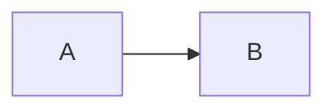

# <Concept>

## In one sentence

## Why it matters
(real-world consequence / exam weight)

## Mental model & analogy
...and where the analogy breaks:

## Diagram

## Key points
-

## Worked example

## Comparison (confusable neighbours)
| | This | Neighbour |
|---|---|---|

## Exam traps & misconceptions
-

## Interview angle
- 30-sec answer:

## Related
- [link](../other-concept.md)

## SRS cards created
- <card ids>
