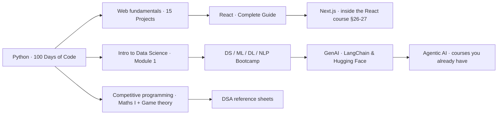

# Learning paths

How the courses in this vault fit together, so you never study the same thing twice.
Each course folder has a `roadmap.md` checklist. Tick sections as you go, and use pro-instructor to run each track.

## Path A · Full-stack web
| Step | Course | Where | Notes |
|---|---|---|---|
| 1 | 100 Days of Code, Days 1–40 | `technical/programming/python/courses/udemy-100-days-of-code` | Your Day 1–17 work is in `100-days-of-python/` |
| 2 | Complete Web Dev, §1–15 (HTML, CSS, Flexbox/Grid/Sass, JS, jQuery, Bootstrap, ES6) | `technical/web-dev/fundamentals/courses/udemy-complete-web-dev-15-projects` | Do this before Python Days 41–44 and 58, which cover the same web basics |
| 3 | 100 Days of Code, Days 41–71 (web, Flask, SQL, auth, deploy) | as step 1 | |
| 4 | React Complete Guide, §1–25, then §26–27 (Next.js), §32 (TypeScript) | `technical/web-dev/react/courses/udemy-react-complete-guide` | Skip §36–40 (old optional versions of §3–5) unless you need a refresher |
| 5 | Complete Web Dev, §16–32 (Node, PHP/MySQL projects) | as step 2 | Optional, mostly older tech |

## Path B · Data science → ML → GenAI
| Step | Course | Where | Notes |
|---|---|---|---|
| 1 | Intro to Data Science (Module 1/3) | `technical/data-ai/data-science/courses/udemy-intro-data-science-python` | 2.5 h orientation |
| 2 | 100 Days of Code, Days 72–81 (pandas, matplotlib, plotly, NumPy, seaborn, regression) | `technical/programming/python/courses/udemy-100-days-of-code` | Hands-on notebooks |
| 3 | DS/ML/DL/NLP Bootcamp, §20–45 (stats, probability, feature engineering, all classic ML) | `technical/data-ai/machine-learning/courses/udemy-ds-ml-dl-nlp-bootcamp` | Skip §2–19 if Python is solid |
| 4 | Same bootcamp, §46–50 (Docker, Git, end-to-end ML projects, MLOps, MLflow) | as step 3 | |
| 5 | Same bootcamp, §51–62 (NLP, ANN, RNN, LSTM/GRU, seq2seq, attention, transformers) | as step 3 | **Replaces GenAI §10–20**, which is the same material |
| 6 | GenAI with LangChain & Hugging Face, §21–55 | `technical/data-ai/genai/courses/udemy-genai-langchain-huggingface` | Start at §21 |
| 7 | Agentic AI courses already in the vault | `technical/data-ai/agentic-ai/` | LangGraph, CrewAI, MCP go deeper there |

Both the bootcamp (§63) and the GenAI course (§53) include the same Claude Code section. Take it once.

## Path C · Problem solving
| Step | Course | Where |
|---|---|---|
| 1 | Competitive Programming: Maths Puzzles I (Euclid, sieve, Gaussian elimination, modular arithmetic) | `technical/software-engineering/competitive-programming/courses/udemy-cp-maths-puzzles-1` |
| 2 | Competitive Programming: Game theory (Nim and variants) | `technical/software-engineering/competitive-programming/courses/udemy-cp-game-theory` |
| 3 | Practise with the DSA sheets | `technical/software-engineering/dsa/docs/` and the full-stack roadmap `dsa/` tasks |

## Overlaps already handled
| Same material | Kept in |
|---|---|
| GenAI §10–20 = ML bootcamp §51–62 (10 identical PDFs/zips) | ML bootcamp folder |
| GenAI §53 = ML bootcamp §63 (Claude Code) | ML bootcamp folder |
| Python Days 41–44, 58 ≈ Web Dev §1–2, 9 (HTML/CSS/Bootstrap) | both kept (different projects) |
| 8 Python starter PDFs | `technical/programming/python/docs/` |
