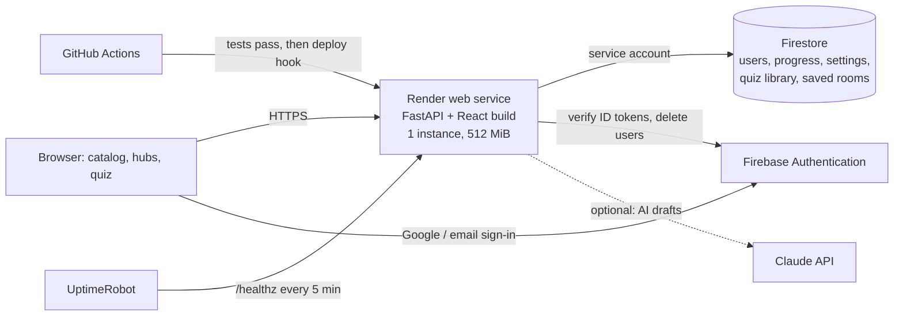

# Operations guide

How to run, secure, watch and move the Study Hubs site. Each guide is a runbook: numbered steps,
what to check afterwards, and what to do when something fails.

| Guide | Read it when |
|---|---|
| [firebase.md](firebase.md) | Setting up or changing Firebase (sign-in, Firestore, the service account, domains) |
| [render.md](render.md) | Creating, deploying, rolling back or debugging the Render web service |
| [secrets-and-rotation.md](secrets-and-rotation.md) | A key leaked, a person left, or it is time to rotate a secret |
| [capacity-and-limits.md](capacity-and-limits.md) | A meter on **Admin → Overview** looks high, or you want to know what uses what |
| [migration-overview.md](migration-overview.md) | The free tiers are not enough any more: the decision, then the common cut-over steps |
| [migrate-to-aws.md](migrate-to-aws.md) | Moving the site (and its data) to AWS |
| [migrate-to-azure.md](migrate-to-azure.md) | Moving the site (and its data) to Azure |
| [live-quiz-host-guide.md](live-quiz-host-guide.md) | Running quizzes, presenter screens, challenges and reports |

Related reference (not runbooks):
- [`site/README.md`](../../README.md): local development, every environment variable, the first-time
  Render and Firebase setup checklist, backups and restore.
- [`docs/architecture-spec.md`](../architecture-spec.md) and
  [`docs/build-contracts.md`](../build-contracts.md): how the system is built.
- [`docs/research/kahoot-feature-research.md`](../research/kahoot-feature-research.md): the product
  research behind the live-quiz features.

## The system in one picture

- Browsers never talk to Firestore; the server does, with a service account. Firestore rules deny
  every client request.
- One instance only: live quiz rooms and the maintenance/backup scheduler live in that process.
  Never scale it out to two instances on any platform (see [capacity-and-limits.md](capacity-and-limits.md)).
- Everything a learner does in a hub is saved in their browser first and synced to their account
  when they are signed in.

## Where each thing lives

| Thing | Where | Backed up by **Admin → Backup** |
|---|---|---|
| Accounts (sign-in) | Firebase Authentication | No (Firebase keeps them; a restore never re-creates deleted accounts) |
| Learner progress, account records | Firestore `users/*`, `progress/*`, `tombstones/*` | Yes |
| Site settings, maintenance, jobs, daily usage | Firestore `meta/settings`, `meta/*`, `jobs/*`, `usage/*` | Settings: yes |
| Quiz library and pictures | Firestore `meta/quiz-index`, `meta/quiz:<id>`, `meta/quiz-img:<id>` | Yes (since PR #13, inside the settings record) |
| Running quiz rooms | Server memory, saved to `meta/quiz-rooms` and `meta/quiz-room:<pin>` | No (finish rooms before a migration) |
| Hub pages | Built into the Docker image from `technical/**/hubs` | Git |
| Secrets | Render environment and Secret Files, GitHub Actions secrets | No: see [secrets-and-rotation.md](secrets-and-rotation.md) |
