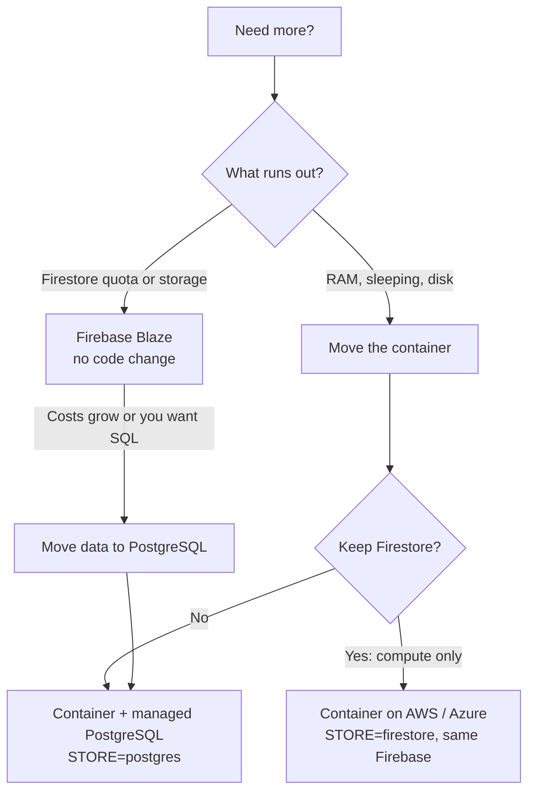

# When the free tiers are not enough: the migration plan

This guide decides **what** to move and gives the cut-over steps every target shares. The
platform-specific steps are in [migrate-to-aws.md](migrate-to-aws.md) and
[migrate-to-azure.md](migrate-to-azure.md).

## 1. Find the real bottleneck first

Open **Admin → Overview** and match what you see:

| What runs out | Signs | Cheapest fix | Bigger fix |
|---|---|---|---|
| **Firestore writes or reads per day** | "Sync paused" most evenings; backups refused for lack of reads | Upgrade the Firebase project to **Blaze** with a budget alert: same code, pay per extra operation | Move data to PostgreSQL (below) |
| **Firestore storage (1 GiB)** | Storage estimate above ~700 MB | Blaze (billed per GiB-month) | PostgreSQL |
| **Server memory (512 MiB)** | Memory meter above 400 MB, restarts in the logs | A paid Render instance with more RAM | A container on AWS or Azure with 1 GB+ |
| **Cold starts / sleeping** | Slow first page; the scheduler missing windows | Keep the UptimeRobot monitor; or a paid Render instance (does not sleep) | Any always-on container |
| **Restores lost on restart** | Restore wizard "the validated upload is gone" | Do restores in one sitting | A platform with a persistent volume for `DATA_DIR` |

Most sites this size need only **Blaze** for years. Move hosting only when memory, sleeping or the
lack of a persistent disk is the problem, or when you want everything in one cloud account.

## 2. The options



| Option | Data | Code change | Effort |
|---|---|---|---|
| A. Blaze on the same project | Firestore | None | 10 minutes |
| B. Move compute only | Firestore (unchanged) | None: same image, same variables | 1–2 hours |
| C. Move compute and data | PostgreSQL (`STORE=postgres`) | None: the server already supports it; data moves with **Backup → Restore** | Half a day |

Sign-in stays on **Firebase Authentication** in every option: it is not a bottleneck, and moving
accounts would force every learner to sign up again.

## 3. Before any move: get a stable address

Browsers keep anonymous hub progress per web address. If the site moves from
`study-hubs.onrender.com` to a new host name, every learner's not-yet-synced browser progress stays
behind on the old address. Signed-in learners' synced progress is safe (it is on the server).

**Do this first, weeks before a move:** put the site on a domain you own (for example
`quiz.example.com`) while it is still on Render ([render.md → Custom domain](render.md#6-custom-domain-recommended-before-any-migration)).
Then a move only changes where that name points, and nobody loses anything.

## 4. The cut-over (shared by every target)

Plan about an hour in a quiet period. Times below assume the new platform is already built and
tested on its own temporary address (steps in the AWS and Azure guides).

**A day before**
1. Announce a short maintenance window (Admin → Settings → notice).
2. Make sure no quiz room is scheduled to run during the window (running rooms are not moved).
3. Lower the DNS record's TTL for `quiz.example.com` to 300 seconds.
4. On the new platform, sign in as admin on its temporary address: **Admin → Overview** loads and
   shows the new store (`postgres` for option C).

**The cut-over**
1. Old site: **Admin → Maintenance → Read-only** (sync pauses; hubs keep saving in browsers).
2. Old site: **Admin → Backup** with **Encrypt with a passphrase** → download
   `studyhubs-<time>.backup` → store the passphrase in your password manager.
3. Verify it offline:
   ```bash
   site/server/.venv/bin/python site/scripts/backup_tool.py verify ~/Downloads/studyhubs-<time>.backup --passphrase-file pass.txt
   ```
4. New site (temporary address): **Admin → Restore** → upload → validate with the passphrase →
   **Replace** (Postgres) or **Merge** (Firestore) → **Now** → type the confirmation → wait for
   *succeeded*. The quiz library and its pictures come back with the settings record.
5. Spot-check on the new site: a learner's progress in a hub, **Quiz studio** lists the quizzes,
   a picture loads, **Admin → Overview** user count matches the old one.
6. Point DNS for `quiz.example.com` at the new platform (a `CNAME` to its host name). Add the
   domain in the new platform with its certificate.
7. New platform: `PUBLIC_ORIGIN=https://quiz.example.com`; Firebase authorized domains and the
   API-key referrers already include the domain (from section 3).
8. Watch both: within 5–10 minutes traffic arrives at the new platform (its logs), the old one goes
   quiet.
9. New site: **Admin → Maintenance → Off**. Learners' browsers sync what they saved during the
   window.
10. CI: switch the `deploy` job to the new platform (the guides give the job) and remove the
    `RENDER_DEPLOY_HOOK` secret.

**Keep for a week, then retire**
- Leave the Render service and Firestore untouched for 7 days as the rollback. To roll back: point
  DNS back, set the old site's maintenance to Off.
- Then: suspend the Render service, export a final Firestore backup, and (option C) delete the
  Firestore data. Remove `Cloud Datastore User` from the service account: it then needs only
  **Firebase Authentication Admin**.
- Update UptimeRobot (or switch to the new platform's own health alerts).

## 5. Rules every target must keep

- **One container, one Uvicorn worker, one replica.** No autoscaling out (see
  [capacity-and-limits.md](capacity-and-limits.md#why-only-one-instance)).
- **Always on** (minimum one replica): the scheduler and live rooms need the process running.
- **Health check** on `/healthz`; the container listens on `PORT` (default 10000).
- **`DATA_DIR`** on a persistent volume (for example `/data`), so restores survive restarts.
- **Secrets** in the platform's secret store, not in plain environment settings, where it has one.
- **Region** near your learners and next to the database (Singapore: AWS `ap-southeast-1`,
  Azure `southeastasia`).

## 6. Environment on the new platform

| Variable | Option B (compute only) | Option C (with PostgreSQL) |
|---|---|---|
| `APP_ENV` | `production` | `production` |
| `PUBLIC_ORIGIN` | `https://quiz.example.com` | same |
| `STORE` | `firestore` | `postgres` |
| `DATABASE_URL` | — | `postgresql://studyhubs:<password>@<host>:5432/studyhubs?sslmode=require` (secret) |
| `PG_POOL_MAX` | — | `5` (raise only with a larger database) |
| `AUTH_MODE` | `firebase` | `firebase` |
| `FIREBASE_PROJECT_ID`, `FIREBASE_WEB_CONFIG` | same as Render | same |
| `FIREBASE_SERVICE_ACCOUNT_B64` (secret) or `GOOGLE_APPLICATION_CREDENTIALS` (file) | the key, base64 | the key, base64 (only Firebase Auth Admin is needed now) |
| `SECRET_KEY` (secret) | **the same value as on Render** | **the same value** (otherwise every learner's browser sees a new owner) |
| `ADMIN_EMAILS`, `ADMIN_TZ` | same | same |
| `DATA_DIR` | `/data` on a volume | same |
| `TRUSTED_PROXY_HOPS` | `1` behind one load balancer | same |
| `ANTHROPIC_API_KEY` (secret, optional) | same | same |

With `STORE=postgres` the schema is created on first start (under an advisory lock), the Firestore
quota meters switch off (`QUOTA_ENFORCE=0`) and sync uses one 30-second tier.

Encode the service-account key for `FIREBASE_SERVICE_ACCOUNT_B64`:
```bash
base64 -w0 study-hubs-server-key.json > key.b64   # macOS: base64 -i study-hubs-server-key.json
```
Paste `key.b64`'s content into the platform's secret store, then delete both files.
