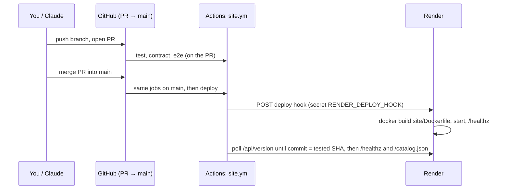

# Render: the web service

The whole site (API, React app, hub pages) is one Docker web service, `study-hubs`, on Render's
**free** instance type in **Singapore**. GitHub Actions deploys it after every test passes; Render's
own auto-deploy is off.

First-time creation is in [`site/README.md` → Deploy on Render](../../README.md#deploy-on-render).
This guide covers running it.

## 1. How a change reaches the site

- The `deploy` job runs only on `main`, only when the commit is still the head of `main`, and only
  if all test jobs passed (or were skipped on purpose, below).
- **Emergency deploy without tests:** set the repository variable `SITE_RUN_TESTS` to `false`
  (GitHub → Settings → Secrets and variables → Actions → Variables), run **Actions → site → Run
  workflow** on `main`, then delete the variable again.
- **Redeploy the same commit:** Actions → site → Run workflow, or Render → **Manual Deploy →
  Deploy latest commit**.

## 2. Settings that matter

| Render setting | Value | Why |
|---|---|---|
| Runtime | Docker, `./site/Dockerfile`, context `.` | The image builds the client, the bridge and the hubs |
| Instance type | Free (512 MiB RAM) | See [capacity-and-limits.md](capacity-and-limits.md) |
| Region | Singapore | Next to Firestore `asia-southeast1` |
| Health check path | `/healthz` | Never touches the database |
| Auto-Deploy | Off | CI deploys after tests |
| Instances | **1** | Quiz rooms and the scheduler live in the process |

Environment variables are listed in [`site/README.md` → Environment variables](../../README.md#environment-variables).
The ones you set by hand on Render:

| Variable | Kind | Notes |
|---|---|---|
| `PUBLIC_ORIGIN` | env | `https://study-hubs.onrender.com` (or your custom domain) |
| `SECRET_KEY` | env (generated) | Never change it casually: see [secrets-and-rotation.md](secrets-and-rotation.md) |
| `FIREBASE_PROJECT_ID`, `FIREBASE_WEB_CONFIG` | env | From the Firebase console |
| `GOOGLE_APPLICATION_CREDENTIALS` | env | `/etc/secrets/firebase-sa.json` |
| `firebase-sa.json` | **Secret File** | The service-account key ([firebase.md](firebase.md#3-the-service-account-key)) |
| `ADMIN_EMAILS`, `ADMIN_TZ` | env | Who is an admin, and their time zone |
| `ANTHROPIC_API_KEY` | env (optional) | Turns on **Draft with AI** in the quiz editor |

Changing an environment variable or Secret File only reaches the running service after a deploy:
use **Save and deploy**, or deploy afterwards.

## 3. Free-plan behaviour you will notice

Third-party summaries of Render's free web services (checked 2026-11-05; confirm on
[render.com/docs/free](https://render.com/docs/free)) agree on:

- **512 MB RAM** per free web service, a fraction of a CPU.
- **Sleeps after 15 minutes without traffic**; the next visit waits for a cold start (tens of
  seconds). The UptimeRobot monitor on `/healthz` every 5 minutes keeps it awake
  ([`site/README.md` → Keep it awake](../../README.md)).
- **750 free instance hours per month** per workspace: enough for **one** always-on service.
- **No persistent disk**: anything written to the container's file system is lost on every deploy,
  restart or sleep. That is why quiz rooms are saved to Firestore and a restore must be done in one
  sitting.
- Bandwidth allowances have changed during 2026; check your workspace's plan page if the site
  serves a lot of video or pictures.

## 4. Logs, metrics, shell

- **Logs:** Render → study-hubs → **Logs**. Useful searches: `ERROR`, `Firestore unavailable`,
  `AI draft`, `Restored`, `quiz room`. Every start prints the commit, the store and the auth mode.
- **Metrics:** Render → **Metrics** shows memory and CPU. The site's own view is **Admin →
  Overview**, which also shows "Server memory" (the process's RSS against 512 MiB).
- **Version:** `https://study-hubs.onrender.com/api/version` returns the deployed commit.
- **Shell:** free instances have no shell. Everything you need is in the admin pages and the logs.

## 5. Roll back

1. Find the last good commit on `main` (GitHub → commits, or Render → **Events**).
2. Either revert on GitHub (open a revert PR of the bad merge and merge it: CI tests and deploys it),
   or, faster, Render → **Manual Deploy → Deploy a specific commit** → the good commit.
3. A Render-side rollback is undone by the next CI deploy, so follow up with the revert PR.

Data is not rolled back by a deploy. To undo a data change, restore a backup
([`site/README.md` → M3: restore](../../README.md#m3-restore)).

## 6. Custom domain (recommended before any migration)

A domain you own (for example `quiz.example.com`) means the address never changes when the hosting
does. Browsers keep anonymous hub progress per address, so moving hosts without a custom domain
strands it.

1. Render → study-hubs → **Settings → Custom Domains → Add**: `quiz.example.com`.
2. At your DNS provider: the `CNAME` Render shows (`quiz` → `study-hubs.onrender.com`). Wait until
   Render shows the certificate as issued.
3. Firebase and Google Cloud: add the domain ([firebase.md → Adding a domain](firebase.md#4-adding-a-domain-custom-domain-or-a-new-host)).
4. Render → Environment: `PUBLIC_ORIGIN=https://quiz.example.com` → Save and deploy.
5. GitHub → Actions variables: `PUBLIC_ORIGIN=https://quiz.example.com` (the deploy job polls it).
6. UptimeRobot: point the monitor at the new address.

## 7. Troubleshooting

| Symptom | Where to look | Usual fix |
|---|---|---|
| Deploy job times out waiting for `/api/version` | Render → Events / Logs | The build failed or the app crashed at start: read the first `ERROR` in the logs |
| `ConfigError` at start | Logs | A required variable is missing or malformed (the message names it) |
| Site slow on first visit | UptimeRobot | The monitor stopped; the service slept |
| `502` during a deploy | — | Normal for a few seconds while the new instance starts |
| Admin → Overview: Server memory above ~400 MB | [capacity-and-limits.md](capacity-and-limits.md) | Find what grew; restart with a deploy; consider a paid instance |
| Quiz rooms gone after a deploy | Logs: `Restored N quiz room(s)` | Rooms are saved every few seconds and on shutdown; a crash can lose the last seconds |
