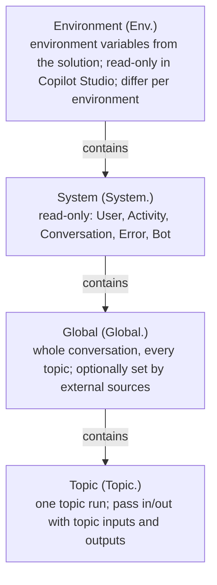
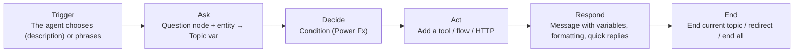

# Topics, variables and response formatting

> AB-620 · D1 Plan and configure agent solutions · about 85 min · Study Hub module `c01` ([open the hub](https://claude.ai/artifact/DfeAjDjaTCgtf36RSKeSSS))

## Why it matters
Topics are where you control a conversation exactly: the questions, the branches, the wording, the data you keep. *Manage variables* and *Configure agent response formatting* are named skills, and they're where small details (scope, type, Power Fx) decide answers.

## Pre-question (answer before reading)
**Q:** A value collected in one topic must be available in every later topic of the same conversation. Topic variable or global variable? And can a website set it before the chat starts?

<details><summary>Answer</summary>

A **global** variable (`Global.` prefix) lasts for the whole conversation across topics. If you tick *External sources can set values*, the hosting page can set it (for example a customer tier) at the start.

</details>

## Mental model & story
Contoso's returns topic needs to feel personal and be exact. Asha opens the topic canvas: a **trigger** at the top (*The agent chooses*, with a description), then **nodes**: *Send a message*, *Ask a question*, *Add a condition*, *Variable management*, *Topic management*, *Add a tool*, and *Advanced* nodes such as generative answers and HTTP requests.

The first message greets the user by name, `{System.User.DisplayName}`, a **system variable** filled by sign-in. A **Question** node asks for the order number and stores it in `Topic.OrderNumber`, a **topic variable** that lives only inside this topic. The reason for return uses a **custom entity** (a closed list: damaged, wrong size, not as described), so the agent recognises "it's broken" as *damaged*.

The customer's loyalty tier comes from the website before the chat starts, so Asha creates `Global.CustomerTier` and allows **external sources** to set it. Later topics use it to offer free return shipping to Gold members. The returns email address lives in an **environment variable**, read as `Env.cr5_ReturnsMailbox`, so test and production can differ without editing the topic.

Some values need calculation. A **Condition** node uses **Power Fx**: `Topic.Amount > 100`. A message shows `Text(Topic.Amount, "$#,##0.00")` so prices look right. When an API returns JSON as text, a **Parse value** node turns it into a record with typed fields.

Finally Asha formats replies so they read well in Teams: short sentences, a bulleted summary, **bold** for the return number, **quick replies** (*Track another order*, *Talk to a person*) and a couple of **message variations** so the greeting doesn't sound robotic. For answers the orchestrator writes itself, she adds formatting rules to the agent's **instructions**.

**Where the analogy breaks:** Variables feel like spreadsheet cells, but their **type is fixed at first assignment** and their **scope** matters: a topic variable is gone when the topic ends unless you return it as an output, and global variables can leak data between topics if you forget to clear them.

## Diagrams
**Variable scopes**



**A typical topic**



## Key points
- Topic nodes: **Send a message**, **Ask a question**, **Ask with adaptive card**, **Add a condition**, **Variable management** (Set a variable value, Parse value, Clear variable values), **Topic management** (Redirect, End current topic, End all topics, Transfer conversation), **Add a tool**, **Advanced** (Generative answers, Send HTTP request, Send an event, Authenticate...).
- Variable scopes: **Topic** (no prefix shown in UI; `Topic.` in formulas), **Global** (`Global.`; all topics; *External sources can set values* lets hosts set it), **System** (`System.`; read-only), **Environment** (`Env.`; read-only).
- Useful system variables: `System.Activity.Text` (user's last message), `System.User.DisplayName`, `System.User.Email`, `System.User.IsLoggedIn`, `System.Conversation.Id`, `System.Error.Code` / `System.Error.Message` (in On Error), `System.FallbackCount`.
- Types: String, Number, Boolean, DateTime, Choice, Record, Table, Blank. A variable's type is set by its **first assignment** and can't change.
- **Topic inputs and outputs** (Receive values from / Return values to other topics): with generative orchestration, the orchestrator fills inputs from the conversation (descriptions matter) and uses outputs to write the reply.
- **Question node**: entity (prebuilt: number, date and time, email, money, person name...; custom: closed list or regex), retries, reprompt, action when no valid entity is found, *Skip question* when the variable already has a value, interruptions.
- **Power Fx** in conditions, Set variable and messages: `If`, `IsBlank`, `Text(value, format)`, `CountRows`, `First`, `Filter`, `ForAll`, string concatenation with `&`.
- **Parse value** converts JSON text into a typed record/table using a sample or schema.
- Message formatting: markdown (bold, italics, lists, links; support varies by channel), variables in `{ }`, images and videos (carousel or list), basic/hero cards, adaptive cards, **quick replies** (suggestions; the user can still type), **message variations** (one picked at random), speech/SSML for voice.
- Generative replies are formatted by the agent's **instructions** ("answer in up to 3 bullets", "bold the order number") and by custom instructions on generative answers nodes.

## Comparisons
**Ending and moving between topics**

| Node | What happens |
|---|---|
| Redirect (go to another topic) | Runs the other topic, then returns here (passes inputs/outputs) |
| End current topic | Ends this topic; conversation continues |
| End all topics | Ends every active topic and clears the current plan |
| Transfer conversation | Hands off to a live agent (Escalate path) |
| Clear variable values | Resets variables (e.g., global) and can clear conversation history |

**Quick replies vs Question with options**

|  | Quick replies | Question (multiple choice) |
|---|---|---|
| User must pick one? | No, suggestions only | Yes, enforced with reprompts |
| Result stored? | Sent as a user message | Saved to a variable |
| Channel support | Varies by channel | Works everywhere |

## Code to recognise
**Power Fx you'll meet in topics**

```
// Condition: high-value return?
Topic.Amount > 100 && Global.CustomerTier <> "Gold"

// Message text: formatted currency and date
"Refund of " & Text(Topic.Amount, "$#,##0.00") & " requested on " & Text(Now(), DateTimeFormat.LongDate)

// Set variable: count open orders from a table returned by a tool
CountRows(Filter(Topic.Orders, Status = "Open"))

// Set variable: default when a value is missing
If(IsBlank(Topic.Email), System.User.Email, Topic.Email)

// Read an environment variable (read-only)
Env.cr5_ReturnsMailbox
```

- Line 2: Conditions are Power Fx expressions that return true or false.
- Line 5: `Text()` formats numbers and dates; `&` joins strings.
- Line 8: Table functions work on Table variables returned by tools or Parse value.
- Line 11: `IsBlank` guards against empty inputs.
- Line 14: Environment variables appear with the `Env.` prefix and can't be changed by the topic.

## Portal steps
**Create a global variable that the website can set** (Topic canvas > (variable) > Variable properties)

1. Select the variable and change its usage to **Global (any topic can access)**.
2. Tick **External sources can set values** if the host page will pass it in.
3. Use it in other topics as `Global.Name`.
4. Clear it with *Clear variable values* when it must not carry over.

## Worked example
**Scenario:** A topic must ask for a delivery date, refuse dates in the past, and show the chosen date in a friendly format.

- Ask a question with the **Date and time** entity → `Topic.DeliveryDate`.
- Condition: `Topic.DeliveryDate < Today()` → message "That date has passed" and ask again (or redirect).
- Message: `"Booked for " & Text(Topic.DeliveryDate, DateTimeFormat.LongDate)`.

**Answer:** Question node with the Date and time entity, a Power Fx **Condition** comparing to `Today()`, a loop back to the question for past dates, and a message using `Text(..., DateTimeFormat.LongDate)`.

## Your turn (faded example)
**Scenario:** An HTTP call returns JSON as a string in `Topic.RawResponse`. You need `status` and `eta` from it.

- The string must become a typed record first.
- **Which node?** <details><summary>answer</summary>**Parse value**, with a sample JSON to define the schema, saving to `Topic.Order` (Record).</details>
- **How do you show the ETA?** <details><summary>answer</summary>Message: `Order is {Topic.Order.status}, expected {Topic.Order.eta}` (or format with `Text()` if it's a date).</details>

## Exam traps & misconceptions
- ✗ Assigning a number to a variable first created as text. → ✓ Type is fixed at first assignment; create a new variable or convert with `Value()`/`Text()`.
- ✗ Using a topic variable in another topic. → ✓ Topic variables die with the topic; use outputs or a global variable.
- ✗ Trying to change an environment or system variable in a topic. → ✓ Both are read-only; copy into a topic/global variable if you need to modify it.
- ✗ Expecting quick replies to force a choice. → ✓ They're suggestions. Use a multiple-choice Question for enforced options.
- ✗ Using End all topics when you only meant to finish this topic. → ✓ End all topics also cancels the orchestrator's current plan.

## Discussion prompts
- **When would you use a global variable instead of topic inputs/outputs?** When many topics need the same value for the whole conversation (customer tier, language, authenticated account number). Inputs/outputs are cleaner for passing a value between two specific topics.
- **How do you make responses consistent across topics and generated answers?** Put formatting rules in the agent's instructions, use the same message patterns in topics, and add custom instructions to generative answers nodes; test in each channel because markdown support varies.

## Interview angle / teach-back
**Prompt:** Explain the four variable scopes in Copilot Studio and give a use for each.

**Rubric:** Topic: within one topic · Global: across topics; external sources · System: read-only context such as user and activity · Environment: read-only, per environment, from solutions · Type fixed at first assignment

**Model answer:** Topic variables live in one topic, like an order number I just asked for. Global variables last the whole conversation, like a customer tier that the website sets at the start. System variables are read-only context, like the user's name or the last message text. Environment variables come from the solution and differ per environment, like an API base URL; they're read-only. A variable's type is set when it's first assigned.

## Quick Q&A
- **Prefix for environment variables in formulas?** `Env.`
- **User's last message?** `System.Activity.Text`.
- **Let a web page set a variable?** Global variable + *External sources can set values*.
- **Turn JSON text into a record?** **Parse value** node.
- **Enforced choice vs suggestion?** Question with options vs quick replies.
- **When is a variable's type decided?** At first assignment.
- **Ends every topic and the plan?** **End all topics**.

## Sources (accessed 2026-10-02)
- [Create and edit topics](https://learn.microsoft.com/en-us/microsoft-copilot-studio/authoring-create-edit-topics)
- [Work with variables](https://learn.microsoft.com/en-us/microsoft-copilot-studio/authoring-variables)
- [Use Power Fx in Copilot Studio](https://learn.microsoft.com/en-us/microsoft-copilot-studio/advanced-power-fx)
- [Agent Academy: add a topic with a trigger](https://microsoft.github.io/agent-academy/recruit/07-add-new-topic-with-trigger/)

## SRS cards created
- ab-620-c01-01, ab-620-c01-02, ab-620-c01-03, ab-620-c01-04
