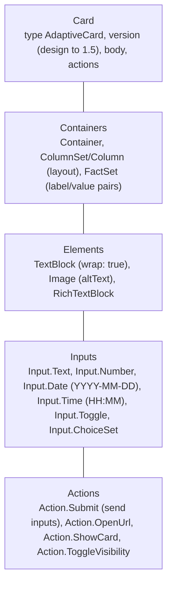
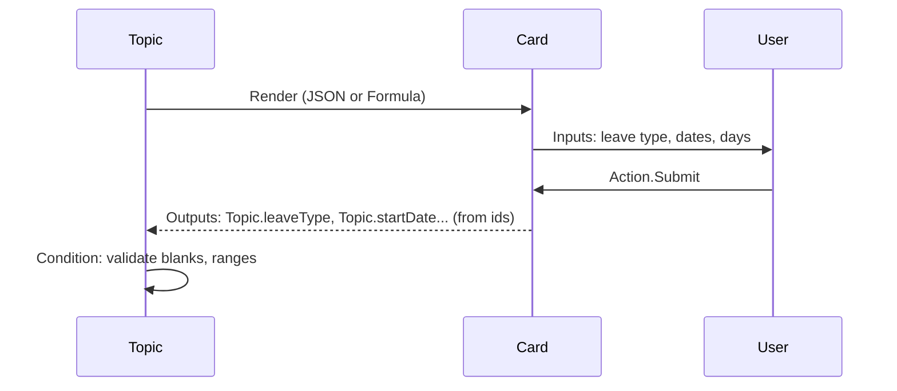

# Adaptive cards

> AB-620 · D1 Plan and configure agent solutions · about 75 min · Study Hub module `c02` ([open the hub](https://claude.ai/artifact/DfeAjDjaTCgtf36RSKeSSS))

## Why it matters
Adaptive cards turn a chat into a form or a dashboard. The exam likes card JSON, input IDs that become variables, schema versions per channel, and when to use a Formula card so values can be dynamic.

## Pre-question (answer before reading)
**Q:** An *Ask with adaptive card* node has an input `"id": "leaveType"`. After the user submits, where is the value?

<details><summary>Answer</summary>

In a topic output variable created from the input's **id**, here `Topic.leaveType`. That's why descriptive camelCase IDs matter.

</details>

## Mental model & story
HR wants leave requests by chat, but typing a date, a leave type and a number of days into free text produces chaos. Asha uses an **Ask with adaptive card** node: one card with an **Input.ChoiceSet** (leave type), two **Input.Date** fields and an **Input.Number**, plus an **Action.Submit** button.

When the employee submits, Copilot Studio creates **output variables** named after each input's **id**: `Topic.leaveType`, `Topic.startDate`, `Topic.endDate`, `Topic.days`. She marks inputs **required**, but also adds a **Condition** after the node, because some channels let blank values through.

Leave types differ per country, so the choice list must come from data. In **JSON** mode a card is static; switching the node to a **Formula** card lets her build the card with **Power Fx**, so `choices` comes from `Topic.AvailableLeaveTypes` (a table with title and value), and the header can show the employee's name.

After submission, a second, *informational* card confirms the request: a **ColumnSet** with the employee's photo, a **FactSet** with dates and days, and a *Submitted* badge. Informational cards go in a **Send a message** node.

In the test pane everything is perfect. In Teams, one card is blank. The culprit: `version: "1.6"` and a 1.6-only property. Teams renders up to **schema 1.5**. Asha sets every card to 1.5, uses **Action.Submit** (not Action.Execute, which the web channel doesn't support), and re-tests in Teams.

**Where the analogy breaks:** Cards aren't free-form web pages: no custom scripts, limited styling, and each host (Teams, web chat, Outlook) renders slightly differently. Keep cards simple, with 3–5 key data points, and always provide a text alternative for screen readers.

## Diagrams
**Building blocks of an adaptive card**



**Ask with adaptive card: from card to variables**



## Key points
- **Informational** cards: Send a message > Add > Adaptive card (edit in the designer or JSON). **Interactive** cards: **Ask with adaptive card** node, which waits for submission.
- Inputs' **id** values become **output variables** (`Topic.<id>`); use descriptive camelCase IDs. Mark inputs required (`isRequired`, `errorMessage`) and still validate with a Condition.
- **Action.Submit** sends all inputs. Use a unique submit ID when several cards are shown in a row so you know which one was submitted.
- **Formula card** (Power Fx) instead of JSON lets the card use variables and computed values, e.g., `choices` from a table variable with `title` and `value`. Compute complex values into variables first.
- Input formats: Input.Date returns `YYYY-MM-DD`; Input.Time returns `HH:MM`.
- Channel versions: **Teams and Omnichannel live chat support schema 1.5**; the web channel supports 1.6; the test pane renders 1.6 (can mislead). Design to **1.5** for multi-channel agents.
- The web channel doesn't support **Action.Execute**; use **Action.Submit**.
- Layout: Container, ColumnSet/Column, FactSet, Image, TextBlock with `wrap: true`, spacing, style `emphasis`, `minHeight`. Keep to **3–5 data points**.
- Accessibility: `altText` on images, clear `label`s on inputs, sufficient contrast, don't rely on colour alone.
- Several cards can be shown as a **carousel** or **list** in one message.

## Comparisons
**JSON card vs Formula card**

|  | JSON card | Formula card (Power Fx) |
|---|---|---|
| Dynamic values (variables) | No | Yes |
| Edit with the designer | Yes | Write Power Fx (start from JSON, then convert) |
| Dynamic choice lists | No | Yes, from a table variable |
| Best for | Static forms and messages | Data-driven cards |

## Code to recognise
**Ask with adaptive card: leave request (JSON, schema 1.5)**

```json
{
  "type": "AdaptiveCard",
  "$schema": "http://adaptivecards.io/schemas/adaptive-card.json",
  "version": "1.5",
  "body": [
    { "type": "TextBlock", "text": "Request leave", "weight": "Bolder", "size": "Medium", "wrap": true },
    { "type": "Input.ChoiceSet", "id": "leaveType", "label": "Leave type", "isRequired": true,
      "errorMessage": "Choose a leave type",
      "choices": [ { "title": "Annual", "value": "annual" }, { "title": "Sick", "value": "sick" } ] },
    { "type": "Input.Date", "id": "startDate", "label": "First day", "isRequired": true },
    { "type": "Input.Number", "id": "days", "label": "Number of days", "min": 0.5, "max": 30 }
  ],
  "actions": [ { "type": "Action.Submit", "title": "Submit request" } ]
}
```

- Line 4: Design to 1.5 so Teams renders it.
- Line 6: `wrap: true` stops long text being cut off.
- Line 7: `id` becomes the output variable `Topic.leaveType`.
- Line 10: Input.Date returns `YYYY-MM-DD`.
- Line 13: Action.Submit sends every input value back to the topic.

**Formula card: dynamic confirmation (Power Fx)**

```
{
  type: "AdaptiveCard",
  version: "1.5",
  body: [
    { type: "TextBlock", text: "Leave request for " & System.User.DisplayName, weight: "Bolder", wrap: true },
    { type: "FactSet", facts: [
        { title: "Type", value: Topic.leaveType },
        { title: "Starts", value: Text(DateValue(Topic.startDate), DateTimeFormat.LongDate) },
        { title: "Days", value: Text(Topic.days) } ] }
  ]
}
```

- Line 1: A Formula card is a Power Fx **record**, so keys aren't quoted and values can be expressions.
- Line 5: Concatenate variables into text.
- Line 8: Convert the `YYYY-MM-DD` string to a date, then format it.
- Line 9: FactSet values must be text, so convert numbers with `Text()`.

## Portal steps
**Add an interactive card** (Topic > + > Ask with adaptive card)

1. Open the card editor (designer) or paste JSON; set version 1.5.
2. Give each input a descriptive **id**; mark required inputs.
3. Need variables? In the node properties switch **JSON card** to **Formula card** and use Power Fx.
4. Check the node's output variables (one per input id).
5. Add a **Condition** to validate values, then use them (tool call, message).

## Worked example
**Scenario:** A card for room booking must list only the rooms available at the chosen site, returned by a tool as `Topic.Rooms` (a table with name and id).

- Static JSON can't read a variable.
- Switch the node to a Formula card.
- Build choices from the table: `ForAll(Topic.Rooms, { title: ThisRecord.name, value: ThisRecord.id })`.

**Answer:** Use a **Formula card**; set the ChoiceSet's `choices` to `ForAll(Topic.Rooms, {title: ThisRecord.name, value: ThisRecord.id})`; the selection returns in `Topic.<inputId>` as the room id.

## Your turn (faded example)
**Scenario:** A card works in the test pane and web chat but shows an error in Teams.

- The test pane renders 1.6; Teams renders up to 1.5.
- **What do you check first?** <details><summary>answer</summary>The card's `version` and any element or property introduced after 1.5 (and `Action.Execute`).</details>
- **What's the durable fix?** <details><summary>answer</summary>Set version 1.5, replace unsupported features, and test in the Teams channel itself.</details>

## Exam traps & misconceptions
- ✗ Relying on `isRequired` alone. → ✓ Some channels still send blanks: add a Condition after the card.
- ✗ Using variables inside a JSON card. → ✓ JSON cards are static; use a Formula card for dynamic values.
- ✗ Trusting the test pane for Teams rendering. → ✓ Test pane = 1.6; Teams = 1.5.
- ✗ Using Action.Execute on the web channel. → ✓ Not supported there; use Action.Submit.
- ✗ Generic input IDs like `input1`. → ✓ IDs become variable names; use descriptive camelCase.

## Discussion prompts
- **Card or plain questions?** Cards suit several related inputs or structured choices (forms, approvals, summaries). Plain questions suit one value, voice channels, or when you want natural language extraction by entities.
- **How do you keep cards accessible?** Labels on inputs, altText on images, readable text sizes, no colour-only meaning, and a text summary in the message for channels or users that can't use cards.

## Interview angle / teach-back
**Prompt:** Explain how an Ask with adaptive card node turns a user's form into variables, and how you make the card dynamic and Teams-safe.

**Rubric:** Input ids → output variables · Action.Submit sends values · Validate with a Condition · Formula card for variables/dynamic choices · Design to schema 1.5; Action.Submit not Execute

**Model answer:** Each input has an id, and after Action.Submit the node creates matching output variables such as Topic.leaveType, which I validate with a Condition because blanks can slip through. For dynamic content I switch from a JSON card to a Formula card and build values and choice lists with Power Fx. I design to schema 1.5 and use Action.Submit so the card works in Teams, and I test in the real channel.

## Quick Q&A
- **Where does input `days` land?** `Topic.days`.
- **Teams max schema?** **1.5**.
- **Dynamic values in a card?** **Formula card** (Power Fx).
- **Input.Date format?** `YYYY-MM-DD`.
- **Submit action to use on web?** **Action.Submit**.
- **Label/value list element?** **FactSet**.

## Sources (accessed 2026-10-02)
- [Adaptive Cards overview (Copilot Studio)](https://learn.microsoft.com/en-us/microsoft-copilot-studio/adaptive-cards-overview)
- [Ask with Adaptive Cards](https://learn.microsoft.com/en-us/microsoft-copilot-studio/authoring-ask-with-adaptive-card)
- [Adaptive Cards designer](https://adaptivecards.microsoft.com/designer)
- [Agent Academy: adaptive cards mission](https://microsoft.github.io/agent-academy/recruit/08-add-adaptive-card/)

## SRS cards created
- ab-620-c02-01, ab-620-c02-02, ab-620-c02-03, ab-620-c02-04
