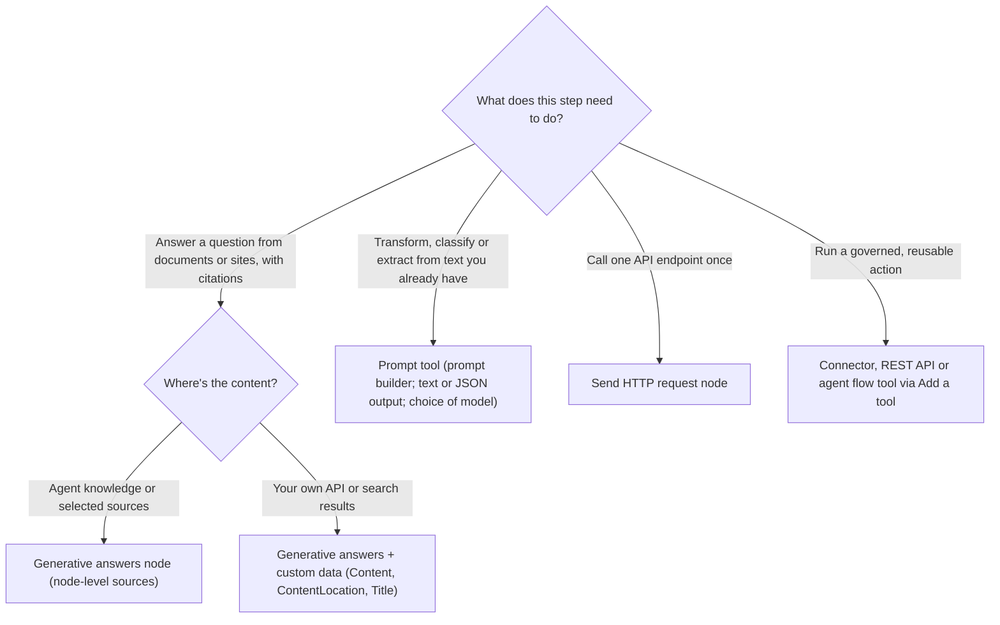
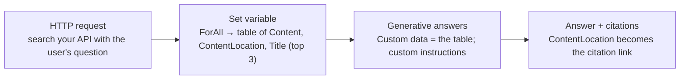

# Advanced responses: generative answers, prompts, HTTP, tools in topics

> AB-620 · D1 Plan and configure agent solutions · about 95 min · Study Hub module `c03` ([open the hub](https://claude.ai/artifact/DfeAjDjaTCgtf36RSKeSSS))

## Why it matters
This is the busiest skill group in D1: generative answers nodes, custom knowledge, custom prompts, Send HTTP request and tools inside topics. Each solves a different problem, and the exam gives you scenarios where only one fits.

## Pre-question (answer before reading)
**Q:** A topic must classify a customer complaint into category and urgency, returning JSON the topic can branch on. Generative answers node or a prompt?

<details><summary>Answer</summary>

A **prompt** (custom prompt tool): it runs your instructions on input you pass (the complaint) and can return structured JSON. Generative answers is for answering questions from knowledge, with citations.

</details>

## Mental model & story
Asha's agent now handles the common requests, but four awkward ones remain. First: inside the *Warranty* topic, the agent must answer questions **only** from the warranty PDFs, not from everything the agent knows. She adds a **generative answers** node to that topic and gives it its own data sources; node-level sources beat the agent's general knowledge for that step. Custom instructions tell it to answer in three sentences and cite the document.

Second: product manuals live in a search API owned by another team. Generative answers can still summarise them through **custom data**: an HTTP call fetches results, a **Set variable** builds a table with `Content`, `ContentLocation` and `Title`, and the node summarises it with citations. Only the **first three** records are used, so Asha sorts by relevance at the source.

Third: complaints need a category and urgency. She builds a **prompt** in prompt builder with an input variable `{complaintText}`, instructions, and **JSON output**. The default model is a small fast one; for tricky legal complaints she tries a reasoning model, and the data team connects a model from the **Foundry model catalog**. In the topic, a *Add a tool > prompt* node maps the input and saves the output.

Fourth: a carrier API needs one GET call with a header. No connector exists and nobody else needs it, so she uses **Send HTTP request**: URL built with Power Fx, the API key read from a secret **environment variable**, response schema from sample JSON, and *Continue on error* so she can check the status code and offer a friendly fallback instead of the On Error topic.

At the end she has a rule of thumb taped to her screen: *answer from knowledge → generative answers; transform or classify text → prompt; one raw API call → HTTP request; a governed reusable action → connector or flow tool.*

**Where the analogy breaks:** These are building blocks, not silos. A topic can call HTTP, feed the result to custom data, summarise with generative answers, then classify the answer with a prompt. The exam picks one block per question, but real topics chain them.

## Diagrams
**Which advanced response?**



**Custom data pattern**



## Key points
- **Generative answers node** (Add node > Advanced > Generative answers): input usually `System.Activity.Text`; data sources set **on the node** apply to that node (agent-level knowledge is used when the node has none); can save the answer to a variable; per-node **content moderation** and **custom instructions** (tone, length, scope; can include variables).
- Sources for generative answers: public websites (Bing), SharePoint, uploaded documents, Dataverse, Azure AI Search (and Azure OpenAI on your data until it retires on 14 Oct 2026), Bing Custom Search, AI general knowledge, and **custom data**.
- **Custom data**: a Power Fx table with `Content` (required), `ContentLocation` (URL for citations) and `Title`. Only the **first 3** records are used, so rank at the source.
- No answer found → the node produces nothing; add a **Condition** (`IsBlank(Topic.Answer)`) with a fallback such as escalation.
- **Conversational boosting** system topic = agent-wide fallback to generative answers under **classic** orchestration; generative orchestration searches knowledge on its own.
- **Prompts** (Tools > Add a tool > New tool > Prompt): instructions + input variables (text, and files/images where supported) + optional knowledge; output **text or JSON**; choose a model (small/default, general, reasoning) or connect a **Foundry model** deployment; test in the builder; use in topics with input mapping and an output variable.
- Prompt vs generative answers: prompt = do *a task* on given input (classify, extract, rewrite); generative answers = *answer a question* from knowledge with citations.
- **Send HTTP request**: method (GET, POST, PUT, PATCH, DELETE), URL (static or Power Fx), headers (no hard-coded secrets: use environment variables, secret type in Azure Key Vault), body (none, JSON, raw), response type with schema **from sample data**, timeout (default 30,000 ms).
- HTTP error handling: default **Raise an error** (goes to On Error) or **Continue on error** (save status code and error body to variables, then branch).
- **Tools in topics** (Add node > Add a tool): connectors, custom connectors, flows, prompts, REST API tools. Map inputs (variables, Power Fx, fixed values) and save outputs; choose credentials (end user or maker).

## Comparisons
**Pick the right advanced response**

| Need | Use | Not this |
|---|---|---|
| Answer from the warranty PDFs only, with citations | Generative answers node with node-level sources | Prompt (no retrieval by default) |
| Summarise results from your own search API | Generative answers + custom data | HTTP node alone (no summary) |
| Return {category, urgency} JSON for a complaint | Prompt tool with JSON output | Generative answers |
| One GET to a partner API, used once | Send HTTP request | New custom connector |
| Create a CRM case (shared, governed) | Connector or flow tool in the topic | HTTP node with a hard-coded key |

**Send HTTP request: error handling**

| Setting | What happens on failure | Use when |
|---|---|---|
| Raise an error (default) | On Error topic runs | Failure should stop the topic |
| Continue on error | Status code and error body saved to variables; topic continues | You want a custom fallback (retry, alternative, apology) |

## Code to recognise
**Custom data for generative answers (Power Fx, Set variable)**

```
// Topic.SearchResults came from a Send HTTP request node (Record with a results table)
ForAll(
    FirstN(Topic.SearchResults.results, 3),
    {
        Content: ThisRecord.snippet,
        ContentLocation: ThisRecord.url,
        Title: ThisRecord.title
    }
)
```

- Line 3: Only the first 3 records are used, so take the best 3 yourself.
- Line 5: `Content` is required: the text the model reads.
- Line 6: `ContentLocation` becomes the citation link.
- Line 7: `Title` labels the citation.

**Prompt for structured classification (prompt builder)**

```text
You triage customer complaints for Contoso Retail.

Complaint: {complaintText}

Return only JSON with this shape:
{"category": "delivery | product | billing | other",
 "urgency": "low | medium | high",
 "summary": "at most 20 words"}

Rules: urgency is high if the customer mentions injury, legal action or a payment taken twice.
```

- Line 3: `{complaintText}` is an input variable you map from the topic.
- Line 5: Choose **JSON** output so the topic gets typed fields to branch on.
- Line 10: Explicit rules make outputs consistent; test them in the prompt builder.

**Send HTTP request node settings**

```http
GET https://api.carrier.example/v2/shipments/{Topic.TrackingNumber}
x-api-key: {Env.cr5_CarrierApiKey}
Accept: application/json

# Response data type: From sample data -> Topic.Shipment (record)
# Error handling: Continue on error -> Topic.StatusCode, Topic.ErrorBody
# Request timeout: 30000 ms (default)
```

- Line 1: The URL is a Power Fx expression in the node: `"https://.../shipments/" & Topic.TrackingNumber`.
- Line 2: Read the key from a **secret environment variable** (Key Vault), never hard-code it.
- Line 5: Paste a sample response to generate the schema; fields become dot-accessible.
- Line 6: Continue on error lets you branch on the status code instead of jumping to On Error.

## Portal steps
**Add a generative answers node to a topic** (Topic > + > Advanced > Generative answers)

1. Input: `System.Activity.Text` (or a rewritten question variable).
2. Data sources > Edit: choose the sources for this node (e.g., the warranty files only) or Custom data.
3. Optional: custom instructions, content moderation level, save the answer to a variable.
4. Add a Condition after the node for when no answer is found.

**Create a prompt and use it in a topic** (Tools > Add a tool > New tool > Prompt)

1. Write instructions; insert input variables; optionally add knowledge.
2. Pick the model (or connect a Foundry model deployment); choose text or JSON output.
3. Test with sample inputs; save.
4. In a topic: + > Add a tool > the prompt; map inputs; store the output; branch on it.

## Worked example
**Scenario:** In a *Product help* topic, answers must come from the manufacturer's manuals API (no connector), cite the manual page, and fall back to a person if nothing is found.

- No connector and one call → Send HTTP request (key in a secret environment variable).
- Summarise with citations → generative answers with **custom data** built from the top 3 results.
- No answer → Condition on the answer variable → Escalate.

**Answer:** HTTP request (Continue on error) → Set variable with `ForAll(FirstN(results,3), {Content, ContentLocation, Title})` → **Generative answers** with Custom data and instructions to cite → Condition `IsBlank(Topic.Answer)` → transfer to a person.

## Your turn (faded example)
**Scenario:** Every message in a *Claims* topic must be checked for whether it mentions a policy number, and the number extracted.

- This is extraction from text you already have, not a knowledge question.
- **Which component?** <details><summary>answer</summary>A **prompt** with `{messageText}` input and JSON output `{hasPolicyNumber, policyNumber}`.</details>
- **How does the topic use it?** <details><summary>answer</summary>Add a tool > the prompt, map `System.Activity.Text`, save output, then Condition on `hasPolicyNumber`.</details>

## Exam traps & misconceptions
- ✗ Putting 10 records in custom data and expecting all to be used. → ✓ Only the first **3** are used.
- ✗ Using generative answers to classify or extract. → ✓ Use a **prompt** for transformations; generative answers retrieves and answers.
- ✗ Hard-coding an API key in the HTTP node header. → ✓ Use a secret environment variable (Key Vault) or a connector with proper auth.
- ✗ Expecting HTTP failures to be handled inside the topic by default. → ✓ Default is **Raise an error** → On Error. Choose Continue on error to branch.
- ✗ Assuming the node also searches agent-level knowledge when node sources are set. → ✓ Node-level sources are what that node uses; agent-level knowledge is the fallback only when the node has none.

## Discussion prompts
- **When would you connect a Foundry model to a prompt?** When you need a model the built-in options don't offer (a fine-tuned or domain model, a specific region for residency, or an open model), and you accept Foundry costs and governance. DLP and connection governance still apply.
- **HTTP node or REST API tool for the same API?** HTTP node for a single call at a fixed step in one topic. REST API tool when the agent (orchestrator) should call several operations flexibly with proper auth and descriptions, still only within Copilot Studio.

## Interview angle / teach-back
**Prompt:** Explain when to use a generative answers node, custom data, a prompt and a Send HTTP request node.

**Rubric:** Generative answers: knowledge Q&A with citations; node-level sources · Custom data: table Content/ContentLocation/Title, first 3 · Prompt: transform/classify/extract, text or JSON, model choice/Foundry · HTTP: single call, secrets in env vars, schema from sample, error handling

**Model answer:** A generative answers node answers a question from knowledge with citations, using sources set on that node. If the content comes from my own API, I build custom data: a table with Content, ContentLocation and Title, and only the first three rows are used. A prompt is for transforming text I already have: classify, extract, rewrite, with JSON output and a model I choose, including Foundry models. Send HTTP request makes one API call from a topic, with secrets in environment variables, a schema from sample data and either raise-an-error or continue-on-error handling.

## Quick Q&A
- **Custom data columns?** `Content` (required), `ContentLocation`, `Title`.
- **How many custom data records are used?** The first **3**.
- **Default HTTP error behaviour?** **Raise an error** → On Error topic.
- **Default HTTP timeout?** **30,000 ms**.
- **Where to keep an API key for HTTP?** Secret environment variable (Azure Key Vault).
- **Prompt output types?** Text or **JSON**.
- **Agent-wide fallback under classic orchestration?** **Conversational boosting** topic.

## Sources (accessed 2026-10-02)
- [Add a generative answers node](https://learn.microsoft.com/en-us/microsoft-copilot-studio/nlu-boost-node)
- [Use a custom data source for generative answers nodes](https://learn.microsoft.com/en-us/microsoft-copilot-studio/nlu-generative-answers-custom-data)
- [Make HTTP requests](https://learn.microsoft.com/en-us/microsoft-copilot-studio/authoring-http-node)
- [Create a prompt and change the model](https://learn.microsoft.com/en-us/microsoft-copilot-studio/prompt-model-settings)

## SRS cards created
- ab-620-c03-01, ab-620-c03-02, ab-620-c03-03, ab-620-c03-04
