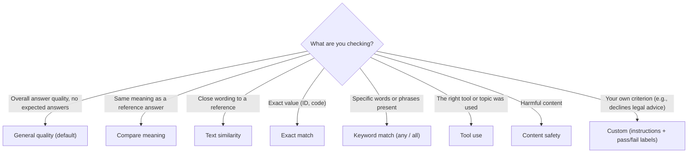
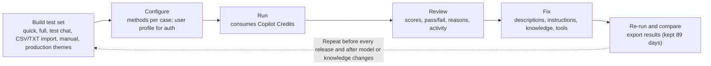

# Evaluate agents: test sets, methods, results

> AB-620 · D3 Test and manage agents · about 80 min · Study Hub module `e01` ([open the hub](https://claude.ai/artifact/DfeAjDjaTCgtf36RSKeSSS))

## Why it matters
D3 starts with **evaluation**: create a test set, choose an evaluation method, review results. The exam checks that you match the method to what you're measuring, and know the limits that make a run *invalid* or misleading.

## Pre-question (answer before reading)
**Q:** Your test set has questions but no expected answers. You select **Compare meaning** and every result says *Invalid*. Why?

<details><summary>Answer</summary>

Compare meaning (like text similarity and exact match) needs an **expected response** to compare against. Without one the result is invalid. **General quality** doesn't need expected answers.

</details>

## Mental model & story
Before going live, Asha's manager asks the question every agent owner dreads: *How do you know it's good?* Asha opens the **Evaluation** page (**Evaluate** tab in the newest UI) and builds a **test set**.

She starts with a **quick question set**: Copilot Studio reads the agent's description and instructions and generates 10 questions. Then a **full question set** from the returns-policy knowledge, a few questions copied from her last **test chat**, and a CSV from the support team's top real questions with **Question** and **Expected response** columns. A test set holds up to **100** cases.

Now the methods. **General quality** (the default) scores each answer for qualities such as relevance, groundedness and completeness without needing expected answers. For policy questions with known answers she adds **Compare meaning** (does the answer *mean* the same?). For *"Create a return for order 1042"* she uses **Tool use** to check the *Create return* flow actually ran. **Keyword match** checks that refund answers mention "14 days". A **Custom** grader with labels *Declines appropriately* / *Answers anyway* tests that medical questions are refused, because General quality tends to penalise correct refusals. **Content safety** checks for harmful content.

The agent calls tools with the user's credentials, so she sets the evaluation's **user profile** to a test account with realistic permissions. She runs it (this costs Copilot Credits, so she keeps sets focused), then drills into each failed case: the answer, the score, the reason, and the activity that produced it.

Two failures share a cause: a vague knowledge description. She fixes it, re-runs the same test set, and compares runs. Results stay for **89 days**, so she exports the CSV for the release record.

**Where the analogy breaks:** A high score on 30 questions you wrote yourself proves little. Good test sets include real user phrasing, edge cases, adversarial and out-of-scope questions, multi-turn conversations, and cases for every tool, and they grow every time production reveals a new failure.

## Diagrams
**Choosing an evaluation method**



**Evaluation loop**



## Key points
- Create a test set by: **quick question set** (10 AI-generated questions from description, instructions and capabilities), **full question set** (from knowledge or topics, you choose how many), **test chat** (questions from your latest test conversation), **import** (.csv or .txt, up to 5 MB; columns *Question*, *Expected response*), **manual**, **production themes** (preview).
- Limits: **100 test cases** per set; **1,000 characters** per question.
- Methods: **General quality** (scored out of 100%; no expected answer needed), **Content safety** (pass/fail), **Compare meaning** (scored; needs expected answer), **Tool use** (pass/fail; expected tools/topics), **Keyword match** (pass/fail; any or all keywords), **Text similarity** (scored; needs expected answer), **Exact match** (pass/fail), **Custom** (your instructions and pass/fail labels).
- **Conversation (multi-turn) test sets** support General quality, Content safety, Keyword match and Custom; Compare meaning, Tool use, Text similarity and Exact match are single-response only.
- Match-type methods without expected answers → **Invalid** results.
- General quality can penalise appropriate refusals; use **Custom** with labels like *declines correctly* for refusal tests.
- Set the **user profile** (Manage profile and connections > User) so evaluations access knowledge and tools with a realistic account.
- Results are kept **89 days**; export to CSV for records.
- Evaluations consume **Copilot Credits**: keep sets focused and re-run deliberately.
- Use evaluations to compare **model** choices and changes: run the same set before and after; in the newest labs, evaluate a candidate model on a small subset before switching.

## Comparisons
**Evaluation methods at a glance**

| Method | Needs expected answer? | Result | Multi-turn? |
|---|---|---|---|
| General quality | No | Score (100%) | Yes |
| Content safety | No | Pass/fail | Yes |
| Compare meaning | Yes | Score | No |
| Text similarity | Yes | Score | No |
| Exact match | Yes | Pass/fail | No |
| Keyword match | Keywords | Pass/fail | Yes |
| Tool use | Expected tools/topics | Pass/fail | No |
| Custom | Your criteria + labels | Pass/fail | Yes |

## Code to recognise
**Single-response test set import (CSV)**

```text
Question,Expected response
"How long do I have to return an item?","You can return most items within 14 days of delivery with proof of purchase."
"Can I return a kettle that arrived broken?","Yes. Damaged items can be returned at any time within 14 days; we cover return shipping."
"Do you price match competitors?","No, Contoso doesn't price match, but you can check current promotions."
```

- Line 1: The two columns Copilot Studio expects for single-response sets.
- Line 2: Expected responses enable Compare meaning, Text similarity and Exact match.
- Line 4: Include out-of-policy questions too, so you test what the agent should *not* promise.

**Multi-turn test set (AB-620T00 v2 lab format)**

```text
conversationNumber,question,response
1,"I want to return my order","Sure, what's the order number?"
1,"It's 1042","Thanks. What's the reason for the return?"
1,"It arrived damaged","I've created return R-311 and emailed you the details."
2,"What's your refund policy?","Refunds are issued within 5 business days after we receive the item."
```

- Line 1: The lab's multi-turn format groups turns by conversation number.
- Line 2: Turns 2–4 belong to conversation 1, so the evaluator sees them as one dialogue.
- Line 5: Conversation sets support General quality, Content safety, Keyword match and Custom.

## Portal steps
**Create and run an evaluation** ((agent) > Evaluation (new UI: Evaluate tab) > + New evaluation / test set)

1. Choose how to create cases: quick, full, test chat, import file, manual or themes.
2. Pick methods (General quality is default); add expected answers, keywords or expected tools where needed.
3. Manage profile and connections > **User**: select the test account.
4. Run; review the aggregate score, then each case's result and reasoning.
5. Fix issues, re-run, compare; export results (kept 89 days).

## Worked example
**Scenario:** An HR agent must (1) answer leave questions correctly, (2) create leave requests with the *Submit leave* flow, (3) refuse to discuss colleagues' salaries. Design the evaluation.

- (1) Known answers exist → expected responses with Compare meaning (plus General quality).
- (2) Behaviour is a tool call → Tool use with *Submit leave* expected.
- (3) Correct behaviour is a refusal → Custom grader with labels; General quality could mark refusals down.

**Answer:** One test set with expected answers for policy questions (**Compare meaning** + **General quality**), action requests checked with **Tool use**, salary questions graded by a **Custom** method (*declines appropriately* = pass), plus **Content safety**; run with a realistic employee **user profile**.

## Your turn (faded example)
**Scenario:** After switching the agent's model, the team wants to know if quality changed.

- Comparisons need the same inputs.
- **What do you run?** <details><summary>answer</summary>The same test set (same methods, same user profile) before and after the change.</details>
- **What do you look at beyond the average?** <details><summary>answer</summary>Per-case regressions (cases that passed before and fail now), tool-use failures, and refusal behaviour; then decide or roll back.</details>

## Exam traps & misconceptions
- ✗ Using Compare meaning without expected answers. → ✓ Results are Invalid; add expected responses or use General quality.
- ✗ Testing refusals with General quality only. → ✓ It may score correct refusals low; use a Custom grader.
- ✗ Running evaluations with the maker's admin account. → ✓ Set a realistic test **user profile**: permissions change answers.
- ✗ Putting Tool use on a multi-turn conversation set. → ✓ Tool use is single-response only.
- ✗ Importing 250 cases into one set. → ✓ Max **100** per set; split into several sets.

## Discussion prompts
- **Where should test cases come from?** Real user questions (themes, transcripts), policy owners' known answers, every tool's happy and failure paths, edge and adversarial cases, and each production incident turned into a regression test.
- **What score is 'good enough' to ship?** Agree thresholds per method and risk with the business (e.g., 100% on safety and refusals, high pass rates on tool use, quality above a baseline), and never accept regressions on critical cases even if the average improves.

## Interview angle / teach-back
**Prompt:** Explain how you'd evaluate an agent in Copilot Studio before release.

**Rubric:** Test set sources and 100-case limit · Method choice: General quality vs match methods vs Tool use vs Custom vs Content safety · Expected answers needed for match methods · User profile for auth · Review, fix, re-run; 89-day retention/export

**Model answer:** I build test sets from generated questions, real user questions and an imported CSV with expected answers, up to 100 cases per set. I use General quality for overall answers, Compare meaning or exact/text match where I have reference answers, Tool use to check the right flow ran, Keyword match for must-have phrases, Content safety, and a Custom grader for refusals. I run it as a realistic test user, review each failure, fix descriptions or knowledge, re-run the same set, and export results because they're kept 89 days.

## Quick Q&A
- **Max cases per test set?** **100**.
- **CSV columns for import?** *Question*, *Expected response*.
- **Default method?** **General quality**.
- **Methods needing expected answers?** Compare meaning, Text similarity, Exact match.
- **Multi-turn methods?** General quality, Content safety, Keyword match, Custom.
- **How long are results kept?** **89 days**.
- **Where to set the test account?** Manage profile and connections > User.

## Sources (accessed 2026-10-02)
- [Create a test set (agent evaluation)](https://learn.microsoft.com/en-us/microsoft-copilot-studio/analytics-agent-evaluation-create)
- [Agent evaluation overview](https://learn.microsoft.com/en-us/microsoft-copilot-studio/analytics-agent-evaluation-intro)
- [View evaluation results](https://learn.microsoft.com/en-us/microsoft-copilot-studio/analytics-agent-evaluation-results)
- [AB-620T00 lab 5.1: evaluate an agent](https://github.com/MicrosoftLearning/AB-620T00_build_integrated_ai_agents_in_copilot_studio/blob/main/Instructions/Labs/lab-5-evaluate-publish-and-manage/exercise-1-evaluate.md)

## SRS cards created
- ab-620-e01-01, ab-620-e01-02, ab-620-e01-03, ab-620-e01-04
