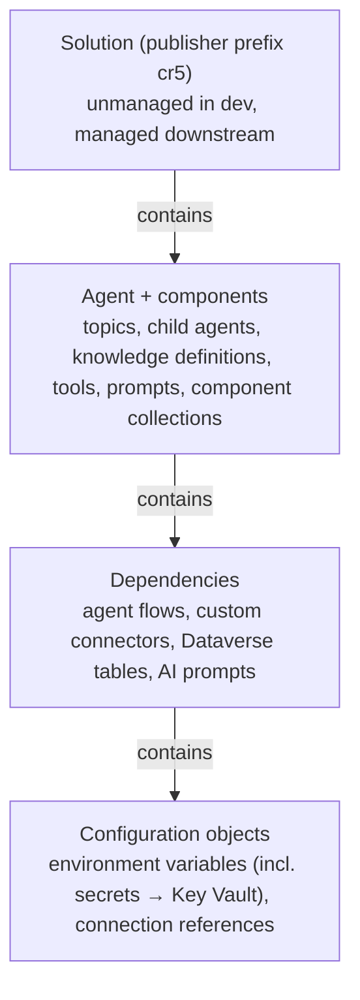
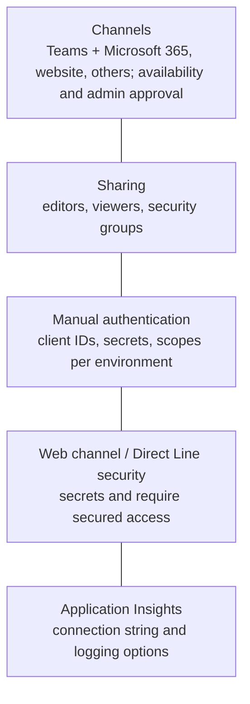

# Solutions, existing agents and environment variables

> AB-620 · D3 Test and manage agents · about 80 min · Study Hub module `e02` ([open the hub](https://claude.ai/artifact/DfeAjDjaTCgtf36RSKeSSS))

## Why it matters
ALM questions are common and often **build lists**: put the steps in order. This module covers the solution half: publishers, preferred solutions, adding existing agents with their required objects, environment variables and connection references, and what doesn't travel.

## Pre-question (answer before reading)
**Q:** You export a solution containing your agent and import it into test. The agent runs, but it isn't in Teams and the Application Insights logging is gone. Bug?

<details><summary>Answer</summary>

No. **Channels**, **sharing**, **manual authentication settings**, **Application Insights** and web channel security aren't solution-aware. Reconfigure them in each environment after import.

</details>

## Mental model & story
Asha's agent works in her developer environment. Now it must move to **test** and **production** without anyone rebuilding it by hand. The vehicle is a **solution**.

She created one on day one: a **publisher** called *Contoso* with prefix `cr5`, and a solution *Customer Support Assistant*, set as the **preferred solution** so every new component landed in it. But two flows were built before that, outside the solution. In the solution she uses **Add existing > Agent**, then on the agent's menu **Advanced > Add required objects**, which pulls in the topics, flows, connection references, environment variables and tables the agent depends on.

Environment-specific values move out of the agent. The carrier API base URL becomes an **environment variable** (`cr5_CarrierBaseUrl`, text), and the API key a **secret** environment variable that points to **Azure Key Vault**. Topics read them as `Env.cr5_CarrierBaseUrl`. In Copilot Studio they're read-only, and changing a value means **republishing** the agent, except secrets, which are fetched at run time.

Each connector in each flow uses a **connection reference**, so test can bind a test mailbox and production the real one. Asha exports the solution as **managed** for test and production (and keeps it **unmanaged** in dev, where she edits).

After the first import she writes a *post-deployment checklist*: add the Teams channel and availability, share the agent with the right security group, set manual authentication values for the production app registration, reconnect Application Insights, and configure web channel security. None of these travel in the solution.

**Where the analogy breaks:** Solutions move *definitions*, not *data* or *everything around the agent*. Dataverse rows (sample returns), connections themselves (credentials), channel registrations and environment-level settings stay behind, and some knowledge sources point at environment-specific locations that need checking.

## Diagrams
**What a Copilot Studio solution can carry**



**Not solution-aware: redo after import**



## Key points
- **Publisher** sets the customisation **prefix** (e.g., `cr5_`). Create your own instead of using the default publisher.
- **Preferred solution**: new components created in Copilot Studio land in it automatically.
- Add an existing agent: solution > **Add existing > Agent**; then agent ⋮ > **Advanced > Add required objects** to include dependencies (flows, connection references, environment variables, tables).
- **Unmanaged** in development (editable); **managed** in test/production (locked, clean uninstall, layering).
- **Environment variables**: types Text, Decimal number, Yes/No, JSON, Data source, **Secret** (Azure Key Vault). Default value vs current value; set current values per environment at import or in the pipeline.
- In Copilot Studio, environment variables are **read-only** (`Env.` prefix). After changing a value, **republish** the agent; **secrets** are read at run time.
- Secret environment variables reference **Key Vault** secrets: the Key Vault must allow the Dataverse/Power Platform service to read it.
- **Connection references** decouple flows and tools from specific connections; each environment binds its own connection.
- Not solution-aware: **channels**, **sharing**, **manual authentication**, **web/Direct Line security**, **Application Insights** settings → post-deployment steps.
- **Component collections** (shared topics, knowledge, tools, entities) also move through solutions.
- **Model choice** is an agent property that travels with the solution: change the model in dev and re-promote, rather than editing production.

## Comparisons
**Managed vs unmanaged solutions**

|  | Unmanaged | Managed |
|---|---|---|
| Where | Development | Test and production |
| Editable | Yes | No (locked, except allowed layers) |
| Uninstall | Removes the container, leaves components | Removes components cleanly |
| Source control | Exported and unpacked for Git | Built artifact deployed |

## Code to recognise
**Deployment settings file: environment variables and connection references per target**

```json
{
  "EnvironmentVariables": [
    { "SchemaName": "cr5_CarrierBaseUrl", "Value": "https://api.carrier.example/v2" },
    { "SchemaName": "cr5_CarrierApiKey",
      "Value": "/subscriptions/<sub>/resourceGroups/rg-prod/providers/Microsoft.KeyVault/vaults/kv-contoso/secrets/carrier-key" }
  ],
  "ConnectionReferences": [
    { "LogicalName": "cr5_sharedoffice365_returns", "ConnectionId": "<prod connection id>",
      "ConnectorId": "/providers/Microsoft.PowerApps/apis/shared_office365" }
  ]
}
```

- Line 1: Generated with `pac solution create-settings`; used by pipelines and CI/CD to set values per environment.
- Line 3: A text environment variable: the value differs per environment.
- Line 5: A **secret** variable stores a Key Vault secret reference, not the secret itself.
- Line 8: Each connection reference is bound to an existing connection in the target environment.

## Portal steps
**Put an existing agent in a solution with its dependencies** (Copilot Studio > Solutions > (solution) > Add existing > Agent)

1. Select the agent and add it.
2. On the agent's ⋮ menu: **Advanced > Add required objects**.
3. Check the solution now lists topics, flows, connection references, environment variables and tables.
4. Set the solution as **preferred** for future work.

**Create an environment variable (new UI)** (Solution objects > + New > More > Environment variable)

1. Display name, schema name (prefix added), data type (Text, Secret...).
2. Default and/or current value; for Secret, point to the Key Vault secret.
3. Use it in topics as `Env.<schema name>`.
4. After changing a non-secret value, **republish** the agent.

## Worked example
**Scenario:** Your agent calls a pricing API whose URL and key differ between test and production. Make it portable.

- URL differs → text environment variable.
- Key is a secret → secret environment variable in Azure Key Vault.
- Topics/HTTP nodes read `Env.` values; deployment sets values per environment.

**Answer:** Create `cr5_PricingBaseUrl` (Text) and `cr5_PricingApiKey` (**Secret**, Key Vault reference) in the solution; use `Env.cr5_PricingBaseUrl` in the HTTP URL and the secret in the header; set values per environment at import or through the pipeline; republish after changing non-secret values.

## Your turn (faded example)
**Scenario:** After importing to test, a tool fails with a connection error.

- Connections aren't moved; references are.
- **What must exist in test?** <details><summary>answer</summary>A **connection** for that connector, bound to the solution's **connection reference** (set during import or in the pipeline's deployment settings).</details>
- **And if the tool uses end-user credentials?** <details><summary>answer</summary>Users create their own connections at runtime; the reference still needs to resolve, and the connector must be allowed by test's DLP policy.</details>

## Exam traps & misconceptions
- ✗ Expecting channels and Teams availability to come with the import. → ✓ Not solution-aware; reconfigure after import.
- ✗ Editing environment variable values in production and expecting the agent to pick them up instantly. → ✓ Republish (secrets are the exception).
- ✗ Putting a real API key in a text environment variable. → ✓ Use a **secret** environment variable backed by Azure Key Vault.
- ✗ Adding only the agent to the solution. → ✓ Use **Add required objects** so flows, references and variables come too.
- ✗ Importing unmanaged solutions into production. → ✓ Use managed downstream; unmanaged is for development.

## Discussion prompts
- **Why bother with a custom publisher?** The prefix identifies your components, avoids collisions with other teams and ISVs, and keeps ownership clear across environments.
- **What belongs on a post-deployment checklist for Copilot Studio?** Channels and availability (Teams admin approval), sharing with security groups, manual auth values (client IDs/secrets), web channel security, App Insights, connection bindings, DLP compatibility, a smoke test and publish.

## Interview angle / teach-back
**Prompt:** Explain how you'd package an agent for ALM: solution, required objects, environment variables, connection references and post-deployment steps.

**Rubric:** Custom publisher + preferred solution · Add existing > Agent + Add required objects · Env vars (secret via Key Vault), read-only, republish · Connection references per environment · Managed downstream · Post-deploy: channels, sharing, manual auth, App Insights, web security

**Model answer:** I create a publisher and solution, set it as preferred, and if the agent already exists I add it with Add existing and then Add required objects so flows, connection references, variables and tables come along. Environment-specific values become environment variables, with secrets in Key Vault; they're read-only in Copilot Studio and need a republish after changes, except secrets. Connection references let each environment bind its own connections. I deploy managed solutions to test and production, then redo channels, sharing, manual auth, web security and Application Insights, which don't travel.

## Quick Q&A
- **Pull in an agent's dependencies?** Agent ⋮ > Advanced > **Add required objects**.
- **Environment variable prefix in topics?** `Env.`
- **Change a non-secret env var value — then?** **Republish** the agent.
- **Where do secret env vars live?** **Azure Key Vault**.
- **Five things not in solutions?** Channels, sharing, manual auth, web/Direct Line security, App Insights.
- **Managed or unmanaged in production?** **Managed**.

## Sources (accessed 2026-10-02)
- [Export and import agents using solutions](https://learn.microsoft.com/en-us/microsoft-copilot-studio/authoring-solutions-import-export)
- [Variables overview: environment variables (Copilot Studio)](https://learn.microsoft.com/en-us/microsoft-copilot-studio/authoring-variables-about#environment-variables)
- [Environment variables overview (Power Apps)](https://learn.microsoft.com/en-us/power-apps/maker/data-platform/environmentvariables)
- [AB-620T00 lab 5.4: ALM and model candidates](https://github.com/MicrosoftLearning/AB-620T00_build_integrated_ai_agents_in_copilot_studio/blob/main/Instructions/Labs/lab-5-evaluate-publish-and-manage/exercise-4-alm-and-model-candidates.md)

## SRS cards created
- ab-620-e02-01, ab-620-e02-02, ab-620-e02-03, ab-620-e02-04
