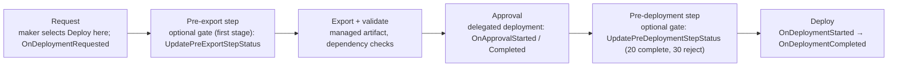
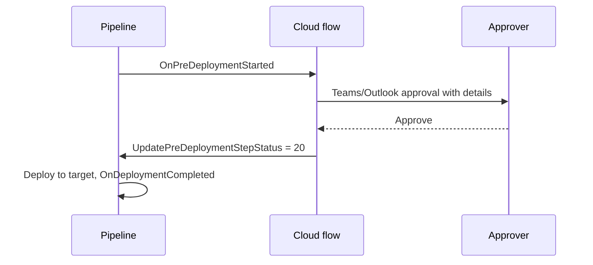

# Power Platform pipelines (implement and extend)

> AB-620 · D3 Test and manage agents · about 75 min · Study Hub module `e03` ([open the hub](https://claude.ai/artifact/DfeAjDjaTCgtf36RSKeSSS))

## Why it matters
*Implement and extend Microsoft Power Platform Pipelines* is the last D3 skill, and the one that most rewards precise facts: managed environment targets, stages, delegated deployments, gated extensions with their trigger and action names, and what pipelines can't do.

## Pre-question (answer before reading)
**Q:** Makers should deploy to production without having any permissions in production, and the release manager must approve first. Which pipeline feature?

<details><summary>Answer</summary>

**Delegated deployment** (*Is Delegated Deployment* on the stage): the deployment runs as a **service principal** or the **pipeline stage owner**, and needs approval from an authorised identity.

</details>

## Mental model & story
Contoso used to move solutions by exporting zip files and emailing them. After one wrong file reached production, IT set up **Power Platform pipelines**.

For her own project Asha could have used a **personal pipeline** from the Pipelines page (the **platform host**): one development environment and up to two targets. Contoso instead runs a **custom host** environment with the **Deployment Pipeline Configuration** app, where admins define pipelines, link environments and assign the **Deployment Pipeline Administrator** and **Deployment Pipeline User** roles.

The *Customer Support Assistant* pipeline has stages **Test** then **Production**. Every environment has **Dataverse**, and every **target** is a **Managed Environment**. Stages run in order: you can't skip Test. The pipeline exports a **managed** artifact once and reuses the same artifact for each stage, with **pre-deployment validation** catching missing dependencies early.

At **Deploy here**, Asha supplies the stage's **environment variable** values and picks **connection references** for the target, which the lab warns is the most common friction point. Production uses **delegated deployment**: a service principal deploys, so makers need no production rights, and the release manager approves.

IT also **extends** the pipeline. The Production stage has **Pre-deployment Step Required** ticked: a Power Automate flow triggered by **OnPreDeploymentStarted** runs checks, posts an approval to Teams, and then calls the **UpdatePreDeploymentStepStatus** action with **20** (complete) or **30** (reject). Another flow on **OnDeploymentCompleted** posts release notes. For deeper needs (Git, complex branching), teams go to **Azure DevOps** or **GitHub Actions** with the Power Platform build tools.

**Where the analogy breaks:** Pipelines deploy solutions; they don't fix what solutions can't carry. Post-deployment steps (channels, sharing, manual auth, App Insights) still need a checklist or automation, and pipelines don't roll back by themselves: you redeploy a previous version.

## Diagrams
**A pipeline run**



**Gated pre-deployment step with Power Automate**



## Key points
- **Platform host**: available to everyone from the Pipelines page; **personal pipelines** with one dev environment and up to **two targets**. **Custom host**: a dedicated host environment with the **Deployment Pipeline Configuration** app for centrally managed pipelines.
- Requirements: all pipeline environments have **Dataverse**; **target environments must be Managed Environments**; default and Teams environments can't be targets for personal pipelines.
- Stages run **in order** (dev → test → prod); one managed artifact is exported once and reused across stages; **pre-deployment validation** checks dependencies.
- At deployment: set **environment variable** values and **connection references** for the target (most common friction point).
- Roles: **Deployment Pipeline Administrator** (configure), **Deployment Pipeline User** (run pipelines they're granted).
- Gated extensions on a stage: **Pre-export Step Required** (first stage only; `UpdatePreExportStepStatus`), **Is Delegated Deployment** (service principal or stage owner; approval required), **Pre-deployment Step Required** (`UpdatePreDeploymentStepStatus`).
- Gate status values: **10** pending (system), **20** complete, **30** reject (deployment fails).
- Power Automate triggers: **OnDeploymentRequested** (fires for all deployments), OnApprovalStarted, OnApprovalCompleted, OnPreDeploymentStarted, OnPreDeploymentCompleted, OnDeploymentStarted, OnDeploymentCompleted.
- Comments: ApprovalComments / pre-deployment comments are visible to makers in run history; PreExportProperties / ApprovalProperties are admin-only.
- Limits/notes: one solution per deployment run; no automatic rollback (redeploy a previous version); for Git-based CI/CD use **Azure DevOps** or **GitHub Actions** with Power Platform build tools / `pac` CLI (`pac pipeline` commands exist).

## Comparisons
**Platform host vs custom host**

|  | Platform host | Custom host |
|---|---|---|
| Setup | None: open Pipelines and create | Admin creates host environment + configuration app |
| Scope | Personal pipelines (dev + 2 targets) | Any number of pipelines and stages |
| Governance | Tenant admin manages | Deployment Pipeline Administrator role; central control |
| Extensions | Limited | Gated extensions, delegated deployments, flows on triggers |
| Best for | Small teams, quick start | Enterprise ALM |

## Code to recognise
**Approving a gated pre-deployment step from a cloud flow (action inputs)**

```json
{
  "trigger": "OnPreDeploymentStarted",
  "action": "Perform an unbound action (Dataverse)",
  "inputs": {
    "Action Name": "UpdatePreDeploymentStepStatus",
    "PreDeploymentStepStatus": 20,
    "StageRunId": "<StageRunId from the trigger's outputs>",
    "PreDeploymentComments": "Approved by release manager after smoke-test sign-off."
  }
}
```

- Line 2: The flow starts when the stage's pre-deployment gate begins.
- Line 5: Gates are completed by calling a Dataverse **unbound action** in the pipelines host.
- Line 6: **20** completes the step; **30** rejects (deployment fails); **10** is the system's pending status.
- Line 8: Comments are shown to the maker in run history (shape simplified).

## Portal steps
**Deploy with a pipeline (maker)** (Copilot Studio / Power Apps > Solutions > (solution) > Pipelines)

1. Choose the pipeline and select **Deploy here** for the next stage.
2. Review pre-deployment validation results.
3. Provide **environment variable** values and map **connection references**.
4. Add deployment notes; deploy (or wait for approval if delegated).
5. After success: run post-deployment steps (channels, sharing, auth, App Insights) and smoke-test.

**Configure a custom-host pipeline (admin)** (Host environment > Deployment Pipeline Configuration app)

1. Register development and target environments (targets must be Managed Environments).
2. Create the pipeline and its stages in order (Test, then Production).
3. Set gated options per stage: pre-export, delegated deployment, pre-deployment step.
4. Grant Deployment Pipeline User to makers; build flows on the pipeline triggers.

## Worked example
**Scenario:** A regulated company needs: makers can't touch production; every production deployment is approved by a release manager in Teams; a ServiceNow change record must be created automatically.

- No maker rights in prod + approval → delegated deployment.
- Extra Teams approval and checks after approval → pre-deployment step with a flow.
- Change record → a flow on the deployment triggers.

**Answer:** Custom-host pipeline; Production stage with **Is Delegated Deployment** (service principal) and **Pre-deployment Step Required**; a flow on **OnPreDeploymentStarted** sends the Teams approval and calls **UpdatePreDeploymentStepStatus** (20/30); a flow on **OnDeploymentRequested** (or OnDeploymentStarted) creates the ServiceNow change record; makers hold only Deployment Pipeline User.

## Your turn (faded example)
**Scenario:** A pipeline can't add the new production environment as a target.

- Targets have prerequisites.
- **What do you check first?** <details><summary>answer</summary>That the environment has **Dataverse** and is a **Managed Environment**.</details>
- **And for personal pipelines on the platform host?** <details><summary>answer</summary>Default and Teams environments can't be targets, and there's a limit of one dev plus two targets.</details>

## Exam traps & misconceptions
- ✗ Using a non-managed environment as a pipeline target. → ✓ Targets must be Managed Environments (with Dataverse).
- ✗ Expecting to skip the Test stage for a hotfix. → ✓ Stages run in order.
- ✗ Setting Pre-export Step Required on the production stage. → ✓ It's meant for the **first** stage; production uses pre-deployment steps.
- ✗ Using status 30 to mark a gate complete. → ✓ **20** completes; **30** rejects.
- ✗ Assuming pipelines roll back automatically. → ✓ Redeploy a previous version; plan rollback.

## Discussion prompts
- **When would you choose Azure DevOps or GitHub Actions over pipelines?** When you need source control as the system of record, branching strategies, automated tests in CI, multi-solution orchestration, or integration with an existing enterprise release process. Pipelines are simpler and built in; many teams combine them (pipelines + Git export extensions).
- **How would you automate post-deployment steps that solutions can't carry?** Use a flow on OnDeploymentCompleted or a CI/CD stage with `pac`/APIs where available, plus a checklist for steps that still need a person (Teams admin approval, app registrations).

## Interview angle / teach-back
**Prompt:** Explain how Power Platform pipelines work and how you'd extend them for approvals and automation.

**Rubric:** Platform vs custom host · Targets: Dataverse + Managed Environments; ordered stages; managed artifact · Env var values and connection references at deploy · Delegated deployment (service principal/stage owner) · Gated pre-export/pre-deployment steps with UpdatePre...StepStatus 20/30 · Triggers: OnDeploymentRequested etc.

**Model answer:** Pipelines deploy a managed artifact through ordered stages to targets that must have Dataverse and be Managed Environments. The platform host gives personal pipelines; a custom host gives central control. At deployment I set environment variable values and connection references. To extend, delegated deployments run as a service principal or stage owner with approval, and gated pre-export or pre-deployment steps pause the run until a flow calls UpdatePreExportStepStatus or UpdatePreDeploymentStepStatus with 20 to complete or 30 to reject. Flows can also react to triggers like OnDeploymentRequested and OnDeploymentCompleted.

## Quick Q&A
- **Target environment requirement?** **Managed Environment** with Dataverse.
- **Personal pipeline size?** One dev + **two** targets.
- **Deploy without maker rights in prod?** **Delegated deployment**.
- **Gate status to complete / reject?** **20** / **30**.
- **Action for pre-deployment gate?** `UpdatePreDeploymentStepStatus`.
- **Trigger that fires for all deployments?** **OnDeploymentRequested**.
- **Can stages be skipped?** **No**; they run in order.

## Sources (accessed 2026-10-02)
- [Create pipelines using the platform host](https://learn.microsoft.com/en-us/power-platform/alm/platform-host-pipelines)
- [Configure pipelines using a custom host](https://learn.microsoft.com/en-us/power-platform/alm/custom-host-pipelines)
- [Extend pipelines (gated extensions, triggers)](https://learn.microsoft.com/en-us/power-platform/alm/extend-pipelines)

## SRS cards created
- ab-620-e03-01, ab-620-e03-02, ab-620-e03-03, ab-620-e03-04
