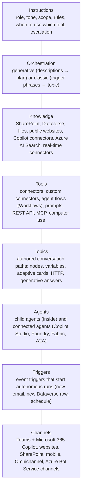
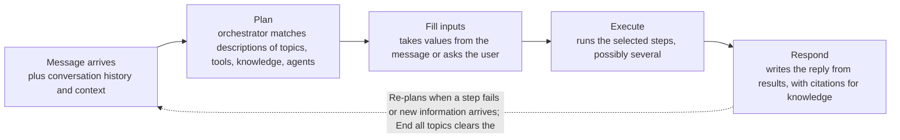
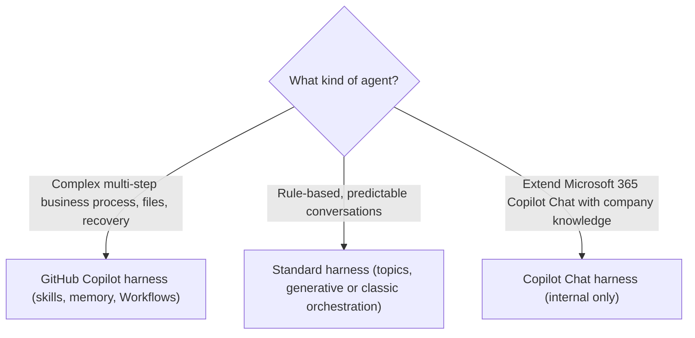

# Copilot Studio essentials (exam UI and new UI)

> AB-620 · D1 Plan and configure agent solutions · about 80 min · Study Hub module `f01` ([open the hub](https://claude.ai/artifact/DfeAjDjaTCgtf36RSKeSSS))

## Why it matters
Every AB-620 question assumes you know where things live in Copilot Studio: instructions, knowledge, tools, topics, agents, settings, channels. The interface also changed during 2026, so this module maps the **exam's names** to the **newest screens** before you build anything.

## Pre-question (answer before reading)
**Q:** An agent has a topic called *Check order status* and also a connector tool called *Get order*. A user types *where's my parcel?*. With generative orchestration on, how does the agent decide what to run?

<details><summary>Answer</summary>

The orchestrator reads the **descriptions** (and names) of topics, tools, knowledge and agents, builds a plan, and picks what fits, possibly both. With classic orchestration, only **trigger phrases** on topics would match, and tools run only when a topic calls them.

</details>

## Mental model & story
Meet **Asha**, an IT developer at Contoso Retail. Her manager wants a *Customer Support Rep Assistant* that answers policy questions, looks up orders in Dataverse, files returns, and asks a supervisor before any refund over $100. Asha has Power Apps experience but has never built an agent.

She opens Copilot Studio and finds that every agent lives in a **Power Platform environment** (with a Dataverse database), just like her apps. Before creating the agent she sets up a **solution** with her own publisher and marks it as the **preferred solution**, so everything she builds lands in a package she can move to test and production later.

The agent's *brain* is the **orchestrator**. With **generative orchestration**, it reads the descriptions of everything Asha adds (knowledge sources, tools, topics, other agents) and decides at run time what to call, in what order, and what to ask the user when an input is missing. **Instructions** tell it who it is, what it may do, and when to escalate.

Asha adds **knowledge** (the returns-policy PDF and the SharePoint site), **tools** (a Dataverse connector action and two agent flows), and a few **topics** for the conversations that must happen exactly the same way every time, such as the refund disclaimer. She tests in the test pane (*Preview* in the newest UI), watches the **activity map** to see which tool ran, and publishes to **Teams and Microsoft 365 Copilot**.

A month later Microsoft's labs show her a new screen: the agent sits on a **GitHub Copilot harness**, flows are called **Workflows**, reusable behaviours are **Skills**, and there's a **Memory** toggle. The building blocks are the same; the names and defaults moved. Knowing both sets of names is how she reads any exam question calmly.

**Where the analogy breaks:** The story makes the orchestrator sound like magic. It isn't: it chooses from **what you describe**. Vague or overlapping descriptions cause wrong picks, and topics, agent flows and connectors still decide exactly what happens once they're called.

## Diagrams
**Anatomy of a Copilot Studio agent**



**One user message under generative orchestration**



**Which harness? (2026 Copilot Studio)**



## Key points
- Agents live in a **Power Platform environment** with **Dataverse**. Use a developer or sandbox environment for building, and a **solution** (custom publisher + prefix) set as the **preferred solution** so new components land in it.
- **Generative orchestration** (Settings > Generative AI): the orchestrator selects topics, tools, knowledge and agents by their **descriptions**, handles several intents in one message, asks for missing inputs and writes the answer. **Classic**: topics fire on trigger phrases and tools only run when a topic calls them.
- Under generative orchestration a topic's trigger reads *The agent chooses* and you write a **description**. Names and parameter descriptions matter too, but the description is the main routing signal.
- **Instructions** guide the orchestrator: role, tone, scope, which tool for which job, what never to do, when to escalate. Keep them specific and test them.
- **System topics** exist in every agent: Conversation Start, Greeting, Fallback, On Error, Escalate, End of Conversation, Multiple Topics Matched, Reset Conversation, Sign in, Start Over, Thank you, Goodbye, Conversational boosting (classic fallback to generative answers).
- Test in the **test pane** (*Preview* tab in the newest UI). The **activity map** shows which topic, tool, knowledge source or agent ran and with which inputs.
- **Event triggers** make an agent autonomous: a new email, a new Dataverse row, a recurrence. They need generative orchestration and run with the **maker's** connection, so scope permissions carefully.
- **Harnesses** (2026): GitHub Copilot harness (reasoning, Skills, Memory, file creation, automatic recovery), Standard harness (topics and defined paths), Copilot Chat harness (extend Microsoft 365 Copilot Chat; internal only). The GitHub Copilot harness is a Copilot Studio runtime, not the GitHub Copilot service.
- New-UI names: **Workflows** = agent flows, **Preview** = test pane, **Evaluate** and **Monitor** tabs, **Settings > Safety & access** for authentication, **Skills** = reusable SKILL.md behaviours, **Memory** = per-user memory across sessions.
- Usage is billed in **Copilot Credits** (generative answers, tool and flow runs, evaluations, computer use, and Preview turns in the official labs). Watch estimated credits on the agent's monitoring page.

## Comparisons
**Exam names vs newest Copilot Studio screens**

| Exam / Learn term | Newest UI (AB-620T00 v2 labs) | Same thing? |
|---|---|---|
| Agent flow | Workflow (left nav Workflows; Flows in some regions) | Yes: trigger When an agent calls the flow/workflow, action Respond to the agent |
| Test pane, Test your agent | Preview tab (End user preview toggle) | Yes |
| Analytics | Monitor tab (sessions, success rate, credits, transcripts) | Yes, regrouped |
| Agent evaluation | Evaluate tab (test sets, General quality, user profile) | Yes |
| Settings > Security > Authentication | Settings > Safety & access | Yes |
| Topics | Topics (standard harness); Skills on the GitHub Copilot harness | Different tools for reuse: topics are scripted, skills are guidance |
| Channels > Teams and Microsoft 365 Copilot | Channels > Teams + Microsoft 365 | Yes, one combined channel |

**Generative vs classic orchestration**

|  | Generative | Classic |
|---|---|---|
| Topic selection | Descriptions; several per message | Trigger phrases; one topic |
| Tools | Called directly by the orchestrator | Only from topics |
| Missing inputs | Asks automatically | You author Question nodes |
| Knowledge | Searched when relevant, with citations | Conversational boosting fallback topic |
| Needed for | MCP tools, computer use, Fabric data agents, autonomous triggers | Fully scripted bots |

## Code to recognise
**A topic in the code editor (YAML view)**

```yaml
kind: AdaptiveDialog
modelDescription: Checks the delivery status of an existing order when the user gives or asks about an order number.
beginDialog:
  kind: OnRecognizedIntent
  id: main
  intent:
    displayName: Check order status
    triggerQueries:
      - Where is my order
      - Track my parcel
  actions:
    - kind: Question
      id: question_order
      variable: init:Topic.OrderNumber
      prompt: What's your order number?
      entity: StringPrebuiltEntity

    - kind: SendActivity
      id: send_status
      activity: Thanks {System.User.DisplayName}, checking order {Topic.OrderNumber} now.
```

- Line 2: With generative orchestration the **description** is what the orchestrator reads to decide when to run this topic.
- Line 4: `OnRecognizedIntent` = the topic's trigger. Trigger phrases (line 8) matter under classic orchestration.
- Line 14: A Question node stores the answer in a topic variable. `init:` marks the first assignment.
- Line 16: The entity decides what counts as a valid answer (here any text).
- Line 20: Curly braces insert variables into a message: system and topic variables.

## Portal steps
**Create an agent (standard harness, exam UI)** (Copilot Studio > Agents > + Create > New agent)

1. Pick the right **environment** (top right) and confirm your preferred solution is set.
2. Describe the agent or switch to **Configure**: name, description, instructions, icon.
3. Create, then add **Knowledge**, **Tools**, **Topics** and **Agents** from the Overview page.
4. Settings > Generative AI: confirm **Orchestration** is on (generative).
5. Test in the test pane; open the **activity map** to see each step.

**Create an agent (new UI, GitHub Copilot harness)** (Copilot Studio > Create > Agent (GitHub Copilot))

1. If asked to *Describe your agent*, choose **Skip to configure** for predictable setup.
2. Name (42 characters max), then **Instructions** (role, tone, scope, escalation, security) and Save.
3. Turn on **Memory** if per-user recall across sessions is wanted.
4. Settings > **Safety & access**: *Authenticate with Microsoft* is the default.
5. Test in **Preview**; turn the *End user preview* toggle off to see maker details such as tool calls.

## Worked example
**Scenario:** Asha's agent has a topic *Refund policy* (description: "Explains the refund policy") and the returns-policy PDF as knowledge. Users asking "can I get my money back for a broken kettle?" get a generic answer from the PDF instead of the topic's mandatory legal disclaimer. Why, and what's the fix?

- Generative orchestration picks by description, so it compares the question with each description.
- "Explains the refund policy" is vague and overlaps with the PDF's content.
- The topic must win whenever money back, refunds or returns for damaged goods are discussed.

**Answer:** Rewrite the topic **description** to say exactly when to use it (refund, money back, damaged or faulty items) and that it must be used before quoting policy. Add a line to the **instructions** if needed, then retest and check the **activity map**.

## Your turn (faded example)
**Scenario:** You inherit an agent with 40 topics built on trigger phrases. The business wants it to call a new connector tool directly and answer multi-part questions.

- Multi-intent handling and direct tool calls are generative orchestration features.
- **Which setting changes, and where?** <details><summary>answer</summary>Settings > Generative AI > orchestration: switch to **generative**.</details>
- **What must you then fix in the 40 topics?** <details><summary>answer</summary>Write clear **descriptions** for each topic (the orchestrator routes by them), remove overlaps, and retest. Trigger phrases stop being the main routing signal.</details>

## Exam traps & misconceptions
- ✗ Writing great trigger phrases and expecting them to drive routing under generative orchestration. → ✓ Descriptions drive routing under generative orchestration; trigger phrases matter under classic.
- ✗ Building in the default environment with no solution, then trying to move the agent later. → ✓ Create a solution and set it as preferred **before** building, so every component is packaged for ALM.
- ✗ Assuming an autonomous (event-triggered) agent runs as the end user. → ✓ Event triggers use the maker's connection. Limit what that connection can reach.
- ✗ Treating *Workflows* and *agent flows* as different features. → ✓ Same feature, new name in the left navigation. Same trigger and *Respond to the agent* action.
- ✗ Thinking the GitHub Copilot harness sends data to the GitHub Copilot service. → ✓ It's a Copilot Studio runtime that shares technology with GitHub Copilot; customer data isn't processed by the GitHub Copilot service.

## Discussion prompts
- **When would you keep classic orchestration?** Rarely: fully scripted, regulated conversations where every path must be predictable and you don't need tools called directly. Even then, generative orchestration plus topics for the fixed parts usually works better. Remember MCP, computer use, Fabric data agents and event triggers need generative orchestration.
- **Topics or skills for reusable behaviour?** Topics are deterministic scripts: exact questions, branches, cards and calls. Skills (GitHub Copilot harness) are reusable *guidance* the orchestrator applies when a situation matches. Use topics where wording or order is mandated; skills where judgment is fine.

## Interview angle / teach-back
**Prompt:** Explain to a new maker how a Copilot Studio agent decides what to do with a user's message, and what they control.

**Rubric:** Generative orchestration plans using descriptions of topics, tools, knowledge, agents · Instructions shape choices, tone and limits · Missing inputs are asked for automatically · Topics give deterministic paths when needed · Test with the activity map and fix descriptions

**Model answer:** With generative orchestration the agent reads the descriptions of everything you've added (topics, tools, knowledge sources, other agents) and builds a plan for each message. It fills inputs from the message or asks the user, runs the steps, and writes the reply. You control it through clear descriptions, the agent's instructions, and topics where a conversation must run exactly the same way. The activity map in the test pane shows what it chose, so you fix routing problems by improving descriptions.

## Quick Q&A
- **Where do Copilot Studio agents live?** In a Power Platform environment with Dataverse (ideally inside a solution).
- **Main routing signal under generative orchestration?** Component **descriptions**.
- **New-UI name for agent flows?** **Workflows**.
- **Which harness supports Skills and Memory?** The **GitHub Copilot harness**.
- **Where do you see which tool ran in a test?** The **activity map** in the test pane / Preview.
- **Whose credentials do event triggers use?** The **maker's** connection.
- **What does the Copilot Chat harness do?** Extends Microsoft 365 Copilot Chat with company knowledge; internal audiences only.

## Sources (accessed 2026-10-02)
- [What is Microsoft Copilot Studio?](https://learn.microsoft.com/en-us/microsoft-copilot-studio/fundamentals-what-is-copilot-studio)
- [Harnesses in Copilot Studio](https://learn.microsoft.com/en-us/microsoft-copilot-studio/harnesses-overview)
- [Orchestrate agent behaviour with generative AI](https://learn.microsoft.com/en-us/microsoft-copilot-studio/advanced-generative-actions)
- [AB-620T00 official labs (v2)](https://github.com/MicrosoftLearning/AB-620T00_build_integrated_ai_agents_in_copilot_studio)

## SRS cards created
- ab-620-f01-01, ab-620-f01-02, ab-620-f01-03, ab-620-f01-04
