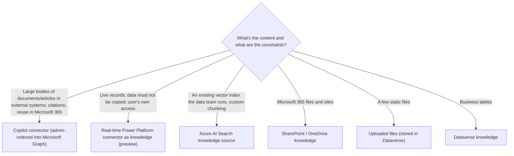
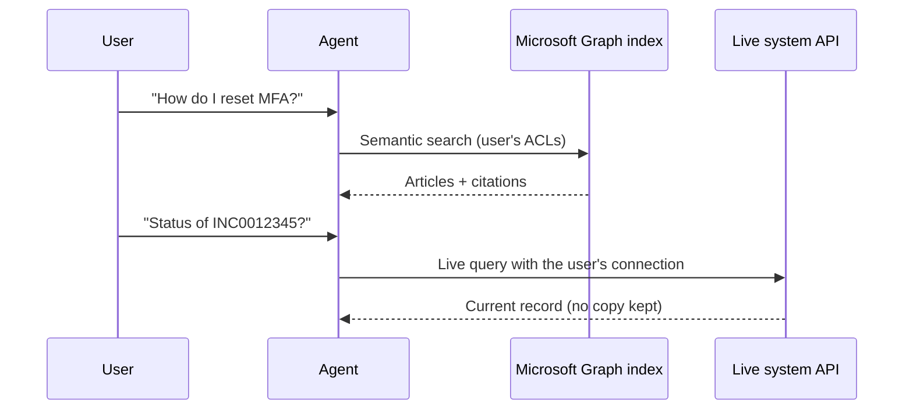

# Enterprise knowledge: Copilot connectors, real-time connectors, Azure AI Search

> AB-620 · D2 Integrate and extend agents in Copilot Studio · about 85 min · Study Hub module `k01` ([open the hub](https://claude.ai/artifact/DfeAjDjaTCgtf36RSKeSSS))

## Why it matters
D2 is the largest domain, and it opens with knowledge. The exam wants you to pick between **indexed** knowledge (Copilot connectors), **live** knowledge (real-time Power Platform connectors) and **your own index** (Azure AI Search), and to know the setup gotchas of each.

## Pre-question (answer before reading)
**Q:** ServiceNow holds 40,000 knowledge articles and also live incident tickets. Users ask both "how do I reset MFA?" and "what's the status of INC0012345?". Same knowledge option for both?

<details><summary>Answer</summary>

No. Articles suit a **Copilot connector** (indexed into Microsoft Graph, semantic search, citations). Live ticket status suits a **real-time Power Platform connector** (knowledge, preview) or a connector **tool**: queried at question time under the user's identity, no copy of the data.

</details>

## Mental model & story
Contoso's IT service desk wants an agent that knows everything in ServiceNow, Confluence and the HR SharePoint, plus live order data. Daniel sketches three kinds of shelf.

The first shelf is a **library index**. A Microsoft 365 admin sets up **Copilot connectors** (formerly Graph connectors) in the Microsoft 365 admin center for ServiceNow's knowledge base and Confluence. Content is copied into **Microsoft Graph**, semantically indexed, labelled, and kept with each item's permissions. In Copilot Studio, Asha simply adds the connection as knowledge, and answers come back with **citations**. The same index also serves Microsoft 365 Copilot and Microsoft Search.

The second shelf is a **telephone**. For order status and live tickets, copying data isn't allowed or makes no sense, so she adds a **real-time Power Platform connector** as knowledge (preview): at question time the agent calls Salesforce, ServiceNow or Azure SQL with the **user's connection**, under DLP rules. Nothing is replicated; latency depends on the API; citations aren't built in.

The third shelf is the data team's **own search engine**. They already run **Azure AI Search** with a vectorised index of 2 million product documents. Asha adds it as knowledge with *Create new connection* (Microsoft Entra ID auth recommended), confirms the index uses **integrated vectorization** and has the **semantic ranker** enabled, and maps a URL field for citations.

Everything else is familiar: the SharePoint site (searched with the user's permissions), a few uploaded PDFs, the public returns page, and a couple of Dataverse tables. The agent's job is to search the right shelf and say where the answer came from.

**Where the analogy breaks:** The shelves blur in practice: real-time connectors are also tools, Copilot connectors can be custom-built against the Graph API, and Azure AI Search can index the same SharePoint content. The exam's deciding words are usually *copy/index vs no data movement*, *who configures it*, and *citations*.

## Diagrams
**Which enterprise knowledge option?**



**Copilot connector vs real-time connector at question time**



## Key points
- **Copilot connectors** (formerly Microsoft Graph connectors): set up by an admin in the **Microsoft 365 admin center**; content **indexed into Microsoft Graph** with source ACLs and semantic labels; low-latency retrieval; **citations**; indexing quota and Microsoft 365/Copilot licensing apply; examples: ServiceNow KB, Confluence, Jira, GitHub, Azure DevOps, enterprise websites, file shares.
- In Copilot Studio, add a Copilot connector via **Add knowledge** and pick the connection. Users must be signed in; with manual authentication add the Graph scope **`ExternalItem.Read.All`** before publishing, or answers return nothing.
- **Real-time Power Platform connectors** as knowledge (preview): **Add knowledge > Advanced >** e.g. Salesforce, ServiceNow, Azure SQL; select tables/entities; **no data movement**; runs **under the user's connection and identity**; governed by DLP; standard vs premium; citations not inherent.
- Rule of thumb (Microsoft): *knowledge discovery and grounded Q&A at scale → Copilot connectors; real-time grounding without copying, or transactions → Power Platform connectors.*
- **Azure AI Search** knowledge: add with **Create new connection** (don't hand-type endpoint/key into the wrong place); auth options access key, client certificate, service principal, or **Microsoft Entra ID integrated** (recommended).
- Azure AI Search requirements: the index should be a **vector index built with integrated vectorization**, the **semantic ranker** enabled on the service, and a field with a full URL (e.g., `metadata_storage_path`) for **citations**. One index per knowledge source; add more sources for more indexes.
- Private networking for Azure AI Search: configure VNet support for the Power Platform environment (admin center) before connecting.
- Other knowledge: **SharePoint/OneDrive** (user permissions), **uploaded files** (stored in Dataverse), **public websites** (Bing), **Dataverse** tables (add synonyms and glossary to improve results).
- Knowledge quality depends on **descriptions** too: describe each source so the orchestrator searches the right one.
- Real-time knowledge vs tools: the same connector can be **knowledge** (agent grounds answers on live data) or a **tool** (agent fetches or changes specific records).

## Comparisons
**Copilot connectors vs Power Platform connectors (knowledge)**

| Dimension | Copilot connectors | Power Platform connectors |
|---|---|---|
| Data movement | Yes: indexed into Microsoft Graph | No: live API calls at runtime |
| Set up by | Admin, Microsoft 365 admin center | Makers/admins, Power Platform connections |
| Identity | Source ACLs honoured in the index | User's connection and identity at runtime |
| Freshness / latency | As fresh as the last crawl; fast retrieval | Up to the minute; depends on the API |
| Citations | Yes | Not inherent |
| Governance | Indexing quota; Microsoft 365 licensing | DLP; standard vs premium connectors |
| Best for | Articles, wikis, tickets at scale | Live status, no-replication rules, transactions (as tools) |

## Code to recognise
**Azure AI Search index fields Copilot Studio can use (simplified index definition)**

```json
{
  "name": "products-idx",
  "fields": [
    { "name": "chunk_id", "type": "Edm.String", "key": true },
    { "name": "chunk", "type": "Edm.String", "searchable": true },
    { "name": "title", "type": "Edm.String", "searchable": true },
    { "name": "metadata_storage_path", "type": "Edm.String", "retrievable": true },
    { "name": "text_vector", "type": "Collection(Edm.Single)", "dimensions": 1536,
      "vectorSearchProfile": "vector-profile" }
  ],
  "vectorSearch": { "vectorizers": [ { "name": "aoai-vectorizer", "kind": "azureOpenAI" } ] },
  "semantic": { "configurations": [ { "name": "default" } ] }
}
```

- Line 5: The chunk text the agent reads.
- Line 7: A full URL field such as `metadata_storage_path` becomes the citation link.
- Line 8: Vector field for similarity search.
- Line 11: A **vectorizer** = integrated vectorization, so queries can be vectorised at search time.
- Line 12: Semantic configuration: the semantic ranker must be enabled on the service.

## Portal steps
**Add a Copilot connector as knowledge** (Copilot Studio > (agent) > Knowledge > Add knowledge > Copilot connectors)

1. Admin first creates and indexes the connection in the Microsoft 365 admin center.
2. Select the connection; describe what it contains.
3. Authentication: Microsoft sign-in, or manual auth with the `ExternalItem.Read.All` scope added.
4. Publish and test with users who have and don't have access to items.

**Add Azure AI Search** ((agent) > Knowledge > Add knowledge > Azure AI Search)

1. **Create new connection**: endpoint and authentication (Entra ID integrated recommended).
2. Pick the index (vectorised with integrated vectorization).
3. Confirm semantic ranker is enabled; choose the citation URL field.
4. Write a description of the index for the orchestrator; test with questions that need citations.

## Worked example
**Scenario:** A bank wants its agent to answer from 15,000 Confluence policy pages (citations required, reused by Microsoft 365 Copilot), and to give account managers the live credit limit of a customer from a core-banking system whose data must never be copied.

- Confluence at scale + citations + reuse in Microsoft 365 → indexed knowledge.
- Live data + no copying + user's own access → live query under the user's identity.
- Different shelves for different needs.

**Answer:** A **Copilot connector** for Confluence (admin-configured, indexed into Graph, citations, also available to Microsoft 365 Copilot) and a **real-time Power Platform connector** (as knowledge or as a tool) for the credit limit, running under each account manager's connection and governed by DLP.

## Your turn (faded example)
**Scenario:** An agent's Azure AI Search knowledge returns answers without clickable citations.

- Citations need a URL to link to.
- **What do you check in the index?** <details><summary>answer</summary>That a retrievable field holds a full URL (e.g., `metadata_storage_path`) and it's selected for citations.</details>
- **And if relevance is also poor?** <details><summary>answer</summary>Check that the semantic ranker is enabled and the index uses integrated vectorization; improve chunking and the knowledge description.</details>

## Exam traps & misconceptions
- ✗ Choosing a Copilot connector when data must not leave the source system. → ✓ Copilot connectors **copy and index** content. Use a real-time connector.
- ✗ Expecting makers to create Copilot connectors in Copilot Studio. → ✓ They're configured by an **admin** in the Microsoft 365 admin center; makers add them as knowledge.
- ✗ Publishing with manual auth and getting no Copilot connector results. → ✓ Add the `ExternalItem.Read.All` Graph scope before publishing.
- ✗ Pointing Azure AI Search knowledge at a keyword-only index. → ✓ Use a vector index with integrated vectorization and enable semantic ranker.
- ✗ Assuming real-time connector knowledge gives citations like documents. → ✓ Citations aren't inherent for real-time connectors.

## Discussion prompts
- **Why might an organisation prefer Azure AI Search over a Copilot connector for the same documents?** Custom chunking and enrichment (OCR, skillsets), hybrid and vector tuning, data that isn't in Microsoft 365, existing investment, private networking needs, or using the same index from Foundry apps and agents.
- **How do you keep answers correct when the same fact lives in two sources?** Pick a source of truth, remove or narrow duplicate sources, write descriptions that say which source wins, and test with evaluation sets that include conflicting cases.

## Interview angle / teach-back
**Prompt:** Compare Copilot connectors, real-time Power Platform connectors and Azure AI Search as knowledge sources.

**Rubric:** Copilot connectors: admin, M365 admin center, indexed in Graph, ACLs, citations · ExternalItem.Read.All for manual auth · Real-time: no data movement, user identity, DLP, preview, no inherent citations · Azure AI Search: create new connection, Entra auth, integrated vectorization, semantic ranker, URL field for citations

**Model answer:** Copilot connectors are set up by admins in the Microsoft 365 admin center and index external content into Microsoft Graph with permissions, so they're great for large article bases with citations; with manual auth you need the ExternalItem.Read.All scope. Real-time Power Platform connectors query live systems under the user's identity without copying data, governed by DLP, but citations aren't built in. Azure AI Search plugs in an existing vector index: create a new connection with Entra ID auth, use integrated vectorization and the semantic ranker, and map a URL field for citations.

## Quick Q&A
- **Where are Copilot connectors configured?** Microsoft 365 admin center (by an admin).
- **Graph scope needed with manual auth?** `ExternalItem.Read.All`.
- **Real-time connectors copy data?** **No**; live calls under the user's identity.
- **Azure AI Search auth recommended?** Microsoft Entra ID integrated.
- **Index requirement for Azure AI Search knowledge?** Vector index with integrated vectorization; semantic ranker enabled.
- **Field used for citation links?** A full-URL field such as `metadata_storage_path`.

## Sources (accessed 2026-10-02)
- [Copilot connectors vs Power Platform connectors as knowledge](https://learn.microsoft.com/en-us/microsoft-copilot-studio/knowledge-graph-vs-power-platform-connectors)
- [Knowledge sources summary](https://learn.microsoft.com/en-us/microsoft-copilot-studio/knowledge-copilot-studio)
- [Add Azure AI Search as a knowledge source](https://learn.microsoft.com/en-us/microsoft-copilot-studio/knowledge-azure-ai-search)
- [Troubleshoot enterprise knowledge sources](https://learn.microsoft.com/en-us/troubleshoot/power-platform/copilot-studio/knowledge/enterprise-data)

## SRS cards created
- ab-620-k01-01, ab-620-k01-02, ab-620-k01-03, ab-620-k01-04
