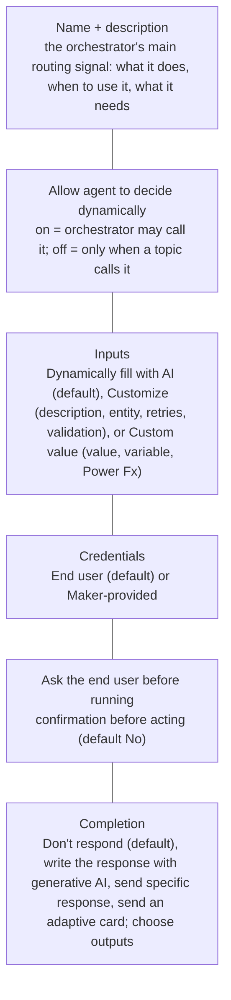
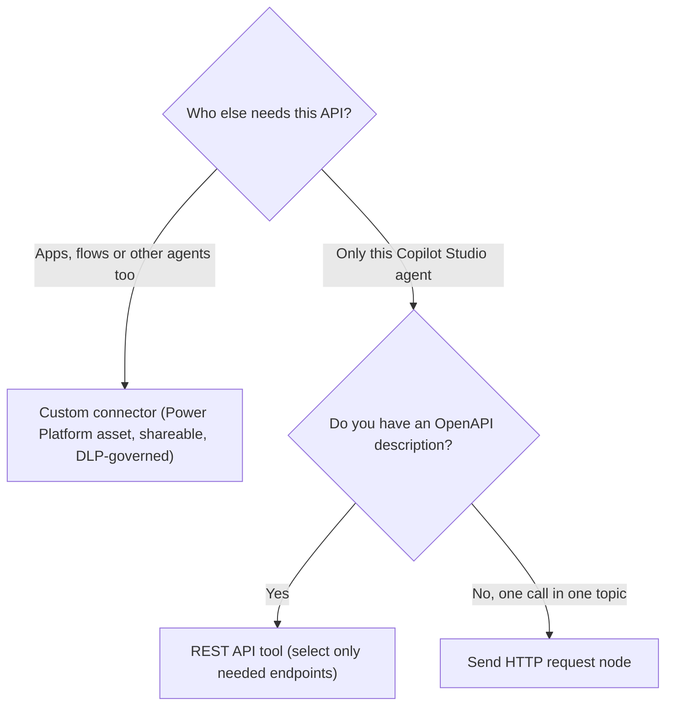

# Connector tools, custom connectors and REST APIs

> AB-620 · D2 Integrate and extend agents in Copilot Studio · about 85 min · Study Hub module `k02` ([open the hub](https://claude.ai/artifact/DfeAjDjaTCgtf36RSKeSSS))

## Why it matters
Tools are how agents *act*. The exam names two skills here: **add a tool by using an existing custom connector** and **add REST APIs to an agent**. Behind both sit the same tool settings: description, inputs, credentials, confirmation and completion.

## Pre-question (answer before reading)
**Q:** A tool's input is set to *Dynamically fill with AI*. What does that mean, and when would you override it?

<details><summary>Answer</summary>

The orchestrator extracts the value from the conversation (or asks the user). Override with a **custom value** (fixed value, variable or Power Fx) when the value must not come from the user, e.g., the signed-in user's email or a fixed region code.

</details>

## Mental model & story
Contoso's warehouse system has an OpenAPI description. The Power Apps team already built a **custom connector** for it last year, used by a stock app and two flows. Asha doesn't build anything new: in the agent she opens **Tools > Add a tool**, filters by **Custom connector**, picks *Get stock level*, and the existing connector becomes a tool.

She tunes the tool. The **name** and **description** say exactly when to use it ("Use to check current stock of a product at a store; needs product SKU and store ID"), because generative orchestration chooses tools by description. Inputs: SKU is *dynamically filled with AI*; store ID is a **custom value** from `Global.StoreId`, so users can't ask about other stores. Credentials: **maker-provided**, a read-only service account, because store staff don't have their own warehouse logins.

For *Reserve stock*, which changes data, she turns on **Ask the end user before running**, so the agent confirms before acting. Under **Completion** she chooses *Write the response with generative AI* for friendly replies, and exposes only the output fields the agent needs.

A month later the carrier team gives her an OpenAPI file for their tracking API, used by nobody else. Building a custom connector would be overkill. She adds a **REST API** tool: uploads the specification, chooses **OAuth 2.0** authentication, and selects only the two endpoints the agent needs. Each selected operation becomes a tool with its own description.

The custom connector itself still matters for ALM: it's in the solution, shared with the makers who need it (*Can use*/*Can edit*), and DLP has it in the Business group. The REST API tool lives inside the agent and moves with the agent's solution.

**Where the analogy breaks:** Tool descriptions aren't documentation for humans; they're instructions for a model. Ten tools with overlapping descriptions route worse than five precise ones, and too many tools in one agent hurts accuracy long before the hard limit.

## Diagrams
**Tool settings that matter**



**Custom connector or REST API tool?**



## Key points
- Tool types at agent level: **prebuilt connector**, **custom connector**, **REST API**, **agent flow**, **prompt**, **Model Context Protocol**, **computer use** (plus Azure Bot Service skills and client tools).
- Add: agent > **Tools > Add a tool** > type > configure > Save > *Add and configure*. Topic level: **Add node > Add a tool**.
- **Description** drives selection under generative orchestration: say what it does, when to use it and what it needs.
- **Allow agent to decide dynamically when to use this tool**: off means topic-only (useful when a tool exists on both a parent and a child agent).
- Inputs: **Dynamically fill with AI** (default) → extracted from context or asked; **Customize** (display name/description, *Identify as* entity, retry logic, validation); **Custom value** (value, variable, Power Fx) to lock values.
- Credentials: **End user** (default) or **Maker-provided**. Premium connectors need licences; admins can block maker credentials.
- **Ask the end user before running** (default No): confirmation before side-effects.
- **Completion**: Don't respond (default), Write the response with generative AI, Send specific response, Send an adaptive card; choose which outputs are available.
- Limits: up to **128 tools** per agent with generative orchestration; Microsoft recommends **25–30** for best results (child agents have their own 128).
- **Custom connectors**: built from an OpenAPI file/URL, Postman collection or from blank; auth: no auth, basic, API key, OAuth 2.0; optional code transforms; share (Can use / Can edit), connections shared separately; include in a **solution** to move between environments.
- **REST API tool**: Copilot Studio only; OpenAPI v2 (Swagger) JSON, v3 converted; auth None, API key or OAuth 2.0; select only the endpoints the agent needs; each operation's summary/description guides the orchestrator.

## Comparisons
**Custom connector vs REST API tool**

|  | Custom connector | REST API tool |
|---|---|---|
| Lives in | Power Platform (environment/solution) | The Copilot Studio agent |
| Reused by apps, flows, other agents | Yes | No |
| Definition | OpenAPI / Postman / blank; policies; code | OpenAPI spec upload |
| Auth | None, Basic, API key, OAuth 2.0 | None, API key, OAuth 2.0 |
| Governance | DLP connector policy; sharing | Agent's solution and DLP for HTTP/connectors |
| Choose when | Shared enterprise API | Quick, agent-only integration |

## Code to recognise
**OpenAPI operation that becomes a good tool (Swagger 2.0 excerpt)**

```yaml
paths:
  /stock/{sku}:
    get:
      operationId: GetStockLevel
      summary: Get stock level for a product at a store
      description: Use when the user asks if a product is in stock or how many units a store has. Needs the product SKU and the store ID.
      parameters:
        - name: sku
          in: path
          required: true
          type: string
          description: Product SKU, e.g. KET-1042
        - name: storeId
          in: query
          required: true
          type: string
          description: Store identifier such as STR-07
      responses:
        '200':
          description: Stock level
          schema:
            type: object
            properties:
              available: { type: integer }
```

- Line 4: `operationId` becomes the action's identifier.
- Line 5: Summary and description guide the orchestrator, so write them for a model: what, when, inputs.
- Line 12: Parameter descriptions with examples help the AI fill inputs correctly.
- Line 17: In the tool you might set `storeId` to a **custom value** (e.g., `Global.StoreId`) instead of asking the user.

## Portal steps
**Add an existing custom connector action as a tool** ((agent) > Tools > Add a tool > filter: Custom connector)

1. Select the connector and the action; create or select a connection.
2. Edit **name** and **description**; set *Allow agent to decide dynamically*.
3. Inputs: keep AI fill, customise, or set custom values.
4. Additional details: credentials (end user / maker), **Ask the end user before running**.
5. Completion: response option and outputs; Save; test and check the activity map.

**Add a REST API tool** ((agent) > Tools > Add a tool > REST API)

1. Upload the OpenAPI specification (v2 JSON; v3 is converted).
2. Review the API name and description.
3. Choose authentication: None, API key, or OAuth 2.0 (client ID/secret, authorization and token URLs, scopes).
4. Select only the endpoints/operations the agent needs; review each tool's description and inputs.
5. Create the connection and test.

## Worked example
**Scenario:** A store agent's *Reserve stock* tool sometimes reserves the wrong quantity, and staff in one store could reserve stock for another store.

- Wrong quantity → AI filled an input it misunderstood or the user didn't confirm.
- Other stores → store ID came from the conversation instead of the user's context.
- Side-effects should be confirmed.

**Answer:** Set **storeId** to a **custom value** (`Global.StoreId`), customise the quantity input (description with examples, number entity, validation), and turn on **Ask the end user before running** so staff confirm SKU, store and quantity before the reservation runs.

## Your turn (faded example)
**Scenario:** A tool exists on both the parent agent and a child agent; the parent keeps calling it directly instead of delegating to the child.

- The parent's orchestrator can see and call its own copy of the tool.
- **Which setting on the parent's tool stops this?** <details><summary>answer</summary>Clear **Allow agent to decide dynamically when to use this tool** (so it's topic-only), or remove it from the parent.</details>
- **What else helps?** <details><summary>answer</summary>Make the child agent's description clearly own that job, and mention delegation in the parent's instructions.</details>

## Exam traps & misconceptions
- ✗ Building a new custom connector when the API is only for one agent. → ✓ A REST API tool is quicker for agent-only use; custom connectors are for reuse.
- ✗ Writing tool descriptions like "Calls the stock API". → ✓ Say what, when and what it needs; the orchestrator routes by description.
- ✗ Letting AI fill values that must come from context (user ID, store, region). → ✓ Set **custom values** from variables or Power Fx.
- ✗ Adding 60 tools to one agent. → ✓ Up to 128 are allowed, but 25–30 is recommended; split into child or connected agents.
- ✗ Forgetting to share the custom connector and its connection with co-makers. → ✓ Share the connector (Can use / Can edit) and connections separately; keep it in the solution.

## Discussion prompts
- **When is maker-provided credential use acceptable for a tool that writes data?** When users have no account in the target system and the action is narrow, approved and audited (e.g., create a support case). Use a dedicated least-privilege account, confirmation before running, and logging.
- **How would you test whether tool descriptions are good?** Write a test set of realistic requests (including ambiguous ones), run evaluation with the Tool use method or check the activity map, and look for wrong or missing tool calls; then refine descriptions and retest.

## Interview angle / teach-back
**Prompt:** Explain how to add an existing custom connector as a tool, and how a REST API tool differs.

**Rubric:** Tools > Add a tool > Custom connector > action · Description, dynamic use, inputs (AI fill / custom value) · Credentials end user vs maker; ask before running · Completion options and outputs · REST API tool: agent-only, OpenAPI v2, auth options, select endpoints

**Model answer:** I go to Tools, Add a tool, filter by custom connector and pick the action. I write a description that says what it does and when, decide whether the orchestrator may call it dynamically, keep AI-filled inputs or lock some with custom values, pick end-user or maker credentials, turn on confirmation for actions with side-effects, and choose the completion behaviour. A REST API tool skips the connector: I upload an OpenAPI spec, set None, API key or OAuth 2.0 auth, and select only the endpoints the agent needs, but it can't be reused by apps and flows.

## Quick Q&A
- **Default input fill?** **Dynamically fill with AI**.
- **Lock an input to a variable?** Fill using **Custom value**.
- **Confirmation before a tool runs?** **Ask the end user before running** (default No).
- **Default completion?** **Don't respond**.
- **Max tools per agent / recommended?** 128 / 25–30.
- **REST API tool spec format?** OpenAPI v2 JSON (v3 converted).
- **REST API tool auth options?** None, API key, OAuth 2.0.

## Sources (accessed 2026-10-02)
- [Add tools to custom agents](https://learn.microsoft.com/en-us/microsoft-copilot-studio/add-tools-custom-agent)
- [Use connectors as tools](https://learn.microsoft.com/en-us/microsoft-copilot-studio/advanced-connectors)
- [Add REST API tools](https://learn.microsoft.com/en-us/microsoft-copilot-studio/agent-extend-action-rest-api)
- [Create a custom connector from an OpenAPI definition](https://learn.microsoft.com/en-us/connectors/custom-connectors/define-openapi-definition)

## SRS cards created
- ab-620-k02-01, ab-620-k02-02, ab-620-k02-03, ab-620-k02-04
