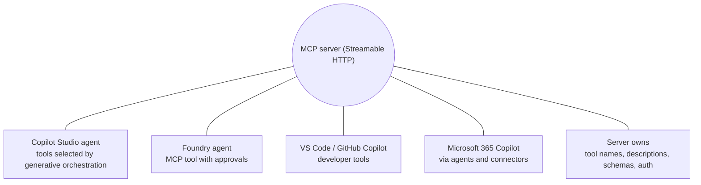
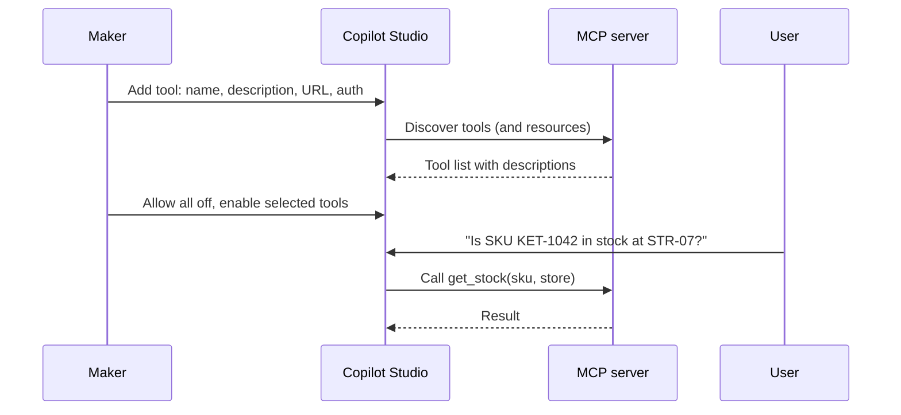

# MCP tools

> AB-620 · D2 Integrate and extend agents in Copilot Studio · about 70 min · Study Hub module `k03` ([open the hub](https://claude.ai/artifact/DfeAjDjaTCgtf36RSKeSSS))

## Why it matters
**Model Context Protocol (MCP)** lets one server offer a catalogue of tools to many agents and clients. The exam tests how to connect a server, which transport and auth options work, which tools to allow, and what MCP can't do in Copilot Studio.

## Pre-question (answer before reading)
**Q:** You connect an MCP server with 14 tools, including *send_email* and *delete_file*. Your agent must be read-only. What do you change?

<details><summary>Answer</summary>

Turn off **Allow all** for the server and enable only the read tools (or disable the action-shaped ones individually). Otherwise new and risky tools are available to the orchestrator automatically.

</details>

## Mental model & story
Contoso's platform team runs an **MCP server** that wraps their inventory, pricing and promotions systems. The store agent, a VS Code coding assistant and a Foundry agent all use it. When the team adds a tool, every client sees it without anyone editing their agents. That's the appeal: **one server, many clients, tools discovered automatically**.

Asha connects it from **Tools > Add a tool > New tool > Model Context Protocol**: a name, a **description** (the orchestrator reads it), the **server URL**, and authentication: none for the public demo, **API key** for test, **OAuth 2.0** for production. The server must speak **Streamable HTTP**; old SSE-only servers won't connect.

Copilot Studio lists the server's **tools** (and resources). Their names and descriptions come from the server and are read-only in Copilot Studio; if a description is bad, the platform team fixes it on the server. Asha turns off **Allow all**, which would auto-enable future tools, and enables only *get_stock*, *get_price* and *list_promotions*.

She also tries Microsoft's prebuilt MCP connectors: **Work IQ** (cross-source workplace context from Microsoft 365) and Dataverse. In Preview the first call asks for consent (*Permission required*) and she approves.

One limitation surprises her: she wanted to call *get_price* from inside a topic at a fixed step. Topics can't call MCP tools; MCP tools are selected by **generative orchestration**. For that fixed step she uses the pricing **connector** instead.

**Where the analogy breaks:** MCP standardises *how* tools are described and called, not whether they're safe. A malicious or careless server can expose dangerous tools or poisoned descriptions. Treat MCP servers like any third-party integration: trusted sources, least privilege, allow-listed tools, monitoring.

## Diagrams
**One MCP server, many clients**



**Connecting and using an MCP server in Copilot Studio**



## Key points
- MCP = open protocol for exposing **tools** (and **resources**) to AI clients. In Copilot Studio: tools and resources supported; **prompts** are not.
- Transport: **Streamable HTTP** only (SSE isn't supported).
- Add: **Tools > Add a tool > New tool > Model Context Protocol**: server name, **description**, server URL, authentication. Behind the scenes this creates a connector (custom connector) for the server.
- Authentication: **None**, **API key** (header preferred, or query; each user may supply their own key), **OAuth 2.0**: *Dynamic discovery* (DCR + discovery), *Dynamic* (DCR with manual auth/token URLs) or *Manual* (client ID/secret, authorization, token and refresh URLs, scopes; register the callback URL).
- Tool names and descriptions are **read-only** in Copilot Studio (the server owns them).
- **Allow all** toggle: on = all current *and future* server tools are enabled; off = choose tools individually. For governance, turn it off and enable only what's needed.
- MCP tools need **generative orchestration**; **topics can't call MCP tools**.
- Prebuilt MCP connectors include Dataverse, Dynamics 365 (Sales, Service, Finance), Outlook, Teams, GitHub and **Work IQ** (preview; needs Microsoft 365 Copilot licensing).
- Runtime consent: users may see a *Permission required* prompt the first time a connection is used.
- MCP vs others: MCP = orchestrator controls tools from a shared server; A2A = delegate a whole task to another agent; connector = governed access to one system's operations.

## Comparisons
**MCP vs connector vs A2A**

|  | MCP server | Connector tool | A2A agent |
|---|---|---|---|
| Unit of reuse | A server's tool catalogue | One connector's actions | A whole agent |
| Who reasons | Your agent's orchestrator | Your agent's orchestrator | The remote agent |
| Discovery | Automatic from server | Defined in connector | Agent card |
| Callable from topics | No | Yes | Via agent connection (orchestration) |
| Owner of descriptions | Server team | You (tool settings) | Remote agent (card) |

## Code to recognise
**Custom connector definition for an MCP server (Swagger 2.0)**

```yaml
swagger: '2.0'
info:
  title: Contoso Inventory MCP
  description: Inventory, pricing and promotions tools for store agents.
  version: 1.0.0
host: mcp.contoso.com
basePath: /
schemes:
  - https
paths:
  /mcp:
    post:
      summary: Contoso Inventory MCP server
      x-ms-agentic-protocol: mcp-streamable-1.0
      operationId: InvokeMCP
      responses:
        '200':
          description: Success
```

- Line 4: The description helps the orchestrator decide when to use this server.
- Line 6: The server's host; HTTPS only.
- Line 14: This extension marks the operation as an MCP endpoint using **Streamable HTTP**.
- Line 15: One operation represents the whole server; individual tools are discovered at run time.

## Portal steps
**Connect an MCP server** ((agent) > Tools > Add a tool > New tool > Model Context Protocol)

1. Enter server name, **description** and server URL (Streamable HTTP).
2. Choose authentication: None / API key / OAuth 2.0 (dynamic discovery, dynamic or manual).
3. Create the connection (consent if prompted).
4. Review discovered tools; turn **Allow all** off and enable only the tools you need.
5. Test in the test pane / Preview; approve *Permission required* if shown.

## Worked example
**Scenario:** A read-only HR assistant must use Work IQ for meeting and document context, but must never send email or schedule meetings, and should stay safe when Microsoft adds new Work IQ tools.

- Work IQ exposes many tools, some of which act.
- New tools could appear later.
- Read-only must be enforced, not just requested.

**Answer:** Add **Work IQ** as an MCP tool, turn **Allow all** off, enable only read/search tools, leave action-shaped tools (send, schedule, delete) off, state read-only scope in instructions, and re-audit the tool inventory after updates.

## Your turn (faded example)
**Scenario:** A maker wants a topic node to call an MCP tool at step 3 of a scripted flow.

- Topics can't call MCP tools.
- **What are the options?** <details><summary>answer</summary>Call the same capability through a connector, REST API tool or agent flow from the topic; or redesign so the orchestrator chooses the MCP tool (generative orchestration).</details>
- **What would you tell the server team?** <details><summary>answer</summary>If a step must be deterministic, consider also exposing it as a connector/API; MCP suits orchestrator-driven use.</details>

## Exam traps & misconceptions
- ✗ Connecting an SSE-only MCP server. → ✓ Copilot Studio needs **Streamable HTTP**.
- ✗ Editing MCP tool descriptions in Copilot Studio. → ✓ They're read-only; change them on the server.
- ✗ Leaving **Allow all** on for a governed agent. → ✓ Future tools are enabled automatically; turn it off and pick tools.
- ✗ Calling MCP from a topic. → ✓ Not supported; MCP needs generative orchestration.
- ✗ Expecting MCP **prompts** to appear. → ✓ Tools and resources are supported; prompts aren't.

## Discussion prompts
- **What makes an MCP server trustworthy enough for production?** Known owner and hosting, HTTPS with OAuth, least-privilege tools, versioned and reviewed descriptions (to avoid tool poisoning), logging, rate limits, and a change process so new tools are reviewed before you enable them.
- **Why might a platform team prefer MCP over publishing 20 connectors?** One server serves Copilot Studio, Foundry, IDEs and other clients; tools are discovered automatically; and the team controls descriptions centrally. Connectors still win for deterministic topic steps and Power Platform reuse.

## Interview angle / teach-back
**Prompt:** Explain how to add an MCP server to a Copilot Studio agent and how to keep it governed.

**Rubric:** Tools > Add a tool > MCP: name, description, URL · Streamable HTTP · Auth: none / API key / OAuth 2.0 variants · Tools discovered; descriptions read-only · Allow all off; enable selected tools · Generative orchestration required; no topic calls

**Model answer:** I add a new Model Context Protocol tool with a name, a clear description and the server URL, which must use Streamable HTTP. I choose authentication: none, an API key, or OAuth 2.0 with dynamic discovery, dynamic or manual settings. Copilot Studio discovers the server's tools and resources, whose descriptions are owned by the server. For governance I turn Allow all off and enable only the tools the agent needs. MCP tools are chosen by generative orchestration, so topics can't call them.

## Quick Q&A
- **Supported transport?** **Streamable HTTP**.
- **MCP features supported?** Tools and resources (not prompts).
- **Can topics call MCP tools?** **No**.
- **Allow all on means?** All current and future server tools enabled.
- **Who owns MCP tool descriptions?** The **server** (read-only in Copilot Studio).
- **OAuth 2.0 variants?** Dynamic discovery, Dynamic, Manual.
- **Connector extension marking an MCP endpoint?** `x-ms-agentic-protocol: mcp-streamable-1.0`.

## Sources (accessed 2026-10-02)
- [Extend your agent with Model Context Protocol](https://learn.microsoft.com/en-us/microsoft-copilot-studio/agent-extend-action-mcp)
- [Work IQ in Copilot Studio (preview)](https://learn.microsoft.com/en-us/microsoft-copilot-studio/add-work-iq)
- [Model Context Protocol specification](https://modelcontextprotocol.io/)
- [AB-620T00 lab 3.2: MCP as a tool](https://github.com/MicrosoftLearning/AB-620T00_build_integrated_ai_agents_in_copilot_studio/blob/main/Instructions/Labs/lab-3-integrate-knowledge-and-tools/exercise-2-mcp-as-tool.md)

## SRS cards created
- ab-620-k03-01, ab-620-k03-02, ab-620-k03-03, ab-620-k03-04
