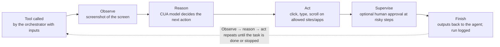
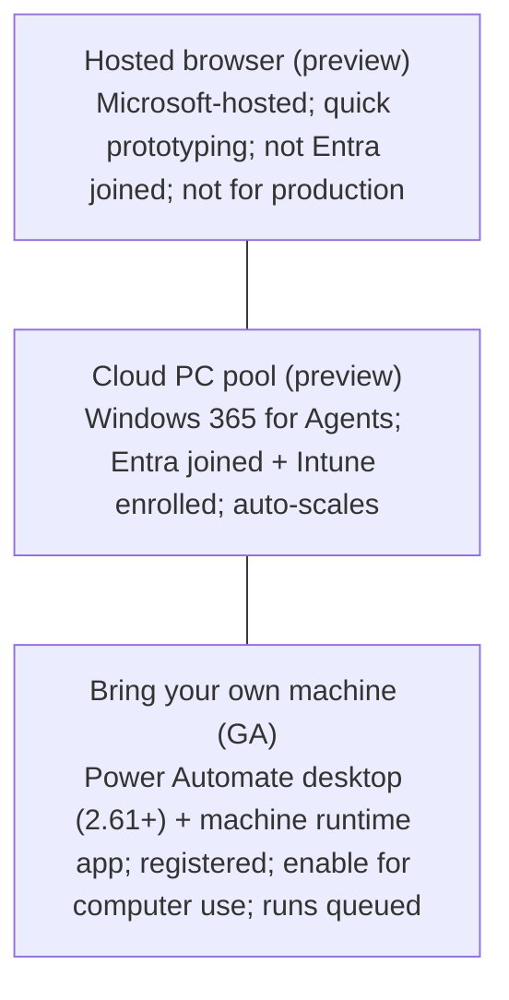

# Computer use

> AB-620 · D2 Integrate and extend agents in Copilot Studio · about 60 min · Study Hub module `k04` ([open the hub](https://claude.ai/artifact/DfeAjDjaTCgtf36RSKeSSS))

## Why it matters
Some systems have no API at all, just a screen. **Computer use** lets an agent operate websites and Windows apps like a person. The exam asks how to configure it safely (credentials, allowed sites, supervision), where it runs, and how to monitor runs.

## Pre-question (answer before reading)
**Q:** A computer use tool must enter invoices into a supplier portal that needs a login. Where should the password live, and how do you stop the agent wandering to other websites?

<details><summary>Answer</summary>

In **stored credentials** (in Copilot Studio or **Azure Key Vault**), not in instructions. Restrict navigation with **allowed websites/apps**, and add **human supervision** for risky steps.

</details>

## Mental model & story
Contoso's oldest supplier only offers a web portal from 2009. Every day someone copies 40 delivery notes into it by hand. No API, no connector, no export. Asha adds a **computer use** tool.

The tool gets **instructions** like a job aid for a temp worker: the full portal URL, then explicit steps ("Select *New delivery*, enter the PO number in *Reference*, ..."). **Inputs** carry the data for each run (PO number, quantity, date). The portal password goes into **stored credentials**, kept in Copilot Studio or **Azure Key Vault**, never in the prompt.

She restricts **allowed websites** to the portal's domain, so the agent can't interact with anything else. She also enables **human supervision**, so the agent can email a named reviewer for confirmation and stops if nobody answers before the timeout. Because supervision is triggered by the model (it may not fire every time), the £10,000 rule itself is enforced by a deterministic approval in the agent flow before the computer use step runs.

Where does it run? For a prototype, the **hosted browser** (preview; not Entra joined, not for production). For production the GA option is **bring-your-own machine**: register a machine with **Power Automate desktop** and the machine runtime app; runs on one machine are queued one at a time. A **Cloud PC pool** (Windows 365 for Agents) is Entra joined, Intune enrolled and auto-scales, but it's still **preview** (checked 2 Oct 2026).

Every run leaves a trail: in the agent's **Activity**, Asha opens a run and replays **screenshots** with the agent's reasoning for each step. Logs are stored in **Dataverse** (with configurable retention and verbosity), and Purview captures audit events. When the portal's layout changes, the replay shows exactly where the agent got confused.

**Where the analogy breaks:** Computer use is powerful but slow, costly per step and brittle to UI changes. It's the last rung of the integration ladder, used when there is genuinely no API, connector or RPA flow, and it shouldn't run unsupervised on high-impact actions.

## Diagrams
**A computer use run**



**Where computer use runs**



## Key points
- Add: **Tools > Add a tool > New tool > Computer use**. Requires **generative orchestration**.
- Configure: **instructions** (full URLs, explicit steps, what *done* looks like), **inputs**, model choice (computer-using agent models), **stored credentials** (in Copilot Studio or **Azure Key Vault**; maker or end-user credentials), **allowed websites and apps**, **enforce HTTPS**, **human supervision** (reviewer by email, timeout; model-triggered and probabilistic, so not a fail-safe).
- Allowed websites/apps restrict what the agent can **interact with**; they're a key guardrail.
- Runtime: **hosted browser** (preview; prototyping only), **Cloud PC pool** (preview; Windows 365 for Agents; Entra joined, Intune enrolled, auto-scales), **bring-your-own machine** (GA; Power Automate desktop + machine runtime app; register and enable for computer use; runs queue sequentially per machine).
- Monitoring: agent **Activity** > run > activity map/transcript, **session replay screenshots** with reasoning and coordinates; logs stored in **Dataverse** (retention default 7 days; verbosity: all data, without screenshots, minimal); **Microsoft Purview** audit events.
- Billing per step in Copilot Credits; slower than API calls.
- Unsupported/poor targets include Electron apps, Java apps, Citrix sessions, command-line tools and games.
- Use only when there's no API/connector; prefer APIs, connectors or desktop flows (RPA) for stable, high-volume work.

## Comparisons
**Computer use vs desktop flow (RPA) vs connector**

|  | Connector / API | Desktop flow (RPA) | Computer use |
|---|---|---|---|
| Needs an API | Yes | No | No |
| Handles UI changes | N/A | Breaks (scripted selectors) | Adapts (vision + reasoning), but can err |
| Speed and cost | Fast, cheap | Fast once built | Slow, credits per step |
| Best for | Anything with an API | Stable, repetitive UI tasks | Variable UI tasks without APIs |

## Code to recognise
**Computer use instructions (good pattern)**

```text
Goal: record a delivery in the supplier portal.

1. Go to https://portal.supplier.example/deliveries (sign in with the stored credential "SupplierPortal").
2. Select "New delivery".
3. Enter {poNumber} in "Reference", {quantity} in "Units", {deliveryDate} in "Date" (format DD/MM/YYYY).
4. Select "Save". Wait for the confirmation banner.
5. Return the confirmation number shown in the banner as output "confirmationNumber".

Stop and report an error if the PO number is not found. Never change existing deliveries.
```

- Line 3: Full URL and the name of the stored credential, never the password itself.
- Line 5: Inputs inserted by name; specify formats the site expects.
- Line 7: Say how to recognise success.
- Line 9: Boundaries: what to do on failure, what never to touch.

## Portal steps
**Configure a computer use tool** ((agent) > Tools > Add a tool > New tool > Computer use)

1. Write instructions with full URLs and explicit steps; define inputs and outputs.
2. Choose where it runs: hosted browser (prototype), Cloud PC pool, or your registered machine.
3. Add stored credentials (Copilot Studio or Azure Key Vault).
4. Set **allowed websites/apps**, enforce HTTPS, and human supervision (reviewer, timeout).
5. Test, then review the run's screenshots in Activity.

**Monitor runs** ((agent) > Activity > (session) > computer use step)

1. Open the run's activity map and transcript.
2. Replay screenshots step by step with reasoning and coordinates.
3. Check logs stored in Dataverse (retention/verbosity settings) and Purview audit for compliance.

## Worked example
**Scenario:** Finance wants the agent to update vendor bank details in a legacy web app with no API. Design computer use safely.

- High-impact change → supervision and tight scope.
- Credentials and sites must be controlled.
- Production needs managed machines and auditability.

**Answer:** Computer use with explicit instructions, **stored credentials in Azure Key Vault**, **allowed websites** limited to the app's domain, a **deterministic approval** before every bank-detail change (plus **human supervision**, which is model-triggered), running on a **registered machine** (GA) or a **Cloud PC pool** (preview; Entra joined, Intune enrolled), with logs in Dataverse and Purview audit; evaluate with test runs before go-live.

## Your turn (faded example)
**Scenario:** Computer use runs fail when the portal adds a cookie banner.

- The agent stops at an unexpected screen.
- **Where do you see what happened?** <details><summary>answer</summary>Session replay screenshots in the run's Activity details.</details>
- **How do you fix it?** <details><summary>answer</summary>Update instructions: "If a cookie banner appears, select *Accept necessary cookies* and continue," and keep the domain in allowed websites; retest.</details>

## Exam traps & misconceptions
- ✗ Putting passwords in computer use instructions. → ✓ Use stored credentials (Copilot Studio or Key Vault).
- ✗ Using the hosted browser for production with corporate identity. → ✓ It's for prototyping and isn't Entra-joined; use a Cloud PC pool or registered machine.
- ✗ Picking computer use when a connector exists. → ✓ APIs/connectors are faster, cheaper and more reliable.
- ✗ Expecting topics with classic orchestration to run computer use. → ✓ Computer use needs generative orchestration.
- ✗ Relying on human supervision alone for irreversible actions. → ✓ It's model-triggered and not a fail-safe; put a deterministic approval before high-impact steps.

## Discussion prompts
- **How would you measure whether computer use is reliable enough?** Run a test batch, track success rate, steps per task, time and credits per run, review failed replays, and require supervision until success is consistently high on realistic variations.
- **Computer use or a desktop flow (RPA)?** Desktop flows for stable, high-volume, well-defined UI tasks (cheap once built). Computer use for varied tasks or UIs that change often, accepting higher per-run cost and the need for supervision.

## Interview angle / teach-back
**Prompt:** Explain how to configure and monitor a computer use tool safely.

**Rubric:** Instructions with URLs and steps; inputs/outputs · Stored credentials (Key Vault) · Allowed websites/apps; HTTPS · Human supervision · Runtime options: hosted browser, Cloud PC pool, own machine · Monitoring: replay screenshots, Dataverse logs, Purview

**Model answer:** I add a computer use tool with explicit instructions and full URLs, define inputs and outputs, store credentials in Copilot Studio or Azure Key Vault, limit allowed websites and apps, enforce HTTPS and add human supervision for risky steps. It runs in a hosted browser for prototypes; for production I use a registered machine (GA), or a Cloud PC pool (preview) when managed, auto-scaling Cloud PCs are needed. Supervision is model-triggered, so high-impact steps also get a deterministic approval. I monitor runs in Activity with screenshot replays and reasoning, with logs in Dataverse and audit in Purview.

## Quick Q&A
- **Where to store portal passwords?** Stored credentials (Copilot Studio or **Azure Key Vault**).
- **Guardrail limiting what the agent can touch?** **Allowed websites/apps**.
- **GA runtime for production?** **Bring-your-own (registered) machine**; the Cloud PC pool is preview.
- **Prototype runtime?** **Hosted browser**.
- **Where to replay a run?** Activity > run > screenshots.
- **Orchestration needed?** **Generative**.

## Sources (accessed 2026-10-02)
- [Automate web and desktop apps with computer use](https://learn.microsoft.com/en-us/microsoft-copilot-studio/computer-use)
- [Windows 365 for Agents (Cloud PC pools)](https://learn.microsoft.com/en-us/windows-365/agents/)
- [Power Automate desktop](https://learn.microsoft.com/en-us/power-automate/desktop-flows/introduction)

## SRS cards created
- ab-620-k04-01, ab-620-k04-02, ab-620-k04-03, ab-620-k04-04
