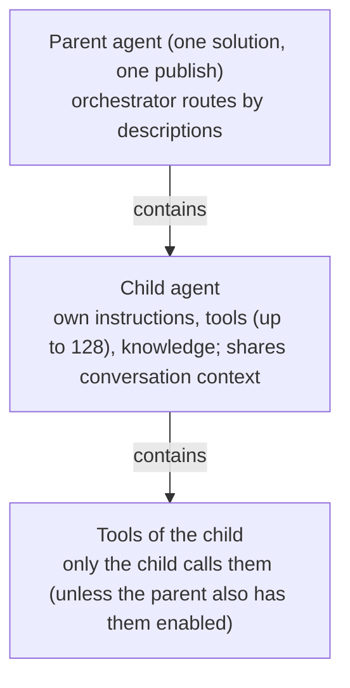
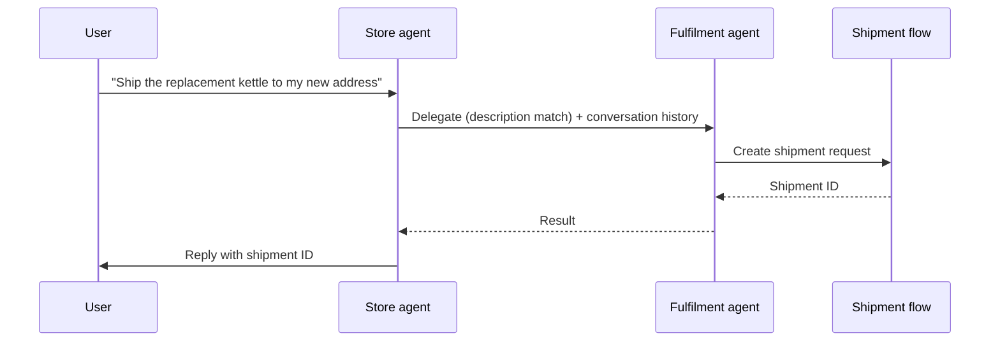
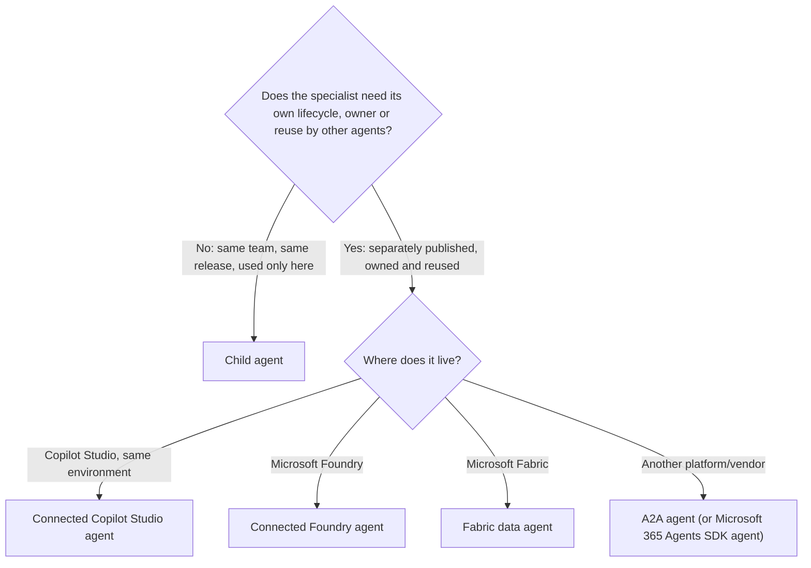

# Multi-agent design: child and connected agents

> AB-620 · D2 Integrate and extend agents in Copilot Studio · about 85 min · Study Hub module `m01` ([open the hub](https://claude.ai/artifact/DfeAjDjaTCgtf36RSKeSSS))

## Why it matters
*Design multi-agent solutions* and *integrate an existing agent* are core D2 skills. Most questions hinge on one distinction: a **child agent** lives inside its parent and ships with it; a **connected agent** is published separately, owned separately and reused by others.

## Pre-question (answer before reading)
**Q:** The warehouse team owns a *Fulfilment* agent with its own release schedule. The store agent must hand shipment questions to it. Child or connected?

<details><summary>Answer</summary>

**Connected**: it's separately published and owned, with its own lifecycle, and other agents can reuse it. A child agent would live inside the store agent's solution and release with it.

</details>

## Mental model & story
Asha's store agent has grown to 34 tools and keeps picking the wrong one for returns versus shipments. Daniel's advice: "Don't add more instructions. **Split** it, but only along real seams."

The returns logic belongs to Asha's team and changes with every release of the store agent, so she creates a **child agent** *Returns specialist* inside the store agent: its own instructions, its own tools (the three returns flows) and knowledge, but the **same conversation context** and the **same solution**. It can't be published on its own. The parent invokes it when *the agent chooses based on description*; she writes that description carefully so it doesn't overlap with others.

Shipments are different. The warehouse team already runs a published **Fulfilment agent** with its own environment roles, model settings and release cadence. They turn on *Let other agents connect to and use this one*, share it with Asha, and she adds it as a **connected agent**. Copilot Studio copies its description locally (it won't auto-update if the warehouse team changes theirs), and by default **passes the conversation history** so the specialist has context.

The first end-to-end test shows a subtle bug: the parent agent still has its own copy of the *Create return* tool, and sometimes calls it directly instead of delegating. Asha clears **Allow agent to decide dynamically when to use this tool** on the parent's copy. The activity map now shows: orchestrator → Returns specialist → *Create return* flow.

Daniel adds one more lesson: multi-agent isn't free. Each hop adds **latency**, **cost**, another **governance surface**, more **testing**, and separate transcripts to correlate. And the parent's maker stays **accountable** for what delegated agents do, so approvals still guard anything that writes or deletes.

**Where the analogy breaks:** Org charts are a poor template for agents. Splitting by department can create overlapping descriptions and endless hand-offs. Split by **capability boundaries** that really differ (ownership, security, data, release cycle, tool sets), and keep a single agent when one will do.

## Diagrams
**Child agent: inside the parent**



**Delegating to a connected agent**



**Child or connected?**



## Key points
- Start with **one agent**. Split when routing degrades (too many tools: max 128, best 25–30), when parts have **different owners, release cycles, security or model configuration**, or when a capability must be **reused** by several agents or channels.
- **Child agents**: Agents > Add an agent > *New child agent* (or Add node > Add an agent in a topic). Own instructions, tools, knowledge; **shared conversation context**; **same solution and lifecycle**; can't be published alone.
- Child agent invocation: *The agent chooses – based on description* (dynamic) or explicit triggers with conditions and priority; inputs (with descriptions, prompting rules) and outputs (become variables for the parent).
- After a child agent runs: **Don't respond** (default), Write the response with generative AI, Send specific response, Send an adaptive card.
- **Connected agents**: separately published, own orchestration and lifecycle, reusable. Copilot Studio agents must be in the **same environment**, **published**, with *Let other agents connect to and use this one* turned **on**, and shared with you.
- Connected agent settings: description (a **local copy**, not auto-synced), **Pass conversation history to this agent** (on by default; review privacy).
- Other connected agent types: **Microsoft Foundry agent**, **Fabric data agent**, **Microsoft 365 Agents SDK agent**, **A2A agent** (module m02).
- Patterns: **orchestrator/sub-agent** (dynamic delegation by description) vs **workflow-oriented** (deterministic serial or parallel steps through topics/flows) for compliance and audit.
- Avoid double routing: if a tool exists on both parent and child, clear *Allow agent to decide dynamically* on the parent's copy, or remove it.
- Instructions can reference tools, agents and variables with **/**; test with the **activity map**; **Disable** (keeps configuration) vs **Delete/Disconnect** (removes it; breaks redirects).

## Comparisons
**Child vs connected agents**

|  | Child agent | Connected agent |
|---|---|---|
| Where it's built | Inside the parent agent | Separate agent (or external platform) |
| Publishing | With the parent only | Independently |
| Lifecycle / ownership | Same solution and team | Own solution, team, release cadence |
| Context | Shares the conversation | Receives conversation history if enabled |
| Reuse by other agents | No | Yes |
| Settings to enable | None | Target: Let other agents connect; caller: access + connection |
| Typical use | Split a big agent's tools and instructions | Specialists owned by other teams; external agents |

## Code to recognise
**Parent instructions that delegate cleanly**

```text
You are the Contoso store assistant for store staff.

Delegation:
- Returns, refunds and damaged items: use /Returns specialist. Do not call return tools yourself.
- Shipments, deliveries and address changes: use /Fulfilment agent.
- Store policies: answer from knowledge and cite the policy.

After a specialist responds, summarise the outcome in one or two sentences
and include any reference number it returned.

If a request involves both a return and a shipment, handle the return first.
```

- Line 4: The `/` reference points at a specific child agent; be explicit about ownership.
- Line 5: Connected agents are referenced the same way.
- Line 8: Tell the orchestrator how to present delegated results.
- Line 11: Multi-intent ordering rules reduce surprises.

## Portal steps
**Add a child agent** ((parent agent) > Agents > Add an agent > New child agent)

1. Name and **description** (when the parent should use it).
2. Instructions; add the child's tools and knowledge.
3. Invocation: *The agent chooses* or explicit triggers; define inputs/outputs if needed.
4. Completion: choose what happens after it runs.
5. Test; check the activity map; fix overlapping descriptions.

**Connect an existing Copilot Studio agent** ((target) Settings > Generative AI > let other agents connect; (caller) Agents > Add an agent > Copilot Studio)

1. On the target agent: turn on *Let other agents connect to and use this one*, publish, share with the caller's makers.
2. On the caller: add the agent, review/adjust the description (local copy), keep or turn off *Pass conversation history*.
3. Reinforce delegation in the caller's instructions.
4. Test end-to-end; republish the caller.

## Worked example
**Scenario:** A bank's main agent must handle mortgages (owned by the mortgage team, monthly releases, different security roles) and simple FAQ about branch hours (owned by the main team). Design it.

- Mortgages: different owner, cadence and security → separate agent.
- Reuse is likely (the mortgage agent could serve other channels).
- Branch FAQ: same team, trivial, no reason to split.

**Answer:** Main agent with branch FAQ as knowledge/topics; the **mortgage agent** published separately and added as a **connected agent** (target setting on, shared, clear description, conversation history reviewed for privacy). No child agent needed unless the main agent's own tool list grows too large.

## Your turn (faded example)
**Scenario:** After connecting the Fulfilment agent, the orchestrator still answers shipment questions itself.

- The orchestrator routes by description and instructions.
- **What do you check first?** <details><summary>answer</summary>The connected agent's **local description** (specific, non-overlapping) and the parent's instructions (explicit delegation).</details>
- **What if the warehouse team improved their description last week?** <details><summary>answer</summary>It won't sync automatically: update the local copy in the caller (or reconnect).</details>

## Exam traps & misconceptions
- ✗ Using a child agent for a capability another team owns and releases. → ✓ That's a connected agent.
- ✗ Expecting connected agent description changes to sync. → ✓ The caller keeps a local copy; update it manually.
- ✗ Forgetting *Let other agents connect to and use this one* on the target. → ✓ Without it (and publishing and sharing) the agent can't be connected.
- ✗ Leaving the same tool enabled on parent and child. → ✓ Clear the parent's dynamic-use toggle so the child owns it.
- ✗ Splitting every department into its own agent on day one. → ✓ Each hop adds latency, cost and governance work; split only on real seams.

## Discussion prompts
- **What are the hidden costs of multi-agent designs?** Latency per hop, more model calls and credits, more descriptions to keep non-overlapping, more surfaces to secure and govern, harder testing, and transcripts split across agents that must be correlated.
- **Should conversation history always be passed to connected agents?** No. It gives context but may share personal or sensitive data with an agent owned by another team. Review data processing, minimise what's needed, and turn it off where context isn't required.

## Interview angle / teach-back
**Prompt:** Explain when to use a child agent versus a connected agent, and how to set each up.

**Rubric:** Start with one agent; split on real seams · Child: inside parent, shared context, same solution, no separate publish · Connected: separately published, owned, reusable · Target setting + publish + share; local description; pass history · Avoid duplicate tools; test with activity map

**Model answer:** I start with one agent. If it gets too many tools or needs separate instructions for one area, I add a child agent inside it: it has its own instructions and tools but shares the conversation and ships with the parent. If a capability is owned and released by another team or must be reused, I use a connected agent: the target is published with 'let other agents connect' on and shared with me; I add it, adjust its local description and decide whether to pass conversation history. Then I make sure tools aren't duplicated and test with the activity map.

## Quick Q&A
- **Can a child agent be published alone?** **No**; it ships with its parent.
- **Target setting for connected agents?** *Let other agents connect to and use this one*.
- **Does a connected agent's description auto-sync?** **No**; local copy.
- **Default for passing conversation history?** **On**.
- **Default completion after a child runs?** **Don't respond**.
- **Recommended tools per agent?** About **25–30** (max 128).
- **Disable vs delete a child agent?** Disable keeps configuration; delete removes it and breaks redirects.

## Sources (accessed 2026-10-02)
- [Add other agents overview](https://learn.microsoft.com/en-us/microsoft-copilot-studio/authoring-add-other-agents)
- [Multi-agent orchestration patterns and best practices](https://learn.microsoft.com/en-us/microsoft-copilot-studio/guidance/multi-agent-patterns)
- [AB-620T00 lab 4: multi-agent solution](https://github.com/MicrosoftLearning/AB-620T00_build_integrated_ai_agents_in_copilot_studio/tree/main/Instructions/Labs/lab-4-configure-multi-agent-solution)

## SRS cards created
- ab-620-m01-01, ab-620-m01-02, ab-620-m01-03, ab-620-m01-04
