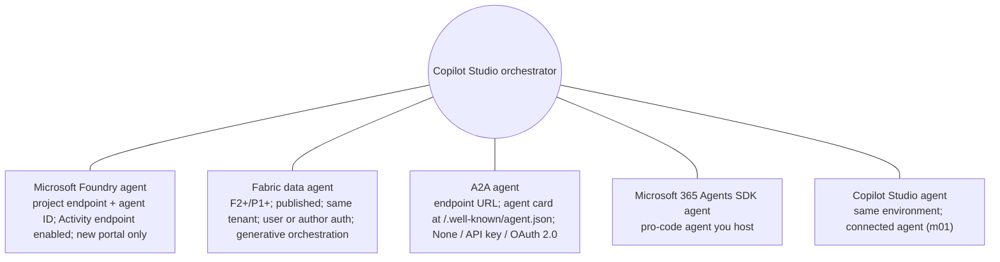
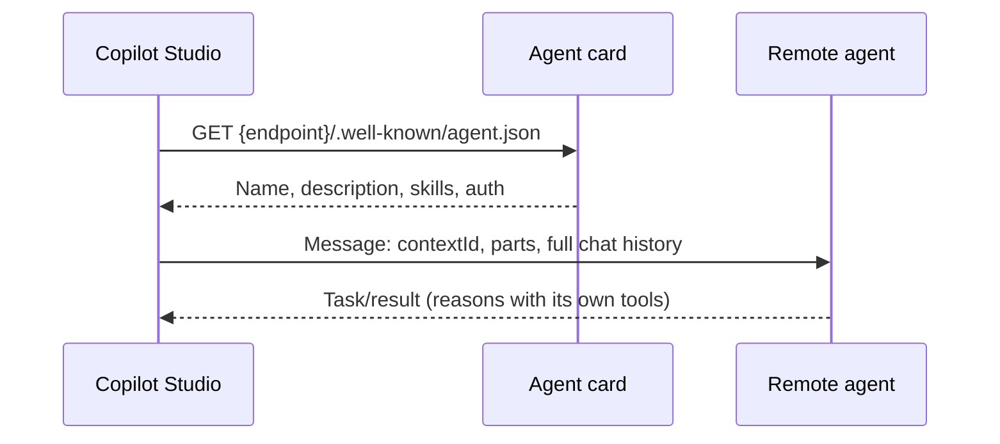

# Foundry agents, Fabric data agents and A2A

> AB-620 · D2 Integrate and extend agents in Copilot Studio · about 80 min · Study Hub module `m02` ([open the hub](https://claude.ai/artifact/DfeAjDjaTCgtf36RSKeSSS))

## Why it matters
Three skills sit here: **integrate a Foundry agent**, **integrate a Fabric data agent**, and **create a multi-agent solution with A2A**. Each has precise prerequisites the exam can test: endpoints, capacities, protocols and identities.

## Pre-question (answer before reading)
**Q:** You connect a Foundry agent to Copilot Studio and every call fails with a 400 error, though the agent works in the Foundry playground. What's the likely cause?

<details><summary>Answer</summary>

The Foundry agent doesn't have the **Activity protocol endpoint** enabled. New Foundry agents expose only the Responses protocol by default; enable Activity programmatically (REST API or Python SDK; the portal can't change protocols).

</details>

## Mental model & story
Contoso's data science team built a **Foundry agent** that predicts delivery delays with code interpreter and the carrier's data. Asha wants the store agent to use it. In Copilot Studio she opens **Agents > Add an agent**, chooses **Microsoft Foundry**, creates a connection with the **project endpoint URL**, enters the **agent ID**, and writes a description so the orchestrator knows when to call it.

The first test returns HTTP 400. The data scientists check: their agent only had the **Responses** and **A2A** endpoints, the defaults. They enable the **Activity protocol** endpoint with the Python SDK (the portal has no switch for it) and it works. A colleague's older agent fails with *404 – Version not found*: it was built in the **classic** Foundry portal, and only agents from the new portal can be connected.

Finance analysts want sales figures. The BI team has a **Fabric data agent** over the sales lakehouse and a Power BI semantic model. It runs on an **F64** capacity (anything **F2 or above, or P1+**, works), is **published** with a detailed description, and lives in the same tenant. Asha adds it from **Agents > Add > Microsoft Fabric**, and chooses **User authentication** so each analyst only sees data they're allowed to read. Generative orchestration must be on, and the agent isn't supported in Microsoft 365 Copilot (validated for Teams).

Finally, a logistics partner runs its own agent on another cloud and exposes it through the **Agent2Agent (A2A)** protocol. Asha adds an **A2A agent** with the partner's **endpoint URL** (not the agent card URL). Copilot Studio reads the **agent card** from `/.well-known/agent.json` to fill the name and description. Authentication is **OAuth 2.0** with the partner's client ID, secret and token URLs.

Ifeoma, the legal counsel, spots something in the A2A payload: Copilot Studio sends the **full chat history** to the partner, not just the last question. A data processing agreement and a privacy review follow before go-live.

**Where the analogy breaks:** Connecting an agent doesn't make it *yours*: you don't see its prompts, tools or data handling. Copilot Studio documents that you're responsible for reviewing and testing connected external agents, including security, permissions and observability.

## Diagrams
**External agents you can connect**



**A2A call from Copilot Studio**



## Key points
- **Foundry agent** (standard harness; preview): Agents > Add an agent > *Connect to an external agent* > **Microsoft Foundry** > connection with the **Foundry project endpoint URL** > **Agent ID** > name and description.
- The Foundry agent must have the **Activity protocol endpoint** enabled (only via REST API or Python SDK); otherwise runtime **400** errors. Only agents from the **new Foundry portal** connect (classic → *404 – Version not found*).
- **Fabric data agent**: needs a paid **F2+ Fabric capacity** or **Power BI Premium P1+** with Fabric enabled; data in a warehouse, lakehouse, semantic model, KQL database, mirrored database or ontology; the data agent **published** with a rich description; **same tenant**.
- Fabric in Copilot Studio: Agents > Add > **Microsoft Fabric** > connection > select the data agent; auth **User authentication** (users need access to the data agent and sources) or **Agent author authentication**; requires **generative orchestration**.
- Fabric limits: not supported in **Microsoft 365 Copilot**; validated for **Teams**; responses may leave Fabric's compliance boundary (review residency).
- **A2A agent**: Agents > Add > A2A agent > **endpoint URL** (the communication endpoint, *not* the card URL); name and description auto-filled from the **agent card** at `{endpoint}/.well-known/agent.json`.
- A2A auth: **None** (dev/sample only), **API key** (header name or query parameter), **OAuth 2.0** (client ID, client secret, authorization URL, token URL, refresh URL).
- A2A payload: a `contextId`, message IDs, locale, message parts and the **full chat history** (not just the last utterance): plan privacy reviews and agreements.
- Choosing: **MCP** = your orchestrator calls tools; **A2A** = delegate a task to an agent with its own reasoning on any platform; **connector** = data/operations of one system.
- You're accountable for connected external agents: test them, review data handling, permissions and observability, and gate write/delete actions with approvals.

## Comparisons
**Connecting external agents: prerequisites at a glance**

| Agent type | You provide | Must be true | Common failure |
|---|---|---|---|
| Microsoft Foundry | Project endpoint URL, agent ID, description | Activity endpoint enabled; new Foundry portal agent | 400 (no Activity endpoint), 404 Version not found (classic) |
| Fabric data agent | Fabric connection, data agent, auth mode | F2+/P1+, published, same tenant, generative orchestration | Users lack access to data agent or sources |
| A2A agent | Endpoint URL, auth (None/API key/OAuth 2.0) | Valid agent card at /.well-known/agent.json (for auto-fill) | Using the card URL as the endpoint; auth mismatch |
| Copilot Studio agent | Selection from same environment | Published; let other agents connect; shared | Setting off or not shared |

## Code to recognise
**An A2A agent card (served at /.well-known/agent.json)**

```json
{
  "name": "Northwind Logistics Agent",
  "description": "Books carrier pickups and answers delivery ETA questions for Northwind shipments.",
  "url": "https://agents.northwind.example/a2a",
  "version": "1.2.0",
  "capabilities": { "streaming": true },
  "defaultInputModes": ["text"],
  "defaultOutputModes": ["text"],
  "skills": [
    { "id": "book-pickup", "name": "Book pickup", "description": "Books a carrier pickup for a shipment ID and date." },
    { "id": "eta", "name": "Delivery ETA", "description": "Returns the estimated delivery date for a tracking number." }
  ],
  "securitySchemes": { "oauth": { "type": "oauth2" } }
}
```

- Line 3: Copilot Studio reads the name and description from the card to pre-fill the connection.
- Line 4: This is the **endpoint** you enter in Copilot Studio, not the card's own URL.
- Line 9: Skills tell callers what the agent can do.
- Line 13: Auth declared by the agent; match it with None, API key or OAuth 2.0 in Copilot Studio.

## Portal steps
**Connect a Foundry agent** ((agent) > Agents > Add an agent > Connect to an external agent > Microsoft Foundry)

1. Create a connection with the Foundry **project endpoint URL** (or select one).
2. Enter the **Agent ID**, a name and a precise **description**.
3. Confirm with the Foundry team that the **Activity** endpoint is enabled and the agent is from the new portal.
4. Add, test, and check the activity map.

**Connect a Fabric data agent** ((agent) > Agents > + Add > Microsoft Fabric)

1. Create the Fabric connection; select the published data agent.
2. Adjust the description; choose **User authentication** or **Agent author authentication**.
3. Make sure generative orchestration is on.
4. Test in Teams with users who have the right Fabric permissions.

**Connect an A2A agent** ((agent) > Agents > Add agent > A2A agent)

1. Enter the agent's **endpoint URL**; name/description auto-fill from its card.
2. Choose authentication: None, API key (header or query name), or OAuth 2.0 (client ID, secret, authorization, token and refresh URLs).
3. Save, create/select the connection, *Add and configure*.
4. Review privacy: full chat history is sent.

## Worked example
**Scenario:** Sales managers want to ask "what were Q3 sales by region?" in Teams and get numbers from the Fabric lakehouse that respect row-level security. Design the integration.

- Numbers from a Fabric lakehouse via natural language → Fabric data agent.
- Respect each manager's access → user authentication.
- Constraints: capacity, publishing, tenant, orchestration, channel.

**Answer:** Publish a **Fabric data agent** (F2+/P1+ capacity) over the lakehouse with a detailed description; in Copilot Studio add it via **Microsoft Fabric** with **User authentication**; ensure **generative orchestration**; deploy to **Teams** (on this standard-harness preview path Microsoft 365 Copilot isn't supported; the GA GitHub Copilot harness integration can publish to both); give managers read access to the data agent and sources.

## Your turn (faded example)
**Scenario:** An A2A connection fails right after you paste `https://agents.partner.example/.well-known/agent.json` as the endpoint.

- Copilot Studio wants the communication endpoint.
- **What should you enter?** <details><summary>answer</summary>The agent's endpoint, e.g. `https://agents.partner.example/a2a`; Copilot Studio fetches the card from `{endpoint}/.well-known/agent.json` itself.</details>
- **What else do you check?** <details><summary>answer</summary>That the authentication type (API key header name or OAuth 2.0 URLs and credentials) matches what the partner's agent requires.</details>

## Exam traps & misconceptions
- ✗ Expecting a classic-portal Foundry agent to connect. → ✓ Only new-portal agents; classic → 404 Version not found.
- ✗ Enabling the Foundry Activity endpoint in the portal. → ✓ There's no portal switch; use REST or the Python SDK.
- ✗ Deploying a standard-harness agent with a Fabric data agent (preview path) to Microsoft 365 Copilot. → ✓ Not supported there (Teams is validated). The GA GitHub Copilot harness integration (Add a tool > Fabric IQ Data MCP) can publish to Teams and Microsoft 365 Copilot.
- ✗ Pasting the agent card URL as the A2A endpoint. → ✓ Enter the communication endpoint; the card is fetched from `.well-known`.
- ✗ Assuming A2A sends only the latest message. → ✓ It sends the **full chat history**: review privacy.

## Discussion prompts
- **Foundry agent via connected agent, or Foundry model via a prompt?** Use the **agent** when the Foundry side needs its own tools, reasoning and state (code interpreter, Foundry IQ, workflows). Use a **Foundry model in a prompt** when you just need a different model for a single transformation step.
- **What due diligence do you need before connecting a partner's A2A agent?** Data processing agreement, what history and personal data it receives, authentication strength, logging and correlation IDs, SLAs and rate limits, failure behaviour, and approvals for any action with side-effects.

## Interview angle / teach-back
**Prompt:** Explain how to connect a Foundry agent, a Fabric data agent and an A2A agent to Copilot Studio, with one gotcha for each.

**Rubric:** Foundry: project endpoint + agent ID; Activity endpoint; new portal only · Fabric: F2+/P1+, published, same tenant; user vs author auth; generative orchestration; not M365 Copilot on the standard-harness preview path · A2A: endpoint (not card); card at .well-known; None/API key/OAuth 2.0; full history sent

**Model answer:** For Foundry I add an external Microsoft Foundry agent with the project endpoint URL and agent ID; the gotcha is that the agent must have the Activity endpoint enabled and come from the new portal. For Fabric I add a published data agent from an F2+ or P1+ capacity in the same tenant, pick user or author authentication, and keep generative orchestration on; it isn't supported in Microsoft 365 Copilot. For A2A I enter the communication endpoint, not the card URL, choose None, API key or OAuth 2.0, and remember the full chat history is sent.

## Quick Q&A
- **Values for a Foundry agent connection?** Project endpoint URL + agent ID.
- **Endpoint the Foundry agent must expose?** **Activity protocol**.
- **Classic Foundry agent error?** **404 – Version not found**.
- **Fabric capacity needed?** **F2+** or **P1+** with Fabric enabled.
- **Fabric auth options?** User authentication or Agent author authentication.
- **A2A card path?** `{endpoint}/.well-known/agent.json`.
- **A2A auth options?** None, API key, OAuth 2.0.

## Sources (accessed 2026-10-02)
- [Connect to a Microsoft Foundry agent (preview)](https://learn.microsoft.com/en-us/microsoft-copilot-studio/add-agent-foundry-agent)
- [Consume a Fabric data agent in Copilot Studio](https://learn.microsoft.com/en-us/fabric/data-science/data-agent-microsoft-copilot-studio)
- [Connect to an agent over A2A](https://learn.microsoft.com/en-us/microsoft-copilot-studio/add-agent-agent-to-agent)
- [Learn module: cross-platform multi-agent with A2A](https://learn.microsoft.com/en-us/training/modules/build-cross-platform-multi-agent-solutions-agent2agent-copilot-studio/)

## SRS cards created
- ab-620-m02-01, ab-620-m02-02, ab-620-m02-03, ab-620-m02-04
