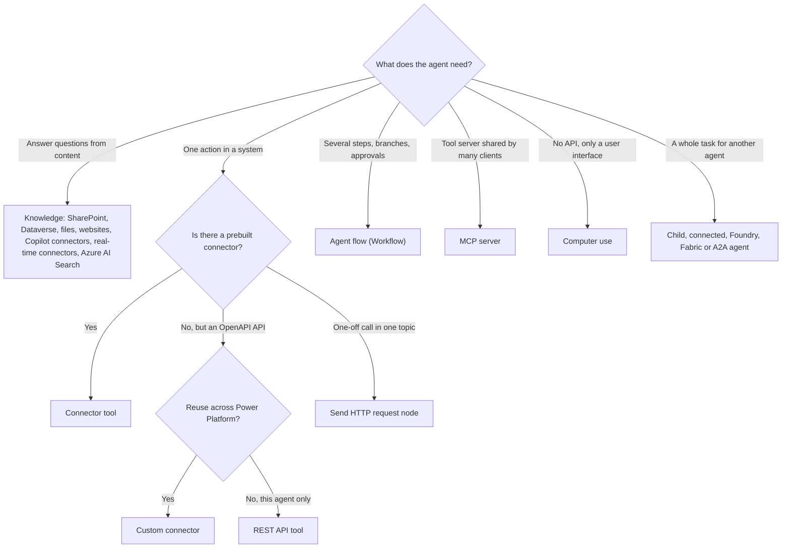
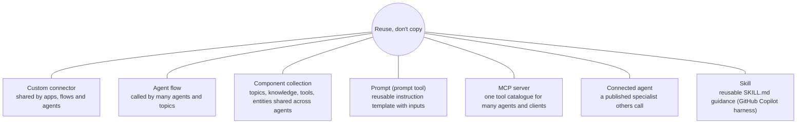

# Plan an agent solution: integration, reuse, audiences

> AB-620 · D1 Plan and configure agent solutions · about 75 min · Study Hub module `p01` ([open the hub](https://claude.ai/artifact/DfeAjDjaTCgtf36RSKeSSS))

## Why it matters
Planning questions are worth a third of the exam, and they're almost all *choose the right pattern* questions. The trick is to spot the one constraint in the scenario that rules out every other option.

## Pre-question (answer before reading)
**Q:** A system has a documented REST API and you need to call it from one agent and also from a Power Apps app and two Power Automate flows. Custom connector or REST API tool?

<details><summary>Answer</summary>

A **custom connector**: it's a Power Platform asset reused by apps, flows and agents. A REST API tool lives only in Copilot Studio.

</details>

## Mental model & story
Contoso's architect, **Daniel**, keeps a whiteboard with three columns for every agent request: **do something**, **answer questions**, **hand off reasoning**. "Every requirement lands in one of these," he tells Asha. *Do something* means tools. *Answer questions* means knowledge. *Hand off reasoning* means another agent.

For tools he climbs a ladder and stops at the first rung that works. First: a **prebuilt connector** (1,000+ exist, governed by DLP). If none fits but the API has an OpenAPI description, a **custom connector**, which every app and flow in Power Platform can reuse. If only this agent needs it, a **REST API tool** inside Copilot Studio. A single one-off call inside one topic: the **Send HTTP request** node. Several steps, branches or an approval: an **agent flow**. A tool server shared by many agents and clients: **MCP**. No API at all, only a screen: **computer use**.

For knowledge, he asks where the content lives and who may see it. SharePoint and OneDrive keep permissions per user. **Copilot connectors** bring ServiceNow or Confluence content into Microsoft Graph. **Real-time Power Platform connectors** query live systems at question time. **Azure AI Search** serves large or custom indexes the data team already runs.

Then reuse. The *returns lookup* will be needed by three agents, so it becomes an agent flow in a shared solution, not three copies of a topic. Common topics and knowledge go into a **component collection**. A fulfilment specialist that the warehouse team owns becomes a **connected agent** others can call.

Last, the audience. The internal assistant runs in Teams with Microsoft sign-in and SharePoint knowledge. The public returns bot on the website has no sign-in, can't use tools that act as the user, discloses that it's an AI, and hands complex cases to a live agent. *Same company, two very different designs.*

**Where the analogy breaks:** Real projects mix patterns: a connector inside an agent flow, an MCP server built on top of a custom connector, knowledge plus tools in one turn. The ladder tells you the *default*; scenario constraints (licensing, DLP, latency, identity) can move you up or down a rung.

## Diagrams
**Integration decision tree**



**Reusable agent components**



## Key points
- Classify each requirement: **tools** (do), **knowledge** (answer), **agents** (delegate reasoning). Plan each separately.
- Tool ladder: prebuilt connector → custom connector (reuse across Power Platform) → REST API tool (Copilot Studio only; OpenAPI v2, v3 auto-converted) → Send HTTP request node (one-off, not shareable) → agent flow (multi-step, approvals) → MCP (shared server, auto-discovered tools) → computer use (no API).
- Knowledge choices follow **where data lives** and **who may see it**: SharePoint/OneDrive (user permissions), Dataverse, uploaded files, public websites, Copilot connectors (indexed into Graph, admin-configured), real-time Power Platform connectors (live query, user auth), Azure AI Search (existing vector index).
- Enterprise integration questions often hinge on **identity** (end user vs shared account), **DLP** (connector groups), **licensing** (premium connectors), **latency** (100-second flow limit) and **network** (on-premises data gateway, VNet).
- Reusable components: custom connectors, agent flows, **component collections** (topics, knowledge, tools, entities shared across agents and moved with solutions), prompts, MCP servers, connected agents, skills.
- Child agents are reusable *within* one agent; connected agents are reusable *across* agents (separately published, own lifecycle).
- Internal audiences: Teams and Microsoft 365 Copilot, Microsoft Entra sign-in, SSO, SharePoint/Graph knowledge, tools acting as the user.
- External audiences: website, WhatsApp, Facebook, mobile; often no sign-in (or a customer identity provider through manual authentication); public knowledge only; AI disclosure; content moderation; human handoff to a contact centre; plan for scale and cost.
- Anonymous users can't use tools that need **end-user credentials**: use maker-provided credentials with tight scopes or require sign-in.
- Start with **one agent**. Split into several only for a reason: routing accuracy drops with too many tools, different owners or release cycles, different security, or reuse by other agents.

## Comparisons
**Tool patterns side by side**

| Pattern | Best when | Shareable? | Limits / notes |
|---|---|---|---|
| Prebuilt connector | A connector already exists (Dataverse, Outlook, ServiceNow...) | Yes, any Power Platform asset | DLP groups; premium connectors need licences |
| Custom connector | Your API, reused by apps, flows and agents | Yes | OpenAPI definition; API key, OAuth 2.0 or basic auth |
| REST API tool | Your API, this agent only | No (Copilot Studio) | OpenAPI v2 JSON (v3 converted); pick only needed operations |
| Send HTTP request node | One self-contained call in one topic | No | Headers, JSON body, response schema; default timeout 30 s |
| Agent flow | Multi-step logic, approvals, parallel branches | Yes (solution-aware) | Must respond within ~100 s; billed in Copilot Credits |
| MCP server | Shared tool catalogue, many clients | Yes (server) | Generative orchestration only; topics can't call MCP |
| Computer use | No API; Windows or web UI only | Per agent | Slower, credits per step; supervise and allow-list sites |

**Internal vs external agent design**

|  | Internal (employees) | External (customers) |
|---|---|---|
| Channels | Teams + Microsoft 365 Copilot, SharePoint | Website, WhatsApp, Facebook, mobile app, contact centre |
| Sign-in | Authenticate with Microsoft (Entra ID) | None, or manual auth with a customer identity provider |
| Knowledge | SharePoint, Graph, Dataverse with user permissions | Public websites, curated files, public FAQ |
| Tools | End-user credentials (act as the user) | Maker-provided, least privilege; no user-credential tools for anonymous users |
| Safety and trust | Sensitivity labels, DLP, audit | AI disclosure, strict moderation, escalation to humans, privacy notice |

## Code to recognise
**Instruction skeleton that encodes the plan**

```text
# Role
You are the Contoso Customer Support Rep Assistant for store staff.

# Scope
Answer questions about returns, refunds, orders and products only.
Politely decline anything else and suggest the IT service desk.

# Tools and knowledge
- Use /Get order details for any order-status question. Never guess.
- Use /Create return request only after the customer confirms the item and reason.
- Use the Returns Policy knowledge for policy questions and cite it.

# Escalation
Refunds over $100 go through /Request refund approval. Tell the user a supervisor will decide.

# Security
Never reveal customer data unless the staff member gives the order number.
```

- Line 1: Role and audience first: the orchestrator uses this to set tone and limits.
- Line 4: Scope plus a polite refusal path reduces off-topic answers.
- Line 9: In Copilot Studio, typing `/` in instructions inserts a reference to a tool, topic or variable.
- Line 10: Encode confirmation rules for actions that change data.
- Line 13: Escalation rules belong in instructions *and* in the flow (approval) so they're enforced, not just suggested.

## Portal steps
**Create a component collection for reuse** (Copilot Studio > Agents > (agent) > Settings > Component collections (or Library))

1. Create a new component collection and name it for its purpose, e.g. *Contoso common*.
2. Add topics, knowledge, tools or entities to it.
3. Add the collection to other agents in the same environment.
4. Include it in your solution so it moves with ALM.

## Worked example
**Scenario:** Fabrikam's HR agent must (1) answer leave-policy questions from SharePoint, (2) create leave requests in an HR system that has an OpenAPI-described API already used by a Power Apps app, (3) route requests over 10 days to a manager for approval. Pick a pattern for each.

- (1) is *answer questions*: SharePoint knowledge keeps each user's permissions.
- (2) is *do something* in an API that apps already use: reuse means a custom connector (one may already exist for the app).
- (3) needs a decision by a person before the write: a multi-step agent flow with an approval, which calls the connector.

**Answer:** **SharePoint knowledge** for policies; a **custom connector** for the HR API (shared with the app); an **agent flow** with a condition (>10 days) and an approval that then calls the connector. The agent calls the flow as a tool.

## Your turn (faded example)
**Scenario:** A logistics company wants its website bot (anonymous visitors) to show delivery status from a tracking API.

- Visitors aren't signed in, so end-user credentials are impossible.
- **Which credential model must the tool use?** <details><summary>answer</summary>**Maker-provided** credentials (a service account or API key held in the connection), scoped to read-only tracking.</details>
- **What extra protection limits abuse?** <details><summary>answer</summary>Ask for both tracking number and postcode before calling, return only status fields, apply content moderation, and monitor usage. Writes should require sign-in.</details>

## Exam traps & misconceptions
- ✗ Choosing a REST API tool when the scenario says the API must also be used by Power Apps or Power Automate. → ✓ Reuse across Power Platform → **custom connector**.
- ✗ Using the Send HTTP request node for a call several agents need. → ✓ The node is per topic and not shareable. Use a connector or agent flow.
- ✗ Splitting into many agents from day one. → ✓ Start with one agent. Split for routing accuracy, ownership, security or reuse.
- ✗ Planning tools that act as the user on a public anonymous website. → ✓ No sign-in, no user identity. Use maker-provided credentials with least privilege, or require sign-in.
- ✗ Putting a business rule only in instructions ("always get approval"). → ✓ Instructions guide; flows and approvals enforce. High-impact rules must be enforced in the flow.

## Discussion prompts
- **Your security team prefers MCP for everything. When would you push back?** MCP needs generative orchestration, can't be called from topics, and its tool descriptions are controlled server-side. For a single deterministic action inside a scripted topic, a connector or agent flow is simpler and easier to govern with DLP. MCP shines when many agents and clients share one tool catalogue.
- **How do you decide between knowledge and a tool for the same data (e.g., product catalogue in Dataverse)?** Knowledge suits free-text questions over descriptions and documents (search + summarise with citations). A tool suits exact lookups and filters (price of SKU 123, stock in store 4). Many agents use both: knowledge for *tell me about*, tool for *give me the exact value*.

## Interview angle / teach-back
**Prompt:** Explain how you'd choose between a prebuilt connector, custom connector, REST API tool, HTTP node, agent flow, MCP and computer use.

**Rubric:** Prebuilt connector first · Custom connector for reuse across Power Platform · REST API tool for Copilot Studio-only use · HTTP node for a one-off call in a topic · Agent flow for multi-step/approvals · MCP for shared tool servers (generative orchestration) · Computer use only when there's no API

**Model answer:** I start with a prebuilt connector. If there isn't one and the API has an OpenAPI description, I build a custom connector when apps or flows also need it, or a REST API tool when only this agent does. A single call inside one topic can be a Send HTTP request node. Multi-step work with branches or approvals becomes an agent flow. When many agents and clients share tools, I use an MCP server, which needs generative orchestration. Computer use is the last resort for systems with no API.

## Quick Q&A
- **Three purposes of integrations?** Do something (tools), answer questions (knowledge), hand off reasoning (agents).
- **Reuse an API across apps, flows and agents?** **Custom connector**.
- **API only for this agent, with an OpenAPI file?** **REST API tool**.
- **Multi-step with approval?** **Agent flow**.
- **No API at all?** **Computer use**.
- **Share topics and knowledge across agents?** **Component collection**.
- **Anonymous users and user-credential tools?** Not possible: use maker-provided credentials or require sign-in.

## Sources (accessed 2026-10-02)
- [Integration and extensibility overview (Copilot Studio)](https://learn.microsoft.com/en-us/microsoft-copilot-studio/guidance/)
- [Knowledge sources summary](https://learn.microsoft.com/en-us/microsoft-copilot-studio/knowledge-copilot-studio)
- [Add tools to custom agents](https://learn.microsoft.com/en-us/microsoft-copilot-studio/add-tools-custom-agent)
- [Exam AB-620 study guide](https://learn.microsoft.com/en-us/credentials/certifications/resources/study-guides/ab-620)

## SRS cards created
- ab-620-p01-01, ab-620-p01-02, ab-620-p01-03, ab-620-p01-04
