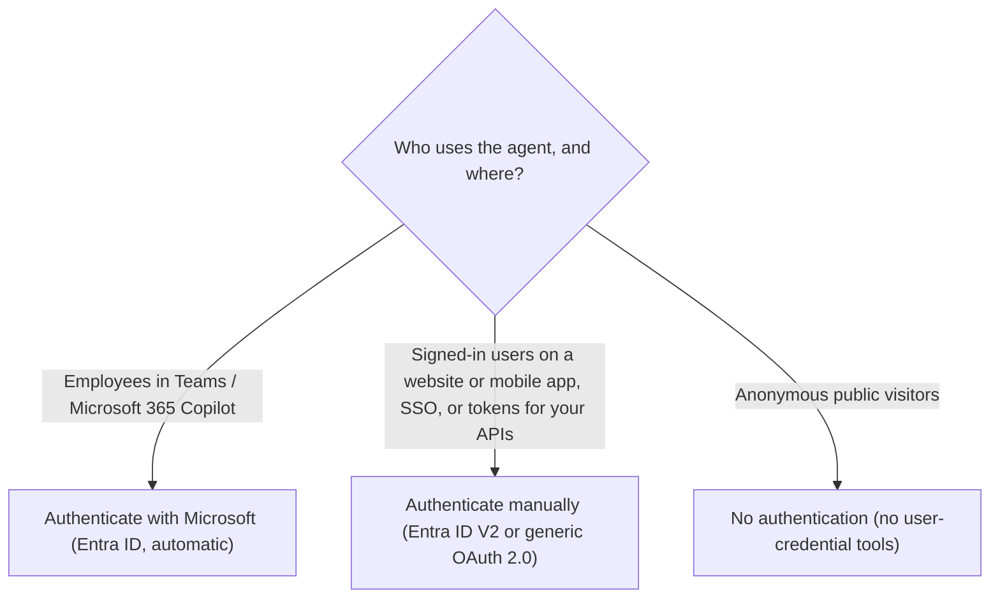

# Identity, security and governance

> AB-620 · D1 Plan and configure agent solutions · about 85 min · Study Hub module `p02` ([open the hub](https://claude.ai/artifact/DfeAjDjaTCgtf36RSKeSSS))

## Why it matters
Identity is the hidden key to many AB-620 answers: *whose* permissions does a tool use, which channels work with which sign-in option, and what can an admin block? Get this wrong and a correct-looking design leaks data.

## Pre-question (answer before reading)
**Q:** A Teams agent uses a SharePoint connector tool. Should it read documents with the user's own permissions or with one shared account? What decides it?

<details><summary>Answer</summary>

Usually the **user's own** permissions (end-user credentials), so people only see what they're allowed to. A **shared** (maker-provided) account fits when everyone should see the same data or users have no access to the system. The requirement wording decides.

</details>

## Mental model & story
Contoso's security lead, **Mei**, reviews Asha's agent with three questions on a sticky note: *Who is the user? Whose keys does each tool use? What can admins switch off?*

**Who is the user?** The agent's authentication setting answers it. *No authentication* means anyone with the link can chat and the agent knows nothing about them. *Authenticate with Microsoft* signs people in with Microsoft Entra ID automatically in Teams and Microsoft 365 Copilot. *Authenticate manually* lets Asha register her own Entra ID app (or another OAuth 2.0 provider) for websites, mobile apps, single sign-on and access tokens she can pass to APIs.

**Whose keys?** Each connector tool has a credential choice. **End-user credentials** (default) make every user sign in to the connection, so the HR connector shows each person only their own records. **Maker-provided credentials** use Asha's connection for everyone, convenient but powerful, so Mei insists on a narrowly scoped service account and admin approval.

**What can admins switch off?** Plenty. **Data loss prevention (DLP)** policies put connectors into *Business*, *Non-business* or *Blocked* groups, and Copilot Studio features appear as connectors too: public website knowledge, specific channels, HTTP requests, Application Insights, unauthenticated chat. Managed Environments add sharing limits and solution checks. **Purview** audits activity and sensitivity labels follow SharePoint content into answers.

By the end of the review, the agent signs users in with Microsoft, reads HR data with end-user credentials, writes returns through a scoped service account, and lives in a production environment whose DLP policy blocks everything it doesn't need.

**Where the analogy breaks:** Three questions are a start, not a threat model. Real reviews also cover prompt injection through documents, data residency, transcript retention, who may edit the agent, and how autonomous triggers (which run as the maker) are scoped.

## Diagrams
**Choosing the agent's authentication option**



**Connector credentials: whose permissions?**

| | Users see the same data | Users see their own data |
|---|---|---|
| **Read only** | **Maker-provided, read-only**: Shared catalogue or FAQ lookups; scoped service account | **End-user credentials**: Each user reads only what they can open (SharePoint, Outlook, HR) |
| **Writes data** | **Maker-provided, writes**: Service account writes for everyone: approvals, auditing, least privilege | **End-user credentials, writes**: Actions as the user (send my email, update my record); clear consent |

## Key points
- Agent authentication options: **No authentication** (anyone with the link; no user identity), **Authenticate with Microsoft** (Entra ID, automatic in Teams, Microsoft 365 Copilot and other Microsoft surfaces; no access token available to you), **Authenticate manually** (Microsoft Entra ID V2 with federated credentials, certificates or client secrets; Entra ID; or Generic OAuth 2).
- Manual authentication: app registration, client ID and credential, **scopes**, optional **token exchange URL** for SSO, and *Require users to sign in*. Gives you `System.User.AccessToken` to call your APIs.
- Authentication changes take effect only after you **publish**.
- Connector tool credentials: **end-user** (default; each user's own permissions; needs signed-in users) vs **maker-provided** (the maker's connection for everyone; admins can restrict this).
- Teams with manual Entra authentication: configure SSO (token exchange URL + Teams app manifest) so users aren't asked to sign in to the agent with a validation code. Connectors still can't use SSO under manual auth (users authenticate to each connector); *Authenticate with Microsoft* gives Teams SSO automatically. (Microsoft's pages currently disagree on whether manual auth is allowed in Teams at all; check before you build.)
- **DLP** policies group connectors as Business, Non-business or Blocked; one agent can't mix Business and Non-business connectors. Copilot Studio capabilities (channels, knowledge sources such as public websites, HTTP requests, Application Insights, chat without Entra authentication) are governed as connectors too. Enforcement is in real time.
- **Endpoint filtering** in DLP can allow or deny specific URLs for HTTP requests and connectors.
- Environment strategy: separate dev / test / prod; **Managed Environments** add sharing limits, solution checker enforcement, usage insights; security roles control who can build and who can view transcripts.
- Sharing an agent: **Editor** (co-author) vs **Viewer**; end users through security groups or the Teams/Microsoft 365 availability settings.
- Data protection: transcripts in Dataverse (retention configurable), **Microsoft Purview** audit and sensitivity labels, customer-managed keys at environment level, data stays in the environment's geography.
- Agent runtime protection: built-in defences against user and cross-prompt injection attacks (UPIA/XPIA); optional external threat detection that can review tool calls before they run.

## Comparisons
**Agent authentication options**

| Option | Channels | User identity available? | Typical use |
|---|---|---|---|
| No authentication | Website, demo site, most channels | No | Public FAQ bot |
| Authenticate with Microsoft | Teams, Microsoft 365 Copilot, other Microsoft surfaces | Yes (name, ID), no access token | Internal employee agent |
| Authenticate manually | All, incl. custom website and mobile app | Yes, plus System.User.AccessToken | SSO, calling your own APIs, customer identity providers |

**Who governs what**

| Control | Where | Example |
|---|---|---|
| DLP policy | Power Platform admin center | Block public website knowledge in prod |
| Managed Environments | Power Platform admin center | Limit sharing to security groups |
| Maker credential control | Admin settings | Disallow maker-provided credentials |
| Purview audit, sensitivity labels | Microsoft Purview | Audit agent edits and conversations |
| Conditional Access | Microsoft Entra | Require compliant devices to sign in |

## Code to recognise
**Using the signed-in user in a topic (Power Fx)**

```
// Condition node: only continue for signed-in users
System.User.IsLoggedIn = true

// Message node text can insert the user's name
"Hi " & System.User.DisplayName & ", let's check your order."

// HTTP request header (manual authentication only)
"Bearer " & System.User.AccessToken
```

- Line 2: Use in a Condition node before steps that need identity; send others to the Sign in topic.
- Line 5: `DisplayName`, `Email` and `Id` come from the sign-in.
- Line 8: `AccessToken` exists only with **Authenticate manually**; *Authenticate with Microsoft* doesn't expose it.

## Portal steps
**Set authentication** (Copilot Studio > (agent) > Settings > Security > Authentication (new UI: Settings > Safety & access))

1. Pick No authentication, Authenticate with Microsoft, or Authenticate manually.
2. Manual: choose the service provider (Entra ID V2 with federated credentials / certificates / client secrets, or Generic OAuth 2), then client ID, credential and scopes.
3. Optional: token exchange URL for SSO; *Require users to sign in*.
4. Save, then **publish** so the change takes effect.

**Set a connector tool's credentials** ((agent) > Tools > (tool) > Details > Additional details > Credentials to use)

1. **End user credentials** (default) or **Maker-provided credentials**.
2. For maker-provided, create the connection with a dedicated, least-privilege account.
3. Test with a non-admin account to see what real users get.

## Worked example
**Scenario:** An internal Teams agent must let employees see **their own** payslips through an HR connector, and must also post anonymised daily stats to a shared Teams channel. Configure identity.

- Agent sign-in: employees in Teams → Authenticate with Microsoft.
- Payslips: each user's own data → end-user credentials on the HR connector tool.
- Daily stats post: same for everyone, scheduled → an event trigger or flow with a service connection (maker-provided), scoped to that channel only.

**Answer:** **Authenticate with Microsoft**; HR tool with **end-user credentials**; stats posting with a **dedicated maker-provided/service connection** limited to that channel. Add DLP so only the needed connectors are allowed.

## Your turn (faded example)
**Scenario:** A customer portal (custom website) already signs users in with your company's Entra ID tenant. The agent must call your orders API as the user.

- Website + need for a token for your API → not Authenticate with Microsoft.
- **Which authentication option and provider?** <details><summary>answer</summary>**Authenticate manually** with **Microsoft Entra ID V2** (app registration, scopes for the orders API).</details>
- **How does the agent pass identity to the API?** <details><summary>answer</summary>Send `System.User.AccessToken` in the `Authorization: Bearer` header (HTTP node) or use a connector/REST tool configured for OAuth with the user's sign-in.</details>

## Exam traps & misconceptions
- ✗ Expecting `System.User.AccessToken` with *Authenticate with Microsoft*. → ✓ It's only available with **manual** authentication.
- ✗ Using maker-provided credentials for personal data ("so users don't have to sign in"). → ✓ Everyone would see what the maker can see. Use end-user credentials for per-user data.
- ✗ Changing authentication and testing in Teams immediately. → ✓ Auth changes need a **publish**, and users may need a new conversation.
- ✗ Mixing a Business connector and a Non-business connector in one agent. → ✓ DLP forbids it; the agent is blocked.
- ✗ Forgetting autonomous triggers run as the maker. → ✓ Scope the maker's connections, or use a dedicated service account.

## Discussion prompts
- **Why might an organisation block maker-provided credentials entirely?** Because a maker's broad permissions would be lent to every user, and audit logs show the maker instead of the real user. Blocking it forces end-user credentials or dedicated, approved service accounts.
- **What would you put in a production DLP policy for a customer-facing agent?** Allow only the connectors it uses (Business group), block public website knowledge if answers must come from curated sources, restrict HTTP to known endpoints with endpoint filtering, block unneeded channels, and keep Application Insights allowed for monitoring.

## Interview angle / teach-back
**Prompt:** Explain the three agent authentication options and the two connector credential modes, and how you'd pick them.

**Rubric:** No auth = anonymous, no user tools · Authenticate with Microsoft = Entra in Teams/M365, no token · Manual = Entra ID V2/OAuth for websites, SSO, tokens · End-user credentials = each user's permissions · Maker-provided = shared identity, least privilege · Changes need publish

**Model answer:** Agent sign-in is either none (anonymous, so no tools that act as the user), Authenticate with Microsoft (automatic Entra sign-in in Teams and Microsoft 365 Copilot, but no access token for you), or manual authentication with Entra ID V2 or another OAuth provider, which works on any channel and gives a token for your APIs. Separately, each connector tool uses either the end user's own credentials, so people only see their own data, or the maker's shared connection, which must be tightly scoped. Publish after changing authentication.

## Quick Q&A
- **Default connector credential mode?** **End-user credentials**.
- **Option for a custom website with SSO to your API?** **Authenticate manually** (Entra ID V2).
- **Where is `User.AccessToken` available?** Manual authentication only.
- **DLP connector groups?** Business, Non-business, Blocked.
- **What's needed after changing auth?** **Publish**.
- **Whose identity do event triggers use?** The maker's connection.
- **What adds sharing limits and solution checks?** **Managed Environments**.

## Sources (accessed 2026-10-02)
- [Configure user authentication](https://learn.microsoft.com/en-us/microsoft-copilot-studio/configuration-end-user-authentication)
- [Configure data loss prevention policies for agents](https://learn.microsoft.com/en-us/microsoft-copilot-studio/admin-data-loss-prevention)
- [Security and governance in Copilot Studio](https://learn.microsoft.com/en-us/microsoft-copilot-studio/security-and-governance)

## SRS cards created
- ab-620-p02-01, ab-620-p02-02, ab-620-p02-03, ab-620-p02-04
