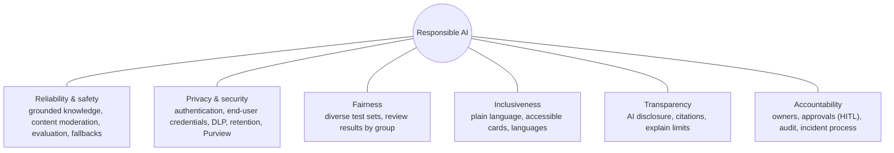
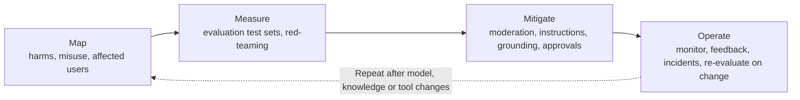

# Responsible AI strategy for agents

> AB-620 · D1 Plan and configure agent solutions · about 60 min · Study Hub module `p03` ([open the hub](https://claude.ai/artifact/DfeAjDjaTCgtf36RSKeSSS))

## Why it matters
The exam expects a *strategy*, not slogans: which Copilot Studio settings, review steps and human controls make an agent fair, safe, transparent and accountable. Each principle maps to something you can switch on or design.

## Pre-question (answer before reading)
**Q:** Your external agent's generative answer is blocked by content moderation. What does the user see, and where would you change it?

<details><summary>Answer</summary>

Copilot Studio raises an error (content filtered) and the **On Error** system topic runs, so by default the user gets a generic message. Customise the message (moderation settings or the On Error topic) and consider whether the moderation level fits.

</details>

## Mental model & story
Contoso's legal counsel, **Ifeoma**, joins the project when Asha's agent is about to go public. "Tell me how this thing behaves when it's wrong, when someone abuses it, and when it doesn't know," she says.

Asha walks her through **Microsoft's six principles** with a concrete control for each. *Reliability and safety*: grounding in approved knowledge, content moderation, evaluation before release. *Privacy and security*: sign-in, end-user credentials, DLP, transcript retention. *Fairness*: test sets with varied names and phrasing. *Inclusiveness*: accessible adaptive cards and plain language. *Transparency*: an opening message that says it's an AI, citations on answers. *Accountability*: named owners, Purview audit, and humans approving refunds.

Ifeoma tries to break it. She asks it to ignore its instructions; the built-in jailbreak protection stops her. She uploads a document with hidden instructions; cross-prompt injection protection flags it. She asks for medical advice; the instructions decline politely and point to a doctor.

Her last request is the most useful: "When it isn't sure, I want a person." Asha adds an escalation path: low-confidence or sensitive cases hand off to a live agent with the conversation history, and every refund above $100 waits for a supervisor's approval in the flow.

**Where the analogy breaks:** Settings reduce risk; they don't remove it. Moderation can block legitimate content (false positives) and miss subtle harms; that's why RAI also means monitoring, user feedback, and regular re-evaluation after every model or knowledge change.

## Diagrams
**Six principles → Copilot Studio controls**



**Responsible AI lifecycle for an agent**



## Key points
- Microsoft's principles: **fairness, reliability and safety, privacy and security, inclusiveness, transparency, accountability**.
- **Content moderation** level is set for the agent (generative AI / moderation settings) and can be customised per **generative answers** node. Stricter levels block more; looser levels allow more answers but more risk.
- When moderation blocks a response, a *content filtered* error is raised and the **On Error** system topic handles it; customise the user-facing message.
- Built-in protection against **jailbreaks (UPIA)** and **cross-prompt injection (XPIA)** from documents and tool outputs; optional external runtime threat detection for tool calls.
- **Grounding**: limit answers to approved knowledge; decide whether the agent may use **general knowledge** and **web search**; ask for citations.
- **Transparency**: disclose AI in the greeting (Conversation Start topic), show citations, say what the agent can't do.
- **Human oversight**: escalation/handoff (Escalate topic, Omnichannel/contact centre), approvals in agent flows for high-impact actions.
- **Privacy**: collect only needed data, end-user credentials, DLP, transcript retention settings, sensitivity labels honoured from SharePoint.
- **Fairness & inclusiveness**: test sets with varied names, dialects and phrasing; accessible adaptive cards (alt text, clear labels); multilingual support.
- **Accountability**: owners and approvers, Purview audit, version control via solutions, an incident process and re-evaluation after changes.

## Comparisons
**Risk → control**

| Risk | Control in Copilot Studio | Enforced or advisory? |
|---|---|---|
| Harmful or offensive output | Content moderation level, On Error message | Enforced |
| Prompt injection in a document | Built-in XPIA protection; least-privilege tools | Enforced (plus design) |
| Ungrounded answers | Knowledge-only answers, general knowledge off, citations | Configuration |
| Wrong refund issued | Approval step in the agent flow | Enforced |
| Off-topic advice (medical, legal) | Instructions with refusal and referral | Advisory (test it) |
| Users unaware it's an AI | Disclosure in Conversation Start | Design |

## Code to recognise
**On Error topic: friendlier message for filtered content (Power Fx condition)**

```
// Condition branch 1
System.Error.Code = "ContentFiltered"

// Message for branch 1
"I can't help with that request. If you think this is a mistake, type 'agent' to reach a person."

// Else: generic message with a reference code for support
"Something went wrong. Reference: " & System.Conversation.Id
```

- Line 2: Branch on the error code so blocked content gets a specific, non-technical message.
- Line 5: Offer a human route: transparency and accountability in practice.
- Line 8: The conversation ID lets support find the transcript.

## Portal steps
**Responsible AI settings to review before go-live** ((agent) > Settings > Generative AI / Moderation)

1. Set the content moderation level; customise per generative answers node where needed.
2. Decide on general knowledge and web search for the agent.
3. Edit the Conversation Start topic to disclose AI and set expectations.
4. Edit the On Error and Escalate topics for safe failure and human handoff.
5. Run an evaluation (incl. content safety) and record results before publishing.

## Worked example
**Scenario:** A university's admissions agent answers prospective students. Requirements: never give immigration legal advice, always show sources, and let students reach a person. Design the RAI controls.

- Scope: instructions decline immigration-law questions and point to the international office.
- Sources: knowledge restricted to the admissions site and handbook; general knowledge off; citations on.
- People: Escalate topic hands off to the admissions team's live chat with conversation context.
- Verify with a test set including tricky immigration questions.

**Answer:** Instructions with refusal + referral, curated knowledge with citations and general knowledge off, an escalation/handoff path, content moderation at a strict level for an external audience, and evaluation (incl. content safety and custom pass/fail for 'declines legal advice').

## Your turn (faded example)
**Scenario:** Ifeoma wants proof that the agent treats customers fairly regardless of name or dialect.

- Fairness is measured, not assumed.
- **What do you build?** <details><summary>answer</summary>A test set with the same requests phrased with different names, dialects and spelling, plus expected behaviour.</details>
- **How do you judge results?** <details><summary>answer</summary>Compare scores and outcomes across the groups (e.g., Compare meaning, custom pass/fail); investigate any group with worse results and retest after fixes.</details>

## Exam traps & misconceptions
- ✗ Relying on instructions alone for high-impact actions. → ✓ Instructions are advisory. Enforce with approvals in agent flows.
- ✗ Lowering moderation to fix "too many blocked answers" without testing. → ✓ Find the cause first (sources, wording); if you loosen moderation, evaluate content safety again.
- ✗ Thinking citations are an accessibility feature. → ✓ Citations serve **transparency**; accessibility is inclusiveness (alt text, readable cards).
- ✗ Forgetting the On Error topic. → ✓ Blocked content and failures land there; a raw error message is a poor and opaque experience.

## Discussion prompts
- **Is it ever right to turn off general knowledge?** Yes, when answers must come only from approved sources (policies, regulated advice). The trade-off is more *I don't know* answers, which you handle with a clear fallback and escalation.
- **Who should own an agent's responsible-AI decisions?** A named business owner and a technical owner, with legal/compliance for external or regulated agents. Ownership, approvals and audit logs are what make accountability real.

## Interview angle / teach-back
**Prompt:** Describe a responsible-AI strategy for a customer-facing Copilot Studio agent, mapping principles to concrete controls.

**Rubric:** Names the six principles · Content moderation + On Error handling · Grounding with citations / general knowledge decision · AI disclosure · Human escalation and approvals · Evaluation and monitoring over time

**Model answer:** I map each principle to a control: reliability and safety through grounded knowledge, content moderation and evaluation; privacy and security through sign-in, end-user credentials and DLP; fairness through diverse test sets; inclusiveness through plain language and accessible cards; transparency through AI disclosure and citations; accountability through owners, approvals for high-impact actions, audit and an incident process. Blocked content is handled in On Error, and I re-evaluate whenever the model, knowledge or tools change.

## Quick Q&A
- **Six RAI principles?** Fairness, reliability & safety, privacy & security, inclusiveness, transparency, accountability.
- **Where does a moderation block surface?** As an error handled by the **On Error** topic.
- **Where to override moderation for one node?** The generative answers node's content moderation setting (Customize).
- **Where to disclose AI?** Conversation Start topic / greeting.
- **What enforces human approval?** An approval step in an agent flow.
- **UPIA vs XPIA?** User prompt injection (jailbreak) vs cross-prompt injection via documents or tool outputs.

## Sources (accessed 2026-10-02)
- [Responsible AI FAQ for Copilot Studio](https://learn.microsoft.com/en-us/microsoft-copilot-studio/responsible-ai-overview)
- [Agent Academy: AI safety and content moderation](https://microsoft.github.io/agent-academy/operative/06-ai-safety/)
- [Microsoft Responsible AI principles](https://www.microsoft.com/en-us/ai/principles-and-approach)

## SRS cards created
- ab-620-p03-01, ab-620-p03-02, ab-620-p03-03, ab-620-p03-04
