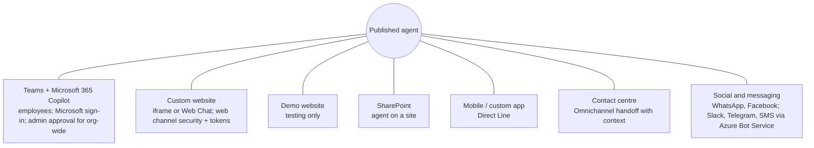
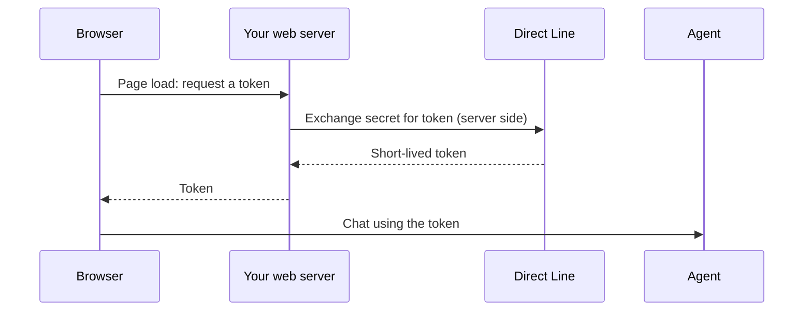

# Channels and deployment

> AB-620 · D1 Plan and configure agent solutions · about 60 min · Study Hub module `p04` ([open the hub](https://claude.ai/artifact/DfeAjDjaTCgtf36RSKeSSS))

## Why it matters
Publishing is easy; publishing *correctly* is tested: which channels need which sign-in, why Teams cards look different from the test pane, what happens when you republish, and how an org-wide Teams rollout gets approved.

## Pre-question (answer before reading)
**Q:** You publish an update, but a colleague in Teams still sees the old behaviour. Why?

<details><summary>Answer</summary>

Their existing conversation keeps the old session. A new conversation (after inactivity, or typing *start over*) picks up the latest published version, which can take a short while to reach all channels.

</details>

## Mental model & story
Asha's agent is ready. She clicks **Publish**, and one button pushes the latest version to **every** channel the agent is connected to. Nothing changes for users until she publishes, so she can keep editing safely in between.

For staff she adds the **Teams and Microsoft 365 Copilot** channel (one combined channel in the newest UI). She can share a link, let colleagues she shared it with find it in Teams, or **submit it for admin approval** so it appears for everyone in the organisation, and the Teams admin approves it in the Teams admin center.

For customers, the marketing team wants the agent on the public site. The **demo website** is only for quick tests. The real site gets the **custom website** embed code, an iframe, and because the agent shouldn't be embeddable by anyone, Asha turns on **web channel security** so the site exchanges a secret for a short-lived **Direct Line token** on its server.

The mobile team uses **Direct Line** too, from their app. The contact centre connects the agent to **Dynamics 365 Contact Center/Omnichannel** so it can hand conversations to a live agent with full context. Someone asks about Slack; that goes through **Azure Bot Service** channels.

On launch day, a manager complains that a card looks broken in Teams. It used a feature from Adaptive Card schema 1.6, which the test pane renders but Teams (1.5) doesn't. Asha learns to test **in the real channel**.

**Where the analogy breaks:** "Publish once, everywhere" is true for content, but each channel has its own capabilities and settings outside the agent: Teams app availability, website embedding and security keys, Azure Bot Service registrations, contact-centre routing. Those don't travel in a solution and must be configured per environment.

## Diagrams
**Channels from one published agent**



**Secured web channel: token exchange**



## Key points
- **Publish** sends the latest version to all connected channels; edits are invisible to users until then. Users may need a new conversation to see changes.
- Teams + Microsoft 365 Copilot: availability options include a share link, showing it to people you shared it with, or **submitting for admin approval** to show it to the whole organisation (approved in the Teams admin center).
- Custom website: embed code (iframe) or Bot Framework Web Chat; turn on **web channel security** (require secured access) and exchange the secret for a **token** on your server; never put the secret in page script.
- Demo website is for testing and stakeholder demos, not production.
- Mobile and custom apps use **Direct Line** (token endpoint from the agent's channel settings).
- Contact-centre handoff: Dynamics 365 Contact Center / Omnichannel for Customer Service receives the conversation and context through the **Escalate** (transfer) path.
- Other channels through **Azure Bot Service**: Slack, Telegram, Twilio SMS, LINE, email and others.
- Channel capabilities differ: **Teams supports Adaptive Card schema 1.5**, while the test pane renders 1.6; some channels lack quick replies or markdown. Test in the target channel.
- Sign-in option limits channels: *Authenticate with Microsoft* suits Microsoft surfaces; custom websites/mobile with sign-in need **manual authentication**.
- Channel configuration, sharing and web security keys are **not** solution-aware: redo them in each environment after deployment.

## Comparisons
**Channel decision table**

| Need | Channel | Watch out |
|---|---|---|
| Employees in Teams and Copilot | Teams + Microsoft 365 Copilot | Org-wide needs admin approval; cards max 1.5 |
| Public website | Custom website | Web channel security + tokens; moderation; no user-credential tools |
| Quick demo for stakeholders | Demo website | Not for production |
| Your own mobile app | Direct Line (mobile app channel) | Token exchange on your back end |
| Human agents take over | Omnichannel / Contact Center | Configure Escalate topic and context variables |
| Slack or SMS | Azure Bot Service channels | Extra Azure resource configuration |

## Code to recognise
**Get a Direct Line token on your server (never in the browser)**

```http
POST https://directline.botframework.com/v3/directline/tokens/generate
Authorization: Bearer <WEB_CHANNEL_SECRET_FROM_KEY_VAULT>

HTTP/1.1 200 OK
{
  "conversationId": "abc123",
  "token": "eyJhbGciOi...",
  "expires_in": 3600
}
```

- Line 1: Your back end calls Direct Line with the channel secret from web channel security settings.
- Line 2: Keep the secret in Key Vault or server configuration, never in the page.
- Line 7: The browser only ever sees this short-lived token.

## Portal steps
**Publish to Teams and Microsoft 365 Copilot** ((agent) > Publish, then Channels > Teams and Microsoft 365 Copilot)

1. Publish the agent.
2. Open the channel, add it, and edit details (icon, short and long description).
3. Availability options: copy a link, show to teammates and shared users, or submit for admin approval to show to everyone.
4. Teams admin approves in the Teams admin center; users then find it under apps built for the org.
5. Republish after changes; users start a new conversation to see them.

## Worked example
**Scenario:** A retailer wants the same agent on its public website (anonymous), in Teams for store staff, and with handoff to live agents for complaints. Plan the deployment.

- One agent can't have two sign-in modes; anonymous web and signed-in staff have different needs.
- Staff features (tools acting as the user) shouldn't be exposed to anonymous visitors.
- Complaints need the Escalate path into the contact-centre platform.

**Answer:** Two agents (or a staff agent plus a public agent sharing a component collection): the public one with **no authentication**, custom website channel with **web channel security**, strict moderation and **Omnichannel handoff**; the staff one with **Authenticate with Microsoft** in **Teams + Microsoft 365 Copilot**, submitted for admin approval.

## Your turn (faded example)
**Scenario:** Marketing pasted the iframe embed code into the public site. Security says anyone can now embed the agent elsewhere.

- The embed code works without a token unless security is required.
- **What setting do you turn on?** <details><summary>answer</summary>**Web channel security**: require secured access (secret/token).</details>
- **What must the website team change?** <details><summary>answer</summary>Add a server-side endpoint that exchanges the secret for a Direct Line token and passes only the token to Web Chat.</details>

## Exam traps & misconceptions
- ✗ Judging card rendering from the test pane. → ✓ The test pane renders schema 1.6; Teams uses 1.5. Test in Teams.
- ✗ Using the demo website for customers. → ✓ It's for testing. Use the custom website channel.
- ✗ Putting the Direct Line secret in JavaScript on the page. → ✓ Exchange it for a token on your server.
- ✗ Expecting channel settings to travel in the solution. → ✓ Channels, sharing and web security must be configured in each environment after import.
- ✗ Thinking each channel needs a separate publish. → ✓ One publish updates all channels.

## Discussion prompts
- **Why might you publish two agents instead of one for internal and external users?** They need different sign-in, tools, knowledge and moderation. Sharing a component collection or connected agent keeps common logic in one place while each agent keeps the right security boundary.
- **How would you roll out an agent to 20,000 employees safely?** Pilot with a security group (shared users), monitor analytics and feedback, fix issues, then submit for admin approval to show to everyone; communicate how to give feedback and reach a human.

## Interview angle / teach-back
**Prompt:** Explain how publishing works across channels and what you must check for Teams and for a public website.

**Rubric:** One publish updates all channels; new conversation to see changes · Teams: availability options and admin approval for org-wide · Teams cards max schema 1.5 · Website: custom website + web channel security + server-side token · Channel settings aren't solution-aware

**Model answer:** Publishing pushes the latest version to every connected channel, and users see it in a new conversation. For Teams and Microsoft 365 Copilot, I choose availability: a link, shared users, or admin approval for the whole organisation, and I test cards in Teams because it supports schema 1.5. For a public website I use the custom website channel, require secured access, and exchange the secret for a Direct Line token on the server. Channel settings don't travel in solutions, so I redo them in each environment.

## Quick Q&A
- **What does one publish update?** All connected channels.
- **Max adaptive card schema in Teams?** **1.5**.
- **Org-wide Teams availability needs?** Admin approval in the Teams admin center.
- **Secure a website embed?** Web channel security + server-side Direct Line token.
- **Mobile app channel uses?** **Direct Line**.
- **Slack, Telegram, SMS?** Through Azure Bot Service channels.

## Sources (accessed 2026-10-02)
- [Publish and deploy an agent (channels)](https://learn.microsoft.com/en-us/microsoft-copilot-studio/publication-fundamentals-publish-channels)
- [Connect an agent to Teams and Microsoft 365 Copilot](https://learn.microsoft.com/en-us/microsoft-copilot-studio/publication-add-bot-to-microsoft-teams)
- [Configure web and Direct Line channel security](https://learn.microsoft.com/en-us/microsoft-copilot-studio/configure-web-security)

## SRS cards created
- ab-620-p04-01, ab-620-p04-02, ab-620-p04-03, ab-620-p04-04
