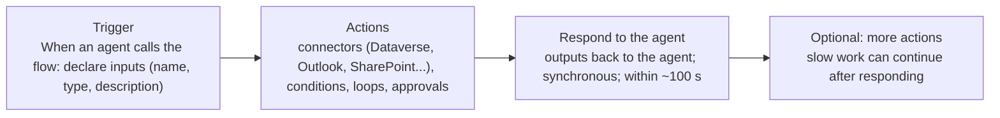
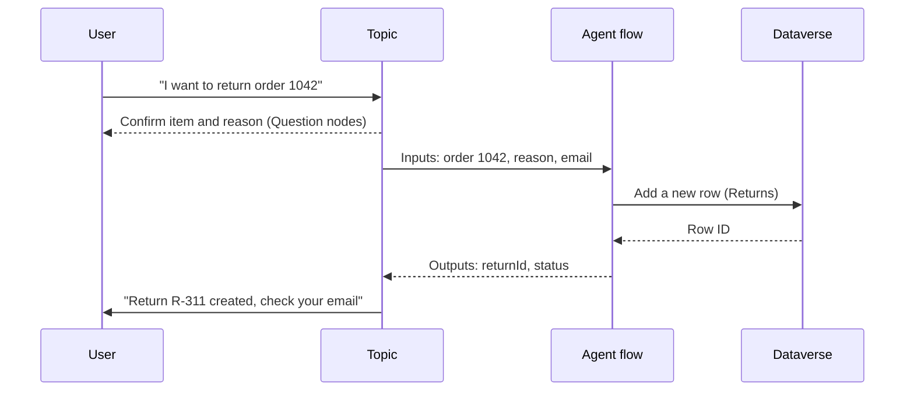

# Agent flows: build, parameters, connectors, topics

> AB-620 · D1 Plan and configure agent solutions · about 85 min · Study Hub module `w01` ([open the hub](https://claude.ai/artifact/DfeAjDjaTCgtf36RSKeSSS))

## Why it matters
Agent flows (called **Workflows** in the newest UI) are how a Copilot Studio agent does reliable multi-step work: write a record, call two systems, send an email, all in a fixed order. The exam tests the trigger, the response action, parameters, the time limit and how a topic calls a flow.

## Pre-question (answer before reading)
**Q:** Your flow writes a return record, emails the customer, then waits two minutes for a warehouse system to confirm stock. Called as a tool, the agent reports a failure even though the email arrives. Why?

<details><summary>Answer</summary>

A flow used as a tool must reach **Respond to the agent** within the **100-second action limit**. Waiting two minutes before responding breaks that. Respond first (e.g., with a reference number) and continue the slow work after responding.

</details>

## Mental model & story
Asha needs the agent to **file a return**: create a row in the Dataverse *Returns* table, then email the customer a confirmation. One connector action can't do both, and the order must never change, so she builds an **agent flow**.

Every agent flow starts with the same trigger: **When an agent calls the flow** (*When an agent calls the workflow* in the new designer). Here she declares **inputs**: order number (text), reason (text), customer email (text). Each input gets a clear name and description, because the orchestrator reads them when deciding what to pass.

Then come ordinary Power Automate actions: **Dataverse – Add a new row** maps the inputs into the Returns table; **Office 365 Outlook – Send an email (V2)** confirms to the customer. Each connector uses a **connection**, and in a solution that connection is referenced through a **connection reference**, which is what lets the flow move to test and production with different accounts.

The flow ends with **Respond to the agent**, returning **outputs**: the return ID and a status message. Asha leaves *Asynchronous response* **off** so the agent waits for the answer, and keeps the run well under **100 seconds**. She saves and **publishes** the flow, because only published flows can be used as tools.

Finally she wires it up twice. At **agent level** (Tools > Add a tool > the flow) the orchestrator decides when to call it and fills inputs from the conversation. Inside the *Start a return* **topic** (Add node > Add a tool), she maps topic variables to inputs and saves outputs into topic variables, because that topic must always confirm the details with the customer first.

**Where the analogy breaks:** A flow is not an agent: it doesn't reason or recover on its own. If an action fails, nothing "tries something else" unless you design error handling (next module). And a flow called at agent level still depends on the orchestrator passing sensible inputs.

## Diagrams
**Anatomy of an agent flow**



**A topic calling an agent flow**



## Key points
- An **agent flow** is a Power Automate-based flow native to Copilot Studio, billed in **Copilot Credits** (not Power Automate licences). Newest UI name: **Workflow**.
- Required shape for use as a tool: trigger **When an agent calls the flow**, action **Respond to the agent**, the flow **published**, *Asynchronous response* **Off** (Respond to the agent > Settings/Networking), and a response within the **100-second action limit**.
- Inputs are declared on the trigger (simple types such as Text, Number, Yes/No; pass complex data as JSON text). Outputs are declared on Respond to the agent. Good names and **descriptions** help the orchestrator fill inputs.
- Use a flow for **multi-step, ordered, branching or reusable** logic, approvals and parallel work. For a single action, a connector tool is simpler.
- Connector actions inside the flow use connections; in solutions they use **connection references** so each environment can bind its own connection.
- Agent-level tool: the orchestrator decides when to call and fills inputs (*Dynamically fill with AI* by default; you can also set a fixed value or Power Fx).
- Topic-level: **Add node > Add a tool** (or *Call an action*) > choose the flow, map **topic variables → inputs**, and outputs become **topic variables**. Use it when the call must happen at a precise step.
- Long-running work: respond early (return a tracking ID), then continue processing after the response; notify the user later (email, Teams). Some environments also offer an **asynchronous response** mode with a callback (fully supported in Teams).
- Flows can be created from Copilot Studio (Flows/Workflows page, or Tools > Add a tool > New agent flow) and edited in the designer; use natural language to draft a flow, then check every step.
- Keep flows in the **same solution** as the agent so ALM moves them together.

## Comparisons
**Agent flow vs other ways to act**

|  | Connector tool | Agent flow | Send HTTP request node |
|---|---|---|---|
| Steps | One action | Many, ordered, branching | One call |
| Approvals / waiting | No | Yes | No |
| Reuse across agents | Yes | Yes | No (topic only) |
| Called by | Orchestrator or topic | Orchestrator or topic | Topic |
| Time limit | Connector timeouts | Respond within ~100 s | Default timeout 30 s (configurable) |

**Agent-level vs topic-level tool calls**

|  | Agent level | Topic level |
|---|---|---|
| Who decides to call | Orchestrator, by description | Your topic, at a fixed step |
| Inputs | Filled by AI from the conversation (or set values) | Mapped from topic variables |
| Outputs | Used by the orchestrator to write the reply | Saved to topic variables you use next |
| Best for | Flexible requests | Mandatory sequences (confirm, then act) |

## Code to recognise
**Topic YAML: calling an agent flow with input and output bindings**

```yaml
- kind: Question
  id: ask_reason
  variable: init:Topic.ReturnReason
  prompt: What's the reason for the return?
  entity: StringPrebuiltEntity

- kind: InvokeFlowAction
  id: call_create_return
  flowId: 4f6c0d2e-...            # the agent flow in this solution
  input:
    binding:
      orderNumber: =Topic.OrderNumber
      reason: =Topic.ReturnReason
      customerEmail: =System.User.Email
  output:
    binding:
      returnId: Topic.ReturnId
      status: Topic.ReturnStatus

- kind: SendActivity
  id: confirm
  activity: Return {Topic.ReturnId} is {Topic.ReturnStatus}. A confirmation email is on its way.
```

- Line 7: Calling a flow from a topic appears in YAML as `InvokeFlowAction`.
- Line 12: Input bindings are Power Fx expressions (note the `=`).
- Line 14: System variables are read-only but can be passed as inputs.
- Line 17: Outputs bind into topic variables for the next nodes.
- Line 22: Use the outputs immediately in a message.

## Portal steps
**Create an agent flow (exam UI)** (Copilot Studio > Flows > + New agent flow (or Tools > Add a tool > New agent flow))

1. Trigger **When an agent calls the flow**: add inputs (Text/Number/Yes-No) with clear names.
2. Add actions, e.g. Dataverse **Add a new row** and Outlook **Send an email (V2)**; create or select connections.
3. Add **Respond to the agent** with outputs; in its settings keep **Asynchronous response** off.
4. Save and **Publish** the flow.
5. In the agent: Tools > Add a tool > Flow > select it; write a precise description.

**Create a Workflow (new UI, AB-620T00 v2 labs)** (Copilot Studio > Workflows > New workflow)

1. Start node: trigger **When an agent calls the workflow** (Respond to the agent is added automatically).
2. + Add an input for each parameter.
3. Add actions between Start and Respond to the agent; map outputs.
4. Save, then **Publish** the workflow.
5. In the agent: Tools > + > **Workflows** > select it; fill **Description for AI**.

## Worked example
**Scenario:** A flow called by the agent creates a shipping label (5 s), then polls the carrier until pickup is booked (up to 10 minutes), then emails the customer. Users see "Something went wrong" every time. Fix the design.

- The tool fails because Respond to the agent comes after the 10-minute polling, beyond the ~100-second limit.
- The user only needs to know the label was created and that an email will follow.
- Slow polling can run after the response.

**Answer:** Move **Respond to the agent** directly after label creation (return the label/tracking ID and "you'll get an email when pickup is booked"), keep async response off, and let the polling and email actions run **after** the response. The agent answers within seconds and the flow finishes in the background.

## Your turn (faded example)
**Scenario:** The orchestrator keeps calling your *Create return* flow with an empty reason.

- The orchestrator fills inputs from the conversation using names and descriptions.
- **What do you improve first?** <details><summary>answer</summary>The input's name and **description** (e.g., *reason: the customer's stated reason for returning the item, such as damaged or wrong size*) and the flow's description; mark it required.</details>
- **What protects the flow if a blank still arrives?** <details><summary>answer</summary>Validate in the flow (Condition on empty input → respond with a clear error status), or call the flow from a topic after a Question node collects the reason.</details>

## Exam traps & misconceptions
- ✗ Turning on *Asynchronous response* for a flow you want as an agent tool. → ✓ Tools need a real-time (synchronous) response: async off, respond within ~100 s.
- ✗ Forgetting to **publish** the flow. → ✓ Only published flows show up and run as tools.
- ✗ Putting Respond to the agent at the very end of a slow flow. → ✓ Respond as soon as you have what the user needs; continue afterwards.
- ✗ Using an agent flow for a single connector action. → ✓ A connector tool is simpler and cheaper; flows are for multi-step logic.
- ✗ Building the flow outside the agent's solution. → ✓ Keep flows, connection references and the agent in the same solution for ALM.

## Discussion prompts
- **When should the call happen in a topic instead of at agent level?** When order and confirmation matter: collect and confirm details with Question nodes, then call. Agent-level calls are flexible but the orchestrator decides timing and inputs.
- **Why are input descriptions part of 'prompt engineering'?** The orchestrator reads them to decide what to extract from the conversation. A good description with examples reduces blank or wrong inputs, just like a good function description in any LLM tool-calling system.

## Interview angle / teach-back
**Prompt:** Explain how to build an agent flow that an agent can use as a tool, and how a topic calls it.

**Rubric:** Trigger When an agent calls the flow with inputs · Actions with connections / connection references · Respond to the agent with outputs, async off · Respond within ~100 seconds; publish · Agent-level vs topic-level call; map variables

**Model answer:** I create an agent flow with the trigger When an agent calls the flow and declare inputs with clear descriptions. Connector actions do the work using connection references. Respond to the agent returns outputs; asynchronous response stays off and the flow must respond within about 100 seconds, so slow steps go after the response. I publish it and add it as a tool. At agent level the orchestrator fills inputs; in a topic I use Add a tool, map topic variables to inputs and save outputs to topic variables.

## Quick Q&A
- **Trigger for agent flows?** **When an agent calls the flow** (workflow).
- **Action that returns outputs?** **Respond to the agent**.
- **Response time limit for tool use?** About **100 seconds**.
- **Async response setting for tools?** **Off**.
- **Billing for agent flows?** **Copilot Credits**.
- **Topic YAML kind for calling a flow?** `InvokeFlowAction`.
- **What lets a flow use different connections per environment?** **Connection references**.

## Sources (accessed 2026-10-02)
- [Add an agent flow as a tool to an agent](https://learn.microsoft.com/en-us/microsoft-copilot-studio/flow-agent)
- [Asynchronous response support for agent flows](https://learn.microsoft.com/en-us/microsoft-copilot-studio/flow-asynchronous-response)
- [Combining agent flows with agents: gotchas and patterns (Copilot Studio team blog)](https://microsoft.github.io/mcscatblog/posts/combining-agent-flows-and-agents-gotchas-errors-and-patterns/)

## SRS cards created
- ab-620-w01-01, ab-620-w01-02, ab-620-w01-03, ab-620-w01-04
