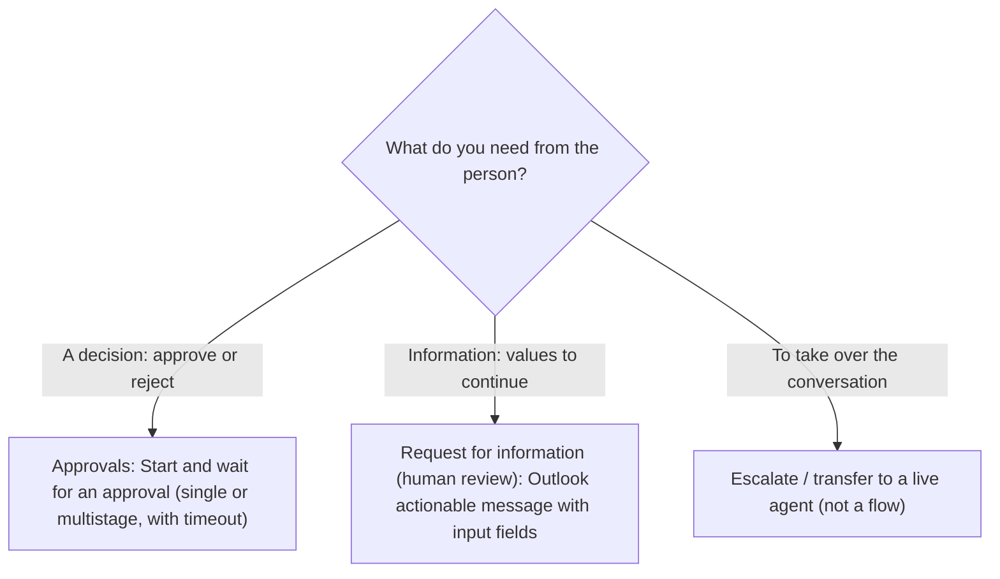
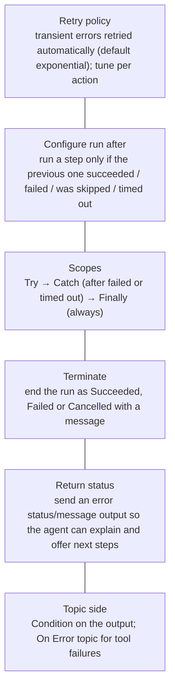

# Human-in-the-loop flows, error handling, monitoring

> AB-620 · D1 Plan and configure agent solutions · about 80 min · Study Hub module `w02` ([open the hub](https://claude.ai/artifact/DfeAjDjaTCgtf36RSKeSSS))

## Why it matters
Agents that change money, data or access need a human checkpoint and need to fail gracefully. The exam asks which approval action fits, how to catch and report errors, and where to look when a flow run goes wrong.

## Pre-question (answer before reading)
**Q:** An approval flow waits for a supervisor who is on holiday. What happens to the flow run, and how should it be handled?

<details><summary>Answer</summary>

Approvals can wait a long time (flows can run for up to **30 days**), so set a **timeout** on the approval and handle the *timed out* path (escalate to a deputy, notify the requester), rather than leaving the request hanging.

</details>

## Mental model & story
Contoso's finance rule is simple: refunds up to $100 are automatic, anything above needs a supervisor. Asha builds a second flow, *Request refund*, with an **If/Else**: under the threshold it updates the Returns row to *Approved*; above it, it starts an approval.

For the approval she uses **Approvals – Start and wait for an approval** (*Approve/Reject – First to respond*). The supervisor gets the request in Teams and Outlook, with the order details and amount. A **Switch on Outcome** handles *Approve* and *Reject*, and each branch updates the row and records who decided.

Her colleague Leo shows her a second option for questions rather than yes/no decisions: the **Request for information** (human review) action sends an Outlook actionable message asking a person to fill in fields (text, yes/no, number, date) that flow back as outputs. *"Ask a warehouse lead which bin the item came from"* is a perfect fit.

Then she thinks about failure. She wraps the Dataverse update in a **Try** scope, adds a **Catch** scope that runs after Try *has failed* or *has timed out*, and returns a friendly status ("couldn't update the record, reference 7781") to the agent instead of a crash. A **Terminate** action marks the run *Failed* so monitoring shows the truth.

Two weeks after launch, a manager says "refunds are stuck". Asha opens the flow's **Activity** page in Copilot Studio, finds runs waiting on one approver, opens a run to see every step's inputs and outputs, and checks **Analytics** for the failure rate over the week. The fix is a timeout and a delegate approver.

**Where the analogy breaks:** A flow that waits for an approval can't keep the agent waiting: the agent needs a reply within about 100 seconds. In production you usually tell the user "submitted for approval, reference R-311" first, then notify them of the decision by email or Teams when it arrives.

## Diagrams
**Which human-in-the-loop action?**



**Error-handling toolkit in agent flows**



## Key points
- **Approvals – Start and wait for an approval**: types *Approve/Reject – Everyone must approve*, *Approve/Reject – First to respond*, *Custom responses* (wait for one / all); then branch on **Outcome** with Condition or **Switch**.
- **Request for information** (human review, Copilot Studio agent flows): sends an Outlook **actionable message** to reviewers with input fields (Text, Yes/No, Email, Number, Date); the **first response** completes it; reviewers must be in your tenant; avoid spaces in input names.
- **Multistage approvals** can chain manual stages (and AI stages with instructions) for complex sign-off.
- Approvals can wait long (flow runs last up to **30 days**); set **timeouts** on the action and handle the *timed out* path.
- Keep the agent responsive: respond to the agent with a reference first, notify the user of the decision later.
- **Configure run after**: is successful, has failed, is skipped, has timed out. Basis of try/catch/finally with **Scope** actions.
- **Retry policy** handles transient failures (HTTP 408/429/5xx); don't retry non-idempotent writes blindly.
- **Terminate** sets the run status (Succeeded/Failed/Cancelled) so monitoring reflects reality.
- Return an error **status/message output**; in the topic, check it with a Condition and offer alternatives (retry, escalate). Unhandled tool failures go to the **On Error** topic.
- Monitor in Copilot Studio: Flows page > flow > **Overview**, **Activity** (run history, open a run, see each action's inputs/outputs, resubmit or cancel), **Analytics** (run count, failure rate; data can lag up to ~30 minutes; solution flows). The agent's analytics/Monitor and transcripts show how tools were used.

## Comparisons
**Approvals vs Request for information**

|  | Start and wait for an approval | Request for information |
|---|---|---|
| Output | Outcome (Approve/Reject or custom) + responses/comments | Typed values you defined (text, number, date...) |
| Where people respond | Teams Approvals app, Outlook, Power Automate | Outlook actionable message |
| Multiple people | Everyone must approve or first to respond | First response wins |
| Typical use | Refund over threshold, access request | Ask a specialist for a missing value |

## Code to recognise
**Try / Catch / Finally in the flow definition (code view)**

```json
"Try": {
  "type": "Scope",
  "actions": { "Update_return_row": { "type": "OpenApiConnection", "inputs": { "retryPolicy": { "type": "exponential", "count": 4, "interval": "PT10S" } } } }
},
"Catch": {
  "type": "Scope",
  "runAfter": { "Try": ["Failed", "TimedOut"] },
  "actions": { "Respond_with_error": { "type": "Response", "inputs": { "body": { "status": "error", "message": "Couldn't update the record." } } } }
},
"Finally": {
  "type": "Scope",
  "runAfter": { "Catch": ["Succeeded", "Failed", "Skipped", "TimedOut"] }
}
```

- Line 2: A **Scope** groups actions so you can react to the group's result.
- Line 3: Retry policy for transient errors: exponential back-off, 4 retries.
- Line 7: **Configure run after**: Catch runs only if Try failed or timed out.
- Line 8: Return a clean error output so the agent can explain and offer a next step (shape simplified here).
- Line 12: Finally runs whatever happened (logging, clean-up).

## Portal steps
**Add an approval branch (new UI lab pattern)** (Workflows > (workflow) > + after the record lookup)

1. Add **If/Else**: requestedAmount > 100.
2. True branch: **Approvals – Start and wait for an approval** (Approve/Reject – First to respond); assign the supervisor; include details in the body.
3. Add **Switch** on *Outcome*: cases Approve and Reject, each updating the row.
4. False branch: **Update a row** to auto-approve.
5. Make sure every branch ends in (or has passed) **Respond to the agent**; publish.

**Monitor runs** (Copilot Studio > Flows (Workflows) > (flow) > Activity / Analytics)

1. Activity: filter by status; open a run to see each step with inputs, outputs and errors.
2. Resubmit a failed run after fixing the cause, or cancel stuck runs.
3. Analytics: runs over time and failure rate (may lag ~30 min).
4. Correlate with the agent's transcript to see what the user experienced.

## Worked example
**Scenario:** Access requests to a finance app must be approved by both the user's manager and the app owner; if no decision in 3 days, the request expires and the user is told. The agent must reply immediately.

- Two people must both approve → Approve/Reject – Everyone must approve (or a two-stage multistage approval).
- Immediate reply → respond to the agent first with a request ID.
- 3-day limit → timeout on the approval action (P3D) and a run-after *timed out* branch.

**Answer:** Flow: inputs → create request row → **Respond to the agent** ("Request AR-55 submitted") → **Start and wait for an approval** (Everyone must approve; timeout 3 days) → Switch on outcome → update row + notify user; a **run after: has timed out** branch marks it expired and notifies the user.

## Your turn (faded example)
**Scenario:** A Dataverse update in a flow fails occasionally with 429 (throttling) and the agent tells users "Something went wrong".

- 429 is transient.
- **What flow setting handles it first?** <details><summary>answer</summary>The action's **retry policy** (exponential back-off), so most runs succeed on retry.</details>
- **And if retries are exhausted?** <details><summary>answer</summary>A Catch scope (run after has failed/timed out) returns a friendly status output; the topic or orchestrator tells the user and offers to try later or escalate; Terminate marks the run Failed for monitoring.</details>

## Exam traps & misconceptions
- ✗ Using Request for information when the requirement is approve/reject by several people. → ✓ Use Approvals (Everyone must approve) or multistage approvals.
- ✗ Leaving approvals without a timeout. → ✓ Runs can sit for up to 30 days; add a timeout and a timed-out path.
- ✗ Letting the agent wait for the human decision. → ✓ Respond to the agent first, then notify the user of the outcome.
- ✗ Catching errors but ending the run as Succeeded. → ✓ Use Terminate (Failed) so analytics show real failure rates.
- ✗ Looking for flow run details in the agent's transcript only. → ✓ Use the flow's **Activity** page for step-level inputs, outputs and errors.

## Discussion prompts
- **When is an AI approval stage acceptable?** For low-risk, high-volume checks with clear rules (completeness, policy match), followed by a human stage for exceptions or high values. Never as the only check for high-impact or irreversible actions.
- **How do you prove to auditors who approved a refund?** Store approver, outcome, comments and timestamps from the approval response in the Dataverse row, keep flow run history, and use Purview audit for agent activity.

## Interview angle / teach-back
**Prompt:** Explain how you'd add human approval and robust error handling to an agent flow, and how you'd monitor it.

**Rubric:** Start and wait for an approval + Switch on outcome · Request for information for missing values · Timeouts and timed-out path · Respond to the agent early · Run after / scopes / terminate / retry · Activity and Analytics pages

**Model answer:** For decisions I use Start and wait for an approval and branch on the outcome with a Switch; for missing details I use Request for information. I set a timeout and handle the timed-out path, and I respond to the agent before waiting so the user gets a reference immediately. Errors are handled with retry policies, Try/Catch scopes using configure run after, a clear error output for the agent and Terminate to mark failures. I monitor runs on the flow's Activity page (step inputs and outputs) and Analytics (failure rate).

## Quick Q&A
- **Approval action name?** **Start and wait for an approval**.
- **Branch on the result with?** Condition or **Switch** on *Outcome*.
- **Human gives values, not a decision?** **Request for information** (Outlook actionable message).
- **Max flow run duration?** **30 days**.
- **Run-after states?** Succeeded, failed, skipped, timed out.
- **Where are step-level run details?** Flow > **Activity** > open a run.
- **Mark a handled failure as failed?** **Terminate** with status Failed.

## Sources (accessed 2026-10-02)
- [Human-in-the-loop: Request for information in agent flows](https://learn.microsoft.com/en-us/microsoft-copilot-studio/flows-advanced-approvals)
- [Error handling in Power Automate (configure run after, scopes)](https://learn.microsoft.com/en-us/power-automate/guidance/coding-guidelines/error-handling)
- [Monitor agent flows](https://learn.microsoft.com/en-us/microsoft-copilot-studio/flows-overview)
- [AB-620T00 lab 2 (workflows and approvals)](https://github.com/MicrosoftLearning/AB-620T00_build_integrated_ai_agents_in_copilot_studio/tree/main/Instructions/Labs/lab-2-add-workflows-to-agent)

## SRS cards created
- ab-620-w02-01, ab-620-w02-02, ab-620-w02-03, ab-620-w02-04
