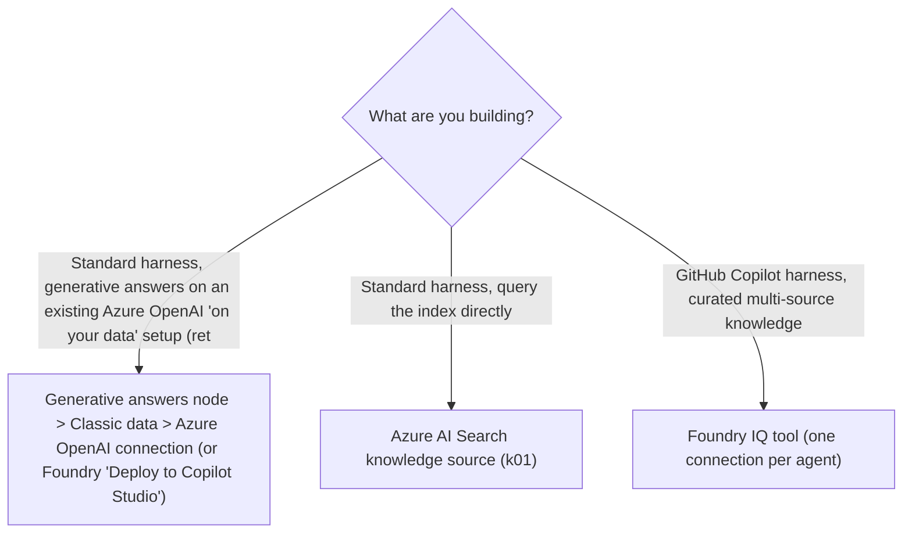
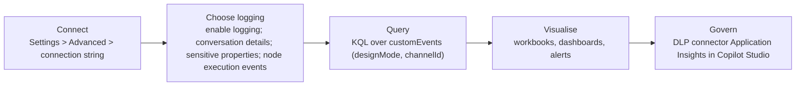

# Integrate with Azure: AI Search with Foundry, Foundry models, Application Insights

> AB-620 · D2 Integrate and extend agents in Copilot Studio · about 80 min · Study Hub module `z01` ([open the hub](https://claude.ai/artifact/DfeAjDjaTCgtf36RSKeSSS))

## Why it matters
The *Integrate agents with Azure* group has three named skills: generative answers with **Azure AI Search via Foundry**, custom prompts with the **Foundry model catalog**, and monitoring with **Application Insights**. Each is a short checklist you can learn precisely.

## Pre-question (answer before reading)
**Q:** Telemetry from your agent in Application Insights is full of test conversations from makers. How do you filter them out in KQL?

<details><summary>Answer</summary>

Use the `designMode` custom dimension: `customEvents | where customDimensions['designMode'] == "False"` keeps only real (non-test-canvas) traffic.

</details>

## Mental model & story
Contoso's data team has an **Azure AI Search** index of product manuals and an Azure OpenAI deployment in **Microsoft Foundry** configured with *Azure OpenAI on your data*. They want the store agent to answer manual questions through that setup, not a copy. (Heads-up, checked 2 Oct 2026: **Azure OpenAI On Your Data retires on 14 Oct 2026**, and Microsoft recommends Foundry Agent Service with **Foundry IQ** instead. Learn this route for the exam, but build new solutions on Azure AI Search knowledge, Foundry IQ or a connected Foundry agent.)

Two routes exist. From the Foundry side, *Deploy to > A new Microsoft Copilot Studio bot* creates an agent already connected, with a **Conversational boosting** topic. From Copilot Studio, Asha adds a **generative answers** node, opens its data sources, picks **Classic data > Azure OpenAI**, and adds the connection. Node-level sources take priority; agent-level knowledge is the fallback.

Agents on the newest **GitHub Copilot harness** use **Foundry IQ** instead: *Tools > Add a tool > Foundry IQ*, a connection (API key, certificate, service principal or Entra ID integrated), and a knowledge base that bundles several sources with retrieval settings. One Foundry IQ connection per agent.

For a prompt that classifies warranty claims, the default model is too generic. The data team has a fine-tuned model in the **Foundry model catalog**. In prompt builder, Asha opens the model list, chooses to connect a Foundry model, enters the **deployment name** and **base model name**, and connects. Foundry usage is billed in Azure, and DLP still governs the connection.

Finally, operations. Asha pastes the Application Insights **connection string** into **Settings > Advanced**, turns on **Enable logging**, adds **Log conversation details** (and tool arguments in traces) only after the privacy review, and enables **node execution events** to see which topic nodes ran. She builds KQL queries over `customEvents`, filtering test traffic with `designMode`, and pins a daily-users chart to a workbook.

**Where the analogy breaks:** App Insights shows *what happened*, not whether answers were *good*: pair it with evaluations (D3) and transcripts. And anonymous channels generate random user IDs, so "unique users" in KQL is only meaningful for authenticated agents.

## Diagrams
**Azure AI Search + Foundry: which route?**



**Application Insights for an agent**



## Key points
- **Azure OpenAI on your data** in Copilot Studio (standard harness, preview): generative answers node > Data sources > **Classic data** > add an **Azure OpenAI** connection; or from Foundry **Deploy to > A new Microsoft Copilot Studio bot**, which creates an agent with a **Conversational boosting** topic. **Retiring:** the On Your Data service retires on **14 Oct 2026**; new builds use Azure AI Search as knowledge (standard harness), Foundry IQ (GitHub Copilot harness) or a connected Foundry agent with Foundry IQ.
- Node-level knowledge takes **priority** over agent-level knowledge; agent-level sources are the fallback.
- **Foundry IQ** (GitHub Copilot harness): Tools > Add a tool > Foundry IQ > connection (API key, client certificate, service principal, Entra ID integrated) > knowledge base; **one Foundry IQ connection per agent**; removing it doesn't delete the knowledge base.
- **Foundry models in prompts**: prompt builder > model list > connect a Foundry model (deployment name, base model name); Azure billing applies; governed by DLP.
- **Application Insights**: Settings > **Advanced** > Application Insights **connection string**.
- Options: **Enable logging** (incoming/outgoing messages and events), **Log conversation details** (user ID, name, message text; tool inputs/outputs in OpenTelemetry spans), **Log sensitive Activity properties**, **Node execution events** (event per executed topic node).
- Data lands in **customEvents** with `customDimensions` such as `type`, `channelId` (msteams, directline, webchat), `fromId`, `fromName`, `locale`, `text`, **`designMode`** (True = test canvas).
- Filter out test traffic with `designMode == "False"`; unique-user counts need authenticated users (anonymous IDs are random per conversation).
- Admins can block agent telemetry with DLP by moving **Application Insights in Copilot Studio** to the Blocked group.
- Log conversation details and sensitive properties only after privacy review; they can contain personal data.

## Comparisons
**Monitoring surfaces**

| Surface | Shows | Best for |
|---|---|---|
| Copilot Studio analytics / Monitor tab | Sessions, resolution, satisfaction, credits, transcripts | Product owners, quick health |
| Application Insights | Raw events, custom KQL, alerts, correlation with other Azure telemetry | Engineers, SRE, custom dashboards |
| Flow Activity / Analytics | Run history, step details, failure rates | Debugging tools and flows |
| Evaluations (D3) | Answer quality vs expectations | Release gates, regression checks |

## Code to recognise
**KQL over Copilot Studio telemetry**

```kusto
// Real (non-test) messages per channel per day, last 14 days
customEvents
| where timestamp > ago(14d)
| extend isDesignMode = tostring(customDimensions['designMode']),
         channel = tostring(customDimensions['channelId'])
| where isDesignMode == "False"
| summarize messages = count() by channel, bin(timestamp, 1d)
| render timechart

// Unique users per day (meaningful only for authenticated users)
customEvents
| where timestamp > ago(14d)
| summarize users = dcount(user_Id) by bin(timestamp, 1d)
```

- Line 2: Telemetry from Copilot Studio lands in `customEvents`.
- Line 4: `designMode` is True for test canvas traffic.
- Line 6: Filter it out to see real usage.
- Line 13: Anonymous channels use random user IDs, so this count is reliable only with sign-in.

## Portal steps
**Connect Application Insights** ((agent) > Settings > Advanced > Application Insights)

1. Paste the **connection string** from the Application Insights resource.
2. Turn on **Enable logging**; add Log conversation details / sensitive properties only if approved.
3. Turn on **Node execution events** to log each executed topic node.
4. Save and publish; query `customEvents` in Logs.

**Connect a Foundry model to a prompt** ((prompt) > Model list > connect a Foundry model)

1. Choose to add/connect a model from Microsoft Foundry.
2. Enter the **model deployment name** and **base model name**, and connect (endpoint and credentials).
3. Select the connected model; test the prompt; compare against the default model.
4. Note: Azure usage costs apply; DLP governs the connection.

## Worked example
**Scenario:** Operations wants a daily alert if the share of failed tool calls in production exceeds 5%, without counting maker tests.

- Need raw telemetry with node/tool events → Application Insights with node execution events and logging on.
- Exclude test traffic → filter designMode.
- Alert → a log alert rule on a KQL query.

**Answer:** Connect Application Insights (Settings > Advanced), enable logging and **node execution events**, write a KQL query over `customEvents` filtered with `designMode == "False"` that computes failed vs total tool events per day, and create an **Azure Monitor log alert** when the ratio exceeds 5%.

## Your turn (faded example)
**Scenario:** Privacy asks you to stop storing message text in Application Insights but keep usage metrics.

- Message text is part of conversation details.
- **Which setting changes?** <details><summary>answer</summary>Turn off **Log conversation details** (and Log sensitive Activity properties); keep **Enable logging** for activity metadata.</details>
- **What do you tell analysts?** <details><summary>answer</summary>Text-based queries stop working; counts by channel, time and topic/node events still work.</details>

## Exam traps & misconceptions
- ✗ Counting unique users on an anonymous website agent. → ✓ Anonymous users get random IDs per conversation; counts are inflated.
- ✗ Forgetting to exclude test pane traffic. → ✓ Filter `designMode == "False"`.
- ✗ Expecting Foundry IQ on a standard-harness agent. → ✓ Foundry IQ (as a tool) is for GitHub Copilot harness agents; standard harness uses Azure AI Search knowledge (or, until 14 Oct 2026, Azure OpenAI on your data).
- ✗ Starting new work on Azure OpenAI On Your Data. → ✓ The service retires on 14 Oct 2026; use Azure AI Search knowledge, Foundry IQ, or a connected Foundry agent with Foundry IQ.
- ✗ Turning on conversation details by default. → ✓ It logs user names and message text (and tool arguments): privacy review first.
- ✗ Thinking a node's Azure OpenAI source combines with agent knowledge. → ✓ Node-level sources take priority; agent-level is only a fallback.

## Discussion prompts
- **Why might engineers want Application Insights even though Copilot Studio has analytics?** Custom KQL, long retention, alerts, correlation with Azure Functions/APIs the agent calls, and dashboards across many agents. Built-in analytics are great for product owners but fixed in shape.
- **How would you decide between the built-in models and a Foundry model for a prompt?** Evaluate both on the same test set: quality, latency, cost (Copilot Credits vs Azure billing), data residency, and governance; prefer built-in unless a Foundry model is measurably better or required.

## Interview angle / teach-back
**Prompt:** Explain the three Azure integration skills in AB-620 and one configuration detail for each.

**Rubric:** Azure AI Search with Foundry: Classic data > Azure OpenAI connection / Deploy to Copilot Studio; node priority · Foundry model in prompts: deployment + base model name; Azure billing; DLP · App Insights: Settings > Advanced connection string; logging options; customEvents; designMode

**Model answer:** For Azure AI Search through Foundry, I add a generative answers node and connect Classic data to the Azure OpenAI 'on your data' deployment (or deploy from Foundry to a new Copilot Studio agent); node sources take priority over agent knowledge. (On Your Data retires on 14 Oct 2026, so for new builds I'd use Azure AI Search knowledge or Foundry IQ.) For prompts, I connect a Foundry model by deployment name and base model name; it's billed in Azure and governed by DLP. For monitoring, I paste the Application Insights connection string under Settings > Advanced, choose logging options, and query customEvents with KQL, filtering designMode to exclude test traffic.

## Quick Q&A
- **Where's the App Insights connection string set?** Settings > **Advanced**.
- **Telemetry table?** **customEvents**.
- **Exclude test pane traffic?** `designMode == "False"`.
- **Block agent telemetry org-wide?** DLP: block *Application Insights in Copilot Studio*.
- **Foundry IQ connections per agent?** **One**.
- **Values to connect a Foundry model to a prompt?** Deployment name + base model name (and connection details).
- **Topic created when deploying from Azure OpenAI on your data?** **Conversational boosting**.

## Sources (accessed 2026-10-02)
- [Capture telemetry with Application Insights](https://learn.microsoft.com/en-us/microsoft-copilot-studio/advanced-bot-framework-composer-capture-telemetry)
- [Use Azure OpenAI on your data with generative answers](https://learn.microsoft.com/en-us/microsoft-copilot-studio/nlu-generative-answers-azure-openai)
- [Connect to Foundry IQ (GitHub Copilot harness)](https://learn.microsoft.com/en-us/microsoft-copilot-studio/agents-experience/foundry-iq-connect)
- [MCS Labs: Bring your own model (Foundry) lab](https://microsoft.github.io/mcs-labs/labs/mcs-byom/)

## SRS cards created
- ab-620-z01-01, ab-620-z01-02, ab-620-z01-03, ab-620-z01-04
