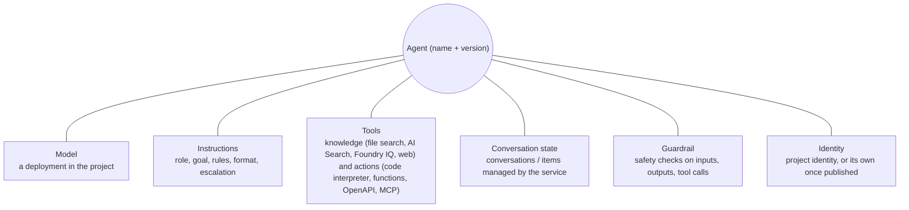
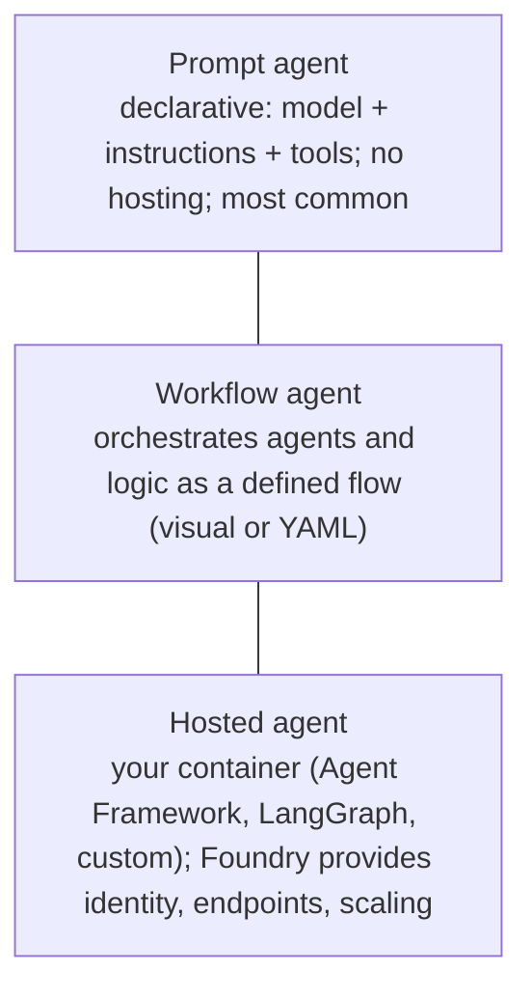

# Agent anatomy in Foundry Agent Service

> AI-103 · D2 Implement generative AI and agentic solutions · about 70 min · Study Hub module `a01` ([open the hub](https://claude.ai/artifact/TdpMZLFYA9knTdjNyCms9F))

## Why it matters
Agents are the centre of AI-103 (D2 is 30–35%). Start with the anatomy: what an agent is made of, the three agent types, how to build one in the portal or VS Code, and what changes when you publish it.

## Pre-question (answer before reading)
**Q:** What's the difference between a chat app that calls a model and an agent?

<details><summary>Answer</summary>

An agent combines a model with **instructions and tools** and can **decide to take actions** (search, run code, call APIs) in a loop to reach a goal, with conversation state managed for it. A plain chat call just generates text from its input.

</details>

## 🍎 Story time (kid version)
**Robo at Foundry Town Hall: Robo gets a real job**

Until now Robo only chatted. Today Maya gives him a real job. He has a brain for thinking, a job card ("Help children find lost things. Never give out home addresses."), and a toolbox with the lost-property list and a phone to the office. Now Robo can decide for himself: "I'll check the list, then call the office," step by step, until the missing lunchbox is found. Maya also gives him a notebook for each child, so he remembers what they already told him.

| In the story | In Foundry |
|---|---|
| Robo's brain | A model deployment |
| The job card | The agent's instructions |
| The toolbox | Tools: knowledge tools and action tools |
| A notebook for each child | Conversation state managed by Agent Service |

**Where the story breaks:** Robo follows his job card most of the time, not always. Tools, identities and approvals must limit what he can actually do.

## Mental model & story (grown-up version)
Think of an agent as a **new team member**. The **model** is their brain. The **instructions** are their job description: role, goal, boundaries, tone, when to escalate. The **tools** are the systems they're allowed to use: file search over the policy library, code interpreter for spreadsheets, an API to create tickets. **Conversations** are their notebook for each customer, so they remember what was said.

**Foundry Agent Service** is the HR department and the office building in one: it hosts the agent, runs the model, executes built-in tools automatically, stores conversation state, applies guardrails and records traces. You don't manage servers. A working agent takes a few dozen lines of code, or none in the portal.

There are three kinds of team member. **Prompt agents** are declarative (model + instructions + tools) and the most common. **Workflow agents** coordinate several agents and steps in a defined flow. **Hosted agents** run your own containerised code (Agent Framework, LangGraph and others) with Foundry providing identity, endpoints and scaling.

Contoso's IT helpdesk agent was built in the portal first (quick to try), then exported to YAML and code in VS Code with the **Foundry Toolkit** extension so it could live in Git. When it was ready, they **published** it. In the original (now legacy) model that created an **agent application** with a stable endpoint and gave the agent its own identity. Since July 2026 a new agent already has its own Entra agent identity and a stable endpoint when it's created, and *publishing* means distributing it to Teams and Microsoft 365.

**Where the analogy breaks:** A team member brings judgment and accountability. An agent follows instructions probabilistically and can be manipulated through its inputs, so its tools, identity and approvals must limit what it can do (see the governance module).

## Diagrams
**What an agent is made of**



**Three agent types**



## Key points
- Agent = **model + instructions + tools**, with conversation state and responses handled by Foundry Agent Service (fully managed).
- Agent Service features: automatic execution of built-in tools, conversation state, tool catalog, keyless (Entra ID) auth, guardrails, optional bring-your-own storage (standard setup), tracing.
- Instructions define **role, goal, boundaries, output format and escalation**; tool schemas define what each tool accepts. Temperature guide: 0.1–0.3 consistent, 0.3–0.7 business writing, 0.7–1.0 creative.
- Conversation tracking options: service-managed **conversations** (durable history), `previous_response_id` chaining, or client-managed history (stateless calls).
- Portal: **Build > Agents > Create agent** (name, model) → Instructions → Tools: *configured* (code interpreter, file search), *catalog* (Bing, Azure AI Search, SharePoint…), *custom* (OpenAPI, MCP) → test in the **playground**.
- VS Code **Foundry Toolkit**: agent designer with a synced YAML view, local and remote playgrounds, hosted-agent deployment, **View code** to generate SDK code. Best practice: prototype in the portal, keep definitions in code.
- Agent YAML holds: `name`, `description`, `metadata`, `model` (id + options such as temperature), `instructions`, `tools`.
- **Legacy publish** creates an **agent application**: a stable endpoint (`…/applications/<app>/protocols/openai/responses`), Entra ID auth only, callers need **Foundry User** (`applications/invoke/action`), and a **dedicated agent identity**, so re-grant RBAC for its tools; *Publish updates* moves traffic to the new version while the URL stays the same. **New agent model (July 2026)**: every new agent has its own Entra agent identity and a stable `agent_endpoint` (`…/agents/<agent>/endpoint/protocols/openai/responses`) from creation; you choose which version the endpoint serves, and *publish* means distributing to Teams and Microsoft 365.
- Agent security risks: data leakage, prompt injection, unauthorised access, data poisoning, supply-chain risk in third-party tools, over-autonomy, poor auditability. Mitigate with least privilege, guardrails, approvals and logging.

## Comparisons
**Portal vs VS Code (Foundry Toolkit)**

|  | Portal | VS Code + Foundry Toolkit |
|---|---|---|
| Best for | Fast prototyping, demos, non-developers | Version control, team workflows, hosted agents |
| Definition | Form-based | Visual designer + YAML in sync |
| Testing | Playground | Local and remote playgrounds, visualizer |
| Output | Agent in the project | YAML/code in Git, deploy to the project |

## Code to recognise
**Declarative agent YAML (as shown in the Foundry Toolkit)**

```yaml
version: 1.0.0
name: it-helpdesk
description: Answers IT questions and drafts tickets
metadata:
  authors: [contoso-it]
  tags: [helpdesk]
model:
  id: gpt-4.1-chat              # deployment
  options:
    temperature: 0.2
instructions: |
  You are Contoso's IT helpdesk assistant. Answer from the knowledge tools only.
  If you can't solve the issue, draft a ticket and ask the user to confirm.
tools:
  - type: file_search
    vector_store_ids: [vs_it_kb]
  - type: code_interpreter
```

- Line 8: The model refers to a deployment in the project.
- Line 10: Low temperature for consistent support answers.
- Line 11: Instructions: role, grounding rule, escalation behaviour.
- Line 15: Tools are listed declaratively; built-in tools run on the service.

## Portal steps
**Create and test an agent** (Foundry portal > Build > Agents > Create agent)

1. Name the agent and choose a model deployment.
2. Write the instructions (role, goal, rules, format).
3. Add tools: e.g. upload files for **File search**, enable **Code interpreter**, add catalog or custom tools.
4. Test in the playground; check tool calls; save (each save creates a new version).

**Publish** (Agent > Publish)

1. Legacy model: Publish creates an agent application with a stable endpoint and its own identity. New model: the agent already has both, so select the version its endpoint serves.
2. Grant callers an invoke role; grant the agent identity the roles its tools need.
3. Roll out a new version without changing the URL (Publish updates, or select the new version).

## Worked example
**Scenario:** A team's agent works in the playground, but after publishing, calls to the application endpoint from their web app return 403.

- Published applications accept Entra ID tokens only.
- The caller (web app's identity) needs a role that allows invoking the agent application.
- Missing role → 403.

**Answer:** Give the web app's **managed identity** an invoke role and call with an Entra token rather than a key. For a legacy **agent application** that's **Foundry User** (Foundry Agent Consumer doesn't grant `applications/invoke/action`); for a new-model **agent endpoint**, **Foundry Agent Consumer** is the least-privilege choice.

## Your turn (faded example)
**Scenario:** Design the instructions for an expense-claims agent that must follow policy and never submit without confirmation.

- Role: "You help employees submit expense claims."
- **What boundary sentence would you add?** <details><summary>answer</summary>E.g. "Only accept claims allowed by the travel policy; never approve or submit a claim without the user's explicit confirmation."</details>
- **What escalation rule?** <details><summary>answer</summary>E.g. "If a claim exceeds the policy limit or receipts are missing, explain why and route it to a manager."</details>

## Exam traps & misconceptions
- ✗ Calling the published agent with an API key. → ✓ Agent applications accept Entra ID tokens only.
- ✗ Assuming the published agent keeps the project identity's permissions. → ✓ It has its own identity; roles on the shared project identity don't carry over.
- ✗ Assuming every tool authenticates as the agent identity. → ✓ Today only MCP and A2A tools do; other tools use their connection's credentials (key, project managed identity or OAuth passthrough).
- ✗ Choosing a hosted agent when a prompt agent would do. → ✓ Hosted agents are for custom code, frameworks, protocols or state; prompt agents need no hosting.
- ✗ Thinking publishing changes the endpoint URL on every update. → ✓ *Publish updates* keeps the URL and routes traffic to the new version.

## Discussion prompts
- **What makes agent instructions good?** A clear role and goal, explicit boundaries (what never to do), a grounding rule (use tools, not memory), output format, and escalation behaviour, with tool names and when to use them. Short, specific and testable.
- **Why prototype in the portal but maintain the agent in code?** The portal is fast for exploring; code and YAML give version control, reviews, automated evaluation and repeatable deployment across environments.

## Interview angle / teach-back
**Prompt:** Explain to a colleague what a Foundry agent is and what happens when you publish it.

**Rubric:** Model + instructions + tools (+ conversation state) · Agent Service manages hosting, tool execution, state, guardrails, tracing · Agent types: prompt, workflow, hosted · Stable endpoint + own identity (legacy: created at publish as an agent application; new model: at creation) · Grant the agent identity its roles; new versions keep the URL

**Model answer:** A Foundry agent is a model plus instructions plus tools, with Agent Service managing the runtime: it runs built-in tools, keeps conversation state, applies guardrails and records traces. Most agents are declarative prompt agents; workflow agents orchestrate steps and hosted agents run your own container. Each agent ends up with a stable, Entra-only endpoint and its own identity: in the legacy model publishing created an agent application to provide them, and since July 2026 new agents have both from creation, with *publish* meaning distribution to Teams and Microsoft 365. Either way, grant the agent identity the roles its tools need, and roll out new versions without changing the URL.

## Quick Q&A
- **Agent building blocks?** Model, instructions, tools (+ conversation state).
- **Most common agent type?** Prompt (declarative) agent.
- **Agent running your own container?** Hosted agent.
- **VS Code extension?** Foundry Toolkit.
- **Legacy publish creates…?** An agent application (stable endpoint, own identity).
- **New agent model (July 2026)?** Endpoint + own identity at creation; publish = distribute to Teams/M365.
- **Auth for agent endpoints?** Microsoft Entra ID only.
- **Update a published agent without changing URL?** Publish updates.

## Sources (accessed 2026-10-02)
- [Learning path: Develop AI agents on Azure](https://learn.microsoft.com/en-us/training/paths/develop-ai-agents-azure/)
- [Lab: Build AI agents with portal and VS Code](https://microsoftlearning.github.io/mslearn-ai-agents/Instructions/Exercises/01-build-agent-portal-and-vscode.html)
- [Agent tool catalog](https://learn.microsoft.com/en-us/azure/foundry/agents/concepts/tool-catalog)

## SRS cards created
- ai-103-a01-01, ai-103-a01-02, ai-103-a01-03, ai-103-a01-04
