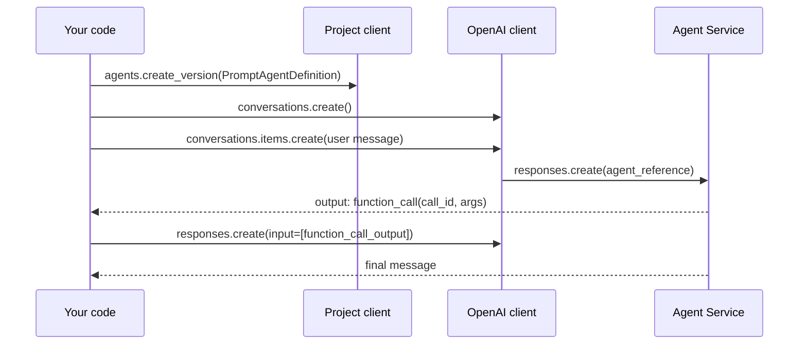

# Build agents in code (Agent Service SDK)

> AI-103 · D2 Implement generative AI and agentic solutions · about 80 min · Study Hub module `a02` ([open the hub](https://claude.ai/artifact/TdpMZLFYA9knTdjNyCms9F))

## Why it matters
Expect drop-down questions on this exact code: `create_version`, `PromptAgentDefinition`, `conversations.create`, `responses.create` with `agent_reference`, and the function-call loop. Learn the two clients and which one does what.

## Pre-question (answer before reading)
**Q:** In the new Agent Service SDK, do you run an agent with the project client or with the OpenAI client?

<details><summary>Answer</summary>

**Both have roles.** `AIProjectClient` (admin plane) creates and manages agent versions. The **OpenAI client** from `get_openai_client()` (runtime plane) creates conversations and responses that reference the agent by name.

</details>

## Mental model & story
The SDK has two desks. The **admin desk** (`AIProjectClient`) is where you register an agent: `agents.create_version(agent_name=..., definition=PromptAgentDefinition(model, instructions, tools))`. Each call creates a new immutable **version** of a named agent. You usually do this at deployment time, not per user request.

The **service desk** (`project.get_openai_client()`) handles conversations. You create a **conversation**, add the user's message as an **item**, and ask for a **response** that references the agent: `extra_body={"agent_reference": {"name": ..., "type": "agent_reference"}}`. The service runs the loop: the model may call built-in tools (file search, code interpreter) automatically.

Your own **function tools** are different: the response contains `function_call` items, your code runs the function, and you send back `function_call_output` items with the matching `call_id`. Then you request another response. The model never runs your code.

If you've seen older samples with **threads, messages and runs** (`AgentsClient`, `runs.create_and_process`), that's the classic v1 API. v2 maps thread → **conversation**, run → **response**, message → **item**, and there's no run-status polling: errors raise exceptions.

**Where the analogy breaks:** The two desks share the same building (endpoint and credential), but calling responses on the admin client is an error. Keep the roles straight.

## Diagrams
**One agent turn with a function tool**



## Key points
- Package `azure-ai-projects` (2.x) + `openai` + `azure-identity`. Classes: `AIProjectClient`, `PromptAgentDefinition`, `FunctionTool`, `MCPTool`, plus tool classes for file search, code interpreter, AI Search, OpenAPI and others.
- `project.agents.create_version(agent_name="x", definition=PromptAgentDefinition(model=deployment, instructions=..., tools=[...]))` → agent with `name` and `version`. Also `agents.get(agent_name=...)`, `agents.delete_version(agent_name=..., agent_version=...)`.
- Runtime: `oc = project.get_openai_client()`; `conv = oc.conversations.create()`; `oc.conversations.items.create(conversation_id=conv.id, items=[{"type": "message", "role": "user", "content": q}])`.
- Run the agent: `oc.responses.create(conversation=conv.id, extra_body={"agent_reference": {"name": agent.name, "type": "agent_reference"}}, input=[])`; read `response.output_text`.
- `FunctionTool(name, description, parameters=<JSON schema>, strict=True)`; on `function_call` items, run the function and send `FunctionCallOutput(type="function_call_output", call_id=item.call_id, output=...)` as `input` of the next response.
- Built-in tools (file search, code interpreter, web search, AI Search) execute on the service; **function tools execute in your app**.
- Conversations give durable, service-side memory per user session; use one conversation per session and store its id.
- v1 → v2 mapping: assistant → agent (name + version), thread → conversation, message → item, run → response, `requires_action` → iterate output items, `last_error` → exceptions. Connected agents (v1) were removed in v2; use workflows or A2A.
- Clean up test agents (`delete_version`) and conversations to avoid clutter and stored data.

## Comparisons
**Which client does what?**

| Task | Client | Method |
|---|---|---|
| Create/update an agent | AIProjectClient | agents.create_version |
| Start a session | OpenAI client | conversations.create |
| Add the user's message | OpenAI client | conversations.items.create |
| Run the agent | OpenAI client | responses.create(... agent_reference ...) |
| Remove a version | AIProjectClient | agents.delete_version |

## Code to recognise
**A complete agent with a local function tool**

```python
import json
from azure.identity import DefaultAzureCredential
from azure.ai.projects import AIProjectClient
from azure.ai.projects.models import PromptAgentDefinition, FunctionTool
from openai.types.responses.response_input_param import FunctionCallOutput

submit = FunctionTool(name="submit_claim", description="Submit an expense claim.",
    parameters={"type": "object", "properties": {"amount": {"type": "number"},
                "reason": {"type": "string"}}, "required": ["amount", "reason"],
                "additionalProperties": False}, strict=True)

with (DefaultAzureCredential() as cred,
      AIProjectClient(endpoint=endpoint, credential=cred) as project,
      project.get_openai_client() as oc):
    agent = project.agents.create_version(agent_name="expense-agent",
        definition=PromptAgentDefinition(model=deployment,
            instructions="Help staff submit expense claims. Confirm before submitting.",
            tools=[submit]))
    conv = oc.conversations.create()
    oc.conversations.items.create(conversation_id=conv.id,
        items=[{"type": "message", "role": "user", "content": "Claim 42.50 for a taxi"}])
    ref = {"agent_reference": {"name": agent.name, "type": "agent_reference"}}
    r = oc.responses.create(conversation=conv.id, extra_body=ref, input=[])
    outs = [FunctionCallOutput(type="function_call_output", call_id=i.call_id,
                               output=submit_claim(**json.loads(i.arguments)))
            for i in r.output if i.type == "function_call"]
    if outs:
        r = oc.responses.create(conversation=conv.id, extra_body=ref, input=outs)
    print(r.output_text)
```

- Line 7: A strict JSON schema keeps arguments well formed.
- Line 15: Admin plane: create (or version) the agent once.
- Line 19: Runtime plane: a conversation per user session.
- Line 22: The agent is referenced by name through `extra_body`.
- Line 23: `input=[]`: the user message is already in the conversation.
- Line 24: Your code executes the function for each `function_call` item.
- Line 28: Send the outputs back; the agent writes the final reply.

## Portal steps
**Generate starter code** (Foundry portal > Build > Agents > (agent) > Code  (or VS Code: Foundry Toolkit > agent > View code))

1. Pick Python; the snippet includes your project endpoint and agent name.
2. Replace keys with `DefaultAzureCredential`.
3. Add your function implementations and the function-call loop.

## Worked example
**Scenario:** A developer creates a new agent version on every user request, and the project soon contains thousands of versions.

- `create_version` is an admin operation that registers a definition.
- Runtime requests should reference an existing agent by name.
- Create versions at deployment time; use `agent_reference` per request.

**Answer:** Create the agent (version) once during deployment and, for each request, use `conversations` and `responses.create` with `agent_reference` to that agent's name.

## Your turn (faded example)
**Scenario:** Migrate this v1 code: `run = client.runs.create_and_process(thread_id=thread.id, agent_id=agent.id)`.

- v1 thread → v2 conversation.
- **What replaces the run?** <details><summary>answer</summary>`oc.responses.create(conversation=conv.id, extra_body={"agent_reference": {...}}, input=[])`.</details>
- **What replaces checking `run.status == "requires_action"`?** <details><summary>answer</summary>Iterating `response.output` for `function_call` items (failures raise exceptions instead of a failed status).</details>

## Exam traps & misconceptions
- ✗ Calling `responses.create` on `AIProjectClient`. → ✓ Responses come from the OpenAI client returned by `get_openai_client()`.
- ✗ Expecting the service to execute your function tool. → ✓ Function tools run in your app; only built-in tools run on the service.
- ✗ Forgetting `call_id` on outputs. → ✓ Each output must match its `function_call`.
- ✗ Polling run status in v2. → ✓ There are no runs to poll; responses return or raise.
- ✗ Creating agent versions per request. → ✓ Create once; reference by name at runtime.

## Discussion prompts
- **Why separate the admin plane from the runtime plane?** Different permissions and lifecycles: deployment pipelines create and version agents; apps only need to run them. It also keeps runtime code simple and avoids accidental agent churn.
- **How should an app store conversation state for many users?** One conversation per user session, keeping the conversation id in the app's session store; the service keeps the items. For long-term personalisation, add a memory store.

## Interview angle / teach-back
**Prompt:** Describe, step by step, how your Python code runs one turn of a Foundry agent that has a custom function.

**Rubric:** create_version with PromptAgentDefinition (once) · conversations.create + items.create (user message) · responses.create with agent_reference · Run function_call items locally → FunctionCallOutput with call_id · Second responses.create → output_text

**Model answer:** Once, at deployment, the project client creates an agent version with a PromptAgentDefinition (model, instructions, tools). Per turn, the OpenAI client adds the user's message to a conversation and calls `responses.create` with an `agent_reference` to the agent. If the output contains `function_call` items, my code runs each function and sends `function_call_output` items with matching call ids in a second `responses.create`. Then I read `output_text`.

## Quick Q&A
- **Create an agent version?** `project.agents.create_version(...)`.
- **Definition class for prompt agents?** `PromptAgentDefinition`.
- **How is the agent referenced at runtime?** `extra_body={"agent_reference": {"name": ..., "type": "agent_reference"}}`.
- **v1 thread is now…** A conversation.
- **v1 run is now…** A response.
- **Who runs FunctionTool code?** Your app.

## Sources (accessed 2026-10-02)
- [Lab: Use a custom function in an AI agent](https://microsoftlearning.github.io/mslearn-ai-agents/Instructions/Exercises/02-agent-custom-tools.html)
- [Learning path: Develop AI agents on Azure](https://learn.microsoft.com/en-us/training/paths/develop-ai-agents-azure/)

## SRS cards created
- ai-103-a02-01, ai-103-a02-02, ai-103-a02-03, ai-103-a02-04
