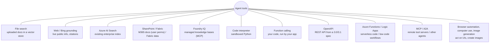
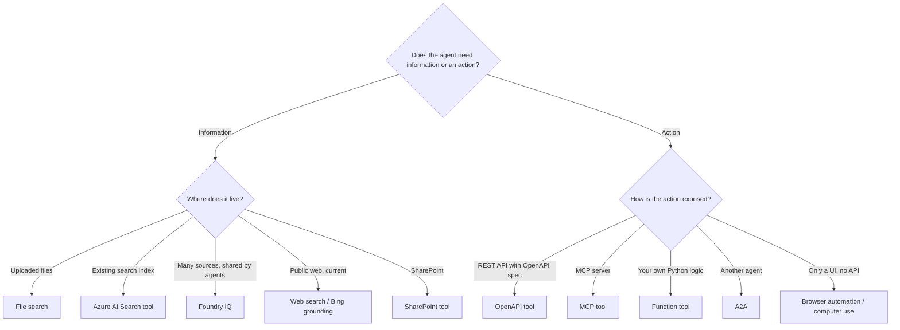

# Agent tools: catalog, OpenAPI, functions and more

> AI-103 · D2 Implement generative AI and agentic solutions · about 70 min · Study Hub module `a03` ([open the hub](https://claude.ai/artifact/TdpMZLFYA9knTdjNyCms9F))

## Why it matters
"Integrate agent tools, including APIs, knowledge stores, search, content understanding, and custom functions" and "choose memory, tool, and knowledge integration services". Questions describe a need and ask for the tool type and its authentication.

## Pre-question (answer before reading)
**Q:** You have a REST API described by an OpenAPI 3.0 spec. What's the quickest way to let an agent call it without writing function code?

<details><summary>Answer</summary>

Add an **OpenAPI tool** with the spec (anonymous, API-key connection or managed-identity auth). The service calls the API directly; no function loop in your app.

</details>

## 🍎 Story time (kid version)
**Robo at Foundry Town Hall: Two drawers in the toolbox**

Robo's toolbox has two drawers. The FIND drawer helps him look things up: a magnifying glass for the school's own papers, binoculars for news from outside, and a card for the big school library. The DO drawer helps him act: a calculator, a phone that rings other offices using their instruction booklet, and a walkie-talkie to other robots. Maya packs only the tools Robo needs today, because a heavy toolbox makes him slow and muddled.

| In the story | In Foundry |
|---|---|
| FIND drawer | Knowledge tools: file search, web search, Azure AI Search or Foundry IQ |
| Calculator and phone with a booklet | Action tools: code interpreter and the OpenAPI tool |
| Walkie-talkie to other robots | A2A |
| Packing only today's tools | Fewer, well-described tools |

**Where the story breaks:** A tool in the box isn't automatically allowed through every door. Real tools need connections and identities with the right permissions.

## Mental model & story (grown-up version)
An agent's tools are its **toolbox**, and Foundry's catalog sorts them into two drawers.

**Knowledge tools** fetch information: **file search** (your uploaded files in a vector store), **web search / Grounding with Bing** (live public web, with citations), **Azure AI Search** (an existing enterprise index), **SharePoint** (documents with the user's permissions), **Fabric data agent** (questions over Fabric data), and **Foundry IQ** knowledge bases.

**Action tools** do things: **code interpreter** (sandboxed Python), **function calling** (your code), **OpenAPI** (call a REST API from its spec), **Azure Functions** (serverless code, e.g. queue-triggered), **MCP** (any Model Context Protocol server), **A2A** (another agent), **browser automation** and **computer use** (operate web pages or desktops), and **image generation**. Logic Apps workflows can be exposed as tools too, which is handy for low-code connectors to Outlook, SAP or ServiceNow.

Northwind's operations agent needed Content Understanding to read delivery notes. They wrapped the analyzer call in a small function (it could also be an OpenAPI or MCP tool) so the agent could pass a document URL and get clean fields back. The **Toolbox** feature let them bundle a set of approved tools behind one versioned MCP endpoint that several agents reuse.

**Where the analogy breaks:** A real toolbox doesn't slow you down when it's full. Every extra tool definition adds tokens and decision complexity, which makes agents slower and more error-prone. Give each agent only what it needs.

## Diagrams
**Agent tool catalog**



**Pick a tool type**



## Key points
- **Knowledge** tools: file search, web search/Grounding with Bing, Azure AI Search, SharePoint, Fabric data agent, Foundry IQ. **Action** tools: code interpreter, function calling, OpenAPI, Azure Functions, MCP, A2A, browser automation, computer use, image generation.
- **OpenAPI tool**: provide an OpenAPI 3.0/3.1 spec; auth **anonymous**, **API key** (stored in a project connection) or **managed identity**; the service calls the API (no app-side loop).
- **Function calling**: the model returns arguments and your app executes, which is best when logic must run in your environment.
- **Azure Functions tool**: serverless code the agent triggers (the lab uses storage-queue input/output bindings).
- Web grounding returns citations; show them to users. File search suits documents provided for that agent; Azure AI Search suits existing enterprise indexes with filters and security.
- Content Understanding can be integrated as a tool (function, OpenAPI or MCP wrapper) to give agents structured data from documents, images, audio or video.
- **Toolbox**: a versioned bundle of tools exposed as one MCP endpoint that many agents (including hosted agents) can reuse.
- Some tools are generally available and some are in preview (e.g. browser automation, computer use, image generation, SharePoint, Fabric, A2A at the time of writing); check status before relying on them in production.
- Fewer, well-described tools → better selection, lower latency and cost. Use an AI gateway (Azure API Management) to rate-limit or restrict access to tool endpoints.

## Comparisons
**OpenAPI vs function vs MCP**

|  | OpenAPI tool | Function tool | MCP tool |
|---|---|---|---|
| Who executes? | Agent Service calls the API | Your app | The MCP server (via the service) |
| Definition | OpenAPI spec | JSON schema in code | Discovered from the server |
| Auth | Anonymous, API key connection, managed identity | Whatever your code uses | Key, Entra ID, OAuth (per user) |
| Best for | Existing REST APIs | Logic inside your app | Shared tools reused by many agents/apps |

## Code to recognise
**An OpenAPI tool from a spec file**

```python
import jsonref
from azure.ai.projects.models import (OpenApiTool, OpenApiFunctionDefinition,
                                      OpenApiAnonymousAuthDetails)

with open("weather_openapi.json") as f:
    spec = jsonref.loads(f.read())             # resolves $ref entries

weather = OpenApiTool(openapi=OpenApiFunctionDefinition(
    name="get_weather",
    spec=spec,
    description="Current weather for a city",
    auth=OpenApiAnonymousAuthDetails()))

agent = project.agents.create_version(agent_name="travel-agent",
    definition=PromptAgentDefinition(model=deployment,
        instructions="Use get_weather for any weather question.", tools=[weather]))
```

- Line 6: `jsonref` expands `$ref` references in the spec.
- Line 11: Description helps the model choose the tool.
- Line 12: Anonymous here; use an API-key connection or managed identity for protected APIs.
- Line 16: Instructions say when to use the tool.

## Portal steps
**Add catalog and custom tools** (Foundry portal > Build > Agents > (agent) > Tools > Add)

1. **Configured**: code interpreter, file search (upload files).
2. **Catalog**: Bing grounding, Azure AI Search (pick connection + index), SharePoint, Fabric, Foundry IQ.
3. **Custom**: OpenAPI (paste spec, choose auth), MCP (server URL, auth), Azure Functions.
4. Test in the playground and inspect each tool call in the trace.

## Worked example
**Scenario:** An agent must look up order status in an internal REST API (OpenAPI spec available, protected by Entra ID) and answer product questions from an existing Azure AI Search index.

- Order status → REST API with spec → OpenAPI tool with **managed identity** auth.
- Product answers → existing index → Azure AI Search tool.
- Grant the agent's identity access to the API and Search Index Data Reader on the index.

**Answer:** **OpenAPI tool (managed identity)** for orders + **Azure AI Search tool** for products, with RBAC for the agent's identity.

## Your turn (faded example)
**Scenario:** An agent must update records in a legacy desktop app that has no API.

- No API, so OpenAPI, function and MCP tools can't reach it directly.
- **Which tool type can operate a user interface?** <details><summary>answer</summary>**Computer use** (desktop/web UI) or **browser automation** for web apps.</details>
- **What safeguard is essential?** <details><summary>answer</summary>Human approval or supervision for changes, a least-privilege account, and logging, since UI automation is fragile and powerful.</details>

## Exam traps & misconceptions
- ✗ Writing a function tool for a REST API that already has an OpenAPI spec. → ✓ The OpenAPI tool calls it directly with less code.
- ✗ Using web search for internal documents. → ✓ Internal knowledge → file search, Azure AI Search or Foundry IQ.
- ✗ Storing an API key inside the OpenAPI spec. → ✓ Use a project connection or managed identity.
- ✗ Giving every agent every tool. → ✓ More tools → slower, costlier, more wrong calls.

## Discussion prompts
- **When would you choose MCP over an OpenAPI tool?** When the same tools serve several agents or apps and you want central updates, dynamic tool discovery and per-user OAuth; or when a vendor already provides an MCP server.
- **Why do web-grounded answers need citations?** Users must be able to verify live web information; citations make sources transparent and expose low-quality sources.

## Interview angle / teach-back
**Prompt:** Explain how you'd decide which tool type an agent needs for a given capability.

**Rubric:** Separate knowledge tools from action tools · Knowledge: file search vs AI Search vs Foundry IQ vs web · Actions: OpenAPI (spec), function (own code), MCP (shared server), A2A (agent), computer use (no API) · Auth: managed identity / connections, never keys in specs · Keep the toolset minimal

**Model answer:** First ask whether the agent needs information or an action. For information, choose by where it lives: uploaded files → file search, an existing index → Azure AI Search, shared curated knowledge → Foundry IQ, live public data → web search. For actions, choose by how the system is exposed: an OpenAPI spec → OpenAPI tool, my own code → function tool, a shared MCP server → MCP, another agent → A2A, only a UI → computer use. Use managed identity or connections for auth and give the agent only the tools it needs.

## Quick Q&A
- **REST API with a spec?** OpenAPI tool.
- **OpenAPI tool auth options?** Anonymous, API key (connection), managed identity.
- **Operate a UI with no API?** Computer use / browser automation.
- **Existing enterprise index?** Azure AI Search tool.
- **Bundle tools behind one MCP endpoint?** Toolbox.
- **Live public info with citations?** Web search / Grounding with Bing.

## Sources (accessed 2026-10-02)
- [Agent tool catalog](https://learn.microsoft.com/en-us/azure/foundry/agents/concepts/tool-catalog)
- [Lab: Use a custom function in an AI agent](https://microsoftlearning.github.io/mslearn-ai-agents/Instructions/Exercises/02-agent-custom-tools.html)

## SRS cards created
- ai-103-a03-01, ai-103-a03-02, ai-103-a03-03, ai-103-a03-04
