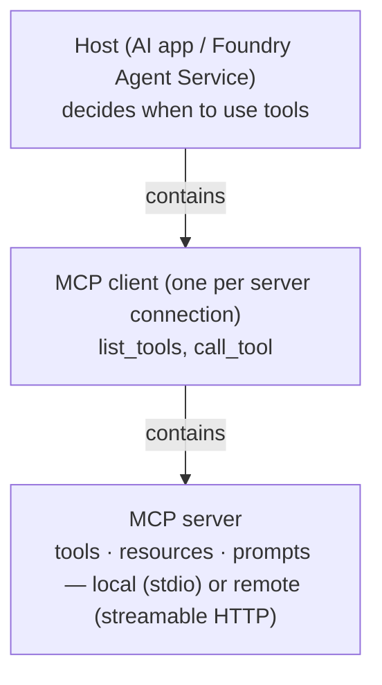
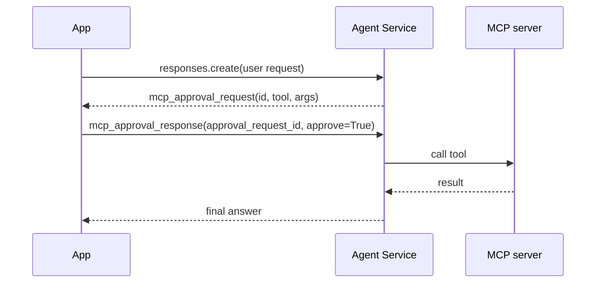

# MCP tools and approval loops

> AI-103 · D2 Implement generative AI and agentic solutions · about 75 min · Study Hub module `a04` ([open the hub](https://claude.ai/artifact/TdpMZLFYA9knTdjNyCms9F))

## Why it matters
The Model Context Protocol appears in AI-103, AB-620 and AI-500. For AI-103 you need the architecture (host, client, server), local vs remote servers, the `MCPTool` settings and the approval loop in code.

## Pre-question (answer before reading)
**Q:** An agent uses a remote MCP tool with `require_approval="always"`. What does your app receive before the tool runs?

<details><summary>Answer</summary>

An output item of type `mcp_approval_request` (with the tool name and arguments). Your app replies with an `mcp_approval_response` (`approve: true/false`) referencing the request id; only then does the call happen.

</details>

## Mental model & story
Before USB, every device needed its own cable. **MCP** is the USB port for AI tools: one standard way for an AI application to discover and call tools, read resources and use prompt templates from any compatible server.

Three roles. The **host** is the AI application (your app or Foundry Agent Service). Inside it, an MCP **client** keeps a connection to each **server**. The server exposes **tools** (actions), **resources** (data) and **prompts** (templates). The client can ask *what tools do you have?* (`list_tools`) at runtime, so when the server adds a tool, every agent using it gets it without a redeploy. That's **dynamic discovery**: integrate once, update centrally.

Servers run in two ways. **Local** servers talk over **stdio** (standard input/output) on the same machine, which suits developer tools. **Remote** servers use **streamable HTTP** over the network, which suits shared enterprise tools. In Foundry, a remote server becomes an `MCPTool` on the agent (label, URL, allowed tools, approval setting, auth headers through a project connection). Microsoft Learn, Azure Language, Azure Speech and Foundry IQ all offer MCP endpoints.

Approval is on by default. The first time Fabrikam's agent wanted to call `create_ticket` on their ITSM MCP server, the response contained an approval request instead of a result. Their app showed it to the user, sent back the approval, and the agent continued. They later set read-only search tools to `require_approval="never"` and kept approvals for anything that writes.

**Where the analogy breaks:** USB devices are dumb peripherals. MCP servers can be third-party code that returns text the model will read, so a malicious server can inject instructions. Trust, approve and monitor servers like any supply-chain dependency.

## Diagrams
**MCP architecture**



**Approval loop for a remote MCP tool**



## Key points
- MCP roles: **host** (AI app), **client** (connection manager inside the host), **server** (exposes **tools**, **resources**, **prompts**).
- Transports: **stdio** for local servers; **streamable HTTP** for remote servers.
- Dynamic discovery: `session.list_tools()`; invoke with `session.call_tool(name, arguments)`. Server code with the Python SDK: `FastMCP(name=...)`, `@mcp.tool()` decorated functions, `mcp.run()`.
- Local MCP with Agent Service: your app is the MCP client. Wrap discovered tools as `FunctionTool`s, and on `function_call` run `call_tool` and return `result.content[0].text` as the output.
- Remote MCP in Agent Service: `MCPTool(server_label=..., server_url=..., require_approval="always"|"never", allowed_tools=[...])`; auth headers through a project connection (key, Entra ID or OAuth with per-user consent).
- `require_approval` defaults to **"always"**. Loop: for each `mcp_approval_request` item, send `{"type": "mcp_approval_response", "approval_request_id": item.id, "approve": True}` with `previous_response_id` until none remain.
- Use `allowed_tools` to expose only the operations the agent needs.
- MCP endpoints in the Microsoft ecosystem: Microsoft Learn docs (`https://learn.microsoft.com/api/mcp`), Azure Language, Azure Speech, Foundry IQ knowledge bases, Toolbox bundles, Work IQ.
- MCP vs OpenAPI vs function: MCP for shared, centrally updated tools across many agents/apps; OpenAPI for a single REST API with a spec; function for logic inside your app.

## Comparisons
**Local vs remote MCP servers**

|  | Local | Remote |
|---|---|---|
| Transport | stdio | Streamable HTTP |
| Runs | Same machine as the client | Hosted service (Functions, Container Apps, App Service…) |
| Typical use | Dev tools, desktop apps | Shared enterprise tools, SaaS |
| With Agent Service | Your app acts as client; wrap as function tools | Add as MCPTool on the agent |

## Code to recognise
**A tiny MCP server (Python SDK)**

```python
from mcp.server.fastmcp import FastMCP

mcp = FastMCP(name="inventory")

@mcp.tool()
def get_stock(sku: str) -> int:
    """Return units in stock for a SKU."""
    return lookup(sku)

if __name__ == "__main__":
    mcp.run()          # stdio by default; HTTP transports for remote use
```

- Line 3: FastMCP builds the server from decorated functions.
- Line 5: Type hints and the docstring become the tool's schema and description.
- Line 11: `run()` serves over stdio unless configured for HTTP.

**Remote MCP tool with an approval loop**

```python
from azure.ai.projects.models import MCPTool

learn = MCPTool(server_label="mslearn", server_url="https://learn.microsoft.com/api/mcp",
                require_approval="always")
agent = project.agents.create_version(agent_name="docs-agent",
    definition=PromptAgentDefinition(model=deployment, instructions="Answer from Microsoft Learn.", tools=[learn]))

ref = {"agent_reference": {"name": agent.name, "type": "agent_reference"}}
r = oc.responses.create(input="How do I enable private endpoints for Foundry?", extra_body=ref)
while True:
    approvals = [{"type": "mcp_approval_response", "approval_request_id": i.id, "approve": True}
                 for i in r.output if i.type == "mcp_approval_request"]
    if not approvals:
        break
    r = oc.responses.create(input=approvals, previous_response_id=r.id, extra_body=ref)
print(r.output_text)
```

- Line 4: Approval on every call (also the default).
- Line 10: Loop until no approval requests remain.
- Line 11: Each request id needs a matching response; in a real app the user decides `approve`.
- Line 15: Chain with `previous_response_id` so the agent continues the same run.

## Portal steps
**Connect an MCP server to an agent** (Foundry portal > Build > Agents > (agent) > Tools > Add > Custom > Model Context Protocol)

1. Enter a name (server label) and the remote server URL.
2. Choose authentication (none, key header via connection, Entra ID, OAuth).
3. Choose approval behaviour; optionally restrict tools.
4. Test: the playground shows approval prompts before calls.

## Worked example
**Scenario:** A company runs an internal MCP server with 25 tools, including `delete_customer`. A support agent should only read customer data and create notes, and humans must approve note creation.

- Restrict exposure with `allowed_tools=["get_customer", "create_note"]`.
- Read tool can run freely; note creation needs approval.
- Use two MCPTool entries (same server, different settings) or approve per call in app logic.

**Answer:** Use **`allowed_tools`** to expose only `get_customer` and `create_note`, with `require_approval="never"` for the read tool and `"always"` for `create_note` (e.g. two tool entries). `delete_customer` is never visible.

## Your turn (faded example)
**Scenario:** Your agent's response contains an item of type `mcp_approval_request` with id `mcpr_42`.

- The user clicks Approve in your UI.
- **What item do you send back?** <details><summary>answer</summary>`{"type": "mcp_approval_response", "approval_request_id": "mcpr_42", "approve": True}`.</details>
- **How does the agent continue the same run?** <details><summary>answer</summary>Send it as `input` with `previous_response_id` set to the response that contained the request.</details>

## Exam traps & misconceptions
- ✗ Assuming MCP tools run without approval by default. → ✓ Default is `require_approval="always"`.
- ✗ Confusing MCP transports. → ✓ stdio = local; streamable HTTP = remote.
- ✗ Thinking agents must be redeployed when a server adds a tool. → ✓ Clients discover tools dynamically (`list_tools`).
- ✗ Treating third-party MCP servers as trusted. → ✓ Their outputs can carry injected instructions: approve, restrict and monitor.
- ✗ Putting auth secrets in `server_url` query strings. → ✓ Use a project connection for headers or Entra/OAuth.

## Discussion prompts
- **Why might an organisation host its own MCP servers instead of giving each agent OpenAPI tools?** Central control: one place to update tools, enforce auth and logging, version tools and reuse them across many agents and apps (including other platforms such as Copilot Studio).
- **When is `require_approval="never"` acceptable?** For trusted, read-only, low-risk tools where approvals would only add friction, with monitoring in place.

## Interview angle / teach-back
**Prompt:** Explain MCP and how a Foundry agent uses a remote MCP server safely.

**Rubric:** Host/client/server; tools, resources, prompts · stdio local vs streamable HTTP remote · Dynamic discovery (list_tools) · MCPTool with server_label, server_url, allowed_tools, require_approval · Approval loop: mcp_approval_request → mcp_approval_response

**Model answer:** MCP standardises how AI apps discover and call tools. The host app runs an MCP client that connects to servers exposing tools, resources and prompts: locally over stdio or remotely over streamable HTTP. Clients discover tools at runtime, so servers can evolve centrally. In Foundry you add an `MCPTool` with a label and URL, restrict it with `allowed_tools`, and keep `require_approval` on for risky tools: the response then includes `mcp_approval_request` items, and your app answers each with an `mcp_approval_response` before the call runs.

## Quick Q&A
- **MCP roles?** Host, client, server.
- **What servers expose?** Tools, resources, prompts.
- **Local transport?** stdio.
- **Remote transport?** Streamable HTTP.
- **Default require_approval?** "always".
- **Approval reply item type?** `mcp_approval_response`.
- **Microsoft Learn MCP URL?** https://learn.microsoft.com/api/mcp

## Sources (accessed 2026-10-02)
- [Lab: Extend agents with MCP tools](https://microsoftlearning.github.io/mslearn-ai-agents/Instructions/Exercises/03-mcp-integration.html)
- [Model Context Protocol (spec site)](https://modelcontextprotocol.io/)
- [Agent tool catalog](https://learn.microsoft.com/en-us/azure/foundry/agents/concepts/tool-catalog)

## SRS cards created
- ai-103-a04-01, ai-103-a04-02, ai-103-a04-03, ai-103-a04-04
