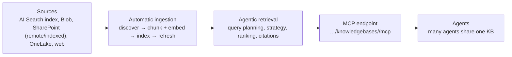
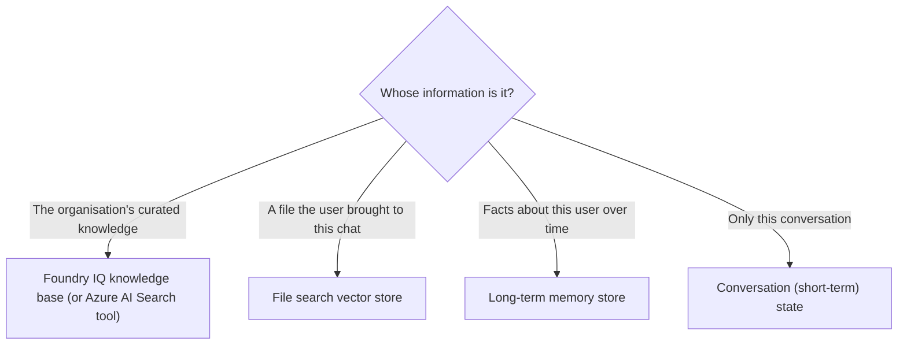

# Knowledge and memory for agents: Foundry IQ

> AI-103 · D2 Implement generative AI and agentic solutions · about 75 min · Study Hub module `a05` ([open the hub](https://claude.ai/artifact/TdpMZLFYA9knTdjNyCms9F))

## Why it matters
Agents need two kinds of remembering: **knowledge** (what the organisation knows) and **memory** (what this user said and prefers). The outline asks you to choose and connect both.

## Pre-question (answer before reading)
**Q:** Three needs: (1) company policies for all agents, (2) a PDF a user uploads for one chat, (3) remembering that a user prefers metric units. Which service fits each?

<details><summary>Answer</summary>

(1) **Foundry IQ** knowledge base; (2) **file search** (vector store); (3) **long-term memory** (memory store).

</details>

## 🍎 Story time (kid version)
**Robo at Foundry Town Hall: The library and the notebook**

Robo remembers things in two ways. The Town Hall library holds everyone's rule books and guides. Any robot can visit, and the librarian finds the right page and says which book it came from. Robo's own notebook holds little facts about each child: "Mia likes the blue lunchbox." When Mia comes back next month, Robo checks the notebook and remembers. If a child hands Robo a drawing today, he just looks at it now; it doesn't go into the library.

| In the story | In Foundry |
|---|---|
| The shared library and its librarian | A Foundry IQ knowledge base with agentic retrieval and citations |
| The notebook of facts about each child | A long-term memory store scoped per user |
| A drawing handed over today | File search over a file the user uploads in this chat |

**Where the story breaks:** Someone could trick Robo into writing a wrong fact in his notebook, so users should be able to see and erase what's remembered.

## Mental model & story (grown-up version)
Picture a company **library** and a personal **notebook**. **Foundry IQ** is the library: a managed knowledge layer on Azure AI Search where you create **knowledge bases** per business domain, each with **knowledge sources** such as an Azure AI Search index, Blob Storage files, SharePoint, OneLake or the web. Foundry IQ handles chunking, embedding and indexing, and at question time does **agentic retrieval**: it plans the query, picks strategies, ranks results and returns citations. Many agents can share one knowledge base.

Agents connect to a knowledge base through **MCP**: the knowledge base exposes an MCP endpoint (`{search endpoint}/knowledgebases/<name>/mcp`) that you add as an `MCPTool`. The project's identity needs **Search Index Data Reader** (or key auth).

SharePoint has two flavours. **Remote** SharePoint queries live with the user's permissions and needs no index maintenance. **Indexed** SharePoint copies content into an index on a schedule: faster, with richer search, but only as fresh as the last refresh.

The notebook is **memory** (preview). **Short-term** memory is the current conversation. **Long-term** memory lives in a **memory store** that extracts facts from conversations (user profile, chat summaries, procedural how-tos), consolidates them (merging duplicates, resolving conflicts) and retrieves them later. Contoso's travel agent attached the **memory search tool**, scoped per user, so next month it still knows Maya prefers aisle seats.

**Where the analogy breaks:** A library is curated and a notebook is personal, but both can be poisoned. A malicious document or a user's crafted message can plant false "facts". Validate sources, use guardrails, and let users see and delete their memories.

## Diagrams
**Foundry IQ knowledge base**



**Where should this information live?**



## Key points
- **Foundry IQ** = managed knowledge layer on **Azure AI Search**: knowledge bases (per domain) with knowledge sources (AI Search index, Blob, SharePoint remote or indexed, OneLake, web/Bing).
- Automatic pipeline: discover → chunk + embed → index → monitor/re-index. Retrieval intelligence: query analysis and planning, strategy selection, ranking, citations.
- Connect agents via MCP: `MCPTool(server_label="kb", server_url=f"{search_endpoint}/knowledgebases/<kb>/mcp")`; project identity needs **Search Index Data Reader** (RBAC) or key auth.
- Portal path: Agent > Knowledge > Add > Connect to Foundry IQ > connect an AI Search resource > create a knowledge base > add a source (e.g. Blob: container, auth, content extraction mode, embedding model such as text-embedding-3-small, chat model for retrieval).
- Grounding instructions for KB agents: always search the knowledge base, don't answer from training data, cite sources in a set format, and use a fixed fallback message when the answer isn't found. Test factual, synthesis, out-of-scope and ambiguous questions; monitor citation and fallback rates.
- SharePoint **remote**: live, permission-trimmed, no maintenance. SharePoint **indexed**: faster, advanced search, refreshed on a schedule.
- **Memory** (preview): short-term (conversation) vs long-term (memory store). Memory types: **user profile**, **chat summary**, **procedural**. Lifecycle: extraction → consolidation → retrieval.
- Use the **memory search tool** on a prompt agent (scoped per user automatically) or the memory store APIs with explicit scopes. Limits exist per store and scope; set TTLs; it needs chat and embedding deployments.
- Rule of thumb: memory for **user context**, Foundry IQ for **curated organisational knowledge**, file search for **user-provided documents**.

## Comparisons
**Knowledge options compared**

|  | File search | Azure AI Search tool | Foundry IQ |
|---|---|---|---|
| Setup | Upload files | Bring an existing index | Create knowledge base from sources |
| Sources | Files | One index | Index, Blob, SharePoint, OneLake, web |
| Sharing | Per agent/app | Any agent with the connection | Designed for many agents |
| Retrieval | Vector store search | Your index config | Agentic retrieval + citations |

## Code to recognise
**Connect an agent to a Foundry IQ knowledge base**

```python
kb_tool = MCPTool(
    server_label="product-docs",
    server_url=f"{search_endpoint}/knowledgebases/product-docs/mcp",
    require_approval="never")              # read-only knowledge retrieval

agent = project.agents.create_version(agent_name="product-expert",
    definition=PromptAgentDefinition(model=deployment, tools=[kb_tool],
        instructions=("Always search the product-docs knowledge base before answering. "
                      "Never answer from general knowledge. Cite as [source title]. "
                      "If nothing relevant is found, reply: 'I couldn't find that in our documentation.'")))
```

- Line 3: The knowledge base's MCP endpoint lives on the Azure AI Search service.
- Line 4: Retrieval is read-only, so skipping approval is reasonable.
- Line 8: Grounding rule, citation format and a fixed fallback make behaviour testable.

## Portal steps
**Create a knowledge base and attach it** (Foundry portal > Build > Agents > (agent) > Knowledge > Add > Connect to Foundry IQ)

1. Connect an Azure AI Search resource.
2. Create a knowledge base; add a source (e.g. Azure Blob: container, auth, extraction mode, embedding and chat models).
3. Save: ingestion runs automatically.
4. Grant the project identity Search Index Data Reader; test with factual and out-of-scope questions.

## Worked example
**Scenario:** A legal team's documents live in SharePoint with strict per-matter permissions that change daily. Several agents need to answer from them, and users must never see documents they can't open.

- Permission trimming is mandatory, and permissions change daily.
- SharePoint remote queries live with the user's permissions; indexed copies can lag.
- Shared by several agents → Foundry IQ knowledge base.

**Answer:** A **Foundry IQ knowledge base with a SharePoint *remote* source**, so retrieval is live and permission-trimmed for each user.

## Your turn (faded example)
**Scenario:** A banking agent should remember each customer's preferred language and recurring goals between sessions.

- This is per-user context, not organisational knowledge.
- **Which capability?** <details><summary>answer</summary>**Long-term memory** (memory store, e.g. user profile memories) via the memory search tool scoped per user.</details>
- **Name one risk and mitigation.** <details><summary>answer</summary>Memory poisoning or storing sensitive data → validate what's stored, apply guardrails, set retention/TTL, and let users view and delete memories.</details>

## Exam traps & misconceptions
- ✗ Using file search for knowledge shared by many agents. → ✓ File search is per agent/app; shared curated knowledge suits Foundry IQ.
- ✗ Using memory as the company knowledge base. → ✓ Memory is for user context; organisational knowledge belongs in Foundry IQ/AI Search.
- ✗ Forgetting Search Index Data Reader for the project identity. → ✓ Without it, keyless retrieval fails.
- ✗ Choosing indexed SharePoint when permissions change constantly. → ✓ Remote SharePoint is live and permission-trimmed.

## Discussion prompts
- **How would you test a knowledge-grounded agent before launch?** Ask factual questions (exact answers), synthesis questions (across documents), out-of-scope questions (should use the fallback) and ambiguous ones (should ask for clarification); check citation correctness and track fallback rates.
- **Why let users view and delete their stored memories?** Transparency and control (privacy rights), correction of wrong memories, and reduced risk of persistent poisoned or sensitive data.

## Interview angle / teach-back
**Prompt:** Explain to a colleague how an agent gets organisational knowledge from Foundry IQ and remembers user preferences.

**Rubric:** Foundry IQ = knowledge bases on Azure AI Search with multiple sources · Automatic ingestion + agentic retrieval with citations · Connect via MCP endpoint; Search Index Data Reader · Long-term memory store: profile/summary/procedural; extraction→consolidation→retrieval · Grounding instructions + fallback

**Model answer:** Foundry IQ creates knowledge bases on Azure AI Search from sources like Blob, SharePoint or an existing index. It handles chunking, embedding and indexing, and answers with agentic retrieval and citations. The agent connects through the knowledge base's MCP endpoint, and the project identity needs Search Index Data Reader. Separately, a long-term memory store extracts and consolidates facts about each user (profile, summaries, procedures) so the agent can retrieve them in later sessions. Instructions tell the agent to always search, cite, and use a fallback when nothing is found.

## Quick Q&A
- **Foundry IQ is built on…** Azure AI Search.
- **Agent connects to a KB via…** Its MCP endpoint (`…/knowledgebases/<kb>/mcp`).
- **Role for keyless KB retrieval?** Search Index Data Reader.
- **SharePoint remote vs indexed?** Remote: live, permission-trimmed. Indexed: faster, scheduled refresh.
- **Long-term memory types?** User profile, chat summary, procedural.
- **Memory lifecycle?** Extraction → consolidation → retrieval.
- **User-uploaded doc for one chat?** File search.

## Sources (accessed 2026-10-02)
- [Lab: Integrate an AI agent with Foundry IQ](https://microsoftlearning.github.io/mslearn-ai-agents/Instructions/Exercises/04-integrate-agent-with-foundry-iq.html)
- [What is memory? (Foundry Agent Service)](https://learn.microsoft.com/en-us/azure/foundry/agents/concepts/what-is-memory)

## SRS cards created
- ai-103-a05-01, ai-103-a05-02, ai-103-a05-03, ai-103-a05-04
