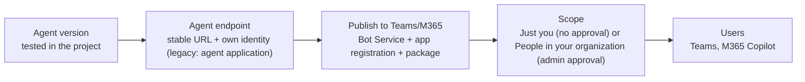
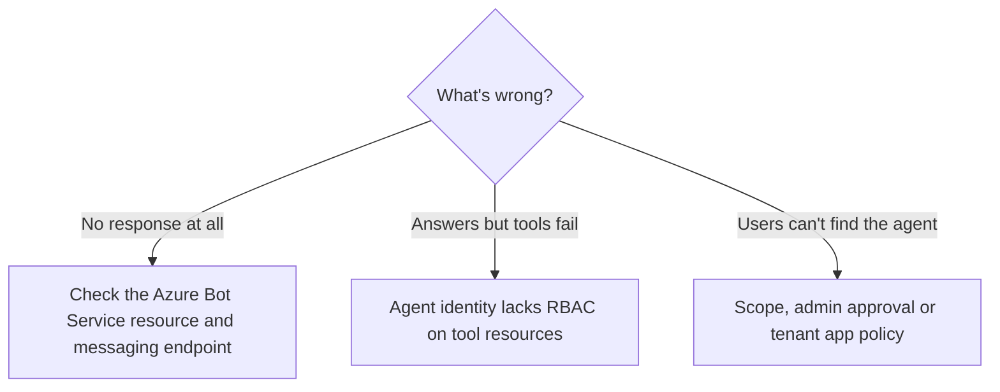

# Publish agents to Teams, Microsoft 365 and apps

> AI-103 · D2 Implement generative AI and agentic solutions · about 60 min · Study Hub module `a06` ([open the hub](https://claude.ai/artifact/TdpMZLFYA9knTdjNyCms9F))

## Why it matters
Configuring agent deployments and integrating agents into applications covers publishing: agent applications, Teams and Microsoft 365 Copilot channels, scopes and admin approval, and Work IQ.

## Pre-question (answer before reading)
**Q:** You publish an agent to Microsoft 365 Copilot with *Organization* scope. Why might colleagues not see it yet?

<details><summary>Answer</summary>

Organization scope requires **admin approval** in the Microsoft 365 admin center (Agents > Requested). Until approved it won't appear under *Built by your org*.

</details>

## 🍎 Story time (kid version)
**Robo at Foundry Town Hall: Opening a booth at the school fair**

Robo's helper booth is ready. First, Maya gives it a fixed spot with a sign and its own name badge, so everyone finds it in the same place. Then she moves it into the big school hallway where everyone walks past. For a trial run, she only tells Robo's class where it is, and nobody else has to agree. To open it to the whole school, the head teacher must sign it off first.

| In the story | In Foundry |
|---|---|
| A fixed spot with a sign and a name badge | A stable endpoint plus the agent's own identity |
| The big school hallway | Teams and Microsoft 365 Copilot |
| Telling only Robo's class | The *Just you* (Shared) scope: no admin approval |
| The head teacher's sign-off | The *People in your organization* scope needs admin approval |

**Where the story breaks:** The booth's new name badge doesn't inherit old permissions. Give it the keys its tools need, or they stop working.

## Mental model & story (grown-up version)
Publishing is opening a **shop front** for your agent. The agent needs a stable address, its own Entra identity, Entra-only authentication and isolation of each user's data, so apps can call it like an API. In the legacy model, publishing created an **agent application** to provide these; since July 2026 every new agent has them from creation, so *publish* now means the next step: distribution.

To reach people where they work, you publish to **Microsoft Teams and Microsoft 365 Copilot**. Foundry creates an **Azure Bot Service** resource, an Entra app registration and an M365 app package. You supply the metadata: name, descriptions, 32×32 and 192×192 icons, privacy and terms URLs (never secrets).

Then you pick a scope. **Just you** (REST value `Shared`; older material says *Shared*) makes it available without admin approval, under *Your agents*; you share the agent link with pilot users. **People in your organization** (REST `Tenant`; older material says *Organization*) puts it under *Built by your org* for everyone, after an admin approves it in the Microsoft 365 admin center. You can also download the package and upload it to Teams as a custom app.

Some teams need more: custom single sign-on, middleware, multi-environment pipelines. They use the **Microsoft 365 Agents Toolkit** in VS Code to build a *custom engine agent* that fronts the Foundry agent. And to give agents access to work data (mail, meetings, files, chats), **Work IQ** offers a CLI and MCP server over Microsoft Graph, permission-trimmed, which requires Microsoft 365 Copilot licences and admin consent.

**Where the analogy breaks:** A shop front stays where you built it. When an agent moves from the shared project identity to its own identity (at publish in the legacy model), tools that authenticate as the agent (MCP, A2A) can break in Teams until you grant roles to the new identity.

## Diagrams
**Publishing to Teams and Microsoft 365 Copilot**



**Troubleshooting after publishing**



## Key points
- Legacy **agent application**: stable invocation URL, its own **Entra agent identity**, Entra-only auth, per-user data isolation; callers need **Foundry User** (`applications/invoke/action`), and **Foundry Agent Consumer doesn't work** for agent applications (403 = missing role). **New agent model (July 2026)**: each agent has a stable `agent_endpoint` and its own identity from creation; **Foundry Agent Consumer** is the least-privilege role for calling it.
- Publish to **Teams and Microsoft 365 Copilot**: creates Azure Bot Service + Entra app registration + M365 package; the subscription needs the **Microsoft.BotService** resource provider registered, and the publisher needs **Azure Bot Service Contributor** (or Contributor) because Foundry roles don't include `Microsoft.BotService/botServices/write`.
- Roles: Microsoft's pages differ on publishing. The RBAC reference names **Foundry Project Manager** (Azure AI Project Manager in older material) as the minimum; the Teams/Microsoft 365 publishing page lists **Foundry User** on the project plus Azure Bot Service Contributor. Invoking: **Foundry Agent Consumer** for agent endpoints, **Foundry User** for legacy agent applications.
- Metadata: name, short and full description, **32×32 and 192×192 PNG icons**, privacy and terms URLs. No secrets in metadata.
- Scopes: **Just you** (REST `Shared`; no admin approval; appears under *Your agents*; share the link) vs **People in your organization** (REST `Tenant`; older material: *Organization*; admin approval in **M365 admin center > Agents > All agents > Requested**; appears under *Built by your org*).
- Alternative: download the package (.zip) and upload in Teams via *Apps > Manage your apps > Upload a custom app* (if tenant policy allows).
- Other channels: web app preview, the stable API endpoint, Azure Bot Service channels (e.g. Slack, Telegram, SMS via Twilio).
- **M365 Agents Toolkit** (VS Code): custom engine agents for custom SSO, middleware, multi-environment CI/CD and deep debugging; **Agents Playground** for local testing.
- **Work IQ** (preview): CLI and MCP server over Microsoft Graph for mail, meetings, files, Teams chats and people; needs M365 Copilot licences + admin consent; results are permission-trimmed and not stored.

## Comparisons
**Publishing scopes**

|  | Just you (Shared) | People in your organization (Tenant) |
|---|---|---|
| Admin approval | Not required | Required (M365 admin center) |
| Where users find it | Your agents | Built by your org |
| Audience | People you share with | Whole organisation (per policy) |
| Use for | Pilots, teams | Company-wide rollout |

## Code to recognise
**Calling a legacy agent application from an app**

```python
from openai import OpenAI
from azure.identity import DefaultAzureCredential, get_bearer_token_provider

app_url = ("https://contoso.services.ai.azure.com/api/projects/support"
           "/applications/helpdesk/protocols/openai")
client = OpenAI(base_url=app_url,
                api_key=get_bearer_token_provider(DefaultAzureCredential(),
                                                  "https://ai.azure.com/.default"))
r = client.responses.create(input="My laptop won't connect to VPN")
print(r.output_text)
```

- Line 4: Legacy application endpoint, stable across published versions. New-model agents expose `…/agents/<agent>/endpoint/protocols/openai` instead.
- Line 7: Entra token only; the caller needs Foundry User on the application (Agent Consumer for new-model agent endpoints).
- Line 9: The endpoint already knows which agent to run.

## Portal steps
**Publish to Teams and Microsoft 365 Copilot** (Foundry portal > Build > Agents > (agent) > Publish > Publish to Teams and Microsoft 365 Copilot)

1. Make sure the tested version is the one the agent's endpoint serves (legacy: publishing creates the agent application).
2. Fill in metadata and icons (32×32, 192×192).
3. Choose **Just you** or **People in your organization**; submit.
4. People in your organization: an admin approves under M365 admin center > Agents > Requested.
5. Grant the agent identity the roles its tools need.

## Worked example
**Scenario:** A pilot group of 20 people should try an agent in Teams this week, without waiting for IT. Later it will roll out to everyone.

- Pilot, quick, no admin approval → Just you (Shared) scope, then share the link.
- Company-wide later → People in your organization (Tenant) scope with admin approval.
- Make sure the agent identity has tool permissions before the pilot.

**Answer:** Publish with **Just you** (Shared) scope and share the agent link for the pilot; republish with **People in your organization** (admin approval) for the company-wide rollout.

## Your turn (faded example)
**Scenario:** After publishing to Teams, the agent replies but every search answer fails with an authorisation error.

- Replies arrive, so Bot Service works.
- **What's the likely cause?** <details><summary>answer</summary>The published **agent identity** lacks roles on the search service.</details>
- **Fix?** <details><summary>answer</summary>Assign **Search Index Data Reader** (and any other needed data roles) to the agent identity.</details>

## Exam traps & misconceptions
- ✗ Expecting org-wide (People in your organization) agents to appear immediately. → ✓ They need admin approval first.
- ✗ Giving a legacy agent application's caller Foundry Agent Consumer. → ✓ Agent Consumer covers agent endpoints only; agent applications need Foundry User (applications/invoke/action).
- ✗ Assuming Foundry roles cover the Teams publish. → ✓ Creating the Bot Service resource needs Azure Bot Service Contributor (or Contributor).
- ✗ Publishing without registering Microsoft.BotService. → ✓ The Teams/M365 publish creates a Bot Service resource, so the provider must be registered.
- ✗ Putting API keys in agent metadata. → ✓ Metadata is visible; never include secrets.
- ✗ Assuming Work IQ works without M365 Copilot licences. → ✓ It requires licences and admin consent.

## Discussion prompts
- **When would you choose the M365 Agents Toolkit over Foundry's built-in publishing?** When you need custom SSO flows, custom middleware (logging, policy), multiple environments with CI/CD, or deeper debugging than the built-in publishing offers.
- **What privacy questions come with Work IQ?** Which data the agent can see (it's permission-trimmed to the user), whether outputs are stored, admin consent and governance, and how users are informed. Microsoft states results are not stored.

## Interview angle / teach-back
**Prompt:** Explain how to get a Foundry agent into Teams for a pilot and then for the whole company.

**Rubric:** Stable endpoint + own identity (new model: at creation; legacy: agent application at publish) · Publish to Teams/M365 creates Bot Service + app registration + package (needs Bot Service Contributor) · Just you (Shared) scope for the pilot (no approval) · People in your organization (Tenant) scope needs admin approval in M365 admin center · Grant tool permissions to the agent identity

**Model answer:** Make sure the tested version is the one the agent's endpoint serves (new agents have a stable endpoint and their own identity from creation; in the legacy model, publishing created an agent application). Then choose Publish to Teams and Microsoft 365 Copilot. Foundry creates a Bot Service resource, so you need Azure Bot Service Contributor, plus an app registration and the app package from the metadata and icons you provide. For the pilot use the Just you scope, which needs no admin approval, and share the link; for everyone, use People in your organization and have an admin approve it in the Microsoft 365 admin center. Make sure the agent's identity has roles for its tools.

## Quick Q&A
- **Publish permissions?** Foundry Project Manager per the RBAC page (publishing page: Foundry User) + Azure Bot Service Contributor.
- **Invoke role?** Foundry Agent Consumer (agent endpoints) · Foundry User (legacy agent applications).
- **Icon sizes?** 32×32 and 192×192 PNG.
- **'Just you' (Shared) scope needs approval?** No.
- **Where admins approve org-wide agents?** M365 admin center > Agents > Requested.
- **Resource provider needed?** Microsoft.BotService.
- **Work IQ requires?** M365 Copilot licences + admin consent.

## Sources (accessed 2026-10-02)
- [Lab: Deploy agents to Microsoft Teams and Copilot](https://microsoftlearning.github.io/mslearn-ai-agents/Instructions/Exercises/05a-m365-teams-integration.html)
- [Lab: Work IQ (optional)](https://microsoftlearning.github.io/mslearn-ai-agents/Instructions/Exercises/05b-work-iq-integration.html)

## SRS cards created
- ai-103-a06-01, ai-103-a06-02, ai-103-a06-03, ai-103-a06-04
