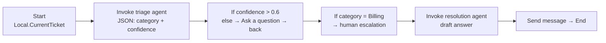
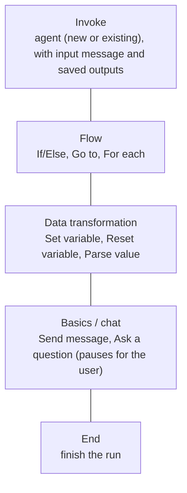

# Foundry workflows: visual multi-step and human-in-the-loop

> AI-103 · D2 Implement generative AI and agentic solutions · about 70 min · Study Hub module `a07` ([open the hub](https://claude.ai/artifact/TdpMZLFYA9knTdjNyCms9F))

## Why it matters
"Build autonomous or semiautonomous workflows with safeguards and approval flow controls" and "Design workflows". Foundry workflows let you chain agents and logic visually, with Power Fx conditions and human-in-the-loop steps. **Heads-up:** Microsoft retires Foundry workflows on **1 Dec 2026** and recommends Microsoft Agent Framework for new workflows (or Logic Apps / A2A); the outline still names workflows, so learn both.

## Pre-question (answer before reading)
**Q:** A triage agent outputs `{"category": "Billing", "confidence": 0.42}`. In a workflow, how would you stop a low-confidence ticket from being routed automatically?

<details><summary>Answer</summary>

Add an **If/Else** node with a Power Fx condition such as `Local.TriageJson.confidence > 0.6`; the *else* branch asks the user for more information (or sends it to a human) instead of routing.

</details>

## 🍎 Story time (kid version)
**Robo at Foundry Town Hall: The board-game path**

Robo's help desk works like a board game. On square 1, a sorting robot reads each note and writes a label plus how sure it is. Square 2 is a fork: more than 6 out of 10 sure, go right; otherwise land on "Ask the child a question" and wait for a reply. Notes about money take the path to a grown-up helper. Maya photographs every finished board and never redraws an old one; she makes a new board instead.

| In the story | In Foundry |
|---|---|
| Squares on the path | Workflow nodes (invoke agent, ask a question, send message) |
| The fork with a rule | If/Else with a Power Fx condition |
| "Ask the child" and wait | A human-in-the-loop pause (Ask a question node) |
| The photo of each board | Immutable workflow versions |

**Where the story breaks:** Foundry's visual workflows retire on 1 December 2026. New boards are built in code with Microsoft Agent Framework.

## Mental model & story (grown-up version)
A workflow is a **railway map** for work. Stations are **nodes**: invoke an agent, ask the user a question, send a message, set a variable, branch with If/Else, loop with For each, jump with Go to, end. Tracks are the order. Signals are **Power Fx** conditions that decide which branch a ticket takes.

Tailspin Toys built a support workflow in **Build > Agents > Workflows**. Step one invokes a **triage agent** whose output is structured JSON (category and confidence), using a JSON-schema text format on the node, saved into variables (`Local.TriageOutputText`, `Local.TriageOutputJson`). An If/Else node checks the confidence: below 0.6, an **Ask a question** node requests more detail and loops back. Billing tickets go to a human escalation path; others go to a **resolution agent**.

Workflows are saved as **immutable versions**: nothing auto-saves, and each save is a new version. The visual canvas and the **YAML** view stay in sync, so you can review changes like code. Templates give you a head start: **sequential**, **human-in-the-loop** and **group chat**.

To run a workflow from code, you reference it by name just like an agent and usually **stream** the response so you can show progress events as each node runs. A human-in-the-loop workflow **pauses** at a question; you send another message to resume.

**Where the analogy breaks:** Trains never improvise. Agent nodes inside a workflow still use models, so a node's output can vary. Validate structured outputs and design branches for unexpected values.

## Diagrams
**Tailspin's support workflow**



**Workflow node types**



## Key points
- Create: **Build > Agents > Workflows > Create**: blank or templates (**sequential**, **human-in-the-loop**, **group chat**).
- Nodes: **Invoke agent**; flow control **If/Else, Go to, For each**; data **Set variable, Reset variable, Parse value**; chat **Send message, Ask a question**; **End**.
- Variables: `Local.<name>` (workflow scope) and `System.<name>` (built-in). Expressions use **Power Fx**: comparisons, `If`, `IsBlank`, `IsEmpty`, `Upper`, `Lower`, `Len`, `Concatenate`, `Sum`, `Count`, `ForAll`.
- Invoke-agent node settings: the input message (e.g. `Local.CurrentTicket`), *save agent output message as* (text variable) and *save output json_object as* (JSON variable) when the agent's text format is a **JSON schema**.
- Saves are manual and each save creates an **immutable version**; the visual designer and YAML stay synchronised; nodes can carry notes.
- Run from code: `responses.create(conversation=conv.id, extra_body={"agent_reference": {"name": workflow_name, "type": "agent_reference"}}, input="Start", stream=True)`, then watch streamed events (`response.output_item.done` items of the workflow-action type report node status; `response.completed` ends).
- **Human-in-the-loop**: an Ask-a-question node pauses the run; another user message resumes it. Use it for approvals and missing information.
- Safeguards: confidence thresholds in conditions, explicit escalation branches, structured outputs between nodes, loop limits, and guardrails on the agents inside.
- The migration guide maps classic *connected agents* to the **A2A tool** in the new Agent Service; for code-first multi-agent orchestration use **Microsoft Agent Framework**.
- **Retirement (checked 2 Oct 2026):** Foundry workflows (visual designer and in-portal runs) retire on **1 Dec 2026**. Migration paths: **Microsoft Agent Framework** (recommended; declarative YAML or code, same patterns), **Azure Logic Apps** (visual designer) or **A2A** for simple agent-to-agent calls.

## Comparisons
**Workflow vs single agent vs code orchestration**

|  | Single agent | Foundry workflow | Agent Framework (code) |
|---|---|---|---|
| Control flow | Model decides | Explicit nodes + Power Fx | Explicit graph in code |
| Human steps | Approvals on tools | Ask-a-question / HITL template | Request-info events |
| Who builds it | Anyone | Low-code makers + devs | Developers |
| Versioning | Agent versions | Immutable workflow versions + YAML | Git |

## Code to recognise
**Run a workflow and stream its progress**

```python
conv = oc.conversations.create()
stream = oc.responses.create(
    conversation=conv.id,
    extra_body={"agent_reference": {"name": "support-workflow", "type": "agent_reference"}},
    input="Start",
    stream=True)

for event in stream:
    if event.type == "response.output_item.done":
        print("step finished:", event.item.type)        # workflow actions, messages
    elif event.type == "response.completed":
        print("workflow done")
```

- Line 4: Workflows are referenced by name exactly like agents.
- Line 6: Streaming shows node-by-node progress.
- Line 9: Each completed output item can be a workflow action or a message.

**Power Fx conditions you might write**

```
Local.TriageJson.confidence > 0.6
Local.TriageJson.category = "Billing"
IsBlank(Local.CustomerEmail)
Upper(Local.Priority) = "HIGH" && Local.Amount > 500
```

- Line 1: Route only confident results automatically.
- Line 3: Ask for missing information instead of guessing.
- Line 4: Combine conditions for escalation rules.

## Portal steps
**Build the triage workflow** (Foundry portal > Build > Agents > Workflows > Create > Blank)

1. Add **Invoke agent** (triage); under Details > Parameters set text format to a JSON schema (category, confidence).
2. Node settings: input `Local.CurrentTicket`; save output as `TriageOutputText` and JSON as `TriageOutputJson`.
3. Add **If/Else** with `Local.TriageOutputJson.confidence > 0.6`; else branch **Ask a question**.
4. Add branches per category; **Save** (creates a version); test in the workflow playground; check the YAML view.

## Worked example
**Scenario:** Refund requests above $200 must be approved by a manager; below that the agent can proceed. Build it without custom code.

- Extract the amount with an agent node that returns JSON.
- If/Else on `Local.RefundJson.amount > 200`.
- High branch: human-in-the-loop step (ask the manager / approval); low branch: proceed to the refund agent.

**Answer:** A **Foundry workflow**: extraction agent (JSON output) → **If/Else (Power Fx)** → human-in-the-loop approval branch for > $200 → refund agent → send message.

## Your turn (faded example)
**Scenario:** Your workflow's If/Else node can't read `confidence` from the triage agent.

- The triage agent returns free text.
- **What must you configure on the agent node?** <details><summary>answer</summary>A **JSON schema text format** so the output is structured, and *save output json_object as* a variable.</details>
- **How do you reference it in the condition?** <details><summary>answer</summary>`Local.<JsonVariable>.confidence`.</details>

## Exam traps & misconceptions
- ✗ Expecting workflows to autosave. → ✓ Saves are manual; each save is an immutable version.
- ✗ Parsing free text in conditions. → ✓ Use a JSON schema output and a JSON variable.
- ✗ Thinking workflows are invoked differently from agents. → ✓ Both use `agent_reference` by name.
- ✗ Using a workflow for a simple single-agent Q&A. → ✓ Workflows add value when steps, branches or human checks are explicit.

## Discussion prompts
- **When would you choose a Foundry workflow over letting one agent decide everything?** When order, checkpoints and approvals must be explicit and auditable (e.g. finance, HR), when different agents own different steps, or when non-developers need to read and change the flow.
- **How do you prevent an Ask-a-question loop from running forever?** Track attempts in a variable and add a condition that escalates or ends after N tries.

## Interview angle / teach-back
**Prompt:** Explain how a Foundry workflow routes a support ticket using an agent's output and a human-in-the-loop step.

**Rubric:** Invoke agent node with JSON schema output saved to variables · If/Else with Power Fx on Local variables · Ask a question / HITL pauses and resumes · Immutable versions, YAML view · Run by name via agent_reference, stream events

**Model answer:** The workflow invokes a triage agent configured to return JSON (category and confidence) and saves it to a Local variable. An If/Else node uses Power Fx, such as `Local.TriageJson.confidence > 0.6`, to decide: low confidence goes to an Ask-a-question node that pauses until the user replies, billing goes to a human, and the rest go to a resolution agent. Each save makes an immutable version with a YAML view, and apps run the workflow by name with `agent_reference`, streaming progress events.

## Quick Q&A
- **Workflow templates?** Sequential, human-in-the-loop, group chat.
- **Expression language?** Power Fx.
- **Variable prefixes?** `Local.` and `System.`.
- **Pause for user input node?** Ask a question.
- **Are workflow saves versioned?** Yes: each save is an immutable version.
- **Invoke a workflow from code?** `responses.create` with `agent_reference` to its name (often `stream=True`).

## Sources (accessed 2026-10-02)
- [Lab: Build a workflow in Microsoft Foundry](https://microsoftlearning.github.io/mslearn-ai-agents/Instructions/Exercises/06-build-workflow-ms-foundry.html)
- [Learning path: Develop AI agents on Azure](https://learn.microsoft.com/en-us/training/paths/develop-ai-agents-azure/)

## SRS cards created
- ai-103-a07-01, ai-103-a07-02, ai-103-a07-03, ai-103-a07-04
