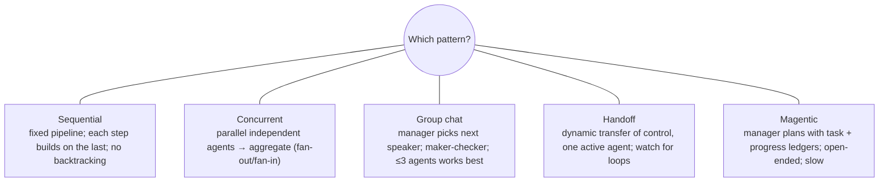
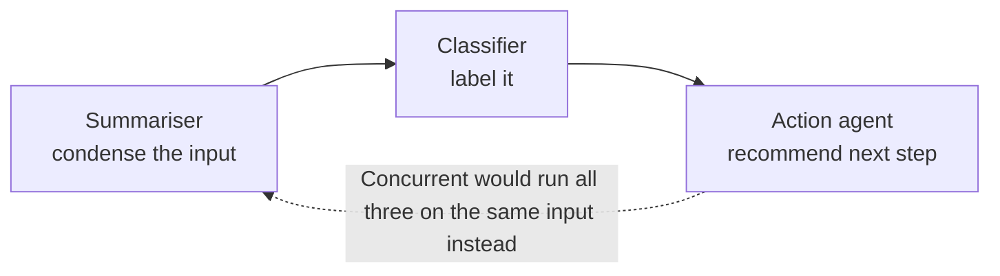

# Microsoft Agent Framework and orchestration patterns

> AI-103 · D2 Implement generative AI and agentic solutions · about 80 min · Study Hub module `a08` ([open the hub](https://claude.ai/artifact/TdpMZLFYA9knTdjNyCms9F))

## Why it matters
"Implement orchestrated multi-agent solutions" and "orchestrate multiple models, flows". Microsoft Agent Framework (the successor to Semantic Kernel and AutoGen) gives you code-level agents and five orchestration patterns you must tell apart.

## Pre-question (answer before reading)
**Q:** Three agents each review a contract independently (legal, finance, security) and you combine their findings. Which orchestration pattern is that?

<details><summary>Answer</summary>

**Concurrent** (fan-out/fan-in): independent agents work in parallel on the same input, then results are aggregated.

</details>

## 🍎 Story time (kid version)
**Robo at Foundry Town Hall: Five ways the robot team works**

Robo's team has five ways of working. A relay race: each robot does a part and passes the baton. A taste test: three robots try the same soup at the same time and vote. An art critique: one draws, one comments, back and forth until the picture is good. A phone transfer: the front-desk robot passes a caller to the right expert, one at a time. A treasure hunt: a captain robot keeps a list of clues and decides who searches next.

| In the story | In Foundry |
|---|---|
| Relay race | Sequential |
| Taste test at the same time | Concurrent |
| Draw and comment | Group chat (maker-checker) |
| Phone transfer | Handoff |
| Captain with a clue list | Magentic (task and progress ledgers) |

**Where the story breaks:** Every time the robots talk to each other it costs time and money. Pick the simplest way that works and cap the number of rounds.

## Mental model & story (grown-up version)
Agent Framework is a **film studio** for agents written in Python or .NET. Each **Agent** has a chat client (Foundry, Azure OpenAI, OpenAI, Anthropic, Ollama and more), instructions and tools. **Function tools** are plain Python functions; type hints and descriptions become their schema, and `@tool(approval_mode="always_require")` makes them pause for approval. **Sessions** keep conversation history; **context providers** add memory; **middleware** can log, authorise or block calls.

Multi-agent work follows recognisable scripts. **Sequential**: a pipeline where each agent builds on the previous one (draft → review → polish). **Concurrent**: several agents work on the same input in parallel and results are merged (independent reviews, voting). **Group chat**: a chat manager picks who speaks next in a shared conversation, ideal for maker-checker loops with two or three agents. **Handoff**: one agent at a time owns the conversation and transfers control dynamically, like triage passing to billing or tech support. **Magentic**: a manager agent plans open-ended work with a **task ledger** and tracks it with a **progress ledger**, assigning steps to specialists; powerful but slow.

Underneath, **workflows** are graphs of **executors** connected by **edges** (direct, conditional, switch-case, fan-out, fan-in) that emit events and can **checkpoint** progress so long runs can resume.

Wingtip's marketing team used **sequential** for copywriting, **concurrent** for compliance checks, and **handoff** for their customer-service triage. They avoided magentic for routine tasks because of its latency and cost.

**Where the analogy breaks:** Film crews talk freely. Free conversation between agents (group chat, magentic) costs tokens and can loop. Cap rounds, set termination conditions, and prefer the simplest pattern that works.

## Diagrams
**Five orchestration patterns**



**Sequential pipeline (SequentialBuilder)**



## Key points
- Install `agent-framework` (and the Foundry integration). Core: `Agent`, chat clients (e.g. `FoundryChatClient`), sessions/threads, tools, middleware, context providers, structured outputs, streaming (`run_stream`).
- Function tools: plain functions with type hints and docstrings (or `Annotated[..., Field(description=...)]`), or `@tool(name=..., description=..., approval_mode="always_require"|"never_require")`.
- History: service-side for Foundry Agent Service and Responses-based clients; local in-memory for Chat Completions clients.
- **Sequential**: fixed order, each agent sees prior output; simple and predictable; can't backtrack.
- **Concurrent**: same input to several agents in parallel, then aggregate (ensemble, voting, independent reviews); don't use when steps depend on each other.
- **Group chat**: a manager chooses the next speaker each round (can ask the user, terminate, filter results); best for refinement and maker-checker; keep to about three agents.
- **Handoff**: agents transfer control dynamically (triage → specialist); only one active at a time; guard against handoff loops (switch-case edges with a default case).
- **Magentic**: manager plans and re-plans using a task ledger and progress ledger; parameters such as maximum rounds, stalls and resets; for complex open-ended problems, at higher latency and cost.
- Workflows: executors + edges (direct, conditional, switch-case, fan-out, fan-in), events (started, executor invoked/completed, output, error, request-info), **checkpointing** for resumable runs. Agents can also be exposed as tools to other agents (agent-as-tool).

## Comparisons
**Pick the pattern**

| Scenario | Pattern |
|---|---|
| Draft → legal review → final edit | Sequential |
| Three independent risk reviews of one proposal | Concurrent |
| Writer and critic iterate until approved | Group chat (maker-checker) |
| Front-desk agent routes to billing or tech support | Handoff |
| Open-ended research with unknown steps | Magentic |

## Code to recognise
**An agent with a tool, then a sequential workflow**

```python
import asyncio
from agent_framework import Agent, tool
from agent_framework.foundry import FoundryChatClient
from agent_framework.orchestrations import SequentialBuilder
from azure.identity import AzureCliCredential

@tool(approval_mode="never_require")
def get_policy(topic: str) -> str:
    """Return the expense policy text for a topic."""
    return POLICIES.get(topic, "No policy found.")

async def main():
    client = FoundryChatClient(project_endpoint=ENDPOINT, model=DEPLOYMENT,
                               credential=AzureCliCredential())
    async with Agent(client=client, name="PolicyAgent",
                     instructions="Answer expense questions using get_policy.",
                     tools=[get_policy]) as agent:
        print((await agent.run("Can I expense a taxi to the airport?")).text)

    summariser = client.as_agent(name="Summariser", instructions="Summarise the request.")
    classifier = client.as_agent(name="Classifier", instructions="Classify it.")
    responder = client.as_agent(name="Responder", instructions="Recommend an action.")
    workflow = SequentialBuilder(participants=[summariser, classifier, responder]).build()
    result = await workflow.run("Customer reports duplicate charge on invoice 1182")
    print(result.get_outputs())

asyncio.run(main())
```

- Line 7: `approval_mode` controls whether calls pause for approval.
- Line 9: The docstring becomes the tool description.
- Line 13: The chat client is provider-agnostic; this one targets Foundry.
- Line 18: `await agent.run(...)` returns a response with `.text`.
- Line 20: `as_agent` is a shortcut to create agents from a client.
- Line 23: SequentialBuilder wires a pipeline; ConcurrentBuilder, group chat, handoff and magentic builders exist too.

## Portal steps
**Develop locally with the Foundry Toolkit** (VS Code > Foundry Toolkit > Agent Framework samples / hosted agents)

1. Scaffold an Agent Framework project; sign in with `az login`.
2. Run and debug locally; visualise the workflow graph.
3. Deploy as a **hosted agent** to Foundry when ready.

## Worked example
**Scenario:** A bank's loan desk: an intake agent must route each conversation to either a mortgage, auto-loan or credit-card specialist, and specialists may hand back to intake if the customer changes topic.

- One agent active at a time, with dynamic transfer of control → handoff.
- Specialists can transfer back → handoff edges both ways.
- Add a guard against loops (max handoffs, default route).

**Answer:** **Handoff orchestration** with intake as the start agent, handoffs to each specialist and back, plus loop protection.

## Your turn (faded example)
**Scenario:** A research task: "Assess market entry for electric bikes in three countries" with unknown sub-steps, web research and analysis.

- Steps aren't known in advance and need re-planning.
- **Which pattern?** <details><summary>answer</summary>**Magentic** (manager with task and progress ledgers).</details>
- **Which settings keep it under control?** <details><summary>answer</summary>Maximum rounds, maximum stalls and resets; plus tool limits and cost monitoring.</details>

## Exam traps & misconceptions
- ✗ Using concurrent orchestration when step 2 needs step 1's output. → ✓ Dependent steps need sequential (or graph edges).
- ✗ Putting six agents in a group chat. → ✓ Group chat works best with a few agents; more increases cost and confusion.
- ✗ Choosing magentic for a fixed three-step process. → ✓ Sequential is cheaper, faster and more predictable.
- ✗ Forgetting loop protection in handoff. → ✓ Agents can bounce control back and forth indefinitely.
- ✗ Assuming Agent Framework only works with Azure OpenAI. → ✓ Chat clients are provider-agnostic.

## Discussion prompts
- **How do you decide between a Foundry workflow and Agent Framework code?** Foundry workflows suit visual, low-code orchestration with Power Fx and built-in HITL; Agent Framework suits developers needing custom logic, testing, checkpointing, middleware or deployment as hosted agents.
- **Why prefer the simplest pattern?** Every agent-to-agent exchange adds tokens, latency, failure points and debugging effort. Use multi-agent patterns only when specialisation, parallelism or separation of duties clearly pays off.

## Interview angle / teach-back
**Prompt:** Explain the five Agent Framework orchestration patterns with one example each.

**Rubric:** Sequential: pipeline, each builds on previous · Concurrent: parallel independent, aggregate · Group chat: manager selects speaker; maker-checker · Handoff: dynamic transfer, one active agent · Magentic: manager with task/progress ledgers, open-ended

**Model answer:** Sequential is a pipeline: draft, review, polish. Concurrent sends the same input to independent agents in parallel and merges their results, like separate legal and finance reviews. Group chat has a manager pick the next speaker in a shared conversation, which suits a writer and critic iterating. Handoff passes control dynamically to one specialist at a time, like triage to billing. Magentic uses a manager that plans with a task ledger and tracks a progress ledger for open-ended problems, at higher cost.

## Quick Q&A
- **Successor of Semantic Kernel + AutoGen?** Microsoft Agent Framework.
- **Parallel independent agents?** Concurrent.
- **Maker-checker iteration?** Group chat.
- **Dynamic transfer, one active agent?** Handoff.
- **Task ledger + progress ledger?** Magentic.
- **Fixed pipeline?** Sequential.
- **Approval setting on tools?** `@tool(approval_mode="always_require")`.

## Sources (accessed 2026-10-02)
- [Lab: Develop an agent with Agent Framework](https://microsoftlearning.github.io/mslearn-ai-agents/Instructions/Exercises/07-agent-framework.html)
- [Lab: Multi-agent solution with Agent Framework](https://microsoftlearning.github.io/mslearn-ai-agents/Instructions/Exercises/08-agent-framework-multi-agents.html)
- [Agent Framework middleware](https://learn.microsoft.com/en-us/agent-framework/agents/middleware/)

## SRS cards created
- ai-103-a08-01, ai-103-a08-02, ai-103-a08-03, ai-103-a08-04
