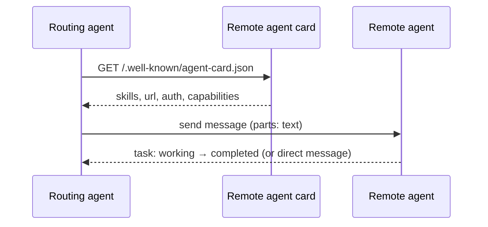
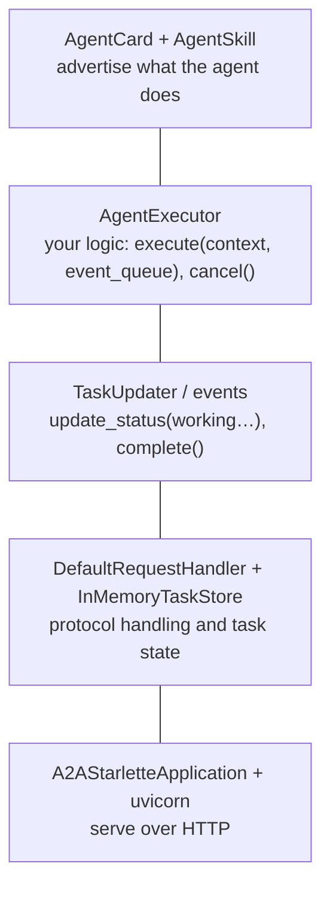

# A2A: connecting remote agents

> AI-103 · D2 Implement generative AI and agentic solutions · about 60 min · Study Hub module `a09` ([open the hub](https://claude.ai/artifact/TdpMZLFYA9knTdjNyCms9F))

## Why it matters
Agent2Agent (A2A) lets agents built by different teams, frameworks or vendors discover and delegate to each other. Know the **agent card**, tasks and messages, the server and client pieces, and when A2A beats MCP.

## Pre-question (answer before reading)
**Q:** MCP connects an agent to tools. What does A2A connect, and why not just use MCP for everything?

<details><summary>Answer</summary>

A2A connects **agents to agents**. The remote agent has its own reasoning, tools and state, and you delegate a task to it as a peer. MCP exposes tools that the calling agent controls step by step.

</details>

## 🍎 Story time (kid version)
**Robo at Foundry Town Hall: Name badges at the robot fair**

At the robot fair, every robot wears a name badge: "I'm Visa-Bot. I answer questions about travel papers. Ask me in words. Find me at table 9." Robo reads the badges, picks Visa-Bot and hands over a question. Visa-Bot thinks on its own with its own tools, and Robo can't see how. Small questions get an answer straight away. Big ones get a ticket that says "working..." until the job is done.

| In the story | In Foundry |
|---|---|
| The name badge | The agent card at `/.well-known/agent-card.json` |
| "I answer questions about travel papers" | The skills listed in the card |
| Handing over a question | Sending a message |
| The "working..." ticket | A task with states |

**Where the story breaks:** Badges can be faked. Check who the robot really is (authentication) and double-check its answers like any outside input.

## Mental model & story (grown-up version)
Imagine a **conference of specialists**. Each wears a **badge**, the **agent card**, published at a well-known address (`/.well-known/agent-card.json`): name, description, endpoint URL, version, input/output modes, capabilities (such as streaming or push notifications), **skills** with examples, and how to authenticate.

A **routing agent** reads the badges, picks the right specialist and sends a **message** (made of parts such as text). Short jobs come back as a direct message; longer ones become a **task** with states (working, completed…) that you poll or stream.

Fabrikam's travel company used it like this: their in-house **routing agent** (built in Foundry) delegated *find flights* to a partner's flight agent (built with a different framework, hosted elsewhere) and *check visa rules* to a government-data agent, both over A2A. Each agent kept its own model, tools and security.

On the server side, the A2A SDK separates protocol from logic: you implement an **AgentExecutor** (`execute`, `cancel`) that updates task status through an event queue, wrap it in a request handler with a task store, and serve it as an HTTP app. On the client side, a **card resolver** fetches the card and a client sends messages.

**Where the analogy breaks:** Conference specialists trust each other's badges. In production, verify identity: A2A supports authentication schemes declared in the card, and you should treat remote agents' output as untrusted input (guardrails, validation).

## Diagrams
**A2A delegation**



**A2A server building blocks (Python SDK)**



## Key points
- A2A = open protocol for **agent-to-agent** communication across frameworks, vendors and hosts. MCP = agent-to-**tool**. Use A2A to delegate a whole task to an opaque agent with its own reasoning.
- **Agent card** at `/.well-known/agent-card.json`: name, description, url, version, default input/output modes, capabilities (streaming, push notifications), **skills** (`AgentSkill(id, name, description, tags, examples)`), authentication.
- Communication: **messages** (role + parts, e.g. `{"kind": "text", "text": ...}`) and **tasks** with states for longer work (poll or stream).
- Server: implement `AgentExecutor` (`execute`, `cancel`) using `RequestContext` and `EventQueue`; update via `TaskUpdater`; host with `DefaultRequestHandler(agent_executor=..., task_store=InMemoryTaskStore())` + `A2AStarletteApplication(agent_card=..., http_handler=...)` + uvicorn.
- Client: `A2ACardResolver` fetches the card; `A2AClient` sends `SendMessageRequest(id, params=MessageSendParams(...))`.
- **Routing agent pattern**: an orchestrator discovers remote agents by their cards and delegates by skill.
- Each agent keeps its own model, tools, identity and auth; A2A supports built-in auth schemes declared in the card.
- In Foundry's new Agent Service, classic *connected agents* were removed; use **workflows** and the **A2A tool** (preview) for multi-agent delegation.
- Copilot Studio can also connect to A2A agents (see the AB-620 hub), so A2A is how Foundry and Copilot Studio agents interoperate.

## Comparisons
**A2A vs MCP**

|  | A2A | MCP |
|---|---|---|
| Connects | Agent ↔ agent | Agent/app ↔ tools and data |
| Remote side | Opaque agent with its own reasoning | Tools the caller invokes directly |
| Discovery | Agent card | list_tools |
| Long work | Tasks with states | Tool call returns a result |
| Use when | Delegating whole tasks across teams/vendors | Sharing tools across agents/apps |

## Code to recognise
**A2A agent card and executor (server side)**

```python
from a2a.types import AgentCard, AgentSkill, AgentCapabilities
from a2a.server.agent_execution import AgentExecutor
from a2a.server.tasks import TaskUpdater
from a2a.types import TaskState
from a2a.utils import new_agent_text_message

skill = AgentSkill(id="visa_rules", name="Visa rules",
                   description="Explains visa requirements for a trip",
                   tags=["travel"], examples=["Do I need a visa for Japan?"])
card = AgentCard(name="visa-agent", description="Visa requirement expert",
                 url="https://visa.example.com/", version="1.0.0",
                 default_input_modes=["text"], default_output_modes=["text"],
                 capabilities=AgentCapabilities(streaming=True), skills=[skill])

class VisaExecutor(AgentExecutor):
    async def execute(self, context, event_queue):
        updater = TaskUpdater(event_queue, context.task_id, context.context_id)
        await updater.update_status(TaskState.working,
                                    message=new_agent_text_message("Checking rules…"))
        answer = await my_agent.answer(context.get_user_input())
        await updater.complete(message=new_agent_text_message(answer))

    async def cancel(self, context, event_queue):
        raise NotImplementedError
```

- Line 7: Skills tell routing agents what this agent is good at.
- Line 10: The card is served at /.well-known/agent-card.json.
- Line 13: Capabilities advertise features like streaming.
- Line 16: `execute` bridges the A2A protocol to your agent logic.
- Line 18: Task status updates let callers see progress.
- Line 21: Complete the task with the final message.

## Portal steps
**Try the A2A lab** (mslearn-ai-agents > Lab 09: Connect to remote agents with A2A)

1. Run two remote agents locally, each serving an agent card.
2. Run the routing agent that resolves the cards and delegates.
3. Ask a question that needs both; inspect which agent handled what.

## Worked example
**Scenario:** Your Foundry agent must use a partner's claims-processing agent built on another platform. The partner won't expose its internal tools, only the agent.

- Opaque agent with its own reasoning → not MCP tools.
- Cross-vendor delegation → A2A.
- Discover via the partner's agent card; authenticate as the card specifies.

**Answer:** Integrate via **A2A**: resolve the partner's **agent card**, delegate claims tasks as messages/tasks, and validate responses.

## Your turn (faded example)
**Scenario:** Your routing agent needs to know whether a remote agent can stream progress.

- You fetched the remote agent card.
- **Which card field tells you?** <details><summary>answer</summary>`capabilities` (e.g. `streaming: true`).</details>
- **Where's the card served?** <details><summary>answer</summary>`/.well-known/agent-card.json` on the agent's base URL.</details>

## Exam traps & misconceptions
- ✗ Using A2A to share simple deterministic tools. → ✓ That's MCP's (or OpenAPI's) job.
- ✗ Thinking A2A requires both agents to use the same framework. → ✓ It's framework- and vendor-neutral.
- ✗ Expecting connected agents in new Foundry Agent Service. → ✓ They were removed; use workflows and the A2A tool.
- ✗ Trusting remote agent output blindly. → ✓ Treat it as untrusted input: validate and apply guardrails.

## Discussion prompts
- **What makes a good agent card?** A precise description and skills with tags and examples so routing agents choose correctly, an accurate capability list, a stable versioned URL, and clear auth requirements.
- **How would you trace a request across A2A hops?** Propagate trace context (W3C traceparent) on each call and log correlation ids, so one end-to-end trace shows every agent involved.

## Interview angle / teach-back
**Prompt:** Explain A2A to a teammate, including the agent card and how a routing agent delegates.

**Rubric:** Agent-to-agent protocol, cross-framework/vendor · Agent card at /.well-known/agent-card.json with skills/capabilities/auth · Messages and tasks (states) · Routing agent discovers and delegates · A2A vs MCP distinction

**Model answer:** A2A is an open protocol for agents to work with other agents, whatever framework or vendor built them. Each agent publishes an agent card at `/.well-known/agent-card.json` describing its skills, endpoint, capabilities and authentication. A routing agent reads the cards, picks a specialist and sends it a message; longer work becomes a task with states. Unlike MCP, which exposes tools the caller drives, A2A delegates a whole task to an agent with its own reasoning.

## Quick Q&A
- **Agent card location?** `/.well-known/agent-card.json`.
- **A2A vs MCP?** A2A: agent↔agent delegation. MCP: agent↔tools.
- **Server class with execute/cancel?** `AgentExecutor`.
- **Client that fetches the card?** `A2ACardResolver`.
- **Long-running unit of work?** A task (with states).
- **Replacement for connected agents?** Workflows + A2A tool.

## Sources (accessed 2026-10-02)
- [Lab: Connect to remote agents with A2A](https://microsoftlearning.github.io/mslearn-ai-agents/Instructions/Exercises/09-multi-remote-agents-with-a2a.html)
- [A2A protocol](https://a2a-protocol.org/)

## SRS cards created
- ai-103-a09-01, ai-103-a09-02, ai-103-a09-03, ai-103-a09-04
