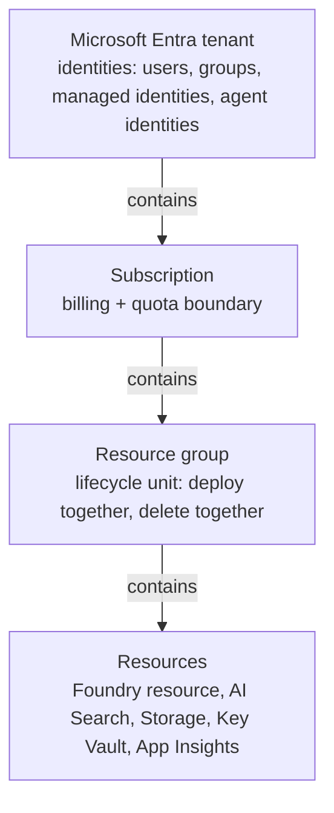
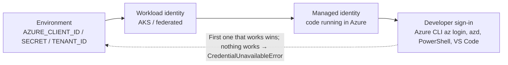

# Python and Azure survival kit

> AI-103 · D1 Plan and manage an Azure AI solution · about 75 min · Study Hub module `f01` ([open the hub](https://claude.ai/artifact/TdpMZLFYA9knTdjNyCms9F))

## Why it matters
Every AI-103 code question is Python calling Azure. If `with`, `async`, dictionaries and `DefaultAzureCredential` feel foreign, the code drop-downs become guesswork. This module gives you exactly the Python and Azure you need to read exam snippets, and no more.

## Pre-question (answer before reading)
**Q:** In `with AIProjectClient(endpoint=ep, credential=cred) as client:`, what does the `with` part do for you?

<details><summary>Answer</summary>

It opens the client and **guarantees it is closed** (connections released) when the block ends, even if an error happens inside. SDK clients hold network connections, so `with` is the tidy way to use them.

</details>

## Mental model & story
Think of Azure as a **hotel chain**. Your company's **Microsoft Entra tenant** is the chain's head office that knows every guest and staff member. A **subscription** is one hotel's bill: everything charged to it ends up on one invoice. A **resource group** is a floor of rooms you book together and can check out of together. Each **resource** (a Foundry resource, a storage account, a search service) is a room with a door and a lock.

Getting into a room needs an identity and a permission. **RBAC (role-based access control)** hands out key cards: *Foundry User* opens the project's working rooms; *Reader* only lets you look through the window. A **managed identity** is a key card issued to a *machine* (your web app or container), so you never have to tape a password (an API key) to the door.

Python is how you talk to the rooms. The SDK client is a **phone line** to a resource: you dial with an endpoint, prove who you are with a credential, make calls (methods), and hang up when done. `with` is the habit of always hanging up. `async`/`await` is putting a call on hold so you can make others while you wait.

`DefaultAzureCredential` is a receptionist who tries your ID documents in order: environment variables, then workload or managed identity (when your code runs in Azure), then your developer sign-ins such as `az login`. The same code works on your laptop and in production, with no secrets in it.

**Where the analogy breaks:** Real RBAC has two layers that the hotel picture blurs: **control plane** permissions (create or delete the room: Owner, Contributor) and **data plane** permissions (use what's inside: call models, build agents). Contributor can create a Foundry resource yet still be refused when calling an agent.

## Diagrams
**Azure resource hierarchy**



**How DefaultAzureCredential finds an identity (simplified)**



## Key points
- Hierarchy: **tenant → subscription → resource group → resource**. Deleting the resource group deletes everything in it (that's your lab teardown).
- **Region** matters for AI: model availability, quota and data residency are all per region.
- RBAC = security principal + role + scope. Scope can be subscription, resource group, resource, or a Foundry project.
- **Control plane** (Azure Resource Manager: create/configure) vs **data plane** (use: inference, agents, search queries). Owner/Contributor are control-plane roles.
- **Managed identity**: system-assigned (lives and dies with one resource) vs user-assigned (standalone, shareable across resources).
- Prefer **keyless** auth (Entra ID tokens). API keys bypass RBAC and are hard to rotate; if you must use them, keep them in **Azure Key Vault**.
- `DefaultAzureCredential()` from `azure-identity` lets one codebase run locally (`az login`) and in Azure (managed identity).
- Python patterns in SDK snippets: `with` (close clients), `for item in response.output` (iterate results), `json.loads(...)` (parse arguments), f-strings, `os.getenv(...)` / `.env` files, `async def` + `await` (Agent Framework, Voice Live).
- Install packages in a **virtual environment**: `python -m venv .venv` then `pip install azure-ai-projects azure-identity openai`.
- Azure CLI essentials: `az login`, `az account set --subscription <id>`, `az group create -n rg -l eastus2`, `az group delete -n rg --yes`.

## Comparisons
**Credential options**

| Option | Where it fits | Watch out |
|---|---|---|
| DefaultAzureCredential | Local dev + Azure with the same code | Slow-ish chain; exclude options you don't use in prod |
| ManagedIdentityCredential | Production code inside Azure | Identity needs RBAC on every resource it calls |
| AzureCliCredential | Labs, scripts after az login | Only works where the CLI is signed in |
| AzureKeyCredential(key) | Foundry Tools quick starts, legacy apps | Bypasses RBAC; store in Key Vault; rotate keys 1 and 2 |

## Code to recognise
**Minimal, keyless “hello Foundry” script**

```python
import os
from dotenv import load_dotenv
from azure.identity import DefaultAzureCredential
from azure.ai.projects import AIProjectClient

load_dotenv()                                   # reads PROJECT_ENDPOINT, MODEL_DEPLOYMENT from .env
endpoint = os.getenv("PROJECT_ENDPOINT")
deployment = os.getenv("MODEL_DEPLOYMENT")

with (DefaultAzureCredential() as cred,
      AIProjectClient(endpoint=endpoint, credential=cred) as project,
      project.get_openai_client() as client):
    response = client.responses.create(model=deployment, input="Say hello in five words.")
    print(response.output_text)
```

- Line 2: `python-dotenv` keeps settings out of code. Never commit the `.env` file.
- Line 8: Settings come from the environment, so the same script works in dev, test and prod.
- Line 10: Parenthesised `with` (Python 3.10+) opens three things and closes all three at the end.
- Line 12: The project client hands you an OpenAI-compatible client already pointed at your project.
- Line 13: `model` is your **deployment name**, not the model family name.

**async and await, the pattern Agent Framework and Voice Live use**

```python
import asyncio

async def ask(agent, question):
    result = await agent.run(question)    # wait without blocking other work
    return result.text

async def main():
    answers = await asyncio.gather(        # run several calls concurrently
        ask(agent_a, "Summarise the policy"),
        ask(agent_b, "List the risks"))
    print(answers)

asyncio.run(main())
```

- Line 3: `async def` makes a coroutine: it can pause at each `await`.
- Line 8: `asyncio.gather` starts both calls and waits for both, which is how parallel agents work.
- Line 13: `asyncio.run` starts the event loop for the whole program.

## Portal steps
**Create a resource group and Foundry resource (portal)** (Azure portal > Create a resource > Microsoft Foundry)

1. Pick your subscription and create a new resource group, e.g. `rg-ai103-lab01`.
2. Choose a region that offers the models you need (check the model availability table).
3. Create the resource; a default project is created with it.
4. Open it in the Foundry portal (ai.azure.com) and copy the **project endpoint** from the overview page.

## Worked example
**Scenario:** Your Python script works on your laptop but fails in an Azure Container App with `CredentialUnavailableError`. The code uses `DefaultAzureCredential()`. What's missing?

- On the laptop the chain found your `az login` session.
- In the container there is no CLI session and no environment-variable credential.
- The next option is managed identity, and the app has none enabled.

**Answer:** Enable a **managed identity** on the container app and grant it a data-plane role on the Foundry project (for example **Foundry User**). No code change needed.

## Your turn (faded example)
**Scenario:** You must delete everything from yesterday's lab so it stops costing money.

- All lab resources were created in resource group `rg-ai103-lab01`.
- **Which single CLI command removes them all?** <details><summary>answer</summary>`az group delete --name rg-ai103-lab01 --yes --no-wait`</details>
- **How do you confirm nothing billable is left?** <details><summary>answer</summary>Check the resource group list (`az group list -o table`) and Cost Management for the subscription the next day.</details>

## Exam traps & misconceptions
- ✗ Assuming **Contributor** lets you call models and agents. → ✓ Contributor is control plane only. Calling inference or building agents needs data-plane roles like Foundry User.
- ✗ Putting the API key in code "just for now". → ✓ Keys bypass RBAC and leak through Git history. Use Entra ID, or Key Vault plus environment variables.
- ✗ Passing the model family (`gpt-4.1`) as `model`. → ✓ Foundry routes by **deployment name**. If you named the deployment `chat-prod`, pass `chat-prod`.
- ✗ Forgetting the region when quota errors appear. → ✓ Quota is per subscription, region, model and deployment type. Another region may have capacity.

## Discussion prompts
- **Why might a company prefer a user-assigned managed identity over system-assigned ones?** One identity can be shared by several resources (for example a web app and a function) and survives if a resource is recreated, so RBAC assignments don't have to be redone. System-assigned identities are simpler when exactly one resource needs access.
- **When would you still use an API key?** Quick experiments, a client that can't use Entra ID, or some Foundry Tools quick starts. Store it in Key Vault, rotate using the two-key pattern, and plan to move to Entra ID.

## Interview angle / teach-back
**Prompt:** Explain to a new teammate how one Python script can authenticate to Foundry both on a laptop and in production, without any secrets in the code.

**Rubric:** Names DefaultAzureCredential (azure-identity) · Laptop: developer sign-in such as az login · Production: managed identity on the hosting resource · The identity needs an RBAC role on the Foundry project/resource · Endpoints and deployment names come from configuration, not code

**Model answer:** Use `DefaultAzureCredential` from `azure-identity`. On a laptop it picks up your `az login` session; in Azure it uses the managed identity of the app or container. The code never contains a key. Whatever identity is used must hold a data-plane role such as Foundry User on the project, and the endpoint and deployment name come from environment variables so the same code moves between environments.

## Quick Q&A
- **What's the boundary for billing and quota?** The **subscription** (quota is further split by region, model and deployment type).
- **What deletes all lab resources in one go?** `az group delete -n <rg> --yes`
- **Control plane vs data plane?** Control = create/configure resources (ARM). Data = use them (inference, agents, queries).
- **System- vs user-assigned managed identity?** System: tied to one resource's life. User: standalone, can be shared.
- **What does `with` give an SDK client?** Automatic close/cleanup at the end of the block.
- **Where should secrets live?** Azure Key Vault (or not exist at all, with Entra ID).
- **What is `model=` in Foundry SDK calls?** The deployment name you chose.

## Sources (accessed 2026-10-02)
- [Azure Identity client library for Python](https://learn.microsoft.com/en-us/python/api/overview/azure/identity-readme)
- [What are managed identities?](https://learn.microsoft.com/en-us/entra/identity/managed-identities-azure-resources/overview)
- [Azure RBAC overview](https://learn.microsoft.com/en-us/azure/role-based-access-control/overview)

## SRS cards created
- ai-103-f01-01, ai-103-f01-02, ai-103-f01-03, ai-103-f01-04
