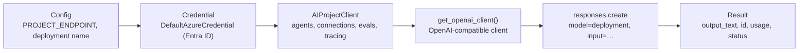
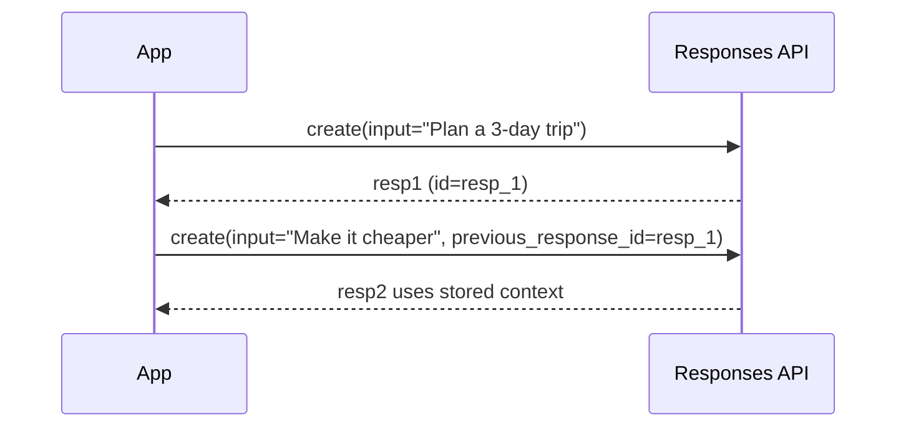

# Connect an app: SDKs, endpoints and the Responses API

> AI-103 · D2 Implement generative AI and agentic solutions · about 70 min · Study Hub module `g01` ([open the hub](https://claude.ai/artifact/TdpMZLFYA9knTdjNyCms9F))

## Why it matters
Code questions start here: which client, which endpoint, which method, which property holds the answer. Get `responses.create`, `previous_response_id` and `output_text` into muscle memory.

## Pre-question (answer before reading)
**Q:** Two calls to `client.responses.create(...)`. The second should remember the first. What do you pass?

<details><summary>Answer</summary>

`previous_response_id=first.id`. The Responses API stores state on the service, so you don't resend the whole history (unless you set `store=False`).

</details>

## Mental model & story
Imagine ordering at a café. With the **Chat Completions** counter, the barista has no memory: each time you must repeat your whole order history ("earlier I asked for oat milk, then…"). That's the `messages` list your app keeps and resends every turn.

The **Responses** counter keeps a ticket for you. Each answer has an **id**; next time you say *same ticket, add a croissant* (`previous_response_id`) and the service brings back the context. It's newer, works with tools and reasoning models, and is Microsoft's recommended API in Foundry, including for non-OpenAI models such as Phi or DeepSeek through the OpenAI-compatible v1 endpoint.

To get to the counter you need an address and an ID card. The **project endpoint** (`…services.ai.azure.com/api/projects/<project>`) is for the **Foundry SDK** (`azure-ai-projects`): its `AIProjectClient` manages agents, connections, datasets, indexes, evaluations and tracing, and can hand you an OpenAI-compatible client with `get_openai_client()`. The **OpenAI SDK** (`openai`) can also talk straight to the v1 endpoint (`…openai.azure.com/openai/v1`) for portable, simple inference.

Wingtip's developer used both: the Foundry SDK in the backend for agents and evaluations, and the plain OpenAI client in a small summarisation function that might move clouds one day.

**Where the analogy breaks:** A café ticket lasts the day. Stored responses have retention limits, and with `store=False` (zero retention) there's no ticket at all, so you must send the conversation items yourself.

## Diagrams
**From app to answer**



**Multi-turn with the Responses API**



## Key points
- Install: `pip install azure-ai-projects azure-identity openai`.
- `AIProjectClient(endpoint=<project endpoint>, credential=DefaultAzureCredential())` for Foundry features; `project.get_openai_client()` for inference with the same identity.
- **Responses API** (recommended): `client.responses.create(model=<deployment>, input=..., instructions=..., temperature=..., max_output_tokens=..., previous_response_id=..., stream=True/False, store=True/False)`.
- Read results: `response.output_text` (all text), `response.output` (typed items: messages, tool calls, reasoning), `response.id`, `response.status` (`completed`, `incomplete`…), `response.usage` (input/output tokens).
- Multi-turn: chain with `previous_response_id`, or keep your own list and append `response.output` items. `responses.retrieve(id)` fetches a stored response.
- Streaming: iterate events; text arrives in `response.output_text.delta` events; `response.completed` marks the end.
- **Chat Completions** (stateless): `client.chat.completions.create(model, messages=[{role: system/user/assistant, content}])` → `response.choices[0].message.content`, `finish_reason`, `usage`. Your app must resend history.
- `AzureOpenAI(azure_endpoint, api_version, azure_ad_token_provider)` is used when you need a specific dated API version.
- Everything in the context window costs tokens: instructions, history, tool definitions, tool outputs and retrieved documents.
- Foundry SDK also covers **connections** (credentials/endpoints to other resources such as AI Search), datasets, indexes, evaluations and telemetry: the "connectors" that integrate generative workflows into apps.

## Comparisons
**Responses vs Chat Completions**

|  | Responses API | Chat Completions |
|---|---|---|
| State | Stored on the service (previous_response_id) | Stateless; you resend messages |
| Input | input (string or items) + instructions | messages with roles |
| Answer text | response.output_text | choices[0].message.content |
| Tools | Built-in tools (code interpreter, web/file search, MCP) + functions | Function calling |
| Best for | New apps, agents, reasoning models | Legacy code, simple stateless calls |

**Which SDK?**

| Need | Use |
|---|---|
| Agents, tool approval, evaluations, tracing, connections | Foundry SDK (azure-ai-projects) |
| Portable inference code | OpenAI SDK on the v1 endpoint |
| Language/Speech/Translator features | Foundry Tools SDKs (resource endpoint) |

## Code to recognise
**A stateful conversation with streaming**

```python
project = AIProjectClient(endpoint=os.environ["PROJECT_ENDPOINT"],
                          credential=DefaultAzureCredential())
client = project.get_openai_client()

first = client.responses.create(
    model="chat-prod",
    instructions="You are a concise travel assistant.",
    input="Suggest a 3-day itinerary for Lisbon.")
print(first.output_text)

stream = client.responses.create(
    model="chat-prod",
    previous_response_id=first.id,          # remember turn 1
    input="Make it cheaper.",
    stream=True)
for event in stream:
    if event.type == "response.output_text.delta":
        print(event.delta, end="")
```

- Line 3: The OpenAI-compatible client inherits the project's endpoint and credential.
- Line 7: `instructions` plays the system-message role for this response.
- Line 9: `output_text` concatenates all text output items.
- Line 13: Chaining by id: no need to resend turn 1.
- Line 16: Streaming yields typed events; deltas carry text chunks.

**The same task with Chat Completions**

```python
messages = [{"role": "system", "content": "You are a concise travel assistant."},
            {"role": "user", "content": "Suggest a 3-day itinerary for Lisbon."}]
r = client.chat.completions.create(model="chat-prod", messages=messages)
answer = r.choices[0].message.content
messages.append({"role": "assistant", "content": answer})      # app keeps history
messages.append({"role": "user", "content": "Make it cheaper."})
r2 = client.chat.completions.create(model="chat-prod", messages=messages)
```

- Line 4: The answer lives in `choices[0].message.content`.
- Line 5: Stateless: you append the assistant turn yourself and resend everything.

## Portal steps
**Get starter code from the playground** (Foundry portal > Build > Models > (deployment) > Playground > Code)

1. Choose language (Python, C#, JavaScript) and API (Responses or Chat Completions).
2. Copy the snippet: it already contains your endpoint and deployment name.
3. Replace any key with `DefaultAzureCredential` before committing.

## Worked example
**Scenario:** A Flask app calls a Foundry deployment with Chat Completions and resends a 30-turn history every time, so token costs keep climbing. What change reduces resent tokens with minimal code?

- Every turn resends the full `messages` list.
- The Responses API stores prior turns on the service.
- Chain turns with `previous_response_id` and send only the new user input.

**Answer:** Switch to **`responses.create`** and pass **`previous_response_id`**. (Context still counts toward the model's window, but the app stops resending the history; also consider trimming or summarising long conversations.)

## Your turn (faded example)
**Scenario:** You need the number of tokens a response used, to charge departments.

- The call is `r = client.responses.create(...)`.
- **Which property holds token counts?** <details><summary>answer</summary>`r.usage` (e.g. `r.usage.input_tokens`, `r.usage.output_tokens`).</details>
- **With Chat Completions, where is it?** <details><summary>answer</summary>Also `r.usage` (`prompt_tokens`, `completion_tokens`).</details>

## Exam traps & misconceptions
- ✗ Reading `response.choices[0]...` from a Responses API call. → ✓ That's Chat Completions. Responses uses `output_text` / `output`.
- ✗ Passing the project endpoint to the plain `OpenAI()` client. → ✓ The plain client needs the v1 endpoint (`…/openai/v1`); or use `project.get_openai_client()`.
- ✗ Expecting `previous_response_id` to work with `store=False`. → ✓ Without storage there's nothing to chain to; send the items yourself.
- ✗ Using the model family name as `model`. → ✓ It's the deployment name.

## Discussion prompts
- **When would you still choose Chat Completions?** Existing code and libraries built on it, strict statelessness, or tools that only support it. New apps, agents and reasoning models favour the Responses API.
- **What's the cost risk of long multi-turn conversations, even with `previous_response_id`?** The model still processes the accumulated context each turn, so input tokens grow. Summarise or truncate history, or start fresh conversations when topics change.

## Interview angle / teach-back
**Prompt:** Explain to a new developer how to call a Foundry model from Python for a two-turn conversation.

**Rubric:** AIProjectClient with project endpoint + DefaultAzureCredential · get_openai_client() · responses.create with model=deployment name · Read output_text · Second turn uses previous_response_id

**Model answer:** Create an `AIProjectClient` with the project endpoint and `DefaultAzureCredential`, then call `get_openai_client()`. Call `responses.create` with `model` set to your deployment name and read `output_text`. For the second turn, call it again with `previous_response_id` set to the first response's id, so the service supplies the earlier context.

## Quick Q&A
- **Recommended inference API in Foundry?** The Responses API.
- **How to chain turns?** `previous_response_id`.
- **Text of a response?** `response.output_text`.
- **Chat Completions answer?** `choices[0].message.content`.
- **Streaming text event type?** `response.output_text.delta`.
- **Get an OpenAI client from a project?** `project.get_openai_client()`.
- **Zero-retention flag?** `store=False`.

## Sources (accessed 2026-10-02)
- [Learning path: Develop generative AI apps](https://learn.microsoft.com/en-us/training/paths/develop-generative-ai-apps/)
- [Lab: Create a generative AI chat app](https://microsoftlearning.github.io/mslearn-ai-studio/Instructions/Exercises/03-foundry-sdk.html)

## SRS cards created
- ai-103-g01-01, ai-103-g01-02, ai-103-g01-03, ai-103-g01-04
