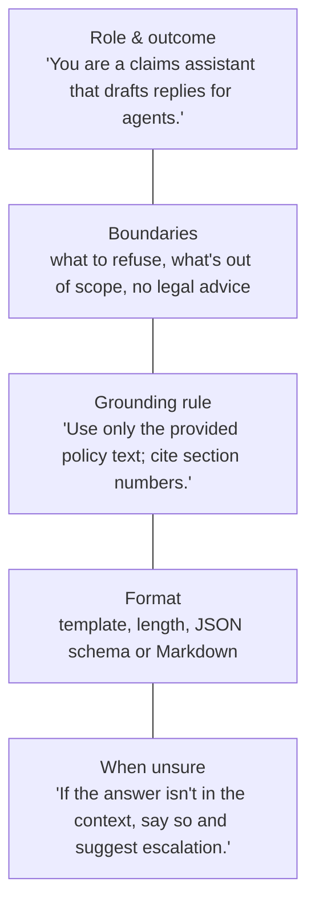
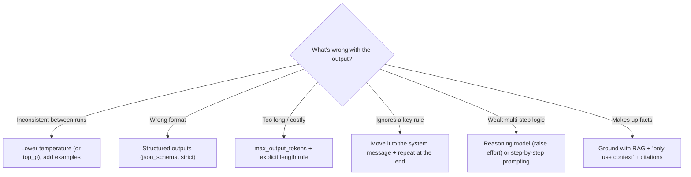

# Tune generation: prompts, parameters, reasoning and structured output

> AI-103 · D2 Implement generative AI and agentic solutions · about 75 min · Study Hub module `g02` ([open the hub](https://claude.ai/artifact/TdpMZLFYA9knTdjNyCms9F))

## Why it matters
"Tune generation behavior" is an explicit D2 skill and also feeds D4 (domain summarisation and extraction). Questions give you a symptom (inconsistent, rambling, wrong format) and ask which knob to turn.

## Pre-question (answer before reading)
**Q:** An extraction prompt sometimes returns valid JSON and sometimes prose. Is lowering temperature enough to guarantee JSON?

<details><summary>Answer</summary>

No. Lower temperature makes output more consistent but guarantees nothing. **Structured outputs** with a JSON schema (`strict: true`) guarantee that the response matches the schema.

</details>

## 🍎 Story time (kid version)
**Robo at Foundry Town Hall: The surprise dial and the cookie-cutter**

Robo writes name cards for the school play. When Maya says "make them nice", every card comes out different. So she gives clear instructions: who they're for, what to write, how long. She turns Robo's surprise dial down low so the cards stay alike, and turns it up only for the poster contest. For cards that go straight into the printer, she gives Robo a cookie-cutter: every card must fit the exact shape, or it can't leave the kitchen.

| In the story | In Foundry |
|---|---|
| Clear instructions | The system message: role, task, format, boundaries |
| The surprise dial | Temperature |
| The cookie-cutter shape | A JSON schema with strict structured outputs |

**Where the story breaks:** A low surprise dial makes cards similar, not guaranteed. Only the cookie-cutter (structured outputs) guarantees the shape.

## Mental model & story (grown-up version)
Prompting is **briefing a talented contractor** who has never met you. Vague briefs get vague work. A good **system message** says who they are, what outcome you want, the boundaries, the output format, and what to do when unsure ("say you don't know").

Then come the techniques. **Few-shot** examples show the pattern you want. **Delimiters** (`---`, Markdown headings, XML-style tags) separate instructions from data so the model doesn't confuse a pasted email with your rules. **Chain-of-thought** ("think step by step") helps non-reasoning models with multi-step problems; reasoning models already think internally. Models also have **recency bias**: repeat the key instruction at the end of long prompts.

**Parameters** are the contractor's style dials. **Temperature** controls randomness (about 0.2 for factual extraction, about 0.7 for creative writing); **top_p** limits sampling to the most likely tokens. Adjust one, not both. **max_output_tokens** caps length and cost.

**Reasoning models** are a different kind of contractor: you set **reasoning effort** instead of temperature. Their hidden reasoning tokens count toward `max_output_tokens` and are billed as output, so a tight limit can end a response `incomplete` before any visible answer appears.

For machine-readable results, Adventure Works stopped asking nicely for JSON and switched on **structured outputs**: a JSON schema with `strict: true`, so every response matches the schema exactly.

**Where the analogy breaks:** A contractor remembers last week's brief. A model only knows what's in the current context: instructions don't persist unless you send them (or the agent definition stores them).

## Diagrams
**Anatomy of a strong system message**



**Symptom → knob**



## Key points
- System message checklist: **role + outcome, boundaries, grounding rule, output format, what to do when unsure**.
- Techniques: persona, zero/one/few-shot examples, delimiters, output templates, step-by-step reasoning (for non-reasoning models), task decomposition, repeating key instructions at the end (recency bias).
- `temperature`: low (≈0–0.3) for factual, consistent output; higher (≈0.7+) for creativity. `top_p`: nucleus sampling. **Change one, not both.**
- `max_output_tokens` (Responses) / `max_tokens` (Chat Completions) caps output length; stop sequences end output at a marker.
- Reasoning models: `reasoning={"effort": "low|medium|high"}` (Responses) or `reasoning_effort` (Chat Completions); `max_output_tokens` / `max_completion_tokens` includes **reasoning tokens**; most reject `temperature`, `top_p` and penalties; the `developer` role replaces `system`; reasoning tokens appear in `usage.output_tokens_details.reasoning_tokens`.
- **Structured outputs**: Responses `text={"format": {"type": "json_schema", "name": ..., "schema": ..., "strict": True}}` or `client.responses.parse(text_format=PydanticModel)` → `response.output_parsed`. Chat Completions: `response_format={"type": "json_schema", ...}`.
- Strict schemas need every field listed as **required** and `additionalProperties: false`; make a field optional with a union type such as `["string", "null"]`.
- **JSON mode** (`json_object`) only guarantees valid JSON, not your schema. Prefer structured outputs.
- Domain customisation (D4): compliance summaries and domain extraction come from precise instructions, schemas, few-shot examples, grounding on domain documents and low temperature; fine-tune only when prompting can't reach the quality.

## Comparisons
**Parameters at a glance**

| Setting | Effect | Typical use |
|---|---|---|
| temperature 0.1–0.3 | More deterministic | Extraction, classification, factual Q&A |
| temperature 0.7–1.0 | More varied | Brainstorming, marketing copy |
| top_p 0.9 | Sample from the top 90% probability mass | Alternative to temperature |
| max_output_tokens | Caps length, cost and latency | Every production call |
| reasoning effort high | Deeper thinking, slower, more tokens | Complex planning, maths, code |

## Code to recognise
**Structured output with a Pydantic model**

```python
from pydantic import BaseModel
from typing import Literal

class Ticket(BaseModel):
    category: Literal["billing", "technical", "general"]
    urgency: int                 # 1-5
    summary: str

r = client.responses.parse(
    model="chat-prod",
    instructions="Classify the support email. Use only the categories given.",
    input=email_text,
    text_format=Ticket)

ticket = r.output_parsed         # a Ticket instance, schema guaranteed
print(ticket.category, ticket.urgency)
```

- Line 5: `Literal` becomes an enum in the JSON schema: the model can't invent categories.
- Line 9: `responses.parse` builds a strict json_schema from the Pydantic model.
- Line 15: `output_parsed` is already validated and typed.

**Calling a reasoning model**

```python
r = client.responses.create(
    model="reasoning-deploy",
    reasoning={"effort": "high"},
    max_output_tokens=8000,                  # covers hidden reasoning + answer
    input=[{"role": "developer", "content": "Show the final schedule only."},
           {"role": "user", "content": problem}])
print(r.status, r.usage.output_tokens_details.reasoning_tokens)
```

- Line 3: Effort replaces temperature as the main dial.
- Line 4: Too small a limit can end the response `incomplete` before any visible text.
- Line 5: The `developer` role carries system-style instructions for reasoning models.
- Line 7: Reasoning tokens are billed as output tokens.

## Portal steps
**Experiment in the playground** (Foundry portal > Build > Models > (deployment) > Playground)

1. Write the system message (instructions).
2. Adjust temperature, top_p and max tokens in **Parameters**; for reasoning models adjust reasoning effort.
3. Add few-shot examples; compare outputs; then **View code** to copy settings.

## Worked example
**Scenario:** A compliance team wants a 5-bullet summary of each regulatory notice, always citing the section numbers, never adding opinions. Outputs currently vary in length and sometimes include advice.

- Variation → lower temperature (≈0.2).
- Format and length → explicit template (exactly 5 bullets) + max_output_tokens.
- No opinions → boundary in the system message, repeated at the end; ground on the notice text with "cite section numbers".

**Answer:** System message with role, boundary ("no advice or opinions"), grounding and citation rule, a 5-bullet template with one example, temperature about 0.2 and a sensible `max_output_tokens`. Consider a JSON schema if downstream systems parse it.

## Your turn (faded example)
**Scenario:** Responses from a reasoning model end with `status: incomplete` and no visible text.

- The model spent its budget thinking.
- **Which setting do you raise?** <details><summary>answer</summary>`max_output_tokens` (it includes reasoning tokens).</details>
- **What else could you lower?** <details><summary>answer</summary>The reasoning effort (e.g. from high to medium) if the task allows.</details>

## Exam traps & misconceptions
- ✗ Changing temperature and top_p together. → ✓ Guidance is to adjust one of them.
- ✗ Setting temperature on a reasoning model. → ✓ Most reasoning models reject it; use reasoning effort.
- ✗ Using JSON mode to guarantee a schema. → ✓ JSON mode guarantees valid JSON only. Use structured outputs with `strict`.
- ✗ Leaving an optional field out of `required` in a strict schema. → ✓ All fields must be required; use a null union for optional values.
- ✗ Asking a reasoning model to "think step by step". → ✓ It already reasons internally; just state the task and constraints.

## Discussion prompts
- **Why do delimiters reduce prompt-injection risk a little but not fully?** They help the model tell instructions from data, so pasted text is less likely to be read as commands. But a determined injection can still work, so you also need Prompt Shields, least-privilege tools and output validation.
- **When should you stop prompt-engineering and consider fine-tuning?** When the model still can't follow a consistent style or format after good prompts and examples, when prompts become very long (cost and latency), or when you need a smaller model to match a larger one's behaviour on a narrow task.

## Interview angle / teach-back
**Prompt:** Explain how you'd make an LLM return the same JSON structure every time for an extraction task.

**Rubric:** Structured outputs with json_schema / responses.parse · strict: true, all fields required, additionalProperties false · Low temperature for consistency · Clear instructions + examples · JSON mode alone isn't enough

**Model answer:** Use structured outputs: define the schema (or a Pydantic model with `responses.parse`) with `strict` on, every field required and no extra properties. That guarantees the shape. Add clear instructions, an example, and low temperature so the values themselves are consistent. JSON mode alone only promises valid JSON, not your schema.

## Quick Q&A
- **Temperature for factual extraction?** Low, ≈0.1–0.3.
- **Adjust temperature and top_p together?** No, adjust one.
- **Reasoning model dial?** Reasoning effort.
- **Do reasoning tokens count toward max_output_tokens?** Yes, and they're billed as output.
- **Guarantee a JSON schema?** Structured outputs, `strict: true`.
- **Read parsed object?** `response.output_parsed`.
- **Fix a model ignoring a key rule in a long prompt?** Put it in the system message and repeat it at the end.

## Sources (accessed 2026-10-02)
- [Learning path: Develop generative AI apps](https://learn.microsoft.com/en-us/training/paths/develop-generative-ai-apps/)
- [Structured outputs](https://learn.microsoft.com/en-us/azure/foundry/openai/how-to/structured-outputs)
- [Reasoning models](https://learn.microsoft.com/en-us/azure/foundry/openai/how-to/reasoning)

## SRS cards created
- ai-103-g02-01, ai-103-g02-02, ai-103-g02-03, ai-103-g02-04
