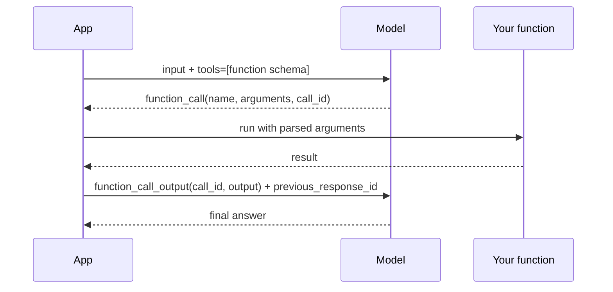
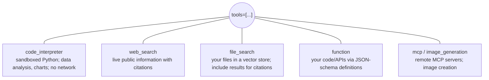

# Tool-augmented apps with the Responses API

> AI-103 · D2 Implement generative AI and agentic solutions · about 70 min · Study Hub module `g03` ([open the hub](https://claude.ai/artifact/TdpMZLFYA9knTdjNyCms9F))

## Why it matters
"Design workflows, tool-augmented flows, and multistep reasoning pipelines". The Responses API gives models built-in tools (code interpreter, web search, file search) and your own functions. Expect code drop-downs on the function-calling loop.

## Pre-question (answer before reading)
**Q:** When a model decides to call your `get_weather` function, who actually runs the function?

<details><summary>Answer</summary>

**Your application.** The model returns a `function_call` item with arguments; your code runs the function and sends back a `function_call_output` with the same `call_id`. Then the model writes the final answer.

</details>

## 🍎 Story time (kid version)
**Robo at Foundry Town Hall: The note to the storeroom**

Robo is clever, but he can't leave his desk. Maya asks, "How many pencils are in the storeroom?" Robo writes a note: "Please count the pencils in room B." A helper runs to the storeroom, counts 37, and brings the note back with the answer. Now Robo replies, "We have 37 pencils!" Robo also has a calculator on his desk he can use himself, and a filing cabinet of school papers he can search.

| In the story | In Foundry |
|---|---|
| The note asking for a count | A `function_call` item with a name and arguments |
| The helper who runs to the storeroom | Your application running the function |
| The note coming back with "37" | A `function_call_output` with the same `call_id` |
| Calculator and filing cabinet on Robo's desk | Built-in tools: code interpreter and file search |

**Where the story breaks:** A good helper double-checks the note first: models can ask for the wrong room or invent arguments, so validate them before acting.

## Mental model & story (grown-up version)
A model on its own is a brilliant **consultant locked in a room**: knowledgeable, but it can't check today's prices, open your files or run a calculation reliably. Tools are the room's **phone, filing cabinet and calculator**.

Built-in tools run on the service side. **Code interpreter** gives the model a sandboxed Python environment (pandas, matplotlib, no internet) to analyse uploaded data and draw charts. **Web search** fetches live information. **File search** searches a **vector store** of your uploaded documents. You list the tools; the model decides when to use them (guided by your instructions or `tool_choice`).

**Function calling** connects the model to *your* systems. You describe each function with a name, a description and a JSON-schema of parameters. When the model wants it, the response contains a `function_call` item. The model never executes anything: your app runs the function, returns the result as a `function_call_output` tied to the `call_id`, and calls the model again.

Tailwind Traders' analyst bot combined all of it: file search over product manuals, code interpreter to chart sales from an uploaded CSV, and a `get_inventory(sku)` function that queries the warehouse database.

**Where the analogy breaks:** A consultant would refuse a tool that's obviously wrong for the job. Models sometimes pick the wrong tool or invent arguments, so validate arguments and keep the number of tools small and well described.

## Diagrams
**Function-calling loop**



**Responses API tools**



## Key points
- Code interpreter: `{"type": "code_interpreter", "container": {"type": "auto"}}`. Sandboxed Python with common data libraries, no internet. Tip: refer to it as "the python tool" in instructions.
- Web search: `{"type": "web_search"}` for live data; results can vary over time.
- File search: create a vector store (`client.vector_stores.create(name=...)`), upload files (`vector_stores.files.upload_and_poll(...)`), add `{"type": "file_search", "vector_store_ids": [id]}`; add `include=["file_search_call.results"]` to get the retrieved chunks.
- Function tool definition: `{"type": "function", "name": ..., "description": ..., "parameters": <JSON schema>}`. Good descriptions drive good tool choice.
- Loop: find items with `item.type == "function_call"`, parse `json.loads(item.arguments)`, run, return `{"type": "function_call_output", "call_id": item.call_id, "output": <string>}`, then call `responses.create` again (with `previous_response_id`).
- The model decides tool use by default; steer with instructions or `tool_choice` (e.g. force a specific tool or none).
- Re-index or update vector stores when documents change; scope stores per domain to keep retrieval precise. For enterprise-scale shared knowledge use Foundry IQ / Azure AI Search.
- Multistep pipelines: chain calls (plan → retrieve → analyse → write) with explicit intermediate outputs, or let the model loop over tools with a cap on iterations.

## Comparisons
**Which tool?**

| Need | Tool |
|---|---|
| Average sales from an uploaded CSV + chart | Code interpreter |
| Today's exchange rate | Web search |
| Answer from 200 uploaded PDFs with citations | File search (vector store) |
| Check stock in your ERP | Function calling |
| Shared company knowledge for many apps/agents | Foundry IQ / Azure AI Search |

## Code to recognise
**The function-calling loop**

```python
import json
tools = [{
    "type": "function",
    "name": "get_inventory",
    "description": "Return units in stock for a product SKU.",
    "parameters": {"type": "object",
                   "properties": {"sku": {"type": "string"}},
                   "required": ["sku"], "additionalProperties": False}}]

r = client.responses.create(model="chat-prod", tools=tools,
                            input="Do we have SKU TT-118 in stock?")
outputs = []
for item in r.output:
    if item.type == "function_call":
        args = json.loads(item.arguments)
        result = get_inventory(**args)          # YOUR code runs here
        outputs.append({"type": "function_call_output",
                        "call_id": item.call_id,
                        "output": json.dumps(result)})

final = client.responses.create(model="chat-prod", tools=tools,
                                previous_response_id=r.id, input=outputs)
print(final.output_text)
```

- Line 5: The description is how the model decides when to call it.
- Line 8: A tight schema reduces invented arguments.
- Line 14: Scan typed output items for function calls.
- Line 15: Arguments arrive as a JSON string.
- Line 18: `call_id` ties your output to the model's request.
- Line 21: Send outputs back, chained to the previous response.

**File search over your documents**

```python
store = client.vector_stores.create(name="manuals")
with open("router-manual.pdf", "rb") as f:
    client.vector_stores.files.upload_and_poll(vector_store_id=store.id, file=f)

r = client.responses.create(
    model="chat-prod",
    tools=[{"type": "file_search", "vector_store_ids": [store.id]}],
    include=["file_search_call.results"],
    input="How do I factory-reset the router?")
```

- Line 3: Uploads, chunks and embeds the file; polls until indexing completes.
- Line 7: Attach one or more vector stores.
- Line 8: Return the retrieved chunks so you can show citations.

## Portal steps
**Try tools in the playground** (Foundry portal > Build > Models > (deployment) > Playground > Tools)

1. Add Code interpreter or File search (upload files to create a vector store).
2. Ask questions that need the tool; inspect the tool calls in the response.
3. Use **View code** to export the configuration.

## Worked example
**Scenario:** A finance assistant must answer "What was our Q3 revenue growth?" using an uploaded spreadsheet, and show a chart.

- Data is in an uploaded file and needs calculation → code interpreter (not file search, which retrieves text chunks).
- A chart is needed → code interpreter generates image files.
- Instruct: "Use the python tool to compute growth and plot it."

**Answer:** **Code interpreter** with the spreadsheet attached; return the computed figure and the generated chart file.

## Your turn (faded example)
**Scenario:** The model returns a `function_call` for `book_room(room="B2", date="2026-10-12")`.

- Your app parses the arguments and books the room.
- **What item type do you send back?** <details><summary>answer</summary>`function_call_output` with the same `call_id` and the result as a string.</details>
- **What do you pass so the model has context?** <details><summary>answer</summary>`previous_response_id` set to the response that contained the function call (or the full item list).</details>

## Exam traps & misconceptions
- ✗ Thinking the model executes your function. → ✓ It only requests the call; your app executes it.
- ✗ Forgetting `call_id` in the output. → ✓ Without it the model can't match the result to the request.
- ✗ Using file search for numeric analysis of a spreadsheet. → ✓ Code interpreter computes; file search retrieves text.
- ✗ Expecting code interpreter to call the internet. → ✓ The sandbox has no network access.
- ✗ Adding dozens of tools "just in case". → ✓ More tools → slower, costlier, more wrong choices.

## Discussion prompts
- **How would you protect a function that updates customer data?** Validate and authorise arguments in your code (never trust model-generated values), use least-privilege credentials, log calls, and require confirmation or approval for high-impact changes.
- **Why might web search answers differ day to day?** The web changes and results are retrieved live, so grounding sources differ. Pin to trusted sources or use your own indexed knowledge when consistency matters.

## Interview angle / teach-back
**Prompt:** Walk a teammate through how function calling works end to end.

**Rubric:** Define function with name, description, JSON schema · Model returns function_call item with arguments + call_id · App executes the function · Return function_call_output with call_id · Call model again (previous_response_id) for final answer

**Model answer:** You describe the function to the model with a name, description and JSON schema. If the model wants it, the response includes a `function_call` item with arguments and a `call_id`. Your app parses the arguments, runs the real function, and sends a `function_call_output` with the same `call_id`, chained with `previous_response_id`. The model then uses the result to write the final answer.

## Quick Q&A
- **Who runs function tools?** Your application.
- **Item type the model emits?** `function_call`.
- **Item type you send back?** `function_call_output` with `call_id`.
- **Sandboxed Python tool?** Code interpreter.
- **Live public info?** Web search tool.
- **Search uploaded docs?** File search with a vector store.
- **Get retrieved chunks?** `include=["file_search_call.results"]`.

## Sources (accessed 2026-10-02)
- [Learning path: Develop generative AI apps](https://learn.microsoft.com/en-us/training/paths/develop-generative-ai-apps/)
- [Lab: Create a generative AI app that uses tools](https://microsoftlearning.github.io/mslearn-ai-studio/Instructions/Exercises/04a-use-own-data.html)

## SRS cards created
- ai-103-g03-01, ai-103-g03-02, ai-103-g03-03, ai-103-g03-04
