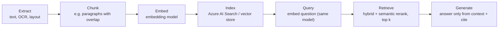
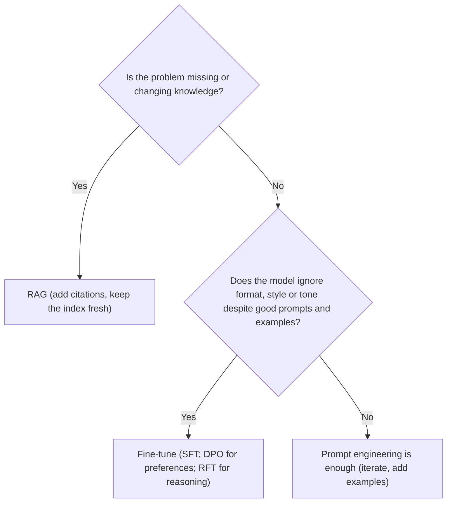

# Ground or tune? RAG, retrieval choices and fine-tuning

> AI-103 · D2 Implement generative AI and agentic solutions · about 80 min · Study Hub module `g04` ([open the hub](https://claude.ai/artifact/TdpMZLFYA9knTdjNyCms9F))

## Why it matters
*Prompt engineering vs RAG vs fine-tuning* is one of the most predictable question types. So is *which retrieval method* (keyword, vector, hybrid, semantic ranker) and *which index* (file search, Azure AI Search, Foundry IQ).

## Pre-question (answer before reading)
**Q:** Your HR assistant must answer from policies that change monthly. Would you fine-tune the model on the policies or use RAG?

<details><summary>Answer</summary>

**RAG.** Fine-tuning bakes knowledge into weights (expensive to refresh, no citations). RAG retrieves the current policy text at question time and can cite it.

</details>

## 🍎 Story time (kid version)
**Robo at Foundry Town Hall: Open-book test or manners camp?**

Robo must answer questions about the school lunch menu, which changes every week. Maya doesn't make him memorise it. She lets him look in the menu book during each question and point to the page he used. Updating is easy: swap the book. But Robo also answers in a grumpy tone, and looking in a book won't fix that. So Maya sends him to manners camp for a week, and he comes back polite every time.

| In the story | In Foundry |
|---|---|
| Looking in the menu book and pointing to the page | RAG with citations |
| Swapping the book each week | Updating the index instead of retraining the model |
| Manners camp | Fine-tuning, which changes behaviour such as tone and format |

**Where the story breaks:** Robo can still open the wrong page. RAG answers are only as good as the search behind them: chunking, embeddings and hybrid search.

## Mental model & story (grown-up version)
Three ways to make a model better at your job, like preparing a new hire. **Prompt engineering** is a good briefing: cheap and instant. **RAG** (retrieval-augmented generation) is giving them the **company handbook to look things up** during each conversation: answers stay current and can cite the page. **Fine-tuning** is **sending them on a training course**: it changes habits (style, format, tone, tool use) permanently, but it's slow, costly and doesn't teach facts that change next month.

RAG has two halves. At **index time** you extract text from documents, split it into **chunks**, turn each chunk into an **embedding** (a vector of numbers capturing meaning) and store them in an index. At **query time** you embed the question with the **same model**, retrieve the best chunks, add them to the prompt and ask the model to answer *only from this context, with citations*.

Retrieval style matters. **Keyword** search (BM25) nails exact terms such as product codes. **Vector** search finds meaning ("laptop won't turn on" ≈ "device fails to boot"). **Hybrid** runs both and merges them with Reciprocal Rank Fusion, which is usually the best default. The **semantic ranker** then re-scores the top results with a language model to push the most relevant to the top.

Where to store it? **File search** gives one app or agent a quick vector store of uploaded files. **Azure AI Search** is the enterprise engine: indexers, skills, filters, security trimming and hybrid plus semantic ranking. **Foundry IQ** puts managed knowledge bases over Azure AI Search so many agents share curated knowledge with citations.

**Where the analogy breaks:** A new hire can tell when the handbook is wrong. A model will happily answer from a bad chunk. RAG quality is mostly retrieval quality: chunking, embeddings, hybrid search and freshness.

## Diagrams
**RAG at index time and query time**



**Prompting, RAG or fine-tuning?**



## Key points
- Use **RAG** for private, changing or post-training-cutoff facts and when citations are needed. Use **fine-tuning** for consistent style, tone or format, shorter prompts, distilling a big model into a small one, or better tool use. Start simple: **prompt → + RAG → + fine-tuning**; prompt + RAG is the most common combination.
- Embed documents and queries with the **same embedding model** (dimensions must match the index's vector field).
- Retrieval methods: **keyword** (exact terms, IDs), **vector** (meaning, synonyms), **hybrid** (both, fused with Reciprocal Rank Fusion; recommended default), **semantic ranker** (re-ranks top results with a language model; adds captions and answers).
- Index choices: **file search** vector store (quick, per app/agent), **Azure AI Search** (enterprise index, indexers, skills, filters), **Foundry IQ** (managed knowledge bases for many agents, MCP access, citations), Cosmos DB vector search (app data next to operational data).
- Data sources for Azure AI Search include Blob Storage, ADLS Gen2, OneLake, SQL and Cosmos DB; you can also upload files through the portal.
- Fine-tuning methods: **SFT** (prompt/response pairs), **DPO** (preferred vs rejected responses), **RFT** (reinforcement with a grader; for reasoning models). LoRA makes it efficient.
- Training data is **JSONL**: one `{"messages": [system, user, assistant]}` object per line; use the same system message in training and in production; hundreds of high-quality examples; measure a baseline first.
- Hyperparameters: epochs, batch size, learning-rate multiplier. Costs: training plus hosting of the fine-tuned deployment; the **Developer** deployment type is a cheap way to evaluate a fine-tuned model.
- Fine-tuned models can over-specialise and need retraining when the base model is updated.

## Comparisons
**Compare the three approaches**

|  | Prompt engineering | RAG | Fine-tuning |
|---|---|---|---|
| Cost / effort | Low | Medium (index, pipeline) | High (data, training, hosting) |
| Fixes | Instructions, format basics | Knowledge: current, private, cited | Behaviour: style, format, tone, tool use |
| Freshness | n/a | As fresh as the index | Stale until retrained |
| Citations | No | Yes | No |

## Code to recognise
**A minimal RAG call with Azure AI Search (hybrid)**

```python
from azure.search.documents import SearchClient
from azure.search.documents.models import VectorizedQuery

emb = client.embeddings.create(model="embed-3-large", input=question).data[0].embedding
hits = search_client.search(
    search_text=question,                                    # keyword half
    vector_queries=[VectorizedQuery(vector=emb, k_nearest_neighbors=5,
                                    fields="content_vector")], # vector half
    select=["title", "content", "url"], top=3)

context = "\n\n".join(f"[{h['title']}]({h['url']}): {h['content']}" for h in hits)
r = client.responses.create(
    model="chat-prod",
    instructions="Answer only from the sources. Cite titles. If the answer isn't there, say so.",
    input=f"Sources:\n{context}\n\nQuestion: {question}")
```

- Line 4: Same embedding model that built the index.
- Line 6: `search_text` + `vector_queries` together = hybrid search (fused by RRF).
- Line 7: `fields` names the vector field in the index.
- Line 11: Keep source titles/URLs so the answer can cite them.
- Line 14: Grounding rule + citation rule + fallback rule.

**One line of fine-tuning training data (JSONL)**

```json
{"messages": [{"role": "system", "content": "You write product blurbs in Contoso's voice."}, {"role": "user", "content": "Trail backpack, 30L, waterproof"}, {"role": "assistant", "content": "Rain or shine, this 30-litre trail pack keeps your kit bone-dry."}]}
```

- Line 1: Each line is one complete example; the system message must match what production sends.

## Portal steps
**Fine-tune a model** (Foundry portal > Build > Models > Fine-tune (or model card > Fine-tune))

1. Pick a base model that supports fine-tuning and a method (supervised, DPO, reinforcement).
2. Upload training (and validation) JSONL.
3. Set hyperparameters or accept defaults; start the job and watch loss curves.
4. Deploy the result (Developer type for evaluation), compare with the baseline, then promote.

## Worked example
**Scenario:** A support bot must (a) answer from 5,000 product manuals updated weekly and (b) always reply in the company's distinctive upbeat tone, which prompts haven't achieved reliably.

- (a) is knowledge that changes weekly → RAG over an index with scheduled re-indexing.
- (b) is a behaviour problem that prompts didn't fix → fine-tuning on examples of the tone.
- Combine: fine-tuned model + RAG + grounding instructions.

**Answer:** **RAG for the manuals** (hybrid search, weekly indexing) **plus fine-tuning for tone** (SFT on approved examples); keep prompts for rules and citations.

## Your turn (faded example)
**Scenario:** Search results miss documents when users type exact part numbers like `ZX-4410`, but work for descriptive questions.

- The index currently uses vector search only.
- **Why do part numbers fail?** <details><summary>answer</summary>Embeddings capture meaning, not exact rare tokens; vector-only search is weak on IDs and codes.</details>
- **What's the fix?** <details><summary>answer</summary>**Hybrid search** (keyword + vector, fused with RRF), optionally with semantic ranking.</details>

## Exam traps & misconceptions
- ✗ Fine-tuning to teach the model facts that change. → ✓ Facts belong in RAG; fine-tuning shapes behaviour.
- ✗ Embedding queries with a different model from the documents. → ✓ Vectors must come from the same model and dimension.
- ✗ Using vector-only search for product codes. → ✓ Hybrid search handles exact terms and meaning.
- ✗ Skipping the baseline before fine-tuning. → ✓ You can't prove improvement without one.
- ✗ Using a different system message in production than in training data. → ✓ Mismatch reduces fine-tuning benefits.

## Discussion prompts
- **How would you decide between file search and Azure AI Search for an agent?** File search suits a few documents for one agent with little setup. Azure AI Search suits large or many sources, scheduled indexing, enrichment skills, security filters, hybrid/semantic ranking and sharing across apps (and Foundry IQ on top for many agents).
- **What would you measure to know whether RAG works?** Retrieval quality (did the right chunks come back?) and generation quality (groundedness, relevance, completeness, citation correctness), using a labelled question set.

## Interview angle / teach-back
**Prompt:** Explain to a stakeholder when to use RAG versus fine-tuning, with one example of each.

**Rubric:** RAG = retrieve current/private knowledge at query time, with citations · Fine-tuning = change behaviour (style/format/tone/tool use) · Start with prompting; add RAG; fine-tune last · Example of each · Can combine both

**Model answer:** RAG looks up current or private information at question time and feeds it to the model, so answers stay fresh and can cite sources. Use it for things like policies or manuals. Fine-tuning retrains the model on examples to change how it behaves, such as a consistent brand tone or output format. Start with good prompts, add RAG for knowledge, and fine-tune only when behaviour still isn't right; many solutions use both.

## Quick Q&A
- **Changing facts: RAG or fine-tune?** RAG.
- **Consistent tone despite prompts?** Fine-tune (SFT).
- **Preference pairs method?** DPO.
- **Grader-based method for reasoning models?** RFT.
- **Fine-tuning data format?** JSONL with a `messages` array per line.
- **Default retrieval recommendation?** Hybrid search (+ semantic ranker).
- **What fuses keyword and vector results?** Reciprocal Rank Fusion (RRF).

## Sources (accessed 2026-10-02)
- [Learning path: Develop generative AI apps](https://learn.microsoft.com/en-us/training/paths/develop-generative-ai-apps/)
- [Lab: Fine-tune a language model](https://microsoftlearning.github.io/mslearn-ai-studio/Instructions/Exercises/04b-finetune-model.html)
- [Hybrid search in Azure AI Search](https://learn.microsoft.com/en-us/azure/search/hybrid-search-overview)

## SRS cards created
- ai-103-g04-01, ai-103-g04-02, ai-103-g04-03, ai-103-g04-04
