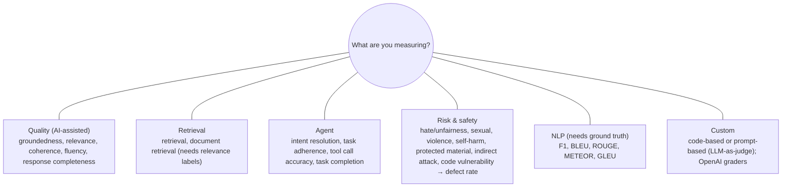
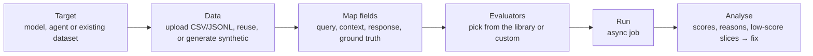

# Evaluate models and apps

> AI-103 · D2 Implement generative AI and agentic solutions · about 75 min · Study Hub module `g05` ([open the hub](https://claude.ai/artifact/TdpMZLFYA9knTdjNyCms9F))

## Why it matters
"Evaluate models and apps, including detecting fabrications, relevance, quality, and safety" plus "apply responsible AI instrumentation, including evaluators". You must know which evaluator measures what, and which need ground truth.

## Pre-question (answer before reading)
**Q:** You have no reference answers, only questions, retrieved context and the app's responses. Can you still measure whether answers are made up?

<details><summary>Answer</summary>

Yes. **Groundedness** is an AI-assisted evaluator that checks whether the response is supported by the given context. It needs no ground-truth answer. Metrics like F1 or BLEU do need ground truth.

</details>

## 🍎 Story time (kid version)
**Robo at Foundry Town Hall: Checking 300 homework answers**

Robo answers 300 homework questions, and Maya can't check them all by hand. One helper asks: "Did Robo use the textbook page he was given, or make it up?" Another asks: "Did he actually answer the question?" For spelling tests with an answer sheet, a stamp machine counts matching words. Then Maya sorts the low scores into piles and spots the pattern: every bad answer is about the field trip, because the field-trip page was out of date.

| In the story | In Foundry |
|---|---|
| "From the page or made up?" | The groundedness evaluator |
| "Did he answer the question?" | The relevance evaluator |
| The stamp machine with an answer sheet | NLP metrics (F1, BLEU, ROUGE), which need ground truth |
| Sorting low scores into piles | Error analysis by slicing results |

**Where the story breaks:** Robot checkers can be unfair (for example, liking longer answers), so compare them with human grading now and then.

## Mental model & story (grown-up version)
Evaluating an LLM app is like **grading essays in a big school**. Teachers can read a sample by hand (**manual evaluation**: playground side-by-side comparisons, structured 1–5 ratings, user studies). For thousands of essays you need **automated** graders.

Some graders compare against an answer key: **F1** (word overlap), **BLEU** (n-gram precision, from translation), **ROUGE** (recall-oriented, from summarisation), **METEOR** (also credits synonyms and word stems) and **GLEU** (sentence-level BLEU). Others use a strong model as the judge, the **AI-assisted** evaluators: **groundedness** (is it supported by the context? This is how you catch fabrications), **relevance**, **coherence**, **fluency**, retrieval quality and response completeness.

For agents there are dedicated evaluators: **intent resolution** (did it understand the request?), **task adherence** (did it follow instructions and constraints?), **tool call accuracy** (right tools, right arguments?) and **task completion**. For safety, **risk and safety evaluators** score hate/unfairness, sexual, violence, self-harm, protected material, indirect attacks, code vulnerabilities and ungrounded attributes, reported as a **defect rate**: the share of responses above the severity threshold.

Adventure Works ran an evaluation on 300 real questions. Groundedness averaged 4.5, but filtering the low scores showed one cluster: questions about returns. The retrieval was pulling an outdated policy. That's **error analysis**: slice the low scores, find the pattern, fix the cause (here the index, not the prompt), then re-evaluate.

**Where the analogy breaks:** An exam grader is consistent. LLM judges can be biased (favouring longer answers, their own style, or answer position), so calibrate them against human labels and use a different, strong model as the judge.

## Diagrams
**Evaluator families**



**An evaluation run in Foundry**



## Key points
- Manual evaluation (playground side-by-side, 1–5 ratings for relevance, accuracy, safety…) comes first; automated evaluation scales it.
- **Groundedness** detects fabrications (claims not supported by context). **Groundedness Pro** gives a binary grounded/ungrounded verdict.
- **Relevance** = answers the question; **coherence** = logical, well organised; **fluency** = language quality; **response completeness** = covers what the ground truth contains.
- NLP metrics need **ground truth**: F1 (shared words), **BLEU** (translation), **ROUGE** (summarisation, recall), **METEOR** (synonyms/stems), **GLEU** (sentence-level BLEU).
- Agent evaluators: **intent resolution, task adherence, tool call accuracy, task completion**.
- Safety evaluators report a **defect rate** (% of responses at or above the severity threshold). Pair with the **AI Red Teaming Agent** (automated adversarial probing; attack success rate).
- Evaluation targets: a **model**, an **agent**, or an existing **dataset** of responses. Data: upload CSV/JSONL, reuse a dataset, or generate synthetic data. Map columns to evaluator inputs.
- Custom evaluators: code (deterministic rules) or prompt-based (LLM-as-judge), versioned in the evaluator library; Azure OpenAI graders (label, score, string check, text similarity).
- Low scores → fix in order: prompt engineering → different model → RAG/retrieval fixes → fine-tuning. Safety issues → guardrails, prompt hardening, output validation.

## Comparisons
**Which evaluator?**

| Question you're asking | Evaluator | Needs ground truth? |
|---|---|---|
| Is the answer made up? | Groundedness / Groundedness Pro | No (needs context) |
| Does it answer the question? | Relevance | No |
| Does the summary capture the reference summary? | ROUGE | Yes |
| How good is this translation vs a reference? | BLEU / METEOR | Yes |
| Did the agent call the right tool with the right arguments? | Tool call accuracy | No (uses tool definitions) |
| How often does it produce violent content? | Violence evaluator → defect rate | No |

## Code to recognise
**Batch evaluation with azure-ai-evaluation**

```python
from azure.ai.evaluation import evaluate, GroundednessEvaluator, RelevanceEvaluator

judge = {"azure_endpoint": os.environ["AOAI_ENDPOINT"],
         "azure_deployment": "judge-model"}           # a strong model as the judge

single = GroundednessEvaluator(judge)(
    query="What is the refund window?",
    context="Refunds are accepted within 30 days of delivery.",
    response="You can get a refund within 60 days.")
print(single)        # low groundedness score + reason

result = evaluate(
    data="eval_set.jsonl",                             # query, context, response per line
    evaluators={"groundedness": GroundednessEvaluator(judge),
                "relevance": RelevanceEvaluator(judge)},
    azure_ai_project=os.environ["PROJECT_ENDPOINT"],   # log results to Foundry
    output_path="results.json")
```

- Line 3: AI-assisted evaluators need a model configuration for the judge.
- Line 6: Evaluators are callables: try one row before a batch.
- Line 9: 60 days contradicts the context, so groundedness flags the fabrication.
- Line 12: JSONL rows supply the evaluator inputs by column name.
- Line 16: Results appear in the project's Evaluation page for comparison.

## Portal steps
**Create an evaluation** (Foundry portal > Build > Evaluations > Create)

1. Choose the target: model, agent or dataset.
2. Provide data (upload, existing dataset, or synthetic generation).
3. Pick evaluators (quality, safety, agent, NLP, custom) and map fields.
4. Run; open results to compare runs and read per-row reasons.

## Worked example
**Scenario:** A translation feature has human reference translations for 500 sentences. Product wants a score that tracks closeness to references across releases.

- Reference translations exist → ground-truth metrics are possible.
- Translation → BLEU is the classic metric; METEOR also credits synonyms.
- Add an AI-assisted fluency check for readability.

**Answer:** Use **BLEU** (and/or **METEOR**) against the references, plus fluency; track scores per release.

## Your turn (faded example)
**Scenario:** An agent sometimes books the wrong meeting room even though it understood the request.

- Intent is understood, so intent resolution is fine.
- **Which evaluator targets this failure?** <details><summary>answer</summary>**Tool call accuracy** (wrong arguments or wrong tool).</details>
- **What would error analysis look at?** <details><summary>answer</summary>Low-scoring rows: the tool definitions, arguments chosen, and instructions; often the room parameter is poorly described or validated.</details>

## Exam traps & misconceptions
- ✗ Using BLEU or ROUGE without reference answers. → ✓ They need ground truth; use AI-assisted evaluators instead.
- ✗ Treating relevance as a fabrication detector. → ✓ An answer can be relevant and still made up. Groundedness catches fabrication.
- ✗ Using the same small model as both app and judge. → ✓ Use a strong, separate judge model.
- ✗ Evaluating once before launch only. → ✓ Re-run on changes and evaluate production continuously.

## Discussion prompts
- **Why slice evaluation results instead of reading the average?** Averages hide failure clusters. Slicing by topic, intent or source reveals where quality breaks (e.g. one product line), which points to the real fix.
- **How would you evaluate an agent without labelled answers?** Reference-free evaluators: intent resolution, task adherence, tool call accuracy, groundedness and safety on representative or synthetic conversations, plus human review of a sample.

## Interview angle / teach-back
**Prompt:** Explain to a project manager how you'd evaluate a RAG chatbot before launch.

**Rubric:** Build a representative dataset (real or synthetic) · Groundedness for fabrications + relevance/completeness · Retrieval quality · Safety evaluators / red teaming → defect rate · Error analysis on low scores, fix, re-run

**Model answer:** Collect a few hundred realistic questions (or generate synthetic ones). Run the bot and score groundedness to catch made-up answers, relevance and completeness for usefulness, retrieval quality for the search step, and safety evaluators plus red-teaming for harmful output. Then slice the low scores to find patterns, fix the cause (prompt, retrieval, model), and re-run until we meet our thresholds.

## Quick Q&A
- **Detects fabrication?** Groundedness.
- **Translation metric?** BLEU (also METEOR).
- **Summarisation recall metric?** ROUGE.
- **Credits synonyms and stems?** METEOR.
- **Agent evaluators?** Intent resolution, task adherence, tool call accuracy, task completion.
- **Safety result metric?** Defect rate.
- **Evaluation targets?** Model, agent, dataset.

## Sources (accessed 2026-10-02)
- [Explore and compare models (lab)](https://microsoftlearning.github.io/mslearn-ai-studio/Instructions/Exercises/02-model-catalog-evaluation.html)
- [Learning path: Develop generative AI apps](https://learn.microsoft.com/en-us/training/paths/develop-generative-ai-apps/)

## SRS cards created
- ai-103-g05-01, ai-103-g05-02, ai-103-g05-03, ai-103-g05-04
