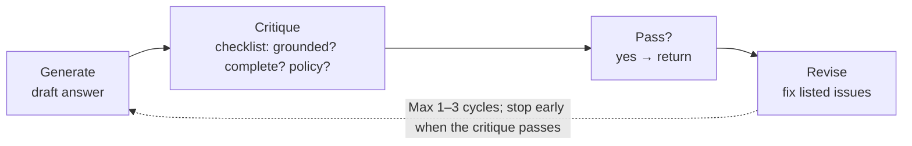
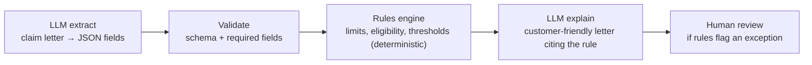

# Reflection loops, multi-model flows and hybrid rules

> AI-103 · D2 Implement generative AI and agentic solutions · about 60 min · Study Hub module `g06` ([open the hub](https://claude.ai/artifact/TdpMZLFYA9knTdjNyCms9F))

## Why it matters
Two D2 skills sound academic but appear as practical scenarios: *model reflection, chain-of-thought evaluations and self-critique loops*, and *orchestrating multiple models, flows, or hybrid LLM and rules engines*.

## Pre-question (answer before reading)
**Q:** A model drafts loan explanations. Would asking it to check its own draft against the policy, then revise, always improve quality? What's the catch?

<details><summary>Answer</summary>

Often it helps, mostly on the first revision. The catch is **cost and latency** (each cycle is another call) and diminishing returns. Cap the loop (1–3 cycles) and stop when a check passes.

</details>

## Mental model & story
Good writers **draft, critique, revise**. A **reflection loop** does the same: generate an answer, ask a model (the same or a different one) to critique it against explicit criteria ("Is every number supported by the source? Is anything missing?"), then revise. Stop when the critique passes or after a fixed number of cycles, because the first revision gives most of the gain.

A **chain-of-thought evaluation** grades the *reasoning*, not just the final answer: did the steps follow the rules, use the right figures, avoid leaps? Reasoning models can return a reasoning summary you can log and evaluate; for others you can ask for a structured rationale.

Multi-model flows split work by strength and cost. A **cascade** sends a request to a small model first and escalates to a larger or reasoning model only when confidence is low or a validator fails. A **specialist pipeline** uses an extraction model, then a reasoning model, then a writer. The **model router** automates per-prompt model choice.

Some decisions shouldn't be left to a model at all. Litware's claims flow uses a **hybrid**: the LLM extracts facts from the claim letter into JSON, a deterministic **rules engine** (or plain code, or a workflow condition in Power Fx) checks policy limits, and the LLM writes the customer-facing explanation. Rules are cheap, auditable and exact; the LLM handles language.

**Where the analogy breaks:** Human writers notice when they're going in circles. A model critiquing itself can confidently approve its own mistake. Use explicit checklists, external validators (code, schemas, rules) or a different model as the critic.

## Diagrams
**Bounded reflection loop**



**Hybrid LLM + rules**



## Key points
- **Reflection / self-critique**: generate → critique against explicit criteria → revise; cap the cycles (often 1–3) and stop when checks pass; most of the gain comes from the first revision; each cycle adds tokens and latency.
- Patterns: plan-then-act (structured plan first), act-then-reflect (critique after), and external validation (schema checks, unit tests for code, rules, a separate critic model).
- **Chain-of-thought evaluation**: assess the reasoning steps (correct rules, correct figures, no unsupported leaps) with an LLM judge or rubric; reasoning models can return reasoning summaries for logging.
- **Cascade** (small model first, escalate on low confidence or failed validation) cuts cost; **specialist pipelines** assign models by task; the **model router** picks per prompt automatically.
- **Hybrid LLM + rules**: use deterministic code/rules for calculations, eligibility, thresholds and compliance checks; use the LLM for understanding and generating language. Rules make decisions explainable and auditable.
- In Foundry workflows, If/Else conditions written in **Power Fx** can act as the rules layer between agent steps (e.g. route when `confidence > 0.6`).
- Validate model outputs with structured outputs + schema validation before rules consume them.
- Measure loops: compare quality scores with and without reflection, and track extra tokens and latency to justify them.

## Comparisons
**Pick the pattern**

| Scenario | Pattern |
|---|---|
| High-volume tickets, a few hard ones | Cascade: small model → escalate |
| Report must be checked against a policy before sending | Reflection loop with a policy checklist (max 2 cycles) |
| Discount must never exceed 15% | Rules engine enforces the limit; LLM writes the message |
| Mixed easy/hard prompts, no custom logic | Model router |
| Code generation | Generate → run tests (external validator) → fix |

## Code to recognise
**A bounded self-critique loop**

```python
CHECKS = "List any claim not supported by SOURCE, any missing required section, any policy breach. Reply PASS if none."

draft = ask(f"Write the summary.\nSOURCE:\n{source}")
for cycle in range(2):                                  # hard cap
    critique = ask(f"{CHECKS}\nSOURCE:\n{source}\nDRAFT:\n{draft}", model="critic-model")
    if critique.strip().startswith("PASS"):
        break
    draft = ask(f"Revise the draft to fix these issues:\n{critique}\nSOURCE:\n{source}\nDRAFT:\n{draft}")
```

- Line 1: Explicit criteria make the critique useful and checkable.
- Line 4: Cap cycles: cost and latency grow with each one.
- Line 5: A different (often stronger) model as critic reduces self-approval bias.
- Line 6: Stop early when the critique passes.

**Hybrid: the LLM extracts, code decides**

```python
claim = client.responses.parse(model="mini", input=letter, text_format=Claim).output_parsed

if claim.amount > policy.max_payout or claim.days_since_incident > 30:   # deterministic rules
    decision = "refer_to_human"
else:
    decision = "approve"

letter = client.responses.create(model="chat-prod",
    input=f"Explain decision '{decision}' for this claim politely: {claim.model_dump_json()}").output_text
```

- Line 1: Structured extraction gives typed fields for the rules.
- Line 3: Eligibility is code: exact, cheap, auditable.
- Line 8: The LLM only writes the explanation.

## Worked example
**Scenario:** A code assistant's generated SQL is sometimes invalid. Adding "double-check your SQL" to the prompt didn't help.

- Self-checking by the same model is weak for syntax.
- An external validator is exact: run the query in a sandbox or parse it.
- Feed the error message back for one or two repair cycles.

**Answer:** Use an **external validator loop**: execute or parse the SQL, return errors to the model for repair, cap at 2 cycles, then escalate.

## Your turn (faded example)
**Scenario:** A support flow uses GPT-4.1 for every ticket; 80% are simple FAQs.

- Cost is driven by the large model on easy tickets.
- **Which pattern reduces cost while keeping quality on hard tickets?** <details><summary>answer</summary>A **cascade**: a small model first, escalating to the large model when confidence is low or validation fails (or the model router).</details>
- **How do you prove quality held?** <details><summary>answer</summary>Evaluate both setups on the same dataset (relevance, groundedness, resolution) and compare cost per ticket.</details>

## Exam traps & misconceptions
- ✗ Letting a reflection loop run until the model is satisfied. → ✓ Always cap cycles; set a stopping test.
- ✗ Using an LLM to enforce numeric limits. → ✓ Deterministic rules or code enforce limits exactly.
- ✗ Assuming self-critique by the same model catches its own errors reliably. → ✓ Use explicit checklists, external validators or a different critic model.
- ✗ Escalating every request to the biggest model "to be safe". → ✓ Cascades and routers keep quality on hard cases at a fraction of the cost.

## Discussion prompts
- **When is a reflection loop not worth it?** Latency-sensitive chat, simple tasks, or when an exact validator (schema, tests, rules) can check the output more cheaply than another model call.
- **Why are hybrid LLM + rules designs popular in regulated industries?** Rules give deterministic, explainable, auditable decisions, while the LLM handles messy language. Regulators can inspect the rules; the LLM never decides eligibility on its own.

## Interview angle / teach-back
**Prompt:** Explain a self-critique loop and a hybrid LLM + rules design, and when you'd use each.

**Rubric:** Generate → critique against criteria → revise · Cap cycles; stop on pass; cost/latency trade-off · External validators or different critic model · Hybrid: LLM for language, rules/code for decisions · Use rules for compliance/limits; reflection for quality of text

**Model answer:** A self-critique loop drafts an answer, checks it against explicit criteria (often with a different model or an external validator) and revises, usually for at most one to three cycles because gains shrink and cost grows. A hybrid design lets the LLM extract and explain while deterministic rules or code make the actual decisions, which is exact and auditable. Use reflection to improve text quality; use rules wherever limits, eligibility or compliance must be guaranteed.

## Quick Q&A
- **Reflection loop steps?** Generate → critique → revise (capped).
- **Where's most of the gain?** The first revision cycle.
- **Cascade pattern?** Small model first; escalate on low confidence/failed checks.
- **Who enforces a 15% discount cap?** Rules/code, not the LLM.
- **Power Fx in Foundry workflows?** Expressions for conditions/variables (e.g. If/Else on confidence).
- **Chain-of-thought evaluation checks…** The reasoning steps, not just the final answer.

## Sources (accessed 2026-10-02)
- [Exam AI-103 study guide](https://learn.microsoft.com/en-us/credentials/certifications/resources/study-guides/ai-103)
- [Learning path: Develop AI agents on Azure](https://learn.microsoft.com/en-us/training/paths/develop-ai-agents-azure/)

## SRS cards created
- ai-103-g06-01, ai-103-g06-02, ai-103-g06-03, ai-103-g06-04
