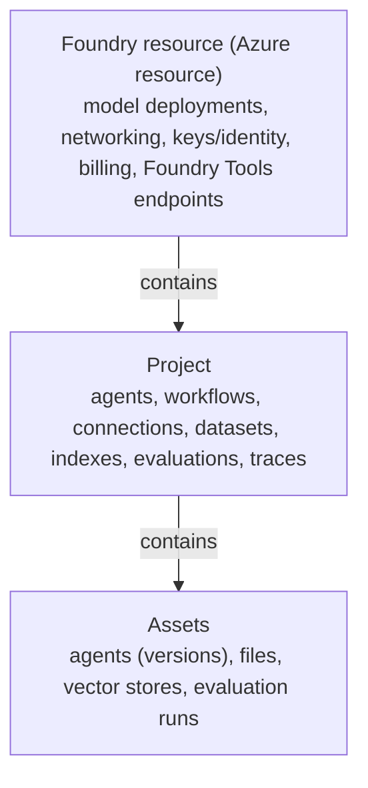
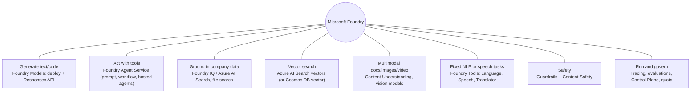

# Foundry platform map

> AI-103 · D1 Plan and manage an Azure AI solution · about 60 min · Study Hub module `p01` ([open the hub](https://claude.ai/artifact/TdpMZLFYA9knTdjNyCms9F))

## Why it matters
Plan and manage is the second-heaviest domain (25–30%). Most of its questions start with *which Foundry service or component fits this need?* You can't answer that without a clear map of what Foundry contains.

## Pre-question (answer before reading)
**Q:** If two teams each need their own agents and evaluation data but must share the same model deployments and billing, how would you organise them in Foundry?

<details><summary>Answer</summary>

One **Foundry resource** (shared deployments, networking, billing) with **two projects** (each team's agents, connections, files and evaluations isolated).

</details>

## Mental model & story
Contoso Pharma wants three things: a chat assistant for sales, an agent that files expense claims, and a pipeline that pulls fields from lab reports. Their architect, Priya, opens Microsoft Foundry and sees it's organised like a **workshop building**.

The **Foundry resource** is the building: power, plumbing and security at the door. Model deployments, networking rules and the bill live here. Inside are **projects**, one workshop room per team. Each room keeps its own agents, connections, uploaded data, evaluations and traces. Every resource gets a default project, and you add more as teams arrive.

Along the corridor is a tool shelf called **Foundry Tools**, the services once called Azure AI services: Language, Speech, Translator, Document Intelligence, Content Understanding and Content Safety. They do one job each, deterministically and cheaply. For the lab reports Priya doesn't need a chatty model; Content Understanding pulls the fields and returns confidence scores.

Generative work uses the **model catalog** (deploy a model, then call it), **Foundry Agent Service** (models + instructions + tools that act), and **Foundry IQ** (a managed knowledge layer on Azure AI Search that agents query through MCP). Around it all, observability (tracing, evaluations) and governance (guardrails, quotas, the Control Plane) keep things safe.

**Where the analogy breaks:** Real projects can't do *everything* alone. Some settings live only at resource level (networking, customer-managed keys, deployments). And there's an older **Foundry (classic)** hub-based project type built on Azure Machine Learning hubs that you may still see in labs and older docs.

## Diagrams
**Foundry structure**



**Which Foundry service for which need?**



## Key points
- A **Foundry resource** is the parent Azure resource; **projects** are child containers. One default project is created; add more for isolation between teams or apps.
- Project endpoint format: `https://<resource>.services.ai.azure.com/api/projects/<project>` (used by `AIProjectClient`). Model inference can also use the OpenAI v1 endpoint `https://<resource>.openai.azure.com/openai/v1`.
- Portal (ai.azure.com) areas: **Discover** (model catalog, tools), **Build** (agents, workflows, models, tools, knowledge, guardrails, evaluations, data), **Operate** (overview, assets, compliance, quota, admin).
- **Foundry Tools** = the renamed Azure AI services: Azure Language, Speech, Translator, Document Intelligence, Content Understanding, Content Safety (plus Vision). Use them for well-defined tasks: cheaper and more predictable than prompting an LLM.
- Foundry Tools are best used through the Foundry resource (one endpoint, one identity), though standalone resources still exist.
- Agent building blocks: **model + instructions + tools**, plus conversation state. Three agent types: prompt (declarative), workflow, hosted (your container).
- **Foundry IQ** = managed knowledge bases over Azure AI Search, exposed to agents through an MCP endpoint, with citations.
- Developer tools: Foundry portal, VS Code with the **Foundry Toolkit** extension, GitHub Copilot, SDKs (`azure-ai-projects`, OpenAI SDK, Foundry Tools SDKs), REST.
- Infrastructure design checklist: region (model availability, residency), resource groups per environment, identity (managed identity, RBAC), networking (private endpoints), monitoring (Application Insights + Log Analytics), storage/search for data, Key Vault.

## Comparisons
**Foundry resource vs project**

| Lives at | Examples |
|---|---|
| Foundry resource | Model deployments, network isolation, customer-managed keys, resource keys, Foundry Tools endpoints, capability host defaults |
| Project | Agents and versions, workflows, connections, files and vector stores, datasets, evaluations, traces view |

**LLM vs Foundry Tool for the same job**

| Need | Foundry Tool | Generative model |
|---|---|---|
| Detect language of 1M support tickets | Azure Language: fast, cheap, scored | Works but costlier, slower |
| Redact PII with offsets | Azure Language PII | Possible, less consistent |
| Summarise with a custom tone | Legacy summarisation is deprecated | Prompt an LLM |
| Extract invoice fields at scale | Document Intelligence / Content Understanding | Possible, harder to validate |

## Code to recognise
**Two ways to reach a model**

```python
# 1) Through the project (gets connections, tracing, agents too)
project = AIProjectClient(endpoint="https://contoso.services.ai.azure.com/api/projects/sales",
                          credential=DefaultAzureCredential())
client = project.get_openai_client()

# 2) Straight to the OpenAI-compatible v1 endpoint of the resource
from openai import OpenAI
from azure.identity import get_bearer_token_provider
token = get_bearer_token_provider(DefaultAzureCredential(), "https://ai.azure.com/.default")
client = OpenAI(base_url="https://contoso.openai.azure.com/openai/v1", api_key=token)

r = client.responses.create(model="chat-prod", input="Hello")
```

- Line 2: Project endpoint: `/api/projects/<name>` on `services.ai.azure.com`.
- Line 4: Same OpenAI client either way; via the project you also get Foundry features.
- Line 9: A token provider is passed as `api_key`: still keyless, the SDK sends a bearer token.
- Line 10: The v1 endpoint suits portable OpenAI-style code.

## Portal steps
**Find the endpoints and keys** (Foundry portal > your project > Overview)

1. Project endpoint and API key are on the project overview.
2. Resource-level endpoints for Foundry Tools (Language, Speech) are under **Operate > Admin** or the Azure portal's resource page.
3. Create another project: project picker > Create project.

## Worked example
**Scenario:** Fabrikam wants (1) a customer-facing chat app, (2) an internal HR agent, both using the same GPT deployment, but HR data and evaluations must never be visible to the chat team. Minimise duplicated cost.

- Shared deployment and one bill → one Foundry resource.
- Isolation of agents, files, evaluations → separate projects.
- Grant each team Foundry User on its own project only.

**Answer:** **One Foundry resource, two projects**, with project-scoped RBAC. Deployments are shared at resource level; data and agents stay per project.

## Your turn (faded example)
**Scenario:** A retailer needs to read 50,000 scanned receipts a month into structured fields with confidence scores, and route low-confidence ones to a person.

- The task is fixed and repeated, with a known schema.
- **Generative model or Foundry Tool?** <details><summary>answer</summary>A Foundry Tool: Content Understanding (prebuilt-receipt) or Document Intelligence. Both give fields plus confidence scores.</details>
- **Where does the low-confidence routing happen?** <details><summary>answer</summary>In your app or workflow logic: compare each field's confidence to a threshold (for example 0.8) and send low-confidence documents to human review.</details>

## Exam traps & misconceptions
- ✗ Creating a new Foundry resource per team to isolate data. → ✓ Projects already isolate agents and data. Extra resources duplicate deployments and networking.
- ✗ Using the project endpoint with Foundry Tools SDKs such as Text Analytics. → ✓ Foundry Tools SDKs want the **resource** endpoint (`*.cognitiveservices.azure.com`), not `/api/projects/...`.
- ✗ Treating Foundry Tools as obsolete because LLMs exist. → ✓ The study guide expects you to pick Foundry Tools when they're cheaper, faster or more predictable.
- ✗ Confusing Foundry IQ with file search. → ✓ File search = a vector store for an agent's own uploaded files. Foundry IQ = shared, managed knowledge bases (many sources, many agents) over Azure AI Search.

## Discussion prompts
- **When would you choose a hosted agent over a prompt agent?** When you need your own code, a custom framework (LangGraph, Agent Framework), custom protocols, or control of state and compute. Prompt agents are declarative (model + instructions + tools) and need no hosting.
- **Name three settings that belong at resource level rather than project level.** Model deployments, network isolation (public access, private endpoints), customer-managed keys. Also resource keys and default agent capability-host settings.

## Interview angle / teach-back
**Prompt:** Explain the difference between a Foundry resource and a Foundry project, and when you'd add a second project.

**Rubric:** Resource = parent Azure resource (deployments, networking, billing) · Project = child container for agents, data, evaluations · Second project for isolation between teams/apps · Deployments are shared across projects · RBAC can be scoped per project

**Model answer:** The Foundry resource is the Azure resource that holds shared things: model deployments, networking and billing. Projects live inside it and hold each team's agents, connections, files and evaluations. Add a project when another team or app needs isolation; it can still use the same deployments, and you grant RBAC roles on that project only.

## Quick Q&A
- **Parent of a Foundry project?** The **Foundry resource**.
- **What are Foundry Tools?** Renamed Azure AI services: Language, Speech, Translator, Document Intelligence, Content Understanding, Content Safety.
- **Project endpoint path?** `/api/projects/<project>` on `services.ai.azure.com`.
- **Three agent types?** Prompt (declarative), workflow, hosted.
- **What is Foundry IQ?** Managed knowledge bases on Azure AI Search, connected to agents through MCP.
- **Where do model deployments live?** On the Foundry resource (shared by its projects).
- **VS Code extension for Foundry?** Foundry Toolkit.

## Sources (accessed 2026-10-02)
- [What is Microsoft Foundry?](https://learn.microsoft.com/en-us/azure/foundry/what-is-foundry)
- [Prepare for AI development (Learn module)](https://learn.microsoft.com/en-us/training/modules/prepare-azure-ai-development/)
- [Exam AI-103 study guide](https://learn.microsoft.com/en-us/credentials/certifications/resources/study-guides/ai-103)

## SRS cards created
- ai-103-p01-01, ai-103-p01-02, ai-103-p01-03, ai-103-p01-04
