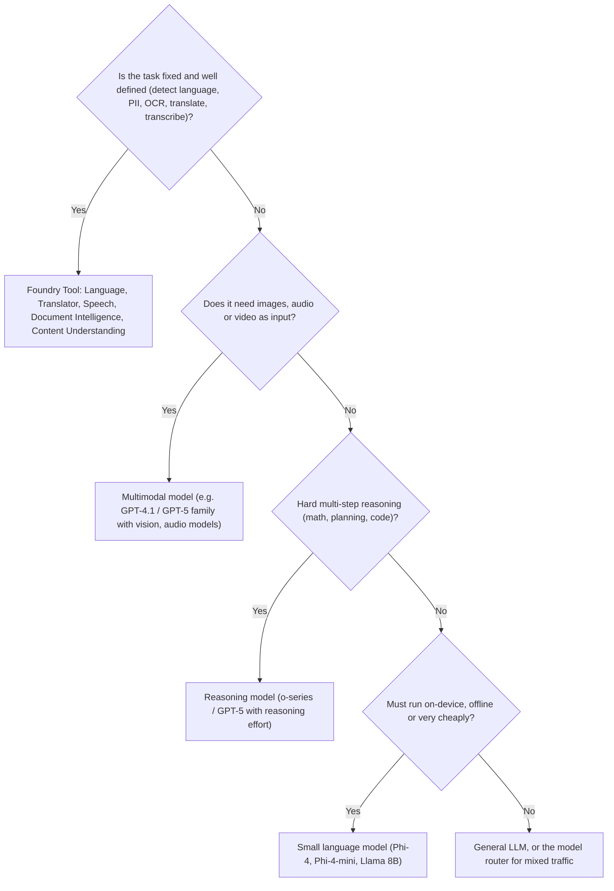

# Choose the right model or tool

> AI-103 · D1 Plan and manage an Azure AI solution · about 70 min · Study Hub module `p02` ([open the hub](https://claude.ai/artifact/TdpMZLFYA9knTdjNyCms9F))

## Why it matters
"Choose an appropriate model for each task" is the very first skill in the outline. Expect scenarios that hinge on one word: *offline*, *cheapest*, *reasoning*, *image input*, *consistent*, *embeddings*.

## Pre-question (answer before reading)
**Q:** A phone app must summarise notes with no internet connection. Would you pick GPT-5 or Phi-4-mini, and why?

<details><summary>Answer</summary>

**Phi-4-mini**, a small language model. It can run on-device or at the edge; a frontier LLM needs a cloud endpoint. Small models trade some quality for cost, speed and local deployment.

</details>

## Mental model & story
Think of the model catalog as a **hiring agency** with thousands of candidates. Big generalists (LLMs such as GPT-5 or Mistral Large) can do almost anything but charge senior rates. Specialists are cheaper and faster: small language models (Phi-4, Llama 3 8B) for focused jobs or devices, **reasoning models** for multi-step problems, **embedding models** that turn text into vectors for search, image and video generators (gpt-image-2, Sora 2), and speech models (gpt-transcribe, gpt-4o-mini-tts).

Then there are the **Foundry Tools** contractors: Language, Speech, Translator, Document Intelligence, Content Understanding. They do one job with a fixed price and predictable output. Hiring a senior generalist to detect the language of a million tickets is like paying a surgeon to take temperatures.

Contoso's architect checks each candidate's **CV**: the **model card** (provider, capabilities, limits, responsible-AI notes, deployment options) and the **benchmarks** (quality, safety, cost, latency, throughput). The **leaderboard** compares candidates; the side-by-side view puts two or three next to each other on the same chart.

When the workload is a mix of easy and hard prompts, Contoso hires a **dispatcher**: the **model router**. It's one deployment that sends each prompt to the cheapest model likely to answer it well.

**Where the analogy breaks:** Benchmarks are someone else's exam. A model that tops MMLU-Pro can still fail on your documents, your language or your format. Always evaluate candidates on your own data before choosing.

## Diagrams
**Which model or tool? (decision tree)**



**Reading the trade-off chart**

| | lower cost | higher cost |
|---|---|---|
| **higher quality** | **Sweet spot**: high quality for little money: shortlist these | **Premium**: pay more only if quality gains matter |
| **lower quality** | **Budget**: fine for simple, high-volume tasks | **Avoid**: costs more and does worse |

## Key points
- Catalog collections: models **sold directly by Azure** (billed through Azure, Microsoft support and terms; includes Azure OpenAI and Microsoft models) vs **partner and community** models (provider's own licence, often via Azure Marketplace).
- Filter the catalog by collection, capability (reasoning, tool calling, multimodal), inference task, fine-tuning support and industry.
- **LLM** = broad, best quality, highest cost. **SLM** = focused, cheaper, faster, can run at the edge. **Multimodal** = text plus images/audio input. **Reasoning** models think before answering (better at multi-step problems, slower, reasoning tokens are billed as output).
- **Embedding models** (text-embedding-3-small/large, Cohere Embed) produce vectors for search and RAG; use the same embedding model for documents and queries.
- Benchmarks: **Quality index** (aggregate of tests like MMLU-Pro, GPQA, HumanEval+, MATH, IFEval), **safety** (HarmBench attack success rate: lower is safer; ToxiGen; WMDP: lower means less hazardous knowledge), **cost** (per 1M input and output tokens, plus a blended estimate at a 3:1 input:output ratio), **performance** (latency P50–P99, time to first token, generated tokens per second).
- Use the leaderboard, trade-off charts, scenario leaderboards (reasoning, coding, math, QA, groundedness) and side-by-side comparison of 2–3 models.
- **Model router**: a single deployment that picks an underlying model per prompt. Modes: **Balanced** (default), **Cost**, **Quality**; you can limit it to a model subset. Its context window is limited by the smallest model in the set.
- Prefer a **Foundry Tool** when a deterministic, cheaper service exists; prefer an **LLM** when the task needs open-ended generation, custom tone or reasoning.
- Code models: filter the catalog for coding capability and check coding benchmarks (HumanEval+, MBPP+) for code-generation tasks.

## Comparisons
**Match the need to the model family**

| Need | Pick | Why |
|---|---|---|
| Customer chat with a custom tone | General LLM (GPT-4.1/GPT-5 class) | Open-ended generation, instruction following |
| Plan a 12-step tax calculation | Reasoning model | Multi-step logic; set reasoning effort |
| Offline field-service assistant | SLM (Phi-4-mini) | Small enough for edge/device |
| Search 2M documents by meaning | Embedding model + Azure AI Search | Vectors, not chat |
| Describe photos for alt text | Multimodal model | Image input |
| Create marketing images | gpt-image family (gpt-image-2) / FLUX | Text-to-image |
| Transcribe calls | gpt-transcribe or Azure Speech | Speech-to-text |
| Mixed easy/hard prompts at lowest cost | Model router (Cost or Balanced mode) | Routes per prompt |

## Code to recognise
**Calling a model router deployment (same code as any model)**

```python
client = project.get_openai_client()

r = client.responses.create(
    model="model-router",              # the router's deployment name
    input="Summarise this paragraph in one sentence: ...")

print(r.model)                         # which underlying model answered
print(r.output_text)
```

- Line 4: To your code, the router is just another deployment.
- Line 7: The response reports the model actually used, which matters for cost analysis.

## Portal steps
**Compare models on the leaderboard** (Foundry portal > Discover > Models > Model leaderboard)

1. Pick a scenario (e.g. reasoning or groundedness) to re-rank models.
2. Open the **trade-off** chart: quality vs cost, or quality vs throughput.
3. Select 2–3 models > **Compare** for side-by-side benchmarks.
4. Open a model card: **Benchmarks** tab, capabilities, deployment options, then **Deploy**.

## Worked example
**Scenario:** Northwind processes 400,000 short product reviews a month. They need sentiment labels in a fixed set (positive, neutral, negative) cheaply. Occasionally a review needs a nuanced reply drafted. What do you recommend?

- Labelling into a fixed set is classification at high volume → cheapest capable model.
- Azure Language sentiment is deprecated, so use a small or mini LLM with a strict JSON schema, or a classifier.
- Reply drafting is generative and rare → a general LLM only for those cases.

**Answer:** Classify with a **small/mini model** using structured output (or the model router in Cost mode), and send only the reviews that need a reply to a **general LLM**. Evaluate both on a labelled sample before going live.

## Your turn (faded example)
**Scenario:** A bank wants a model to explain loan decisions step by step, checking several policy rules. Quality matters more than latency.

- The task has multiple dependent checks, so reasoning quality matters.
- **Which model family?** <details><summary>answer</summary>A **reasoning model**, with reasoning effort set to medium or high.</details>
- **Which benchmark view helps you shortlist?** <details><summary>answer</summary>The **reasoning** scenario leaderboard plus the safety benchmarks; then test on your own policy cases.</details>

## Exam traps & misconceptions
- ✗ Choosing the top Quality-index model for every task. → ✓ Questions usually add cost, latency or deployment constraints. The *best fit* often isn't the most capable model.
- ✗ Reading a high HarmBench score as *safer*. → ✓ HarmBench reports attack success rate: **lower** is safer.
- ✗ Using a chat model to create embeddings. → ✓ Embeddings come from embedding models (text-embedding-3-*), and documents and queries must use the same one.
- ✗ Thinking the model router increases your context window. → ✓ Its effective context window is the **smallest** of the models it routes between.
- ✗ Using an LLM to detect language or PII at massive scale. → ✓ Azure Language does this faster, cheaper and more consistently.

## Discussion prompts
- **When would the model router be the wrong choice?** When you need one specific model's behaviour (fine-tuned style, certified model version), when you rely on very long context, or when traffic needs non-text routing signals such as image inputs. Also when you must pin a model version for compliance.
- **Why evaluate on your own data even after checking benchmarks?** Benchmarks measure general skills on public datasets. Your domain, language, formats and safety needs differ. A small labelled test set from your data predicts real performance far better.

## Interview angle / teach-back
**Prompt:** Explain to a product manager how you'd choose between an LLM, a small model, a reasoning model and a Foundry Tool.

**Rubric:** Fixed, well-defined task → Foundry Tool (cheaper, predictable) · Open-ended generation → LLM · Edge/offline/cheap → SLM · Multi-step logic → reasoning model · Shortlist with benchmarks, then evaluate on own data

**Model answer:** Start with the task. If it's fixed (language detection, OCR, translation), a Foundry Tool is cheaper and more predictable. Open-ended writing or chat needs an LLM; hard multi-step problems suit a reasoning model; on-device or very cheap workloads suit a small model. Use the leaderboard and trade-off charts to shortlist, then evaluate the finalists on our own data.

## Quick Q&A
- **Lower or higher HarmBench is safer?** Lower (it's an attack success rate).
- **Blend ratio used for estimated cost?** 3:1 input to output tokens.
- **Model router modes?** Balanced (default), Cost, Quality.
- **Router context window?** That of the smallest model in its set.
- **Model for semantic search?** An embedding model (e.g. text-embedding-3-large).
- **SLM examples?** Phi-4, Phi-4-mini, Llama 3 8B.
- **What does a model card show?** Provider, capabilities, benchmarks, responsible-AI notes, deployment options.

## Sources (accessed 2026-10-02)
- [Explore the model catalog (Learn module)](https://learn.microsoft.com/en-us/training/modules/model-catalog-evaluate/)
- [Model leaderboards](https://learn.microsoft.com/en-us/azure/foundry/concepts/model-benchmarks)
- [Model router concepts](https://learn.microsoft.com/en-us/azure/foundry/openai/concepts/model-router)

## SRS cards created
- ai-103-p02-01, ai-103-p02-02, ai-103-p02-03, ai-103-p02-04
