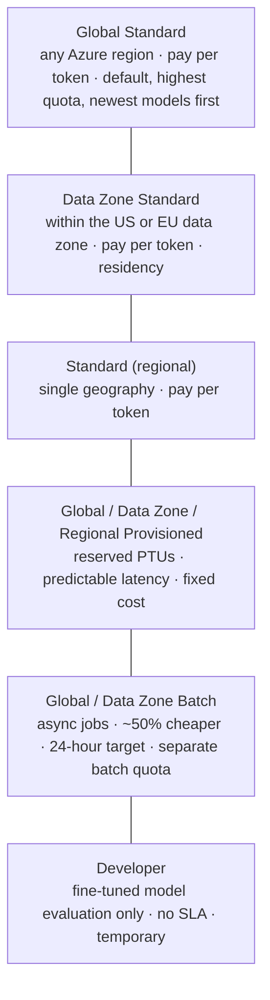
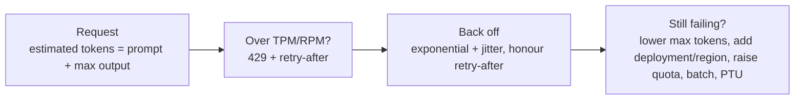

# Deployments, quotas, rate limits and cost

> AI-103 · D1 Plan and manage an Azure AI solution · about 70 min · Study Hub module `p03` ([open the hub](https://claude.ai/artifact/TdpMZLFYA9knTdjNyCms9F))

## Why it matters
429 *Too Many Requests* is the most common production failure for AI apps, and *choose a deployment type* is a guaranteed exam topic. This module connects deployment types, quota, throttling and cost.

## Pre-question (answer before reading)
**Q:** Your quota is 100,000 tokens per minute (TPM). Each request sends 2,000 prompt tokens with `max_output_tokens=4000`. Roughly how many requests per minute fit before throttling?

<details><summary>Answer</summary>

About **16**. The service estimates each request as prompt + maximum output (2,000 + 4,000 = 6,000 tokens) when it arrives, so 100,000 / 6,000 ≈ 16. Lowering `max_output_tokens` raises that number.

</details>

## Mental model & story
Picture model capacity as a **water utility**. A **deployment** is the tap you install for one model in one region. Its **deployment type** is the plumbing contract: **Global Standard** draws from the whole global network, pay per litre, with the most capacity, and is the default. **Data Zone** keeps processing inside the US or EU zone for residency rules. **Standard** (regional) keeps it in one geography. **Provisioned (PTU)** reserves a dedicated pipe for steady flow and predictable latency, at a fixed price. **Batch** is overnight delivery at half price: jobs finish within about 24 hours.

Your **quota** is the maximum litres per minute the utility allows your subscription, per region, per model and per deployment type, measured in **tokens per minute (TPM)**. Requests per minute (RPM) are derived from TPM. When you exceed it, the tap sputters: HTTP **429**, with a `retry-after` header telling you how long to wait.

Contoso's support bot started returning 429s every Monday at 9am. The team found three leaks: `max_output_tokens` set to 8,000 (the estimate counts the maximum, not what's actually used), clients retrying instantly in a tight loop, and one deployment carrying all traffic. They cut `max_output_tokens`, added exponential backoff with jitter, and split traffic across two deployments. The 429s disappeared without buying more capacity.

**Where the analogy breaks:** Water is pay-per-use. **PTU** isn't: you pay for reserved capacity whether you use it or not. It's for steady, high, predictable volume, not spiky prototypes.

## Diagrams
**Deployment types (where processing happens · how you pay)**



**Handling throttling**



## Key points
- Prefer **Global Standard** unless a requirement says otherwise: residency → **Data Zone**; predictable latency at steady high volume → **Provisioned (PTU)**; non-urgent bulk work → **Batch** (about 50% cheaper, 24-hour target).
- Data **at rest** stays in the resource's geography for every type; deployment types change where **processing** can happen.
- SKU names you may see in code or ARM: `GlobalStandard`, `DataZoneStandard`, `Standard`, `GlobalProvisionedManaged`, `DataZoneProvisionedManaged`, `ProvisionedManaged`, `GlobalBatch`, `DataZoneBatch`, `DeveloperTier`.
- Quota = TPM per **subscription × region × model × deployment type**, assigned to deployments in 1,000-token steps. RPM is derived from TPM.
- Rate limiting counts **prompt tokens + max output tokens** when the request arrives, and checks RPM over short windows (seconds), so bursts throttle even under the per-minute total.
- 429 handling: read `retry-after`/`retry-after-ms`, retry with **exponential backoff + jitter** (the OpenAI SDK retries automatically; tune `max_retries`), lower `max_output_tokens`, spread load across deployments or regions, request more quota, or move to PTU.
- Response headers such as `x-ratelimit-remaining-tokens` and `x-ratelimit-remaining-requests` let you monitor headroom.
- **Managed compute** deployments (open models, Hugging Face) are billed per VM hour: choose SKU and instance count, and use 2+ instances in production.
- Agent cost footprint = model tokens (instructions, history, **tool definitions and tool outputs** all count) + tool charges (code interpreter sessions, web grounding, file search storage) + any hosted-agent compute.
- Control cost with budgets and alerts in Cost Management, token metrics in Azure Monitor, smaller models or the model router, caching, and Azure Policy to restrict allowed deployment types.

## Comparisons
**Pick the deployment type**

| Scenario | Type | Reason |
|---|---|---|
| New chatbot, unknown traffic | Global Standard | Highest quota, pay as you go |
| EU bank: processing must stay in the EU | Data Zone Standard (EU) | Residency within the data zone |
| Call centre, 24/7 steady load, latency SLA | Provisioned (PTU) | Reserved capacity, low latency variance |
| Summarise 3M archived emails by next week | Global Batch | ~50% cheaper, async |
| Evaluate a fine-tuned model briefly | Developer | Low-cost, temporary, no SLA |

## Code to recognise
**Respecting rate limits in Python**

```python
import random, time
from openai import RateLimitError

def ask_with_backoff(client, deployment, prompt, attempts=6):
    for i in range(attempts):
        try:
            return client.responses.create(model=deployment, input=prompt,
                                           max_output_tokens=500)
        except RateLimitError as e:
            wait = float(e.response.headers.get("retry-after", 2 ** i))
            time.sleep(wait + random.uniform(0, 1))     # jitter
    raise RuntimeError("Still throttled after retries")
```

- Line 7: A tight `max_output_tokens` lowers the estimate the rate limiter counts.
- Line 9: 429s surface as `RateLimitError` in the OpenAI SDK.
- Line 10: Honour the service's `retry-after`; fall back to exponential growth.
- Line 11: Random jitter stops many clients retrying in lockstep.

## Portal steps
**Deploy a model with a chosen type** (Foundry portal > Discover > Models > (model) > Deploy > Custom settings)

1. Enter a **deployment name** (your code uses it as `model`).
2. Choose the **deployment type** (Global Standard, Data Zone, Provisioned, Batch…).
3. Set the **tokens per minute** limit from your available quota.
4. Optionally attach a guardrail; deploy, then test in the playground.

**Check and request quota** (Foundry portal > Operate > Quota)

1. Filter by deployment type and region to see usage vs limit.
2. Reassign TPM between deployments or request an increase.
3. Viewing subscription quota needs **Cognitive Services Usages Reader** at subscription scope.

## Worked example
**Scenario:** A German insurer's claims assistant must keep inference processing inside the EU, traffic is unpredictable, and the team wants to pay only for what they use. Which deployment type?

- Residency inside the EU → Data Zone (EU) or a regional Standard deployment in an EU region.
- Unpredictable traffic, pay-per-use → Standard (not provisioned).
- Data Zone gives more capacity than a single region while staying in the EU.

**Answer:** **Data Zone Standard** in an EU region.

## Your turn (faded example)
**Scenario:** An app gets 429 errors at peak even though average usage is 40% of the TPM quota.

- Average usage is fine, so bursts are the issue.
- **Which request setting inflates the rate limiter's estimate?** <details><summary>answer</summary>`max_output_tokens` (or `max_tokens`) set much higher than needed.</details>
- **Name two code-level fixes.** <details><summary>answer</summary>Exponential backoff with jitter that honours `retry-after`, and smoothing bursts with a queue or concurrency limit (plus a lower max output setting).</details>

## Exam traps & misconceptions
- ✗ Picking Provisioned for a prototype with spiky traffic. → ✓ PTU is paid whether used or not. Spiky or unknown traffic suits Standard types.
- ✗ Thinking Global Standard stores your data outside your geography. → ✓ Data at rest stays in the geography; only processing can be global.
- ✗ Retrying 429s immediately in a loop. → ✓ That makes throttling worse. Back off and honour `retry-after`.
- ✗ Believing quota is per resource. → ✓ It's per subscription × region × model × deployment type.
- ✗ Using Batch for a real-time chatbot. → ✓ Batch is asynchronous with a 24-hour target.

## Discussion prompts
- **Your app uses 20% of quota on average but users see throttling. What evidence would you gather?** Per-minute token and request metrics, the `max_output_tokens` value, burst patterns (RPM in short windows), retry behaviour in logs, and 429 counts per deployment. Then fix the cause: lower max tokens, smooth bursts, spread load.
- **When is PTU worth it?** Steady, high, predictable volume where latency consistency matters (SLAs), enough to keep reserved capacity busy. Compare the PTU price to the expected pay-as-you-go spend at that volume.

## Interview angle / teach-back
**Prompt:** Explain to a teammate why an app can be throttled while using well under its TPM quota, and how to fix it.

**Rubric:** Estimate counts prompt + max output tokens · RPM checked over short windows → bursts · Lower max_output_tokens · Backoff with jitter honouring retry-after · Spread load / more quota / PTU

**Model answer:** The rate limiter estimates each request as prompt tokens plus the maximum output, and checks requests over short windows. A large `max_output_tokens` or a burst of calls can hit the limit even when average use is low. Fix it by setting max output realistically, retrying with exponential backoff and jitter that honours `retry-after`, smoothing bursts, and spreading load across deployments or getting more quota.

## Quick Q&A
- **Default deployment type?** Global Standard.
- **Residency within EU/US zone?** Data Zone deployment types.
- **Batch discount and timing?** About 50% cheaper; 24-hour target.
- **What does the rate limiter count?** Prompt tokens + max output tokens (estimated on arrival).
- **Quota scope?** Subscription × region × model × deployment type.
- **Header that says how long to wait?** `retry-after` (or `retry-after-ms`).
- **Role to view subscription quota?** Cognitive Services Usages Reader.

## Sources (accessed 2026-10-02)
- [Deployment types](https://learn.microsoft.com/en-us/azure/ai-foundry/foundry-models/concepts/deployment-types)
- [Quotas and limits](https://learn.microsoft.com/en-us/azure/foundry/openai/quotas-limits)
- [Manage quota](https://learn.microsoft.com/en-us/azure/foundry/openai/how-to/quota)

## SRS cards created
- ai-103-p03-01, ai-103-p03-02, ai-103-p03-03, ai-103-p03-04
