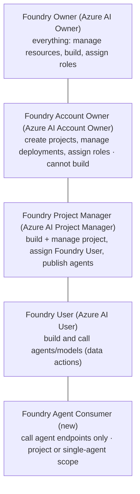
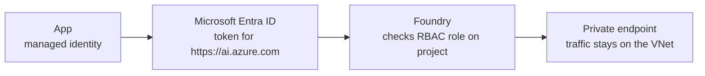

# Secure Foundry: identity, roles and networks

> AI-103 · D1 Plan and manage an Azure AI solution · about 70 min · Study Hub module `p04` ([open the hub](https://claude.ai/artifact/TdpMZLFYA9knTdjNyCms9F))

## Why it matters
"Configure security, including managed identity, private networking, keyless credentials, and role policies" is one bullet but many questions. Most security answers on AI-103 come down to: **Entra ID over keys, least-privilege roles, private endpoints.**

## Pre-question (answer before reading)
**Q:** After publishing, an agent's MCP tool (its connection authenticates with the agent identity) gets 403 from a service it reached fine in the playground. Nothing in the code changed. What's the most likely cause?

<details><summary>Answer</summary>

Publishing gave the agent its **own Entra agent identity**. The role assignment was for the shared project identity, so the new identity needs the role too. (Today only MCP and A2A tools authenticate as the agent identity; other tools use their connection's credentials.)

</details>

## 🍎 Story time (kid version)
**Robo at Foundry Town Hall: Badges, doors and the fence**

Town Hall has badges, doors and a fence. Every person, app and robot gets its own badge. Door rules decide what each badge opens: a builder badge opens the workshop, a visitor badge only the help counter. Maya threw away the spare keys hidden under doormats, so only badges work now. She also built a fence: Town Hall can only be reached through the school's private gate, not from the street. When Robo gets his own new badge, Maya adds it to the storeroom's door list.

| In the story | In Foundry |
|---|---|
| A badge for each person, app and robot | Entra identities: users, managed identities, agent identities |
| Door rules | RBAC roles such as Foundry User and Foundry Agent Consumer |
| No spare keys under doormats | Disabling key (local) authentication |
| The private gate | Private endpoints with public network access off |

**Where the story breaks:** A badge that can build rooms (Contributor) doesn't automatically open what's inside them: control-plane and data-plane rights are separate.

## Mental model & story (grown-up version)
Security in Foundry is a building with **badges, doors and walls**. Badges are identities: people, apps (managed identities) and, since agents became first-class, **agent identities** in Microsoft Entra. Doors are **RBAC roles** that decide what each badge can do. Walls are **networking**: public access, private endpoints and virtual networks.

In 2026 Microsoft renamed the Foundry roles. **Foundry User** (formerly Azure AI User) lets developers build and call agents and models. **Foundry Project Manager** adds managing the project, assigning Foundry User and publishing agents. **Foundry Account Owner** creates projects and manages deployments but can't build. **Foundry Owner** can do everything. The new **Foundry Agent Consumer** can only call agent endpoints, which is perfect for an app that just uses an agent (legacy *agent applications* still need Foundry User).

Fabrikam's security lead set three rules: no API keys (disable local auth so only Entra tokens work), every app and agent gets its own identity with the smallest role that works, and the Foundry resource is reachable only through **private endpoints** from the company network. Secrets that must exist, such as a third-party API key for a tool, live in **Azure Key Vault**.

For agents that store data, there's a choice. **Basic setup** uses Microsoft-managed storage. **Standard setup** brings your own Cosmos DB (conversation state), Storage (files) and Azure AI Search (vector stores), so data stays in resources you control, inside your network.

**Where the analogy breaks:** Badges don't follow a person around automatically. In the agent-application model, unpublished agents share the **project's** agent identity and publishing creates a **distinct** one, so role assignments must be repeated for it. In the new agent model (July 2026) each new agent gets its own identity at creation. Either way, roles on the shared project identity don't carry over.

## Diagrams
**Foundry roles (2026 names; old names in brackets)**



**Keyless call from an app**



## Key points
- Prefer **Microsoft Entra ID** (keyless) auth everywhere; `DefaultAzureCredential` + managed identity in production. API keys bypass RBAC: you can **disable local (key) auth** on the resource.
- Roles renamed in 2026 with the same role IDs: Azure AI User → **Foundry User**; Azure AI Project Manager → **Foundry Project Manager**; Azure AI Account Owner → **Foundry Account Owner**; Azure AI Owner → **Foundry Owner**; new **Foundry Agent Consumer**. Learn modules may still show old names; know both.
- Owner, Contributor and Reader are **control-plane** roles: no data actions such as building or calling agents.
- Minimum to start building: **Foundry User** for the developer *and* for the project's managed identity. Publishing: the RBAC reference names **Foundry Project Manager** as the minimum, and publishing to Teams/Microsoft 365 also needs **Azure Bot Service Contributor**.
- Each agent gets a distinct **agent identity** (Entra Agent ID): at publish in the legacy agent-application model, at creation in the new agent model. Roles on the shared project identity don't carry over, so grant the roles its tools need (e.g. **Search Index Data Reader**, **Storage Blob Data Reader**). Today only **MCP** and **A2A** tools authenticate *as the agent identity*; other tools use their **connection's** credentials (key, project managed identity or OAuth passthrough).
- Networking: disable public network access, use **private endpoints**, and for agents use a managed virtual network or bring your own VNet (standard setup with subnet delegation).
- **Standard agent setup**: your own Cosmos DB for NoSQL (threads/state), Storage (files) and Azure AI Search (vector stores) for data control; **basic setup** uses Microsoft-managed storage.
- **Azure Key Vault** for secrets, certificates and keys; use RBAC roles like *Key Vault Secrets User* for readers. Customer-managed keys (CMK) are configured at resource level.
- Connections in a project (e.g. to AI Search or an API) can authenticate with keys or Entra ID; prefer identity-based connections.

## Comparisons
**Who needs which role?**

| Principal | Role | Scope |
|---|---|---|
| Developer building agents | Foundry User | Project |
| Team lead who publishes agents | Foundry Project Manager (+ Azure Bot Service Contributor for Teams) | Project / resource group |
| Platform admin creating projects/deployments | Foundry Account Owner | Foundry resource |
| Web app that only calls one agent's endpoint | Foundry Agent Consumer (Foundry User for a legacy agent application) | That agent (or project) |
| Project managed identity reading a search index | Search Index Data Reader | Search service/index |

## Code to recognise
**Keyless Azure OpenAI client with a token provider**

```python
from azure.identity import DefaultAzureCredential, get_bearer_token_provider
from openai import OpenAI

token_provider = get_bearer_token_provider(
    DefaultAzureCredential(), "https://ai.azure.com/.default")

client = OpenAI(
    base_url="https://contoso.openai.azure.com/openai/v1",
    api_key=token_provider)      # a callable, not a secret
```

- Line 5: Scope for Foundry/Azure OpenAI tokens. Some samples use `https://cognitiveservices.azure.com/.default`.
- Line 9: The SDK calls the provider to fetch fresh tokens; nothing secret is stored.

## Portal steps
**Grant a role on a project** (Azure portal > Foundry resource > project > Access control (IAM) > Add role assignment)

1. Choose **Foundry User** (or Agent Consumer / Project Manager).
2. Select the user, group or managed identity.
3. Review + assign. Data-plane roles can take a few minutes to apply.

**Lock down the network** (Azure portal > Foundry resource > Networking)

1. Set **Public network access** to Disabled (or selected networks).
2. Add a **private endpoint** in your VNet, with private DNS zones.
3. For agents with standard setup, use VNet injection or a managed network.

## Worked example
**Scenario:** A web app should invoke one published Foundry agent and nothing else. Security wants least privilege and no secrets.

- No secrets → managed identity on the web app.
- Only invoke → Foundry Agent Consumer, not Foundry User.
- Narrowest scope → assign on that agent.

**Answer:** Enable the web app's **managed identity** and assign **Foundry Agent Consumer** scoped to the single agent (or its project if agent scope isn't available). If the agent is a legacy *agent application*, Agent Consumer isn't enough: use Foundry User on the application.

## Your turn (faded example)
**Scenario:** After publishing, an agent's MCP tool (agent-identity authentication) that reads a Foundry IQ knowledge base returns 403 errors in Teams.

- In the playground it used the shared project identity, which had access.
- **What changed at publish time?** <details><summary>answer</summary>The agent received its own **agent identity** (Entra Agent ID).</details>
- **What's the fix?** <details><summary>answer</summary>Assign **Search Index Data Reader** (and any other roles the MCP server checks) to the agent's identity; roles on the shared project identity don't carry over.</details>

## Exam traps & misconceptions
- ✗ Giving Contributor to a developer so they can build agents. → ✓ Contributor has no data actions. Developers need Foundry User.
- ✗ Using Foundry User for an app that only calls an agent's endpoint. → ✓ Least privilege is **Foundry Agent Consumer** (legacy agent applications are the exception: they need Foundry User).
- ✗ Keeping keys enabled "as a backup" while claiming Entra-only access. → ✓ Keys bypass RBAC. Disable local auth to enforce Entra ID.
- ✗ Forgetting to grant roles to the agent's own identity. → ✓ Roles on the shared project identity don't carry over (legacy: at publish; new model: from creation).
- ✗ Assuming every tool authenticates as the agent identity. → ✓ Only MCP and A2A do today; other tools use their connection's credentials.
- ✗ Mixing up basic and standard agent setup. → ✓ Standard = bring your own Cosmos DB, Storage and AI Search (data control, VNet). Basic = Microsoft-managed.

## Discussion prompts
- **Why does Microsoft want each agent to have its own identity?** Least privilege per agent, clear audit trails (which agent did what), Conditional Access and governance in Entra, and the ability to revoke one agent without affecting others.
- **When might you still need API keys?** A client that can't use Entra ID or quick prototypes. Store keys in Key Vault, rotate with key1/key2, and restrict network access.

## Interview angle / teach-back
**Prompt:** Explain how you'd secure a Foundry-based agent app for production: identity, roles, network and secrets.

**Rubric:** Entra ID/keyless with managed identity · Least-privilege roles (Foundry User / Agent Consumer) · Each agent's own identity → grant the roles its MCP/A2A tools need · Private endpoints / disable public access · Key Vault for remaining secrets

**Model answer:** Use Entra ID only: the app runs with a managed identity and local key auth is disabled. Give each principal the smallest role, such as Agent Consumer for an app that only calls an agent and Foundry User for developers. Each agent gets its own identity (at publish for legacy agent applications, at creation in the new model), so grant it exactly the roles its tools need. Put the resource behind private endpoints with public access off, and keep any unavoidable secrets in Key Vault.

## Quick Q&A
- **New name for Azure AI User?** Foundry User.
- **Role that only calls agent endpoints?** Foundry Agent Consumer.
- **Role needed to publish agents?** Foundry Project Manager (RBAC page), plus Azure Bot Service Contributor for Teams.
- **Does Contributor allow building agents?** No: control plane only.
- **Standard agent setup brings which resources?** Cosmos DB for NoSQL, Storage, Azure AI Search (and Key Vault).
- **How to enforce Entra-only auth?** Disable local (key) authentication on the resource.
- **Which tools authenticate as the agent identity today?** MCP and A2A.

## Sources (accessed 2026-10-02)
- [Role-based access control for Foundry](https://learn.microsoft.com/en-us/azure/foundry/concepts/rbac-foundry)
- [Agent identity concepts](https://learn.microsoft.com/en-us/azure/foundry/agents/concepts/agent-identity)
- [Configure private link for Foundry](https://learn.microsoft.com/en-us/azure/foundry/how-to/configure-private-link)

## SRS cards created
- ai-103-p04-01, ai-103-p04-02, ai-103-p04-03, ai-103-p04-04
