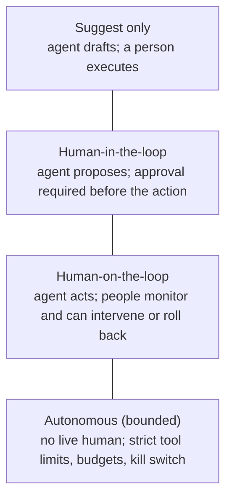
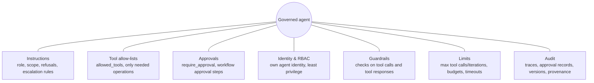

# Govern agents: autonomy, approvals and audit

> AI-103 · D1 Plan and manage an Azure AI solution · about 60 min · Study Hub module `p06` ([open the hub](https://claude.ai/artifact/TdpMZLFYA9knTdjNyCms9F))

## Why it matters
Agents act, so the exam asks how you keep them in bounds: *oversight modes, constraints, tool-access controls, approval workflows, trace logging and provenance*. These skills appear in both D1 and D2.

## Pre-question (answer before reading)
**Q:** An agent can refund customers up to any amount through an API tool. What two controls would you add before going live?

<details><summary>Answer</summary>

For example: **require human approval** for refunds above a threshold (human-in-the-loop), and **restrict the tool** (allow-listed operations, an identity that can only refund up to the limit). Log every call for audit.

</details>

## 🍎 Story time (kid version)
**Robo at Foundry Town Hall: Robo's spending card**

Maya gives Robo a spending card for school supplies. He can buy small things like pencils on his own, but anything over 10 coins needs Maya's signature first. The card only works at the stationery shop, not the toy shop. Every purchase goes into a logbook: what, when, which robot and who said yes. When Robo asks for a bigger allowance, Maya reads the logbook first.

| In the story | In Foundry |
|---|---|
| Small purchases on his own | Bounded autonomy for low-impact actions |
| Maya's signature over 10 coins | Human-in-the-loop approval |
| Only the stationery shop | Tool-access controls (`allowed_tools`, least privilege) |
| The logbook | Audit: traces, approval records and versions |

**Where the story breaks:** Robo doesn't become more trustworthy just by getting older. Every bigger allowance must be a deliberate, tested change.

## Mental model & story (grown-up version)
Think of an agent as a **new employee with a company card**. On day one you don't hand over an unlimited card. You decide how much it can do alone (its **autonomy level**), which shops it may use (**tool-access controls**), when a manager must sign off (**approval workflow**) and what records it must keep (**audit**).

Oversight comes in modes. **Human-in-the-loop**: the agent proposes, a person approves before anything happens, which suits payments, deletions and emails to customers. **Human-on-the-loop**: the agent acts while people monitor and can intervene, suiting low-risk, reversible tasks. **Autonomous**: no live human, only for tightly constrained, low-impact work.

Litware's procurement agent had three tools: search the catalogue, create a purchase request, and approve purchases. The team removed the approve tool entirely (least privilege), required approval on the MCP tool that creates requests (`require_approval="always"`), and limited the agent's identity to the purchasing API's *create* scope. Every tool call, argument and approval decision is traced with the agent's name and version.

**Provenance** answers *where did this come from?*: which agent version, model, prompt and sources produced an output. For generated images, Foundry attaches **C2PA content credentials** so anyone can verify the image is AI-generated.

**Where the analogy breaks:** A new employee learns judgment over time. An agent doesn't get wiser on its own: every expansion of autonomy should be a deliberate, reviewed change backed by evaluation results.

## Diagrams
**Oversight modes (from most to least human control)**



**Controls that keep an agent in bounds**



## Key points
- Pick the **oversight mode** by impact and reversibility: irreversible or high-impact → human-in-the-loop; low-impact, reversible → human-on-the-loop or bounded autonomy.
- Tool-access controls: expose only the tools and operations needed (`allowed_tools` for MCP, minimal OpenAPI operations), separate read tools from write tools, and give each agent its own **least-privilege identity**.
- MCP tools in Foundry Agent Service: `require_approval` defaults to **"always"**; the app must answer each `mcp_approval_request` with an `mcp_approval_response` before the call runs.
- Agent Framework function tools: `@tool(approval_mode="always_require")` pauses for approval; `"never_require"` runs automatically.
- Workflow approvals: Foundry workflows include a **human-in-the-loop** pattern (a question/approval step that pauses the run); Logic Apps or Power Automate approvals also work for business sign-off.
- Constraints: clear instructions (scope, refusal, escalation), limits on iterations and tool calls, timeouts and budgets, plus guardrails at the **tool call** and **tool response** intervention points.
- **Audit** = trace logging of every model and tool call (OpenTelemetry spans with arguments and results, subject to privacy settings), approval records (who, what, when, why), and version metadata.
- **Provenance metadata**: agent name + version, model + version, prompt version, data sources and citations; **C2PA content credentials** on generated images.
- Fleet-level governance: Foundry **Control Plane** (inventory, policies, compliance across agents), **Entra Agent ID** (Conditional Access and lifecycle for agent identities), Azure Policy, Defender for Cloud and Purview.

## Comparisons
**Choose the oversight mode**

| Agent action | Mode | Why |
|---|---|---|
| Answer HR policy questions | Autonomous (bounded) | Read-only, grounded, low impact |
| Reschedule a delivery | Human-on-the-loop | Reversible, moderate impact |
| Issue a refund over $500 | Human-in-the-loop | Financial, hard to reverse |
| Delete customer records | Human-in-the-loop (or remove the tool) | Irreversible |
| Draft a press release | Suggest only | Reputational risk; human publishes |

## Code to recognise
**An MCP tool that needs approval, restricted to two operations**

```python
from azure.ai.projects.models import MCPTool, PromptAgentDefinition

github = MCPTool(
    server_label="github",
    server_url="https://api.githubcopilot.com/mcp/",
    allowed_tools=["search_issues", "create_issue"],   # nothing else is exposed
    require_approval="always")                         # pause before every call

agent = project.agents.create_version(
    agent_name="triage-agent",
    definition=PromptAgentDefinition(
        model=deployment,
        instructions="Triage bug reports. Never close issues. Ask before creating one.",
        tools=[github]))
```

- Line 6: `allowed_tools` is an allow-list: the agent can't even see other server tools.
- Line 7: `always` is the default for MCP tools; `never` skips approval for trusted read-only tools.
- Line 13: Instructions add behavioural limits, but tools and approvals enforce them.

## Portal steps
**Ask for approval on agent tools (VS Code / portal)** (Foundry Toolkit > Prompt agents > (agent) > Tools)

1. Add the tool (e.g. an MCP server or knowledge base).
2. Enable **Ask for approval for all tools** (or per tool).
3. Run in the playground: each call shows an approve/deny prompt before execution.

## Worked example
**Scenario:** A healthcare agent can read patient summaries and send appointment reminders by SMS. Compliance requires that no message goes out without a nurse's review, and that every action is auditable.

- Sending SMS is an outbound, hard-to-reverse action → human-in-the-loop approval.
- Reading summaries is needed but sensitive → read-only, least-privilege identity.
- Audit → tracing with tool arguments (with PII-aware content recording) plus approval records.

**Answer:** Use **human-in-the-loop** approval on the SMS tool, a read-only data tool under the agent's own least-privilege identity, guardrails on tool calls/responses, and tracing plus an approval log (reviewer, time, decision).

## Your turn (faded example)
**Scenario:** An internal agent occasionally loops, calling the same search tool 40 times on one question.

- The behaviour wastes tokens and time.
- **Name one constraint to add.** <details><summary>answer</summary>A limit on tool calls/iterations per run (and a timeout or token budget).</details>
- **How would you find out why it loops?** <details><summary>answer</summary>Read the **traces**: the sequence of tool calls, their arguments and results show where reasoning got stuck.</details>

## Exam traps & misconceptions
- ✗ Relying on instructions alone ("never delete records") for safety. → ✓ Instructions can be overridden. Remove or restrict the tool and require approval.
- ✗ Assuming MCP tools run without approval by default. → ✓ `require_approval` defaults to **always**.
- ✗ Using one shared identity for every agent. → ✓ Per-agent identities give least privilege and clear audit trails.
- ✗ Treating audit as "keep the chat transcript". → ✓ Audit needs tool calls, arguments, approvals, versions and provenance, captured by tracing and approval logs.

## Discussion prompts
- **When is human-on-the-loop better than human-in-the-loop?** When actions are low-impact and reversible and volume is high: approvals would create a bottleneck and approval fatigue. Monitoring plus easy rollback gives oversight without blocking.
- **What makes an approval request good?** Enough context to decide quickly: who and what is affected, the agent's proposed action and reasoning, the impact (amount, reversibility), and exactly what will happen on approval. Otherwise reviewers rubber-stamp.

## Interview angle / teach-back
**Prompt:** Explain how you'd let an agent take actions safely, covering autonomy, tools, approvals and audit.

**Rubric:** Oversight mode chosen by impact/reversibility · Least-privilege tools and identity (allow-lists) · Approval for high-impact actions (require_approval/HITL) · Limits: iterations, tool calls, budgets · Audit: traces, approvals, versions, provenance

**Model answer:** Start from impact and reversibility: high-impact or irreversible actions need human-in-the-loop approval, low-impact ones can run with monitoring. Give the agent only the tools and operations it needs, under its own least-privilege identity. Add approvals (for example `require_approval` on MCP tools), limits on iterations and tool calls, and guardrails on tool calls and responses. Trace every call and keep approval records, versions and provenance so every action can be audited.

## Quick Q&A
- **Default MCP `require_approval`?** "always".
- **Agent Framework approval setting?** `approval_mode="always_require"` or `"never_require"`.
- **Human-in-the-loop vs on-the-loop?** In: approval before action. On: acts, humans monitor and intervene.
- **MCP allow-list parameter?** `allowed_tools`.
- **Provenance for generated images?** C2PA content credentials.
- **Fleet governance in Foundry?** Foundry Control Plane (plus Entra Agent ID, Azure Policy).

## Sources (accessed 2026-10-02)
- [Agent tool catalog](https://learn.microsoft.com/en-us/azure/foundry/agents/concepts/tool-catalog)
- [Learning path: Develop AI agents on Azure](https://learn.microsoft.com/en-us/training/paths/develop-ai-agents-azure/)
- [Lab: Extend agents with MCP tools](https://microsoftlearning.github.io/mslearn-ai-agents/Instructions/Exercises/03-mcp-integration.html)

## SRS cards created
- ai-103-p06-01, ai-103-p06-02, ai-103-p06-03, ai-103-p06-04
