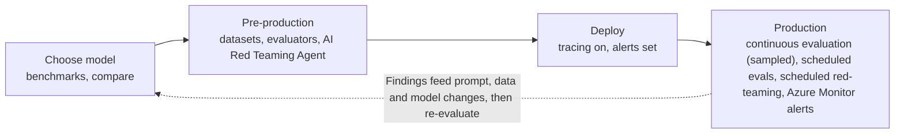
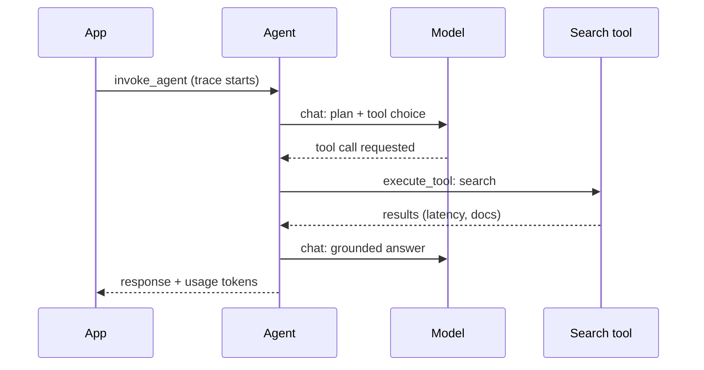

# Monitor: tracing, drift and production evaluation

> AI-103 · D1 Plan and manage an Azure AI solution · about 75 min · Study Hub module `p07` ([open the hub](https://claude.ai/artifact/TdpMZLFYA9knTdjNyCms9F))

## Why it matters
Monitoring appears in three outline bullets across D1 and D2: model performance and drift, data ingestion and index health, and observability (tracing, token analytics, safety signals, latency). This module ties them into one operating picture.

## Pre-question (answer before reading)
**Q:** Users say the support agent got slower and vaguer this week, but error rates are flat. What two kinds of telemetry would you check first?

<details><summary>Answer</summary>

**Traces** (latency per span: model call vs tool call vs retrieval, plus token counts) and **evaluation scores over time** (groundedness, relevance, task adherence from continuous evaluation) to detect quality drift.

</details>

## 🍎 Story time (kid version)
**Robo at Foundry Town Hall: The dashboard and the trip diary**

On the family car trip, the dashboard shows speed and fuel. When the trip felt slow, Dad opened the trip diary: "Drove 20 minutes, shop stop 45 minutes, drove 15 minutes." The shop stop was the problem, not the car. Robo's help desk has the same things: gauges for errors and waiting time, a diary of every step of every answer, and a weekly quiz that checks whether Robo's answers are still as good as last month's.

| In the story | In Foundry |
|---|---|
| Dashboard gauges | Azure Monitor metrics: errors, 429s, latency, tokens |
| The trip diary | Tracing spans in Application Insights (OpenTelemetry) |
| The long shop stop | A slow tool or retrieval span |
| The weekly quiz | Continuous and scheduled evaluation to catch drift |

**Where the story breaks:** A car engine doesn't change by itself, but models, users' questions and documents do, so you compare with a baseline, not a fixed rule.

## Mental model & story (grown-up version)
Running an agent without monitoring is like flying without instruments. Contoso's dashboard has three gauges.

**Health gauges** (Azure Monitor metrics): requests, errors, throttled calls (429s), latency and tokens per deployment. **Flight recorder** (tracing): every run becomes a trace of spans using the OpenTelemetry GenAI conventions (`invoke_agent`, `chat`, `execute_tool`), each with duration, token usage and, if you allow it, the content. Traces flow to **Application Insights**, and the Foundry portal shows them per agent and conversation. **Quality gauges** (evaluation): **continuous evaluation** scores a sample of live traffic with evaluators such as groundedness, relevance, intent resolution and task adherence, and scheduled evaluations and red-teaming runs check for drift.

One Tuesday the latency gauge went up. The traces showed the model was fine and the knowledge tool was slow: the Azure AI Search index had been rebuilt overnight and an indexer was failing on scanned PDFs, so half the documents were missing. Groundedness scores had also dropped. **Index health** (indexer run history, document counts, failed documents, skill warnings) belongs on the same dashboard as model metrics.

Content recording is a privacy decision. Prompts and responses in traces are invaluable for debugging but may hold personal data. Turn content capture on deliberately, restrict who can read the logs, and set retention.

**Where the analogy breaks:** An aircraft has fixed physics. An LLM app drifts for reasons outside your code: model version updates, changes in user questions, changes in your documents. Drift monitoring compares today's scores to a baseline, not to a law of nature.

## Diagrams
**Observability across the lifecycle**



**One traced agent run (spans)**



## Key points
- Tracing uses **OpenTelemetry** with GenAI semantic conventions; spans include `invoke_agent`, `chat` (model call) and `execute_tool`, with attributes such as model, token usage and duration.
- Connect an **Application Insights** resource to the project to store traces; server-side tracing is automatic for prompt and hosted agents once connected. Viewing traces needs Log Analytics read access.
- Client-side tracing for your own app code: `azure-monitor-opentelemetry` (`configure_azure_monitor`) plus the Foundry/OpenAI instrumentation, with the connection string from the project.
- Content capture of prompts and responses is controlled by settings such as `AZURE_TRACING_GEN_AI_CONTENT_RECORDING_ENABLED`: a privacy trade-off.
- **Continuous evaluation** runs evaluators on a **sample** of production traffic; **scheduled evaluations** on fixed datasets reveal drift; scheduled **red-teaming** checks safety over time.
- Watch: latency breakdown (time to first token, per-span duration), **token analytics** (input, output, reasoning tokens per agent and user), error and 429 rates, **safety signals** (content-filter blocks and annotations), quality scores (groundedness, relevance, task adherence).
- Grounding quality = groundedness and retrieval evaluators; a falling groundedness score often means retrieval broke, not the model.
- Index and ingestion health: indexer **execution history** (success, failed and warning documents), document count and storage, skill errors (e.g. OCR on poor scans), query latency and throttling, and relevance checks against labelled queries.
- Use **Azure Monitor alert rules** (metric or log-query alerts) with action groups to notify or trigger automation when thresholds break.

## Comparisons
**Symptom → where to look**

| Symptom | First place to look | Likely fix |
|---|---|---|
| Slower answers | Trace spans: which span grew? | Fix slow tool, reduce context, smaller model |
| Lower groundedness | Retrieval spans + index health | Repair indexer, re-chunk, tune search |
| Spike in 429s | Deployment metrics, retry logs | Quota, max tokens, backoff, spread load |
| More blocked responses | Content-filter annotations | Review guardrail, check abuse, adjust UX |
| Token cost doubled | Token analytics per agent | Trim history/tool output, cache, cheaper model |

## Code to recognise
**Send your app's traces to Application Insights**

```python
import os
from azure.monitor.opentelemetry import configure_azure_monitor
from opentelemetry import trace

# Connection string of the App Insights resource connected to the project
configure_azure_monitor(connection_string=os.environ["APPLICATIONINSIGHTS_CONNECTION_STRING"])
os.environ["AZURE_TRACING_GEN_AI_CONTENT_RECORDING_ENABLED"] = "false"   # privacy first

tracer = trace.get_tracer(__name__)
with tracer.start_as_current_span("answer_question") as span:
    span.set_attribute("app.customer_tier", "gold")
    r = client.responses.create(model=deployment, input=question)
    span.set_attribute("gen_ai.usage.output_tokens", r.usage.output_tokens)
```

- Line 6: One call wires OpenTelemetry to Azure Monitor (traces, metrics, logs).
- Line 7: Keep message content out of traces unless you've decided you need it and protected it.
- Line 10: Custom spans wrap your own steps so they appear in the same trace as model calls.
- Line 13: Token counts per span power token analytics and cost dashboards.

## Portal steps
**Turn on tracing and continuous evaluation** (Foundry portal > Build > Agents > (agent) > Traces)

1. **Connect** an Application Insights resource (or via Operate > Admin > connected resources).
2. Run the agent; open a trace to see spans, inputs/outputs (if recorded), tokens and latency.
3. Under the agent's **Monitor/Evaluation** settings, enable continuous evaluation, choose evaluators and a sampling rate.
4. Create Azure Monitor alerts on key metrics (latency, errors, evaluation scores).

## Worked example
**Scenario:** After a model version upgrade, Fabrikam's agent passes all functional tests but customers complain answers sound less precise. How do you confirm drift and act?

- Compare continuous-evaluation scores (relevance, groundedness, task adherence) before and after the upgrade date.
- Re-run the scheduled evaluation dataset against both versions for a like-for-like comparison.
- If the new version is worse, pin the previous version or adjust prompts, then re-evaluate.

**Answer:** Use **continuous evaluation** trends plus a **scheduled evaluation** on the same dataset to compare versions; act on the evidence (pin, prompt changes, or model switch) and add an alert on the score.

## Your turn (faded example)
**Scenario:** The search-grounded agent's groundedness score fell from 4.6 to 3.1 overnight.

- Model and prompt didn't change.
- **What part of the pipeline do you inspect first?** <details><summary>answer</summary>Retrieval: trace the search tool spans and check the **index health** (indexer run history, document counts, failed documents).</details>
- **What alert would have caught this earlier?** <details><summary>answer</summary>An alert on indexer failures or document count drop (and an alert on the groundedness score).</details>

## Exam traps & misconceptions
- ✗ Recording full prompts and responses in traces by default. → ✓ Content capture is a privacy decision: off by default, enabled deliberately with access controls.
- ✗ Monitoring only HTTP errors. → ✓ LLM failures are often quiet: low quality, ungrounded answers, slow tools. Watch quality scores and spans too.
- ✗ Evaluating 100% of production traffic. → ✓ Continuous evaluation samples traffic; evaluators cost tokens.
- ✗ Blaming the model for falling groundedness. → ✓ Check retrieval and index health first.

## Discussion prompts
- **What would you put on a one-page agent dashboard?** Requests, error and 429 rates, P50/P95 latency with span breakdown, tokens and cost per agent, safety blocks, continuous evaluation scores (groundedness, relevance, task adherence) with trend lines, and index health (last indexer run, failures, document count).
- **How do you detect drift when you have no labelled production data?** Use reference-free evaluators (groundedness, relevance, coherence, task adherence) on sampled traffic, compare to a baseline period, and rerun a fixed labelled dataset on a schedule.

## Interview angle / teach-back
**Prompt:** Explain to an operations engineer how to know whether a Foundry agent is healthy in production.

**Rubric:** Metrics: errors, 429s, latency, tokens · Tracing with OpenTelemetry into Application Insights (spans) · Continuous evaluation on sampled traffic + scheduled evals for drift · Safety signals (filter blocks) · Index/ingestion health for retrieval · Alerts on thresholds

**Model answer:** Three layers. Metrics in Azure Monitor tell you errors, throttling, latency and tokens. Tracing (OpenTelemetry into Application Insights) shows each run's spans, so you can see whether the model, a tool or retrieval is slow. Continuous evaluation scores sampled traffic for groundedness, relevance and task adherence, and scheduled evaluations catch drift. Add safety signals and search index health, and put alerts on the key thresholds.

## Quick Q&A
- **Standard used for Foundry tracing?** OpenTelemetry (GenAI semantic conventions).
- **Where do traces go?** Application Insights connected to the project.
- **Evaluating sampled live traffic is called…** Continuous evaluation.
- **Detecting drift on a fixed dataset?** Scheduled evaluations.
- **Index health signals?** Indexer execution history, failed docs, document count, skill warnings.
- **Env setting for prompt capture?** `AZURE_TRACING_GEN_AI_CONTENT_RECORDING_ENABLED`.

## Sources (accessed 2026-10-02)
- [Learning path: Develop AI agents on Azure](https://learn.microsoft.com/en-us/training/paths/develop-ai-agents-azure/)
- [Learning path: Develop generative AI apps](https://learn.microsoft.com/en-us/training/paths/develop-generative-ai-apps/)
- [Exam AI-103 study guide](https://learn.microsoft.com/en-us/credentials/certifications/resources/study-guides/ai-103)

## SRS cards created
- ai-103-p07-01, ai-103-p07-02, ai-103-p07-03, ai-103-p07-04
