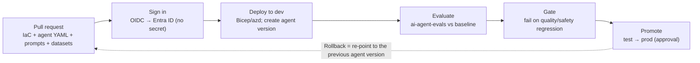
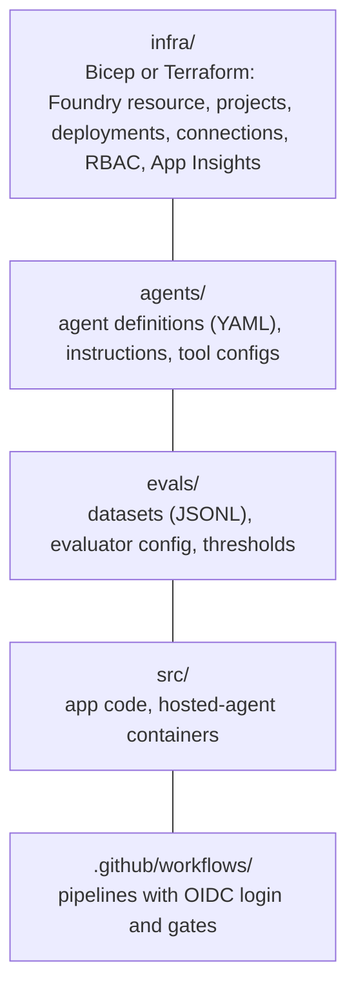

# CI/CD and infrastructure for Foundry projects

> AI-103 · D1 Plan and manage an Azure AI solution · about 60 min · Study Hub module `p08` ([open the hub](https://claude.ai/artifact/TdpMZLFYA9knTdjNyCms9F))

## Why it matters
"Integrate Foundry projects with CI/CD pipelines" and "Design Azure infrastructure" are newer skills. Expect questions on infrastructure as code, keyless pipeline sign-in (OIDC) and evaluation gates before an agent version is promoted.

## Pre-question (answer before reading)
**Q:** Why should a pipeline that deploys an agent use OIDC federated credentials rather than a stored client secret?

<details><summary>Answer</summary>

No long-lived secret exists to leak or rotate. GitHub (or Azure DevOps) gets a short-lived token by federating with Microsoft Entra ID at run time.

</details>

## Mental model & story
Contoso's first agent was built by clicking in the portal. It worked, until someone changed its instructions on a Friday and nobody could say what changed or roll it back. Their second agent was treated like software.

Everything lives in Git: **infrastructure as code** (Bicep or Terraform, or an `azd` template) for the Foundry resource, projects, model deployments, connections and role assignments; the **agent definition** (model, instructions, tools) as YAML or code; and **evaluation datasets**.

On every pull request, GitHub Actions signs in to Azure with **OIDC** (no secrets), deploys to a dev project, creates a new **agent version** and runs evaluations with the `microsoft/ai-agent-evals` action, comparing against the current production version. If quality or safety scores drop, the build fails. Merging to main deploys to test, and production waits for an approval in a protected GitHub environment.

Agent versions are **immutable**: a change creates a new version, and publishing an update routes traffic to it while the endpoint URL stays the same. Rolling back means pointing back to the previous version.

**Where the analogy breaks:** Normal software tests are deterministic. Evaluations of LLM output are statistical: you compare score distributions and confidence intervals against a baseline, not exact strings.

## Diagrams
**A Foundry agent pipeline**



**What goes in the repository**



## Key points
- Use **infrastructure as code** (Bicep, Terraform or an **azd** template with `azure.yaml`) for resources, projects, deployments, connections and role assignments, parameterised per environment.
- Use separate projects (or resources) per environment (dev, test, prod) and promote the same definitions through them.
- Pipelines sign in keylessly with **OIDC federated credentials**: `azure/login@v3` plus `permissions: id-token: write` in GitHub Actions.
- Give the pipeline identity least privilege: Foundry User to create agent versions; Foundry Project Manager if it publishes agents.
- Treat agent definitions and prompts as code; create a new **agent version** per change (versions are immutable).
- **Evaluation gate**: the GitHub Action `microsoft/ai-agent-evals` (an Azure DevOps extension also exists) runs evaluators over a dataset for one or more agent versions and reports scores with confidence intervals against a baseline in the job summary.
- Protect production with environment approvals (required reviewers) and keep a fast rollback path to the previous version.
- Hosted agents: build the container, push to Azure Container Registry, deploy with `azd` or the SDK; each deployment creates an immutable version.
- Keep secrets out of pipelines: Key Vault references and managed identities at runtime.

## Comparisons
**Pipeline sign-in options**

| Option | Secret stored? | Verdict |
|---|---|---|
| OIDC federated credential (workload identity federation) | No | Recommended |
| Service principal with client secret | Yes | Works; rotate and protect |
| Personal account credentials | Yes | Never for automation |

## Code to recognise
**GitHub Actions: keyless login and an evaluation gate**

```yaml
permissions:
  id-token: write          # allow OIDC token request
  contents: read

jobs:
  evaluate:
    runs-on: ubuntu-latest
    steps:
      - uses: actions/checkout@v4
      - uses: azure/login@v3
        with:
          client-id: ${{ vars.AZURE_CLIENT_ID }}
          tenant-id: ${{ vars.AZURE_TENANT_ID }}
          subscription-id: ${{ vars.AZURE_SUBSCRIPTION_ID }}
      - uses: microsoft/ai-agent-evals@v3-beta
        with:
          azure-ai-project-endpoint: ${{ vars.PROJECT_ENDPOINT }}
          deployment-name: ${{ vars.JUDGE_DEPLOYMENT }}
          agent-ids: "support-agent:7,support-agent:8"
          data-path: evals/support-dataset.json
```

- Line 2: Required for the job to request an OIDC token.
- Line 10: `azure/login` exchanges the GitHub token for an Entra token: no client secret.
- Line 12: IDs are configuration, not secrets.
- Line 16: The evaluation action runs evaluators and compares agent versions.
- Line 19: Compare the current version (7) with the candidate (8).

## Portal steps
**Create the federated credential for GitHub** (Microsoft Entra admin center > App registrations (or managed identity) > Federated credentials > Add)

1. Scenario: GitHub Actions deploying Azure resources.
2. Enter organisation, repository and entity (branch, environment or pull request).
3. Grant the identity roles on the target resource group/project (least privilege).

## Worked example
**Scenario:** A team wants every change to their agent's instructions to be reviewed, evaluated and reversible.

- Store instructions and agent definition in Git → review via pull requests.
- Pipeline creates a new agent version in dev and runs `ai-agent-evals` against the production version.
- Block the merge if scores regress; promote with approval; roll back by re-pointing to the previous version.

**Answer:** **Agents-as-code in Git + OIDC pipeline + evaluation gate + protected environments + immutable versions** for rollback.

## Your turn (faded example)
**Scenario:** Your GitHub workflow fails at `azure/login` with an error about requesting an ID token.

- The workflow uses OIDC, not a client secret.
- **What's missing in the workflow?** <details><summary>answer</summary>`permissions: id-token: write` (at workflow or job level).</details>
- **What must exist in Entra ID?** <details><summary>answer</summary>A **federated credential** on the app registration/managed identity matching the repo and branch/environment.</details>

## Exam traps & misconceptions
- ✗ Storing a client secret in GitHub secrets when OIDC is available. → ✓ The exam prefers keyless federation.
- ✗ Editing production agents directly in the portal. → ✓ Changes should flow through version control, evaluation and approval.
- ✗ Comparing LLM outputs with exact-match assertions only. → ✓ Use evaluators and statistical comparison against a baseline.
- ✗ Giving the pipeline Owner on the subscription. → ✓ Scope roles to the resource group/project with the minimum needed.

## Discussion prompts
- **What should an evaluation gate check before promoting an agent?** Quality (task adherence, intent resolution, groundedness, relevance), safety (content safety, indirect attack resistance), and tool-call accuracy, compared with the current version. Fail on statistically significant regressions, not small noise.
- **Why use azd for hosted agents?** It bundles infrastructure (Bicep), container build and deployment in one repeatable command (`azd up`), driven by `azure.yaml`, which suits CI/CD.

## Interview angle / teach-back
**Prompt:** Explain how you'd set up CI/CD for a Foundry agent so changes are safe and reversible.

**Rubric:** IaC for resources/projects/deployments/RBAC · Agent definitions and prompts in Git · OIDC keyless pipeline sign-in · Evaluation gate vs baseline (ai-agent-evals) · Environments with approvals; immutable versions for rollback

**Model answer:** Keep infrastructure (Bicep or azd), agent definitions and evaluation datasets in Git. The pipeline signs in with OIDC, deploys to a dev project, creates a new agent version and runs the ai-agent-evals action against the current version. Regressions fail the build. Promotion to test and production goes through protected environments with approvals, and because versions are immutable, rollback is re-pointing to the previous version.

## Quick Q&A
- **Workflow permission for OIDC?** `id-token: write`.
- **GitHub login action?** `azure/login@v3`.
- **Agent evaluation action?** `microsoft/ai-agent-evals`.
- **Are agent versions mutable?** No: every change creates a new version.
- **Tool for IaC + deploy of hosted agents?** Azure Developer CLI (azd) with `azure.yaml` and Bicep.
- **Where to gate production?** Protected environment with required reviewers.

## Sources (accessed 2026-10-02)
- [Learning path: Develop AI agents on Azure](https://learn.microsoft.com/en-us/training/paths/develop-ai-agents-azure/)
- [Azure Developer CLI overview](https://learn.microsoft.com/en-us/azure/developer/azure-developer-cli/overview)
- [Use GitHub Actions to connect to Azure (OIDC)](https://learn.microsoft.com/en-us/azure/developer/github/connect-from-azure-openid-connect)

## SRS cards created
- ai-103-p08-01, ai-103-p08-02, ai-103-p08-03, ai-103-p08-04
