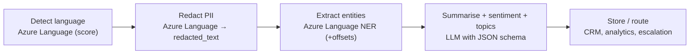
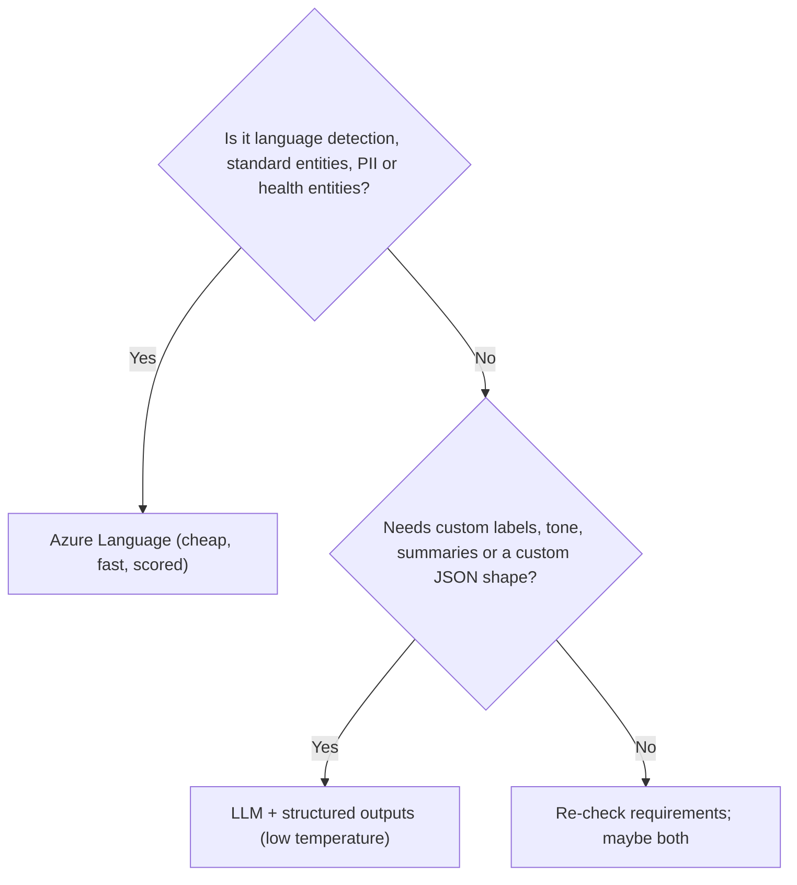

# Text analysis with LLMs and Azure Language

> AI-103 · D4 Implement text analysis solutions · about 70 min · Study Hub module `t01` ([open the hub](https://claude.ai/artifact/TdpMZLFYA9knTdjNyCms9F))

## Why it matters
D4 (10–15%) expects you to mix two tools: **Azure Language** for fast, scored, deterministic tasks (language detection, entities, PII) and **LLM prompting** for summaries, sentiment and tone, topics and custom JSON extraction.

## Pre-question (answer before reading)
**Q:** Azure Language's sentiment and summarisation features are deprecated. How would you now produce a three-bullet summary with sentiment for each customer review?

<details><summary>Answer</summary>

Prompt an LLM with a strict **JSON schema** (summary bullets + sentiment label + rationale) using structured outputs, at low temperature. Keep Azure Language for things like language detection and PII redaction.

</details>

## 🍎 Story time (kid version)
**Robo at Foundry Town Hall: The stamping machine and the storyteller**

Town Hall gets 1,000 letters a day. A stamping machine reads each one fast. It stamps the language ("Spanish, very sure"), circles names and places, and blacks out phone numbers with a thick marker. Then Robo reads the cleaned letters and writes a three-line summary and how the writer felt, always on the same form with the same boxes. The machine is cheap and never changes; Robo is flexible but needs checking.

| In the story | In Foundry |
|---|---|
| The language stamp | Language detection with a confidence score |
| Circling names and places | Named entity recognition |
| The black marker on phone numbers | PII redaction (`redacted_text`) |
| Robo's summary on a fixed form | An LLM with a structured-output schema |

**Where the story breaks:** The machine no longer writes summaries or moods (those Azure Language features are deprecated), so that part belongs to Robo.

## Mental model & story (grown-up version)
Contoso's contact centre receives 40,000 emails a day in a dozen languages. The pipeline has two kinds of worker.

**Azure Language** (a Foundry Tool) is the **conveyor-belt machine**: cheap, fast and consistent. It detects each email's language (with a confidence score), finds **named entities** (people, organisations, places, dates, quantities…) with offsets, and finds **PII** to return a **redacted** copy (`****` in place of phone numbers and card numbers). Each result has a confidence score you can threshold.

The **LLM** is the **skilled analyst**: it writes a summary in the company's format, judges tone (frustrated? sarcastic?), tags topics from a fixed list, and returns everything as **structured JSON** that downstream systems can trust. Microsoft has deprecated Azure Language's sentiment, summarisation and key-phrase features, so these now belong to prompting.

Agents can use Azure Language too, through its **MCP server**: add it as a tool, and the agent can call language detection, entity recognition, PII redaction or Text Analytics for health when it needs them, several in one turn.

**Where the analogy breaks:** Machines on a belt never get tired, but they only do what they were built for. Azure Language won't summarise in your house style or classify into your custom topics; that's LLM work, which needs evaluation because it can vary.

## Diagrams
**Hybrid text pipeline**



**Azure Language or LLM?**



## Key points
- Azure Language preconfigured features in scope: **language detection**, **named entity recognition**, **PII detection/redaction**, **Text Analytics for health**. Sentiment, summarisation and key phrases are **deprecated** → use LLMs. CLU and custom question answering are **not** in AI-103.
- SDK `azure-ai-textanalytics`: `TextAnalyticsClient(endpoint=<Foundry resource endpoint>, credential=AzureKeyCredential(key) or DefaultAzureCredential())`. Use the **resource** endpoint, not the project endpoint.
- `detect_language(documents=[...])` → `primary_language.name`, `.iso6391_name`, `.confidence_score` (0–1). Mixed text → the predominant language with lower confidence; unreadable → "(Unknown)" with score 0. A `country_hint` helps ambiguous text.
- `recognize_entities(...)` → each entity's `text`, `category` (Person, Location, Organization, DateTime, Quantity, Email, URL…), `subcategory`, `confidence_score`, `offset`, `length`.
- `recognize_pii_entities(documents, language="en")` → entities plus `doc.redacted_text`; filter with categories; PHI coverage for health data.
- Limits: about 5,120 characters per document; batch many documents per request.
- **Azure Language MCP server** (remote, preview API version): tools for language detection, NER, PII redaction and Text Analytics for health; connect in the portal (Tools > Connect a tool > Azure Language) or as an `MCPTool`.
- LLM analysis: entities, topics, summaries, sentiment, tone and safety signals with **structured outputs**; domain tasks (compliance summaries, contract clause extraction) via precise instructions, schemas, few-shot examples and grounding.
- Sensitive content: combine PII redaction (Azure Language) with content safety (guardrails/Content Safety) and send minimal data to the LLM.

## Comparisons
**Task → tool**

| Task | Best tool | Why |
|---|---|---|
| Detect language of each email | Azure Language | Fast, cheap, scored |
| Mask card numbers before storage | Azure Language PII | Redacted text + offsets |
| Three-bullet summary in house style | LLM | Custom format (summarisation deprecated) |
| Label tone: calm / frustrated / angry | LLM + enum schema | Custom labels |
| Extract medications and dosages | Text Analytics for health | Domain model |
| Return {customer, issue, product, urgency} | LLM structured outputs | Custom JSON shape |

## Code to recognise
**Language detection, entities and PII redaction**

```python
from azure.ai.textanalytics import TextAnalyticsClient
from azure.core.credentials import AzureKeyCredential

client = TextAnalyticsClient(endpoint="https://contoso.cognitiveservices.azure.com/",
                             credential=AzureKeyCredential(key))
docs = ["Hola, soy Ana. Mi tarjeta 4111 1111 1111 1111 fue cobrada dos veces."]

lang = client.detect_language(documents=docs)[0].primary_language
print(lang.name, lang.iso6391_name, lang.confidence_score)    # Spanish es 1.0

for e in client.recognize_entities(documents=docs, language="es")[0].entities:
    print(e.text, e.category, e.confidence_score)

pii = client.recognize_pii_entities(documents=docs, language="es")[0]
print(pii.redacted_text)        # card number replaced with asterisks
```

- Line 4: Resource endpoint (cognitiveservices), not the project endpoint.
- Line 8: Name, ISO code and confidence.
- Line 11: Entities carry category and confidence (and offsets).
- Line 15: `redacted_text` is ready to store or send to an LLM.

**LLM analysis with a strict schema**

```python
class Review(BaseModel):
    summary: list[str]                      # exactly 3 bullets requested in instructions
    sentiment: Literal["positive", "neutral", "negative", "mixed"]
    tone: Literal["calm", "frustrated", "angry", "sarcastic"]
    topics: list[Literal["billing", "delivery", "quality", "support"]]

r = client.responses.parse(model="mini-deploy", temperature=0.1,
    instructions="Summarise in exactly 3 bullets. Use only the allowed labels.",
    input=redacted_review, text_format=Review)
result = r.output_parsed
```

- Line 3: Enums stop invented labels.
- Line 7: Low temperature for consistent labelling.
- Line 9: Send the PII-redacted text, not the raw review.

## Portal steps
**Give an agent Azure Language through MCP** (Foundry portal > Build > Tools > Connect a tool > Azure Language in Foundry Tools)

1. Provide the resource endpoint and authentication (key header or Entra ID).
2. Choose **Use in an agent** and select the agent.
3. Ask the agent to detect language and redact PII from a sample text; inspect the tool calls.

## Worked example
**Scenario:** A hospital must store patient feedback with names, phone numbers and medical record numbers removed, and route feedback mentioning medication errors to a safety team.

- PII removal at scale → Azure Language PII redaction (store `redacted_text`).
- Medication mentions → Text Analytics for health (or an LLM classifier with a fixed label set).
- Route by detected entity/label.

**Answer:** **Azure Language PII** for redaction plus **Text Analytics for health** (or an LLM with an enum schema) to flag medication errors, then route.

## Your turn (faded example)
**Scenario:** You call `TextAnalyticsClient` with `https://contoso.services.ai.azure.com/api/projects/support` and get 404.

- The client is a Foundry Tools SDK.
- **Which endpoint should it use?** <details><summary>answer</summary>The Foundry **resource** endpoint, e.g. `https://contoso.cognitiveservices.azure.com/`.</details>
- **Can the project's key be used?** <details><summary>answer</summary>Yes, the project key equals the resource key (or use Entra ID).</details>

## Exam traps & misconceptions
- ✗ Using Azure Language sentiment or summarisation for new work. → ✓ Those features are deprecated; use LLM prompting.
- ✗ Passing the project endpoint to Foundry Tools SDKs. → ✓ Use the resource endpoint.
- ✗ Asking an LLM for labels without a schema. → ✓ Labels drift; use enums in structured outputs.
- ✗ Sending raw PII to an LLM unnecessarily. → ✓ Redact first; minimise data.
- ✗ Expecting CLU or custom question answering on AI-103. → ✓ They were removed from the AI-103 scope.

## Discussion prompts
- **Why keep Azure Language when LLMs can do everything?** Cost, speed, consistency and auditability: language detection and PII redaction over millions of records are cheaper and more predictable with a dedicated service that returns confidence scores and offsets.
- **How would you evaluate an LLM-based tone classifier?** Label a few hundred examples, measure accuracy/F1 per class, inspect confusions (e.g. sarcasm vs anger), then refine instructions, examples or labels.

## Interview angle / teach-back
**Prompt:** Explain how you'd analyse multilingual customer emails for language, PII, entities, summary and sentiment.

**Rubric:** Azure Language for language detection (confidence) · Azure Language PII → redacted_text · NER for entities · LLM with structured outputs for summary/sentiment/tone/topics · Mention deprecation of Language sentiment/summarisation

**Model answer:** Use Azure Language for the deterministic parts: detect each email's language with a confidence score, redact PII so we store and send only redacted text, and extract standard entities. Then send the redacted text to an LLM with a strict JSON schema for the summary, sentiment, tone and topics at low temperature, since Azure Language's sentiment and summarisation are deprecated.

## Quick Q&A
- **Deprecated Azure Language features?** Sentiment, summarisation, key phrase extraction.
- **Removed from AI-103?** CLU and custom question answering.
- **PII result with masked text?** `redacted_text`.
- **Language detection outputs?** Name, ISO 639-1 code, confidence score.
- **Endpoint for TextAnalyticsClient?** The Foundry resource endpoint.
- **Unreadable text result?** "(Unknown)" with score 0.

## Sources (accessed 2026-10-02)
- [Learning path: Develop language solutions](https://learn.microsoft.com/en-us/training/paths/develop-language-solutions-azure-ai/)
- [Lab: Analyze text](https://microsoftlearning.github.io/mslearn-ai-language/Instructions/Exercises/01-analyze-text.html)
- [Lab: Develop a text analysis agent](https://microsoftlearning.github.io/mslearn-ai-language/Instructions/Exercises/02-language-agent.html)

## SRS cards created
- ai-103-t01-01, ai-103-t01-02, ai-103-t01-03, ai-103-t01-04
