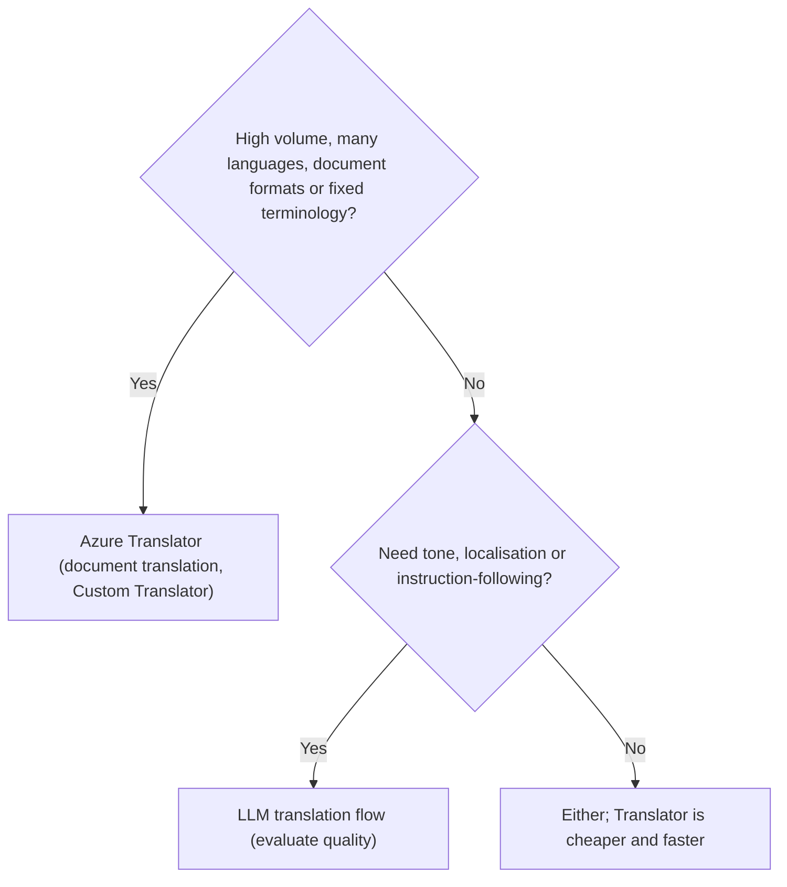
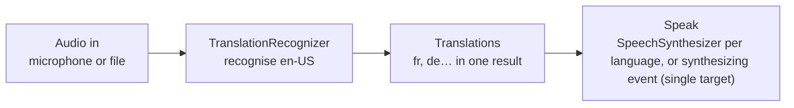

# Translate text and speech

> AI-103 · D4 Implement text analysis solutions · about 60 min · Study Hub module `t02` ([open the hub](https://claude.ai/artifact/TdpMZLFYA9knTdjNyCms9F))

## Why it matters
Two bullets in D4 ask for translation: text (Azure Translator or LLM flows) and speech (language models and Foundry Tools). Know when each wins and the key SDK calls.

## Pre-question (answer before reading)
**Q:** A manual must be translated into 30 languages, keep its Word formatting, and always render the product name *SkyLink* unchanged. LLM prompts or Azure Translator?

<details><summary>Answer</summary>

**Azure Translator**: **document translation** keeps formatting, scales to many languages, and custom terminology (Custom Translator or a glossary) keeps *SkyLink* consistent.

</details>

## 🍎 Story time (kid version)
**Robo at Foundry Town Hall: The translation copier and the headset**

Robo helps visitors from other countries. For a big box of instruction booklets he uses the translation copier. It copies every page into Spanish and keeps the pictures and tables in place, and its special word list keeps "SkyLink" as "SkyLink". For a fun poster for teenagers, he asks his creative robot friend, who makes it sound cool. At the town meeting, a headset listens to English and shows French and German words on two screens.

| In the story | In Foundry |
|---|---|
| The translation copier that keeps the layout | Azure Translator document translation |
| The special word list | Custom Translator or a glossary |
| The creative friend | LLM translation with tone instructions |
| The headset with two screens | Speech translation (`TranslationRecognizer`) with two target languages |

**Where the story breaks:** The headset can only speak one translation aloud on its own (the synthesizing event); for two spoken languages you need a voice per language.

## Mental model & story (grown-up version)
Translation has two styles. **Azure Translator** is a professional agency: 90+ languages, fast and consistent at scale, with **transliteration** (change script, e.g. Japanese to Latin letters), **dictionary lookup**, **document translation** that preserves the layout of Word, PDF or HTML files, and **Custom Translator** for domain terminology.

An **LLM** is a gifted bilingual copywriter. It can adapt tone ("friendly, for teenagers"), localise idioms and follow complex instructions, but it costs more per word and is less predictable for big batches.

Speech translation joins the two worlds. The Speech SDK's **TranslationRecognizer** listens to audio in one language and returns the recognised text plus translations into one or more target languages at once. To speak the result, either synthesise each translation with a voice for that language, or for a single target, set a voice on the translation config and receive audio through the **synthesizing** event.

Contoso's training team uses all three: Translator document translation for manuals, an LLM to localise marketing copy, and speech translation for live Q&A sessions with French and German subtitles.

**Where the analogy breaks:** Agencies and copywriters both make mistakes with names and jargon. Protect terminology explicitly (glossaries, Custom Translator, instructions) and evaluate with native speakers or BLEU/METEOR against references.

## Diagrams
**Translator or LLM?**



**Speech translation**



## Key points
- **Azure Translator**: 90+ languages; text translation, **transliteration**, language detection, dictionary lookup, **document translation** (sync or async, preserves structure), **Custom Translator** (domain terms). Endpoints: global `api.cognitive.microsofttranslator.com`, regional, or the Foundry resource endpoint.
- Python `azure-ai-translation-text`: `TextTranslationClient(credential=AzureKeyCredential(key), endpoint=... | region=...)`; `translate(body=[...], to_language=["fr", "de"], from_language=...)` → `item.detected_language.language`, `item.translations[i].to`, `.text`.
- `transliterate(body=..., language="ja", from_script="Jpan", to_script="Latn")`; `get_supported_languages(scope="translation")`. Options include profanity handling and HTML text type.
- LLM translation: flexible tone and localisation; Translator: scale, consistency, terminology and file formats. Combine: Translator for bulk, LLM for marketing polish.
- Speech translation: `SpeechTranslationConfig(subscription=key, endpoint=... | region=...)`, set `speech_recognition_language = "en-US"`, `add_target_language("fr")`; `TranslationRecognizer(translation_config=..., audio_config=...)`; `recognize_once_async().get()` → `result.text` + `result.translations["fr"]`.
- Speak translations: a `SpeechSynthesizer` with a voice per target language, **or** set `voice_name` on the translation config and handle the `synthesizing` event (audio size 0 = done), which works only for **one** target language.
- LLM speech translation: transcribe (gpt-transcribe) then translate with an LLM, or use audio-capable/realtime models for speech-to-speech in another language.
- Evaluate translation with BLEU/METEOR against references plus human review for tone and terminology.

## Comparisons
**Translator vs LLM**

|  | Azure Translator | LLM |
|---|---|---|
| Scale and cost | High volume, low cost | Higher cost per word |
| Consistency | High; Custom Translator for terms | Varies; needs instructions |
| Formats | Document translation preserves layout | Text in/out |
| Style control | Limited | Strong (tone, audience, idioms) |

## Code to recognise
**Text translation and transliteration**

```python
from azure.ai.translation.text import TextTranslationClient
from azure.core.credentials import AzureKeyCredential

tc = TextTranslationClient(credential=AzureKeyCredential(key), region="westeurope")

res = tc.translate(body=["Where is the nearest station?"], to_language=["fr", "ja"])
for item in res:
    print(item.detected_language.language)            # en
    for t in item.translations:
        print(t.to, t.text)

latin = tc.transliterate(body=["こんにちは"], language="ja",
                         from_script="Jpan", to_script="Latn")
print(latin[0].text)                                    # konnichiwa
```

- Line 4: Key + region (or endpoint).
- Line 6: Several targets in one call; the source language is auto-detected.
- Line 12: Transliteration changes the script, not the language.

**Speech translation with the Speech SDK**

```python
import azure.cognitiveservices.speech as speechsdk

cfg = speechsdk.translation.SpeechTranslationConfig(subscription=key, region=region)
cfg.speech_recognition_language = "en-US"
cfg.add_target_language("fr")
cfg.add_target_language("de")

audio = speechsdk.audio.AudioConfig(use_default_microphone=True)
recognizer = speechsdk.translation.TranslationRecognizer(translation_config=cfg, audio_config=audio)
result = recognizer.recognize_once_async().get()
if result.reason == speechsdk.ResultReason.TranslatedSpeech:
    print(result.text, result.translations["fr"], result.translations["de"])
```

- Line 4: Source language for recognition.
- Line 5: Add every target language you need.
- Line 10: One utterance; use continuous recognition for live sessions.
- Line 12: Translations keyed by language code.

## Portal steps
**Try translation** (Foundry portal > Build > Tools / playgrounds > Translator (or Language & Translator playground))

1. Enter text and choose target languages.
2. Try transliteration and document translation (upload a .docx).
3. Review the code samples for the SDK calls.

## Worked example
**Scenario:** A conference wants live English talks with French and Spanish subtitles, plus spoken French audio for one room.

- Live audio + several targets → TranslationRecognizer with two target languages (continuous recognition).
- Subtitles from `result.translations`.
- Spoken French only (single target) → voice on the translation config + synthesizing event, or a French SpeechSynthesizer.

**Answer:** **Speech translation** with continuous recognition, targets fr + es for subtitles; French audio via a French voice (synthesizing event for one target, or SpeechSynthesizer).

## Your turn (faded example)
**Scenario:** Marketing wants 50 short product taglines localised for Brazil with a playful tone.

- Volume is small and tone matters.
- **Translator or LLM?** <details><summary>answer</summary>An **LLM** with tone and audience instructions (Portuguese, Brazil).</details>
- **How do you keep product names unchanged?** <details><summary>answer</summary>Instruct the model to keep listed brand terms untranslated (and check outputs); a glossary or Custom Translator does this in Translator.</details>

## Exam traps & misconceptions
- ✗ Using the synthesizing event for several target languages. → ✓ Event-based synthesis supports only a single target; use a synthesizer per language.
- ✗ Confusing transliteration with translation. → ✓ Transliteration changes script; meaning and language stay.
- ✗ Using an LLM to translate thousands of formatted documents. → ✓ Document translation preserves formatting at scale.
- ✗ Forgetting the region with key auth for Translator's global endpoint. → ✓ Provide region (or use the resource endpoint).

## Discussion prompts
- **How would you guarantee legal terms translate consistently?** Custom Translator trained on approved bilingual terminology (or a glossary), plus validation that key terms appear correctly, and human review for legal documents.
- **When would you translate speech with an LLM instead of the Speech SDK?** When tone or context-aware rewording matters more than latency, or when using a realtime model for natural speech-to-speech; the Speech SDK is optimised for low-latency recognition plus translation.

## Interview angle / teach-back
**Prompt:** Explain how you'd choose between Azure Translator and an LLM, and how speech translation works in the Speech SDK.

**Rubric:** Translator: scale, consistency, documents, Custom Translator · LLM: tone/localisation, instructions · TranslationRecognizer with recognition language + target languages · result.translations per language · Synthesis: synthesizer per language or event for single target

**Model answer:** Use Azure Translator for high-volume, consistent translation, formatted documents and controlled terminology; use an LLM when tone or localisation matters for smaller volumes. For speech, the Speech SDK's TranslationRecognizer takes a recognition language and one or more target languages and returns the recognised text plus a translation per language. To speak them, use a synthesizer with a voice per language, or the synthesizing event when there's only one target.

## Quick Q&A
- **Preserve Word formatting in translation?** Document translation.
- **Domain terminology in Translator?** Custom Translator (or glossary).
- **Change script, not language?** Transliteration.
- **Speech translation class?** `TranslationRecognizer` with `SpeechTranslationConfig`.
- **Get the French translation?** `result.translations["fr"]`.
- **Synthesizing event limitation?** Single target language only.

## Sources (accessed 2026-10-02)
- [Lab: Translate text and speech](https://microsoftlearning.github.io/mslearn-ai-language/Instructions/Exercises/07-translation.html)
- [Learning path: Develop language solutions](https://learn.microsoft.com/en-us/training/paths/develop-language-solutions-azure-ai/)

## SRS cards created
- ai-103-t02-01, ai-103-t02-02, ai-103-t02-03, ai-103-t02-04
